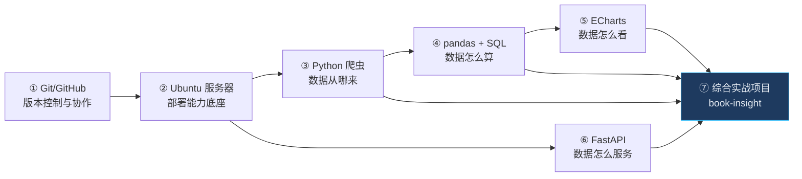
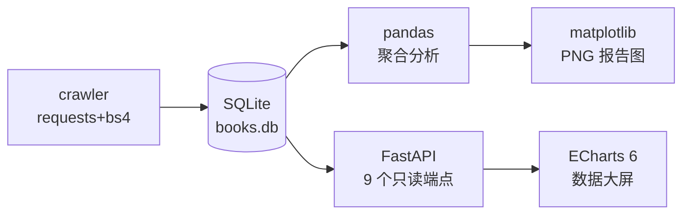

<div align="center">

# Linux · Python 数据全栈学习与实战教程

**Git/GitHub → Ubuntu 服务器 → Python 爬虫 → pandas+SQL 数据分析 → ECharts 可视化 → FastAPI 后端 → 综合实战项目**

*一份以「能复现」为底线的完整中文教程：每个命令有预期输出，每个项目都实测运行，每个数据都有出处。*


[](https://github.com/wdfortest/linux-python-fullstack-tutorial/actions/workflows/ci.yml)

</div>

---

## 学习路线图



①② 是所有开发的公共基础，③④⑤⑥ 是数据全栈的四根支柱，⑦ 把它们拧成一条真实链路：
**采集 1000 本图书 → 存 SQLite → pandas 分析 → FastAPI 提供 API → ECharts 深色数据大屏**。

## 目录总览

| 章节 | 内容 | 配套代码 |
|---|---|---|
| [00 · 如何使用本教程](docs/00-如何使用本教程.md) | 学习方法、环境准备、约定 | — |
| [01 · Git/GitHub 完全指南](docs/01-git-github/) | 核心概念、日常操作、分支、远程、协作 PR、Commit 规范、进阶急救、Actions CI（8 篇） | `git-lab/` |
| [02 · Ubuntu 服务器实战](docs/02-linux-ubuntu/) | 安装加固、文件权限、进程、systemd、网络防火墙、Shell 脚本、Python 环境、MySQL、Nginx、上线清单（10 篇） | — |
| [03 · Python 爬虫](docs/03-python-crawler/) | HTTP 基础、requests、BS4 解析、存储、Scrapy、**合规与法律**、Selenium、工程化（8 篇） | `crawler-lab/` |
| [04 · pandas + SQL 数据分析](docs/04-data-analysis/) | SQL 进阶、SQLAlchemy 2.0、pandas 四件套、可视化、真实数据全流程（7 篇） | `data-analysis-lab/` |
| [05 · ECharts 可视化](docs/05-echarts-visualization/) | 快速上手、图表类型、API 对接、Dashboard 设计、进阶主题（5 篇） | `echarts-lab/` |
| [06 · FastAPI 后端](docs/06-fastapi-backend/) | 入门、请求响应、数据库、认证安全、测试、部署（6 篇） | `fastapi-lab/` |
| [07 · 综合实战项目](docs/07-final-project/00-项目总览与架构.md) | 架构总览 + 采集/分析/后端/大屏/部署 5 篇实战记录 | [`book-insight/`](projects/book-insight/) |

## 30 秒跑通综合实战项目

```bash
git clone https://github.com/wdfortest/linux-python-fullstack-tutorial.git
cd linux-python-fullstack-tutorial/projects/book-insight
pip install -r requirements.txt
python -m pytest tests/ -v        # 14 passed
uvicorn api.main:app --reload     # 打开 http://127.0.0.1:8000/ 即数据大屏
```

仓库已附带爬好的 1000 本图书数据（`data/books.db`），克隆即可复现全部结果；
想自己采集：`python crawler/crawl_books.py`（数据源为 Scrapy 官方练习站，合法合规）。

## 实战项目预览

book-insight 数据大屏（真实数据渲染）：

- **KPI 行**：图书总数 1000 · 分类 50 · 均价 £35.07 · 平均评分 2.92★ · 在售 1000
- **六张图表**：评分分布、价格直方图、分类书目 TOP10、分类均价、价格×评分散点（500 点）、在售环形图
- **TOP10 书单**：评分星级表



## 本仓库的写作底线

1. **可复现**：所有命令、代码、SQL 都在真实环境跑过；文档中的输出是真实输出，不编造数字
2. **版本明确**：实测版本（Python 3.14.0 / FastAPI 0.162 / pandas 2.3.3 / ECharts 6.1.0 / Ubuntu 24.04+26.04 LTS）统一登记在 [STYLE_GUIDE](STYLE_GUIDE.md)，不写会过期的「最新版」断言
3. **安全红线**：SQL 一律参数绑定（含反面案例警示）；爬虫只用明确欢迎抓取的练习站点；密钥一律环境变量；服务器加固作为独立章节
4. **图解优先**：流程、架构、时序全部用 Mermaid 图，GitHub 原生渲染
5. **每章固定结构**：学习目标 → 正文 → 常见坑与排查 → 动手练习 → 自检清单 → 延伸阅读

## 环境与版本

| 组件 | 版本 | 说明 |
|---|---|---|
| Python | 3.14.0 | 本地 venv 实测；Ubuntu 部署方案见第 02 章 |
| FastAPI / uvicorn | 0.162.0 / 0.52.0 | API 层 |
| pandas / numpy | 2.3.3 / 2.3.5 | 分析层 |
| SQLAlchemy | 2.0.50 | 2.0 风格教学 |
| Scrapy / requests / bs4 | 2.13.3 / 2.34.2 / 4.14.3 | 爬虫层 |
| Apache ECharts | 6.1.0 | 前端 CDN |
| Ubuntu | 24.04 LTS（26.04 LTS 新增介绍） | 服务器主线 |
| MySQL | 8.0 兼容写法 | 服务器部署 |

## 使用与许可

- 教程内容免费学习；数据源 books.toscrape.com 为爬虫练习站，数据版权归原站
- 欢迎 Issue 指正勘误；转载请注明仓库地址
- License: [MIT](LICENSE)
