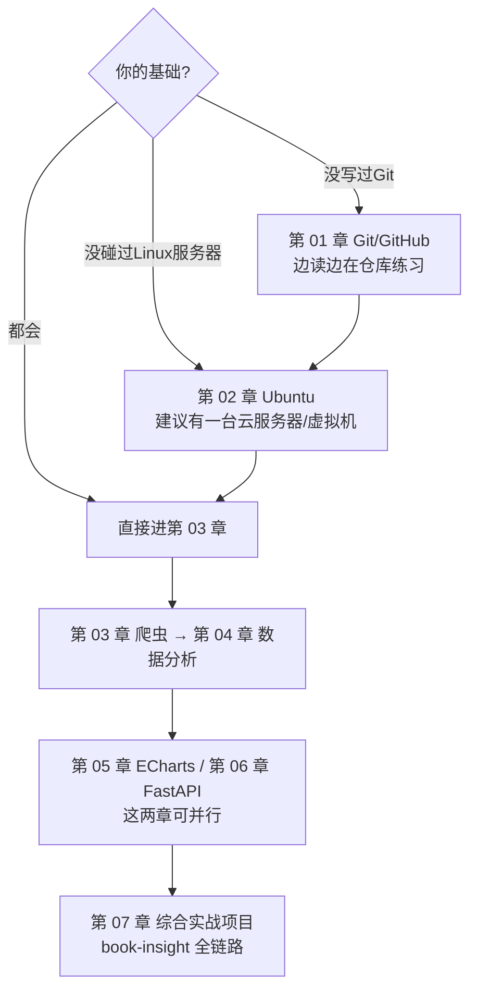

# 00 · 如何使用本教程

> 建议先完整读完这一篇（10 分钟），能让你后面少走很多弯路。

## 1. 这份教程适合谁

- 会基本 Python 语法（变量/函数/类），但没做过完整项目的开发者
- 目标是掌握一条完整技能线：**Linux 服务器 → 爬虫采数据 → pandas/SQL 算数据 → ECharts 看数据 → FastAPI 服务数据**
- 想要「每一步都能在自己电脑/服务器上复现」的教程，而不是看个热闹

## 2. 推荐学习路径



三条经验：

1. **边读边敲**：每章的「配套代码」路径都给了，先跑起来再读解释
2. **卡住先查「常见坑与排查」**：每章末尾的表格是真实高频报错的速查表
3. **章节练习别跳过**：练习是按「能举一反三」设计的，做完一章才算学完

## 3. 环境准备

### 本地环境（学习 01/03/04/05/06 章）

| 需求 | 说明 |
|---|---|
| Python ≥ 3.12 | 本教程实测 3.14.0；建议用 venv 隔离（做法见第 02 章第 7 篇） |
| 一个终端 | macOS/Linux 自带；Windows 建议 WSL2 |
| VS Code 或 PyCharm | 任选 |

```bash
python -m venv .venv
source .venv/bin/activate        # Windows: .venv\Scripts\activate
pip install -r projects/book-insight/requirements.txt
```

### 服务器环境（学习 02 章与部署）

三选一：

1. **云服务器**（推荐）：任意厂商的 Ubuntu 24.04 LTS 轻量服务器，学生机即可
2. **虚拟机**：VirtualBox/UTM 装 Ubuntu Server 24.04
3. **WSL2**（Windows）：适合练命令，不适合练防火墙/网络

### 版本说明

教程所有代码在以下版本实测（详见 [STYLE_GUIDE 版本事实表](../STYLE_GUIDE.md)）：
Python 3.14.0、FastAPI 0.162.0、pandas 2.3.3、ECharts 6.1.0、Ubuntu 24.04/26.04 LTS。
更新的版本一般兼容；遇不兼容请以官方文档为准并欢迎提 Issue。

## 4. 全教程统一约定

- `$` 开头的是终端命令；`#` 开头的是注释（不用输入）
- `<your-username>`、`<server-ip>` 是占位符，替换成你自己的
- 「预期输出」代码块 = 你跑完应该看到的东西，对照自检
- ⚠️ 标记的地方是真实踩过的坑，值得慢读
- 本教程的 SQL 规范：**外部输入一律参数绑定**，每章附拼接反面案例警示
- 本教程的爬虫规范：实战只用 [quotes.toscrape.com](https://quotes.toscrape.com/) 与 [books.toscrape.com](https://books.toscrape.com/)（官方练习站），合规讨论见[爬虫合规章](03-python-crawler/06-反爬应对与爬虫合规.md)

## 5. 本仓库怎么用最划算

- **当课程**：按章节顺序读，配合各章 lab 代码
- **当手册**：报错时直接查对应章节的「常见坑与排查」表
- **当模板**：把 [projects/book-insight](../projects/book-insight/) 复制走，换数据源就是你自己的项目
- **当练手场**：本仓库本身就是标准 Git 工作流的示范（Conventional Commits、CI、PR 规范），第 01 章的练习可以直接在这里提交 PR

## 6. 遇到问题

1. 先查本章「常见坑与排查」
2. 再读官方文档（每章「延伸阅读」都给了链接）
3. 还不行，带着**完整报错信息 + 你做了什么** 提 Issue

---

下一篇：[01 · Git 核心概念与安装配置](01-git-github/01-Git核心概念与安装配置.md)
