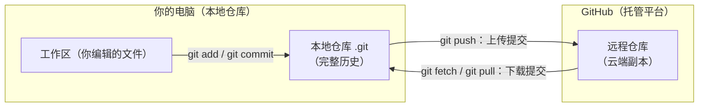
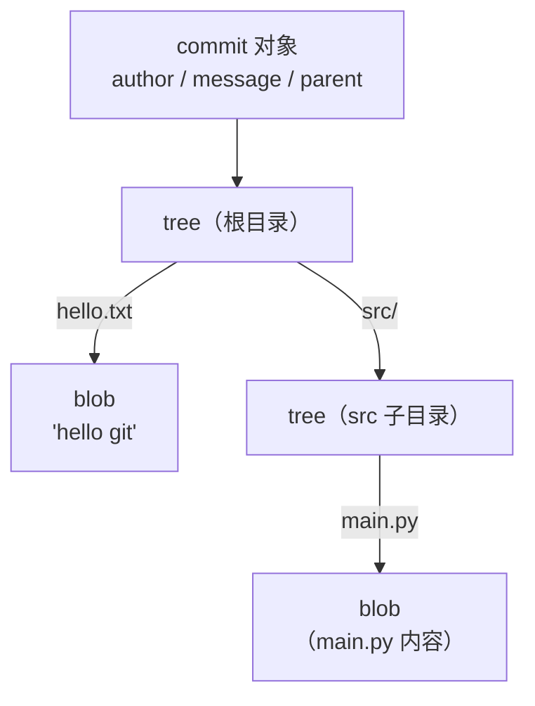
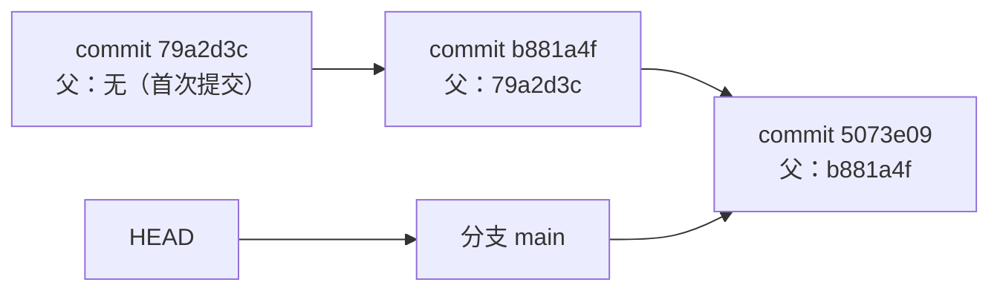
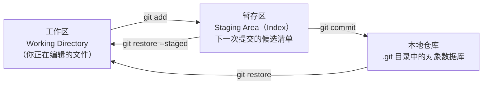

# 1 · Git 核心概念与安装配置

> 本章配套代码：`projects/git-lab/`（练习脚本 `setup-practice-repo.sh` 可一键生成练习仓库，用法见该目录 `README.md`）
> 建议学习时长：约 2.5 小时

## 学习目标

学完本章，你应该能够：

- 说清楚 Git 和 GitHub 的区别，不再把两者混为一谈。
- 用 `git cat-file` 解剖一个提交，指出 blob、tree、commit 三种对象之间的关系。
- 画出「工作区 → 暂存区 → 仓库」三区模型，并解释 `git add` 和 `git commit` 各自做了什么。
- 在 macOS、Ubuntu 或 Windows 上完成 Git 安装，并用 `git --version` 验证。
- 完成 `user.name`、`user.email`、默认分支名、常用别名等首次配置，并知道每一项写进了哪个文件。
- 遇到不会的子命令时，会用 `git help` 和 `man` 自己查手册。

## 1.1 前置知识 / 本章地位

这是整条学习路线（Linux → 爬虫 → 数据分析 → 可视化 → 后端）的第一章。后面的每一章都会假设你：

1. 已经安装并配置好了 Git（本章完成）。
2. 会用「提交（Commit）」记录学习进度——本教程仓库本身就是你的练习场，学完每章都应该产生一次提交。
3. 理解「分支」「远程仓库」这些词的直觉含义——它们分别在[第 03 章](03-分支完全指南.md)和[第 04 章](04-远程仓库与GitHub入门.md)展开。

本章不需要任何编程以外的前置知识。你只需要会用终端（Terminal）：打开终端、输入命令、按回车。

## 1.2 一个真实场景：没有版本控制的那天下午

假设你写了一个爬虫脚本 `spider.py`，已经跑了三天、抓了几万条数据，今天想加一个「断点续抓」功能。你小心翼翼地把原来的文件复制了一份：

```text
spider.py
spider_v2_备份.py
spider_v2_final.py
spider_v2_final_真的最终版.py
spider_v2_final_真的最终版_改前备份.py
```

半小时后你发现新功能把解析逻辑改崩了，数据抓出来全是乱码。你想回退到昨天的版本——问题是：

- 三个「final」文件里，哪个才是昨天下午 4 点、跑成功那次的状态？
- 备份只保留了「文件内容」，没保留「为什么改」——你甚至不记得当时改了哪几行。
- 如果这个文件还有第二个人在改（或者你在服务器和笔记本两头改），手工备份根本对不齐。

版本控制（Version Control）系统解决的就是这个问题。它不复制整个文件夹，而是让你在任意时刻对项目拍一张「快照（Snapshot）」，并给每张快照记录：

- **完整内容**：项目里每个文件在这一刻的样子；
- **来历**：这张快照由哪张快照演变而来，谁在什么时候改的，为什么改（提交信息）；
- **可回退性**：任何时候都能完整还原到任何一张快照，而且这个还原是可逆的。

Git 就是目前事实上的标准版本控制系统。它的核心保证只有一句话：**只要提交过，就永远找得回来**。后面第 07 章会专门讲「急救手册」——很多看似毁灭性的误操作（误删分支、误回退）都能用 `git reflog` 找回，前提正是这个「快照永不丢失」的模型。

## 1.3 Git 与 GitHub 是两回事

初学者最常见的混淆就是把两者当成一个东西。明确区分：

- **Git**：一个安装在你电脑上的**命令行工具**（分布式版本控制系统，Distributed Version Control System）。它离线可用，所有功能——提交、分支、回退——都在本地完成，不需要联网，也不需要注册任何账号。
- **GitHub**：一个基于 Git 的**代码托管平台**。它把你的 Git 仓库放到云端，并提供 Git 本身没有的功能：Pull Request（代码评审）、Issue（问题跟踪）、GitHub Actions（持续集成）、权限管理等。同类平台还有 GitLab、Gitee（码云）等。

一句话：**Git 是协议和工具，GitHub 是用这个工具的平台**。你可以只用 Git 不用 GitHub，也可以用 GitHub 但换成 GitLab。

两者的关系与数据流向如下：



图中所有名词都会在后续章节展开：本地仓库的日常操作在[第 02 章](02-Git日常操作完全指南.md)，与远程的同步在[第 04 章](04-远程仓库与GitHub入门.md)，基于 GitHub 的团队协作在[第 05 章](05-团队协作实战（Issue-PR-CodeReview）.md)。

注意一个容易忽略的事实：**`git clone` 把整个仓库的历史复制到你本地**。克隆完成后，即使断网，你也能查看全部历史、建分支、提交——这是 Git「分布式」的含义，与很多老一代工具（如 SVN）「历史只在服务器上」有本质区别。

## 1.4 Git 的底层模型：快照而非差异

理解 Git 最省力的方式，是把它当成一个**内容寻址的文件系统**，版本控制只是建立在其上的功能。这个文件系统里有四种对象（Object），本章先讲前三种，tag 对象到[第 02 章](02-Git日常操作完全指南.md)讲标签时再回来看。

### 1.4.1 四种对象

| 对象 | 内容 | 通俗理解 |
|---|---|---|
| blob | 文件内容（不含文件名） | 「这段内容」 |
| tree | 目录结构：文件名 → blob/子 tree 的映射 | 「这个目录长什么样」 |
| commit | 指向一个 tree + 父 commit + 作者/时间/提交信息 | 「这一刻的快照」 |
| tag | 指向一个 commit + 标签名 + 说明 + 签名信息 | 「给某个快照贴的标签」 |

关键点：**Git 存的是每次提交时整个项目的快照，而不是「第 3 行改了什么」这样的差异（diff）**。文件内容没变时，新快照里的 tree 只是再次指向同一个 blob，不会重复存储——这就是「快照」模型既简单又高效的原因。

### 1.4.2 对象名：SHA-1 哈希

每个对象都有一个 40 位十六进制的名字，由其**内容**经过 SHA-1 哈希算出。内容相同，名字必相同；内容差一个字节，名字完全不同。所以这个名字既当 ID 用，也当校验码用——你从任何地方复制来的仓库，只要对象名对得上，内容就一定没被篡改。

日常使用中不需要写全 40 位，Git 接受能唯一标识对象的前几位（通常是 7-12 位），`git log --oneline` 显示的短哈希就是它。

> 顺带说明：SHA-1 在 2017 年被证明存在理论碰撞攻击，Git 社区已实现 SHA-256 支持并计划长期过渡，日常使用无需担心。以 Git 官方文档为准。

### 1.4.3 动手解剖：blob 与 tree

在临时目录里实际看一次。以下输出在本教程撰写环境（git 2.54.0，macOS）实测：

```bash
$ mkdir /tmp/git-anatomy && cd /tmp/git-anatomy
$ git init
$ echo "hello git" > hello.txt
$ git add hello.txt
$ git hash-object hello.txt
```

预期输出（哈希值由内容 `"hello git\n"` 唯一决定，你可以自己算出同一个值）：

```text
8d0e41234f24b6da002d962a26c2495ea16a425f
```

这个 40 位字符串就是内容 `"hello git"` 对应的 blob 对象名。提交之后再看内部结构：

```bash
$ git commit -m "feat: 首次提交"
$ git cat-file -t 8d0e41      # -t 问类型，-p 打印内容
blob
$ git cat-file -p 8d0e41
hello git
$ git ls-tree HEAD
100644 blob 8d0e41234f24b6da002d962a26c2495ea16a425f	hello.txt
$ git cat-file -p HEAD
tree 07ed5a7aebb914e3a02edf6d622b82d364037e3c
author 张三 <zhangsan@example.com> 1793722486 +0800
committer 张三 <zhangsan@example.com> 1793722486 +0800

feat: 首次提交
```

逐段解释：

- `git cat-file -t` 告诉你对象类型，`hello.txt` 的内容确实是一个 `blob`。
- `git ls-tree HEAD` 列出当前提交（HEAD 的含义见 1.5.2）的根目录：文件名 `hello.txt` 映射到 blob `8d0e41...`。**文件名存在 tree 里，不在 blob 里**——同一个文件改了名，blob 不变，只是 tree 变了。
- `git cat-file -p HEAD` 展示 commit 对象：它记录一个 `tree`（指向根目录快照）、作者、提交者、时间戳和提交信息。父 commit 这一行在首个提交里不存在。

这三种对象构成下面这棵树：



### 1.4.4 commit 链：历史是怎么串起来的

每个 commit 记录它的父 commit（首个提交没有父），于是历史天然是一条（或多条，见分支）链：



从任何一个 commit 出发，顺着 `parent` 字段就能走完整条历史——`git log` 做的就是这件事。三个重要推论：

1. **commit 一旦创建就不可变**。改内容 = 生成新对象、新哈希。「修改历史」（rebase、amend）本质是造出一条新链，旧链对象仍在 `.git` 里——这正是第 07 章 reflog 能「后悔」的物理基础。
2. **分支极其便宜**。分支只是一个 41 字节的文本文件（`refs/heads/main`，内容是 40 位哈希加换行），创建分支只是写一行哈希，不是复制整个项目。第 03 章展开。
3. **一切都先发生在本地**。add、commit、分支、diff、log 全部不需要网络。

## 1.5 三区模型：工作区、暂存区、仓库

### 1.5.1 三个区域

日常使用 Git 时，你的文件同时存在于至多三个「区域」：



- **工作区（Working Directory）**：你眼睁睁看到的、编辑器里打开的文件。
- **暂存区（Staging Area，内部叫 index）**：一份「下一次提交将包含哪些内容」的清单。`git add` 把工作区文件的当前内容制作成 blob，登记进这份清单。
- **本地仓库（Repository）**：`.git` 目录里的对象数据库，`git commit` 把暂存区清单打包成一个新的 commit（一个 tree 加若干 blob）。

### 1.5.2 为什么要有暂存区

这是初学者最容易觉得「多此一举」的设计，但换个角度就通了：**暂存区让你把「我改了什么」和「我想提交什么」分开**。

典型场景：你一口气改了 3 个文件——`parser.py` 里修了一个 bug，`README.md` 里补了文档，`notes.txt` 里写了点不想提交的草稿。暂存区让你把前两个文件的**部分改动**（甚至单个文件内的某几行，见第 02 章 `git add -p`）组织成两个干净的提交，而把草稿留在工作区。

没有暂存区的工具（如很多 IDE 的「一键提交全部」）只能要么全提交、要么手工排除文件。`git status` 显示的正是三区的状态：

```bash
$ echo "hello" > hello.txt      # 工作区新增文件
$ git status
```

预期输出：

```text
On branch main

No commits yet

Untracked files:
  (use "git add <file>..." to include in what will be committed)
	nothing added to commit but untracked files present (use "git add" to track)
```

`git add` 之后再看：

```bash
$ git add hello.txt
$ git status
```

预期输出：

```text
On branch main

No commits yet

Changes to be committed:
  (use "git restore --staged <file>..." to unstage)
	new file:   hello.txt
```

逐段解释：`Changes to be committed` 列出暂存区里等待提交的内容；括号里的提示是 Git 在教你怎么撤销（`git restore --staged`，第 02 章详解）。**养成习惯：每次提交前都先 `git status`，提交前看一眼状态是所有高效 Git 用户的共同动作。**

### 1.5.3 HEAD 是什么

`HEAD`（大写）是 Git 里一个特殊的指针文件：**它指向「你当前所在的位置」**，通常是一个分支名，间接指向某个 commit。上面命令里的 `HEAD` 就表示「当前提交」。`HEAD~1` 表示「当前提交的父提交」，`HEAD~2` 是祖父，以此类推。这个记号在回退操作（第 02 章）中天天用。

## 1.6 安装 Git

三个平台的官方安装方式如下。装完统一用 `git --version` 验证。

### 1.6.1 macOS

推荐 Homebrew 安装（能持续更新；系统自带的是随 Xcode 命令行工具分发的版本，够用但更新慢）：

```bash
# 方式一：只装 Xcode 命令行工具（含 git，足够本章使用）
xcode-select --install

# 方式二：用 Homebrew 安装最新版 git（推荐，前提是已安装 Homebrew）
brew install git
```

预期输出（`brew install git` 完成后验证；第二行括号里的 `Apple Git-157` 表示这是 Apple 分发的版本，Homebrew 装的版本不会有这个后缀。本书撰写时实测为 2.54.0，你看到的版本号以你安装时为准）：

```bash
$ git --version
git version 2.54.0
```

如果 `brew install git` 之后 `git --version` 仍是旧版本，说明 PATH 里 Apple 的 git 优先——先 `brew link git`，再重开终端（见本章末尾「常见坑」）。

### 1.6.2 Ubuntu（教程的服务器目标环境）

```bash
sudo apt update
sudo apt install git
```

预期输出（版本号取决于你的 Ubuntu 版本和软件源，24.04 LTS 通常为 2.43.x，以 apt 实际安装为准）：

```bash
$ git --version
git version 2.43.0
```

Ubuntu 自带的版本略旧但完全够用。如果确需新版，可用官方 PPA（`ppa:git-core/ppa`），本章不展开。

### 1.6.3 Windows

从官网 <https://git-scm.com/download/win> 下载安装包。安装向导选项很多，首次安装保持默认即可，其中两处建议留意：

- **Choosing the default editor**：选 `Use Visual Studio Code` 或 `Use Vim`（默认），后续 `git commit` 不带 `-m` 时会打开它。
- **Configuring the line ending conversions**：保持默认的 `Checkout Windows-style, commit Unix-style line endings`。换行符问题在第 06 章 `.gitattributes` 一节有系统讲法。

装完在「开始菜单」打开 **Git Bash**（一个模拟 Linux 终端的窗口，本教程所有命令都可在其中执行），验证：

```bash
$ git --version
git version 2.50.1.windows.1
```

（版本号以你下载时官网提供的为准。）

## 1.7 首次配置

安装完成后，先做三件事：告诉 Git 你是谁、设置提交信息编辑器、配置几个高频别名。

### 1.7.1 user.name 与 user.email

每个 commit 都会记录作者的名字和邮箱，这两个信息**写死在每个提交里**，是别人（以及未来的你）追溯历史时看到的署名：

```bash
git config --global user.name "你的名字"
git config --global user.email "your-email@example.com"
```

两点说明：

1. **这里填的是署名，不是登录凭证**。名字建议用真实姓名或常用 ID；邮箱建议用你在 GitHub 上注册并已验证的邮箱，这样 GitHub 会把提交自动关联到你的头像和账号（关联逻辑以 GitHub 官方文档为准）。本地邮箱与 GitHub 账号不一致不影响任何 Git 功能，只是 GitHub 上显示为匿名贡献者。
2. `--global` 表示写入**全局配置**（`~/.gitconfig`），对你所有仓库生效。Git 配置有三个层级，从低到高优先级为：`--system`（整台机器，`/etc/gitconfig`）→ `--global`（当前用户，`~/.gitconfig`）→ 不带参数（当前仓库，`.git/config`）。公司项目和个人项目需要不同署名时，在仓库里用不带 `--global` 的命令覆盖。

验收：

```bash
$ git config --global user.name
你的名字
$ git config --global --list
```

预期输出示例（你的值会不同；如果你配置了别名，列表里还会出现 `alias.*` 行）：

```text
user.name=你的名字
user.email=your-email@example.com
init.defaultbranch=main
```

> 注意 `--list` 输出里配置项的键一律显示为小写（`init.defaultbranch`），这是 Git 的显示惯例，你写入时大小写均可。

### 1.7.2 提交信息编辑器 core.editor

`git commit` 不带 `-m` 时，Git 会打开一个编辑器让你写多行提交信息。不配置的话默认是 Vim，对新手不友好。建议明确指定：

```bash
# 用 VS Code：-w 表示等编辑器关闭后再继续
git config --global core.editor "code --wait"
# 或用 nano（Ubuntu 服务器上常用）
git config --global core.editor "nano"
```

### 1.7.3 初始化默认分支名

Git 2.28 起，`git init` 的默认分支名可配置。本教程统一使用 `main`：

```bash
git config --global init.defaultBranch main
```

配置后，`git init` 会创建名为 `main` 的初始分支（本教程仓库正是 main 分支）。

### 1.7.4 常用别名：把长命令变短

Git 允许把常用命令定义成别名。以下是一组被广泛使用、值得照抄的配置：

```bash
git config --global alias.st status
git config --global alias.co checkout
git config --global alias.sw switch
git config --global alias.ci commit
git config --global alias.last "log -1 HEAD --stat"
git config --global alias.lg "log --oneline --graph --all --decorate"
```

逐条解释：

| 别名 | 等效命令 | 用途 |
|---|---|---|
| `git st` | `git status` | 最高频命令，两个字符省下的时间非常可观 |
| `git co` | `git checkout` | 老牌的切换/检出命令（与 `switch` 的区别见第 03 章） |
| `git sw` | `git switch` | 现代的分支切换命令（Git 2.23+） |
| `git ci` | `git commit` | 提交 |
| `git last` | `log -1 HEAD --stat` | 看最近一次提交改了哪些文件，查「我刚才到底提交了什么」 |
| `git lg` | `log --oneline --graph --all --decorate` | 一屏看懂全仓库历史：单行 + 图形 + 所有分支 + 显示分支名 |

别名只是字符串替换，不会带来任何额外功能；`git st` 和 `git status` 输出完全一致。配完用 `git config --global --get-regexp ^alias` 验收，预期输出示例：

```text
alias.st=status
alias.co=checkout
alias.sw=switch
alias.ci=commit
alias.last=log -1 HEAD --stat
alias.lg=log --oneline --graph --all --decorate
```

别名定义也能用「外部命令」：`git config --global alias.undo '!git reset --hard'`（感叹号开头表示执行 shell 命令）。等你对回退操作（第 02 章）足够熟悉后再加这类「危险别名」，现在不建议。

## 1.8 求助的正确姿势：git help

查手册的能力比背命令重要。Git 的帮助体系有三层：

```bash
# 1. 完整手册：在浏览器格式的手册页里逐节阅读（等效于 man git-config）
git help config

# 2. 终端内手册页（Unix 传统方式）
man git-log

# 3. 速查：只列参数一览，不翻页直接看
git add -h
```

预期输出（`git add -h` 的开头部分，实际更长）：

```text
usage: git add [<options>] [--] <pathspec>...
    -n, --dry-run         dry run
    -v, --verbose         be verbose
    -f, --force           allow adding otherwise ignored files
    -u, --update          update tracked files
    ...
```

使用建议：

- **想不起来命令怎么写**：`git help -a` 列出全部子命令；`git help everyday` 是官方的日常命令速查。
- **怀疑某个参数的行为**：先 `git <cmd> -h` 扫一眼参数，再 `git help <cmd>` 看详细说明。手册里每个参数都配有示例，比搜索引擎可靠且不过期。
- **看不懂某个概念**：`git help git`、`git help glossary` 是概念总览；`git help workflow` 讲典型工作流。

## 常见坑与排查（Troubleshooting）

| 报错现象 | 原因 | 解决办法 |
|---|---|---|
| `git: command not found`（或 Windows 下「'git' 不是内部或外部命令」） | Git 未安装，或未加入 PATH | 按第 1.6 节安装；Windows 用户注意用「Git Bash」而非默认 CMD 重试 |
| `Please tell me who you are.` 且提交失败 | 未配置 `user.name` / `user.email` | 按第 1.7.1 节执行两条 `git config --global` 命令后重试 |
| 提交的作者名字不对（如显示成系统用户名） | 仓库级（local）配置覆盖了全局配置，或先提交后补配置 | `git log` 确认；改配置后，**已产生的提交不会自动变**，可用 `git commit --amend --reset-author`（仅限未推送的提交）修正 |
| macOS 上 `brew install git` 后 `git --version` 还是旧版 | PATH 优先级：`/usr/bin/git` 排在 Homebrew 路径前 | `brew link git`，重开终端；仍不行则检查 `which git`，确认 shell 配置文件里 Homebrew 路径在前 |
| 文件名里的中文显示成 `"\346\226\207..."` 转义序列 | Git 默认把非 ASCII 文件名转义显示 | `git config --global core.quotepath false` |
| Windows 下每次操作都提示换行符 `LF will be replaced by CRLF` | autocrlf 转换策略的常规提示，不是错误 | 可忽略；团队协作请用 `.gitattributes` 统一规则（第 06 章） |
| `warning: unable to access '.gitconfig': Permission denied` | 配置文件权限异常 | 检查 `~/.gitconfig` 的属主与读写权限（`ls -la ~/.gitconfig`） |

## 动手练习

### 练习 1：安装与配置验收

验收标准：依次执行下列命令，输出与括号内描述一致。

```bash
git --version            # 显示 2.x 版本号
git config --global user.name      # 输出你的名字
git config --global user.email     # 输出你的邮箱
git st 2>/dev/null || git status   # 两者输出一致
```

<details>
<summary>提示</summary>

`git st` 无输出说明别名没配上，回看第 1.7.4 节；注意 `alias.*` 不生效的最常见原因是命令打错（`alias.st status` 中间有空格分隔，且没有等号）。
</details>

### 练习 2：解剖一个提交

在 `/tmp/git-anatomy`（第 1.4.3 节创建的仓库）中：再新建一个文件 `notes.md` 并提交，然后用 `git ls-tree HEAD` 找出它的 blob 哈希，再用 `git cat-file -p <哈希>` 打印其内容。

验收标准：`cat-file -p` 打印出的内容与你写入 `notes.md` 的内容完全一致。

<details>
<summary>提示</summary>

`git ls-tree HEAD` 只列根目录。如果文件建在子目录里，会看到一个 `tree` 类型的条目，需要再对它 `cat-file -p` 下钻——这正是目录即 tree 对象的含义。
</details>

### 练习 3：用别名 lg 画出本教程仓库的历史

在本教程仓库根目录（`linux学习与实战/`）执行 `git lg`（第 1.7.4 节配置的别名）。

验收标准：能说出输出中每行的哈希、指向的分支名（如果有的话）和提交信息分别是什么含义。

<details>
<summary>提示</summary>

如果本仓库还没有任何提交（`git lg` 无输出），这正说明「仓库」和「有历史的仓库」是两回事——先浏览 `docs/` 和 `projects/` 目录感受一下即将被你管理的项目结构，动手练习的提交就留到下一章完成。
</details>

### 练习 4：一键生成练习仓库

运行配套脚本生成一个带真实历史的练习仓库，后续三章都用它练手：

```bash
cd /Users/jjy/Documents/linux学习与实战/projects/git-lab
./setup-practice-repo.sh          # 默认生成到 ~/git-lab-practice
```

验收标准：脚本最后打印的仓库路径下 `git lg` 能看到 5 个以上提交和一个 `v1.0.0` 标签。

<details>
<summary>提示</summary>

脚本用法与参数见 `projects/git-lab/README.md`。生成位置默认在用户主目录，与教程仓库无关，不会污染本仓库。
</details>

## 小结与自检清单

本章建立了贯穿全书的心智模型：**Git 是内容寻址的快照文件系统，GitHub 是它的托管平台**。以下清单逐条自测，全部能答「是」再进入下一章：

- [ ] 我能向别人解释 Git 与 GitHub 的区别，各举一个只有对方能做的事。
- [ ] 我知道 blob / tree / commit 三种对象各存什么，并用 `cat-file` 亲手看过至少一次。
- [ ] 我能画出三区模型，并说明 `git add` 和 `git commit` 分别在哪个区域之间搬运了什么。
- [ ] 我的 `git --version` 输出正常，`user.name` / `user.email` / `init.defaultBranch` 已配置。
- [ ] 我配置了至少 3 个别名，并能说出 `git lg` 各个参数的含义。
- [ ] 我知道遇到不会的命令时，优先用 `git help <cmd>` 而不是搜索。
- [ ] 我已运行 `projects/git-lab/setup-practice-repo.sh` 生成了练习仓库。

## 延伸阅读

- [Pro Git（中文版，官方书）第 1 章「起步」与第 10 章「Git 内部原理」](https://git-scm.com/book/zh/v2) —— 本章 1.4 节内容与该书第 10 章同源，想彻底吃透对象模型必读。
- [Git 官方文档：git-config 手册](https://git-scm.com/docs/git-config) —— 所有配置项的权威说明，本文出现的每一项都能在这里查到细节。
- [GitHub Docs：About GitHub and Git](https://docs.github.com/zh/get-started/start-your-journey/about-github-and-git) —— GitHub 官方对两者关系的表述，可与本文 1.3 节互相印证。
- [Oh Shit, Git!?!](https://ohshitgit.com/zh) —— 出错场景速查手册，配合第 02 章和第 07 章食用效果最佳。
