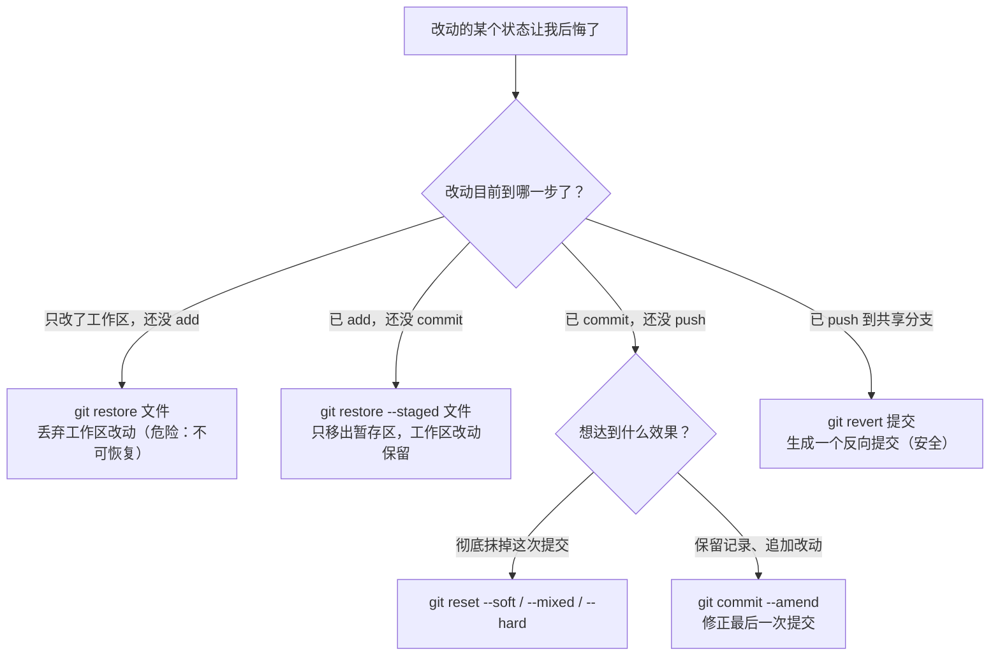

# 2 · Git 日常操作完全指南

> 本章配套代码：`projects/git-lab/setup-practice-repo.sh`（生成带真实历史的练习仓库）与 `projects/git-lab/merge-conflict-setup.sh`（冲突场景，供第 03 章使用）
> 建议学习时长：约 4 小时

## 学习目标

学完本章，你应该能够：

- 独立完成「修改 → status → add → commit → 查看历史」的完整日常循环，并能解释每一步 Git 在三区之间做了什么。
- 用 `git add -p` 把一个文件里的改动拆分暂存，做到「一个提交只干一件事」。
- 面对任意阶段的误操作（未 add、已 add、已 commit、已 push），按照一张决策图选出正确的撤销命令，并知道为什么。
- 读懂并编写 `.gitignore`，包括解读本教程仓库根目录那份真实文件。
- 用 `git stash` 在多任务间安全切换，用 `git tag` 给版本打标。

## 2.1 前置知识 / 本章地位

本章依赖[第 01 章](01-Git核心概念与安装配置.md)建立的心智模型：对象模型（1.4 节）、三区模型（1.5 节）。所有命令都在本地仓库执行，暂不涉及远程——远程同步在第 04 章，多分支操作在第 03 章。本章是全书使用频率最高的一章：工作中 90% 的 Git 输入来自这里。

练习建议：先运行 `projects/git-lab/setup-practice-repo.sh` 生成练习仓库，本章所有命令都可在其中复现（脚本生成的历史与本章示例输出结构一致，哈希值会不同）。

## 2.2 从零开始 vs 加入已有项目：init 与 clone

获得一个 Git 仓库只有两条路，对应两种真实场景：

### 2.2.1 git init：本地新建项目

```bash
$ mkdir myproject && cd myproject
$ git init
```

预期输出：

```text
Initialized empty Git repository in /tmp/gitlab-test/myproject/.git/
```

`git init` 只做一件事：在当前目录创建 `.git/` 子目录（对象数据库的「仓库本体」），把当前目录变成 Git 仓库。**现有文件不会被自动跟踪**——此刻所有文件都是「未跟踪（Untracked）」状态，需要 `git add` 才进入 Git 的管辖。

> `.git/` 目录是仓库的全部秘密：历史、分支、配置都在里面。删掉它，项目退化为普通文件夹；复制它，等于复制了完整历史。日常不要手工改动这个目录里的任何文件。

### 2.2.2 git clone：参与已有项目

```bash
$ git clone <仓库地址> [目标目录名]
```

`clone` = 下载完整历史 + 检出最新版本 + 自动配置好远程连接（`origin`，第 04 章详解）。三种常见地址形态：

```bash
git clone https://github.com/<your-username>/<repo-name>.git   # HTTPS
git clone git@github.com:<your-username>/<repo-name>.git       # SSH
git clone /path/to/local/repo                                  # 本地路径（同机备份练习用）
```

预期输出（本地路径示例，网络克隆还会显示下载进度条）：

```text
Cloning into 'repo'...
done.
```

**选哪个**：新建自己的项目用 `init`；参与任何已有项目（包括把本教程仓库复制一份练手）用 `clone`。初学者常见错误是对着别人项目目录执行 `git init`——如果目录里已有 `.git/`，`init` 不会报错但毫无意义，此时用 `git remote -v` 检查即可确认它本来就是仓库。

## 2.3 完整日常循环：status → add → commit

### 2.3.1 循环总览

日常开发的节奏就是四步循环：

```bash
git status        # 1. 我现在改了什么？（永远先看再动）
git add <文件>    # 2. 把这次要提交的改动放进暂存区
git commit -m "..."   # 3. 把暂存区内容打包成一个提交
git push          # 4. 上传到远程（第 04 章展开）
```

### 2.3.2 add 的三种粒度

```bash
git add app.txt            # 单个文件
git add src/               # 整个目录
git add -A                 # 全部改动（含新增、修改、删除）
```

`git add` 不是「添加文件」，而是「把文件**当前内容**登记进暂存区」。同一个文件改两次、add 两次，暂存区只记住最后一次 add 时的内容——这也是「add 之后又改了代码，记得重新 add」这一常见坑的根源。

### 2.3.3 add -p：按块交互暂存（重点）

`git add -p`（`--patch`）把每个文件的改动切成「块（hunk）」，逐块询问是否暂存。这是实现「一个提交只干一件事」的关键工具。

场景：练习仓库里 `src/calculator.py` 同时有两处改动——一处是 bug 修复，一处是新功能。你只想先提交 bug 修复：

```bash
$ git add -p src/calculator.py
```

预期输出（交互界面，`(1/1)` 表示该文件共 1 个块）：

```text
@@ -8,7 +8,7 @@ class Calculator:
-    return a - b + 1
+    return a - b
(1/1) Stage this hunk [y,n,q,a,d,s,e,p,P,?]?
```

每个选项的含义（真实输出，输入 `?` 可随时查看）：

```text
y - stage this hunk
n - do not stage this hunk
q - quit; do not stage this hunk or any of the remaining ones
a - stage this hunk and all later hunks in the file
d - do not stage this hunk or any of the later hunks in the file
s - split the current hunk into smaller hunks
e - manually edit the current hunk
p - print the current hunk
P - print the current hunk using the pager
? - print help
```

常用组合：`y` 暂存这块 / `n` 跳过这块 / `s` 把相邻改动拆成更小的块 / `e` 手工编辑块内容（最精细）。暂存完成后：

```bash
$ git diff                 # 工作区 vs 暂存区：显示「改了但没暂存」的部分
$ git diff --staged        # 暂存区 vs HEAD：显示「即将提交」的部分
$ git commit -m "fix: 修复减法运算的偏差"
```

### 2.3.4 commit -m 的写法

```bash
git commit -m "fix: 修复减法运算的偏差"
```

`-m` 后写一行提交信息。**提交信息是写给半年后的你和你的同事看的**，怎么写得有价值是第 06 章的主题（本仓库 STYLE_GUIDE 第 8 节规定了自己的格式）。本章先立两条底线：不用 `update`、`修改`、`1` 这种无信息量的占位符；一行说不清的改动，说明应该拆成多个提交。

不带 `-m` 的 `git commit` 会打开第 01 章配置的编辑器，首行为信息正文，`#` 开头的行为注释不生效，适合写多行说明。

小技巧：`git commit -am "..."`（`-a`）会自动暂存**所有已跟踪文件**的改动再提交，省掉 add 一步。注意它只对「已跟踪」文件生效，新建文件仍需手动 `git add`。

### 2.3.5 查看历史：log、show、diff

```bash
$ git log --oneline --graph --all --decorate
```

预期输出示例（练习仓库，哈希必不同）：

```text
* e7a1c09 (tag: v1.0.0, HEAD -> main) feat: 计算器支持浮点数
* c3d9081 feat: 添加除法运算
* 9f2b7e4 fix: 修复减法运算的偏差
* 1a4c553 feat: 实现加减法运算
* 77b1d0e chore: 初始化项目结构与 .gitignore
```

逐参数解释：`--oneline` 每个提交压成一行（短哈希 + 信息）；`--graph` 用 ASCII 画出提交链的分叉合并；`--all` 显示所有分支的链而不只是当前分支；`--decorate` 在行尾标注该提交被哪些分支/标签指向（Git 2.13+ 默认开启，写出来是为了防止被配置关闭）。行内括号的含义：`HEAD -> main` 表示「你正位于 main 分支」，`tag: v1.0.0` 表示该提交被打过标签。

```bash
git show <提交>          # 看某次提交的完整改动（信息 + diff）
git show HEAD            # 最近一次提交
git log -p src/calculator.py   # 按提交顺序看某文件每次怎么被改
```

`diff` 的三种形态对应三区模型（第 01 章 1.5 节），务必分清：

| 命令 | 比较对象 | 回答的问题 |
|---|---|---|
| `git diff` | 工作区 vs 暂存区 | 「改了但还没 add 的是什么？」 |
| `git diff --staged` | 暂存区 vs HEAD | 「add 之后、commit 之前，即将提交的是什么？」 |
| `git diff HEAD` | 工作区+暂存区 vs HEAD | 「从上次提交到现在，总共变了什么？」 |

预期输出示例（`git diff`，真实格式）：

```diff
diff --git a/src/calculator.py b/src/calculator.py
index 3b18e51..ce01362 100644
--- a/src/calculator.py
+++ b/src/calculator.py
@@ -8,4 +8,5 @@ class Calculator:
     def subtract(self, a, b):
         return a - b
+    def power(self, a, b):
+        return a ** b
```

首两行指明比较的两个快照；`index` 行给出两个 blob 哈希；`-` 行是被删除的旧内容，`+` 行是新内容；`@@ -8,4 +8,5 @@` 是位置标记（旧文件第 8 行起 4 行，新文件第 8 行起 5 行）。

## 2.4 撤销操作全景（本章重点）

「改错了想撤」按改动所处阶段分四种情况。**先判断阶段，再选命令**，这张决策图建议截图保存：



### 2.4.1 改了还没 add：git restore

```bash
$ echo "随手写的实验代码" >> src/calculator.py
$ git restore src/calculator.py      # 丢弃该文件工作区改动
```

预期输出：无输出（Unix 风格：没消息就是好消息），再用 `git diff` 确认为空。

**这条命令不可恢复**——被丢弃的改动从未进入过 Git 对象库，删了就是删了。所以执行前先 `git diff` 看清楚要丢什么；或者更稳妥的做法：`git stash`（2.7 节）先把改动收起来而不是销毁。

### 2.4.2 add 了还没 commit：git restore --staged

```bash
$ git add notes.txt        # 不小心 add 了不该提交的文件
$ git restore --staged notes.txt
```

预期输出：无输出；`git status` 中该文件从 `Changes to be committed` 移回 `Untracked files`。

`--staged` 的语义是「只把暂存区里的这份内容移出去」，**工作区文件内容原封不动**——它与 `git reset HEAD <file>` 完全等价（`restore` 是 Git 2.23 引入的更易懂的新命令）。

### 2.4.3 commit 了还没 push：git reset 三种模式

`git reset <目标提交>` 的统一语义是「把当前分支指针和 HEAD 移到目标提交」，区别在于对暂存区和工作区的处理，三种模式对比：

| 模式 | 分支指针/HEAD | 暂存区 | 工作区 | 典型场景 |
|---|---|---|---|---|
| `--soft` | 移到目标 | 保留旧内容 | 保留旧内容 | 撤销 commit 但想重新组织提交内容 |
| `--mixed`（默认） | 移到目标 | 重置为目标状态 | 保留旧内容 | 撤销 commit，改动退回「未暂存」 |
| `--hard` | 移到目标 | 重置为目标状态 | **重置为目标状态** | 彻底丢弃提交和所有未提交改动（最危险） |

在练习仓库实测（先看当前历史，再逐个体验）：

```bash
$ git log --oneline -2
```

预期输出示例：

```text
e7a1c09 (HEAD -> main) feat: 计算器支持浮点数
c3d9081 feat: 添加除法运算
```

`--mixed`（默认）：提交消失，改动回到工作区：

```bash
$ git reset HEAD~1
$ git status --short
```

预期输出示例：

```text
 M src/calculator.py
```

`--hard`：提交、暂存区、工作区改动**全部抹掉**，目录回到上次提交的原始状态（输出真实格式如下）：

```bash
$ git reset --hard HEAD~1
```

预期输出：

```text
HEAD is now at c3d9081 feat: 添加除法运算
```

**`--hard` 前请三思**。被 `reset --hard` 丢掉的「未提交改动」没有任何对象保护，找不回来；但「已提交的内容」永远能通过 `git reflog` 找回（第 07 章完整演示）——这是 reset 与 restore 的本质区别：reset 动的是「有历史保护」的东西。

### 2.4.4 已 push 到共享分支：git revert

`revert` 与 `reset` 相反：它不抹掉历史，而是**生成一个内容相反的新提交**，把指定提交的效果抵消掉：

```bash
$ git revert HEAD
```

预期输出（Git 会打开编辑器让你确认提交信息，保存即完成）：

```text
[main 4d1e77f] Revert "feat: 计算器支持浮点数"
 1 file changed, 1 deletion(-)
```

此时历史变成（示例）：

```text
* 4d1e77f (HEAD -> main) Revert "feat: 计算器支持浮点数"
* e7a1c09 feat: 计算器支持浮点数
* c3d9081 feat: 添加除法运算
```

为什么已推送的提交不用 reset？因为 reset 让本仓库历史与远程分叉（第 04 章），同事 pull 时会撞上你重写过的旧提交；而 revert 是纯增量操作，对所有人都是一次正常推送。**规则：共享分支上，回退用 revert；私有分支上（只有你一个人在用），才考虑 reset。** 第 03 章 rebase 的「黄金法则」是同一条原则的另一种表述。

### 2.4.5 补充：amend 修正最后一次提交

提交后发现少加了一个文件、或提交信息有错别字：

```bash
$ git add 漏掉的文件
$ git commit --amend            # 把暂存区内容并入上一次提交，并重写其信息
```

预期输出：打开编辑器显示旧提交信息，修改保存后：

```text
[main 8f3aa2b] feat: 计算器支持浮点数
 Date: ...
 2 files changed, ...
```

`amend` 生成了一个**全新的提交对象**（哈希与旧的完全不同），旧提交被打入冷宫（reflog 仍可找到）。同样遵守上面的规则：**只 amend 还没 push 的提交**。

## 2.5 .gitignore 完全指南

### 2.5.1 它解决什么问题

工作区总有不该进版本库的东西：Python 的 `__pycache__/`、虚拟环境 `venv/`、含密钥的 `.env`、构建产物 `dist/`……`.gitignore` 文件（放在仓库根目录，本身**必须被提交**）告诉 Git「这些路径无视它们」。

### 2.5.2 语法速查

```gitignore
# 井号开头是注释
__pycache__/          # 目录（末尾斜杠）——匹配所有层级同名目录
*.log                 # 通配符——所有 .log 文件
build/                # 构建产物目录
!keep.example         # 感叹号取反：例外，强制纳入
/debug.log            # 前导斜杠：只匹配仓库根目录下的这个文件
**/temp/*.txt         # ** 跨任意层级目录
```

三条关键规则：

1. **对已跟踪文件无效**。`.gitignore` 只阻止「未跟踪」文件进入暂存区；文件一旦被跟踪，再写进 `.gitignore` 也不会被忽略，必须先 `git rm --cached <文件>`（从暂存区移除但保留工作区文件）再提交。
2. 匹配从仓库根目录算相对路径，**目录条目末尾的 `/` 让匹配限定为目录**。
3. `!` 例外规则的父目录若已被忽略，例外不生效（目录被整体排除后 Git 不会进入它做匹配）。

### 2.5.3 全局忽略：自己的编辑器配置不进任何仓库

`.vscode/`、`.idea/` 这类个人环境文件更适合全局忽略，写一次对所有仓库生效：

```bash
git config --global core.excludesfile ~/.gitignore_global
```

然后把个人内容写进 `~/.gitignore_global`（例如 `.DS_Store`、`*.swp`）。团队公共的忽略规则则写进仓库内的 `.gitignore` 并提交——两者职责不同。

### 2.5.4 实战解读：本教程仓库的 .gitignore

本教程仓库根目录的 [`../../.gitignore`](../../.gitignore) 是一份真实生产级范例，摘取关键段落解读：

```gitignore
# ===== Python =====
__pycache__/
*.py[cod]
...
# ===== 环境变量（绝不提交密钥！）=====
.env
.env.*
!.env.example
...
# ===== 数据文件约定：原始数据不入库，示例数据入库 =====
projects/*/data/raw/
*.db-shm
*.db-wal
!projects/book-insight/data/*.db
```

逐段解释：

- `*.py[cod]`：字符组写法，同时匹配 `.pyc`、`.pyo`、`.pyd` 三种 Python 编译产物。
- `.env` / `.env.*` 配合 `!.env.example`：**密钥文件一律忽略，但提交一个无密钥的模板**供他人复制，这是本仓库的安全红线（STYLE_GUIDE 第 7 节）——真实密钥只放在 `.env` 里，永远不进 Git。
- `projects/*/data/raw/`：爬虫抓的原始数据体积大且可随时重新抓取，不入库；例外规则 `!projects/book-insight/data/*.db` 强制保留一个小体积示例 SQLite 库，让仓库克隆下来即可开箱运行。**「可再生的大文件不入库」是 .gitignore 设计的核心判断标准**——真正的二进制大文件需求请看第 07 章 Git LFS。

验证某个文件为什么被（或没被）忽略：

```bash
$ git check-ignore -v projects/book-insight/data/raw/whatever.txt
```

预期输出示例（`-v` 会告诉你命中了哪一行规则）：

```text
.gitignore:51:projects/*/data/raw/	projects/book-insight/data/raw/whatever.txt
```

## 2.6 现在轮到你：在本仓库练一遍

本教程仓库（`linux学习与实战/`，main 分支）本身就是练习场。安全起见**不要向它 push、不要 commit 删改现有文件**，但下面这些都是无害观察操作：

```bash
cd /Users/jjy/Documents/linux学习与实战
git status          # 观察未跟踪文件
git check-ignore -v projects/crawler-lab/data/raw/demo.txt  # 验证忽略规则
git log --oneline --graph --all --decorate
```

## 2.7 stash：临时存档

写到一半，线上出了 bug 要切到别的分支救火——工作区改动还没到能提交的程度，直接切分支改动会跟着你（甚至冲突拦路）。`stash` 就是「先把当前工作区+暂存区改动打包收进一个栈里，把工作区还原成干净状态」：

```bash
$ git stash push -m "改到一半的断点续抓功能" -u
```

预期输出：

```text
Saved working directory and index state On main: 改到一半的断点续抓功能
```

参数解释：`-m` 给这条存档写备注（强烈建议，否则几天后分不清哪条是哪条）；`-u`（`--include-untracked`）连**未跟踪的新文件**一起收起来——默认 stash 只收「已跟踪文件」的改动，新文件会被留在工作区，这是 stash 最常见的坑。

存起来之后的世界：

```bash
$ git status --short          # 干净了（无输出）
$ git stash list              # 存档栈里有什么
```

预期输出：

```text
stash@{0}: On main: 改到一半的断点续抓功能
```

救火完毕回来取：

```bash
$ git stash pop               # 弹出最近一条并应用到工作区
```

预期输出：

```text
On branch main
Changes not staged for commit:
  (use "git add <file>..." to update what will be committed)
  (use "git restore <file>..." to discard changes in working directory)
	modified:   src/calculator.py

Dropped refs/stash@{0} (693761a069848e01d72e2ad57f73953573e3e6e9)
```

逐段解释：改动回到工作区（未暂存状态）；`Dropped` 表示这条存档已从栈中删除。相关命令：`git stash pop stash@{1}` 取指定条；`git stash apply` 应用但**不删**存档（想多次复用一条改动时用）；`git stash show -p` 看某条存档的内容；`git stash drop stash@{0}` 丢弃。

## 2.8 tag：给重要提交钉上书签

分支会移动（新的提交会顶上来），而**标签（Tag）钉死在某个提交上不动**，专用于标记版本发布点。

```bash
# 附注标签（推荐）：存为完整 tag 对象，含作者、日期、说明（第 01 章 1.4.1 的第四种对象）
git tag -a v1.0.0 -m "发布 1.0.0：首个正式版本"

# 轻量标签：只是一个指向 commit 的别名，像分支但不移动
git tag v1.0.1
```

预期输出（`git show v1.0.0`，附注标签会先显示标签自身的元数据）：

```text
tag v1.0.0
Tagger: 张三 <zhangsan@example.com>
Date:   Wed Nov 4 00:14:16 2026 +0800

发布 1.0.0：首个正式版本

commit 3b1bc3819a9a1d98a471f12a54a7ddcd4395dded
Author: 张三 <zhangsan@example.com>
Date:   Wed Nov 4 00:14:16 2026 +0800

    feat: v1.0.0 功能
...
```

常用操作：

```bash
git tag                    # 列出所有标签
git tag -n                 # 列出标签及附注说明
git show v1.0.0            # 查看标签指向的提交
git tag -d v1.0.1          # 删除本地标签
git push origin v1.0.0     # 推送标签到远程（push 默认不推标签！）
```

版本号建议遵循语义化版本（Semantic Versioning）：`主版本.次版本.修订号`，如 `v2.3.1`——何时加一进位、如何与提交信息联动，第 06 章 SemVer 一节展开。

## 常见坑与排查（Troubleshooting）

| 报错现象 | 原因 | 解决办法 |
|---|---|---|
| `git commit` 提示 nothing to commit 但文件明明改了 | 改动在工作区但未 add（或 add 后又改了没重新 add） | `git status` 看区块；`git diff` 与 `git diff --staged` 分清两份改动 |
| add 了又改，提交的不是最新内容 | 暂存区记录的是 add 时刻的内容 | 重新 `git add`；或养成用 `git commit -am` 前先 `git status` 的习惯 |
| `.gitignore` 写了但文件还是被跟踪 | 对已跟踪文件无效 | `git rm --cached <文件>` 后提交 |
| `restore` 之后想反悔，改动找不回了 | restore 丢弃的改动从未入对象库 | 无法恢复；重要未完成改动请先 `git stash` 而非 restore |
| `git reset --hard` 丢错了提交 | 误用 hard 模式 | 未提交改动无法恢复；**已提交内容**用 `git reflog` 找回（第 07 章 7.2 节） |
| `fatal: refusing to merge unrelated histories` | 两个没有共同祖先的仓库被强行合并（常见于本地 init 后又 pull 远程仓库） | 确认动机后加 `--allow-unrelated-histories`；更常见的情况是你应该 clone 而不是 init |
| commit 后发现提交信息写错 | 手误 | 未推送：`git commit --amend`；已推送：接受它，或在确认无协作时 amend 后强推（慎重） |
| stash pop 报冲突 | 存档的改动与当前工作区/分支状态冲突 | 解决冲突后 `git stash drop` 手动清栈（pop 失败时 Git 不会自动删存档） |
| 中文文件名在 status 里显示为转义码 | `core.quotepath` 默认值 | `git config --global core.quotepath false`（第 01 章坑表同款） |

## 动手练习

### 练习 1：完整循环与三种 diff

在练习仓库中：改一个文件但不 add，依次运行三种 `git diff` 变体并截图；然后 add 再运行一次，对比输出差异。

验收标准：能口头回答「三次输出分别回答了 2.3.5 节表格里的哪个问题」。

<details>
<summary>提示</summary>

`git diff` 在 add 之后会变成空输出——这恰好说明「工作区与暂存区已一致」，是理解三区的最好证据。
</details>

### 练习 2：add -p 拆分提交

在 `src/calculator.py` 里同时制造两处相距较远的改动（一处修 bug、一处加功能），用 `git add -p` 只暂存 bug 修复并提交，再用 `git add` 提交功能改动。

验收标准：`git log --oneline` 出现两个提交，且 `git show --stat` 显示每个提交只含「一件事」。

<details>
<summary>提示</summary>

两处改动如果相邻，`-p` 里按 `s` 也拆不开；可以在文件里隔几行再改，让 Git 能自然分块。交互中按 `?` 随时查看选项含义。
</details>

### 练习 3：撤销决策图实战

按顺序执行并观察（全部在练习仓库，可放心破坏）：改文件 → `git restore` → 改文件 → `git add` → `git restore --staged` → 改文件 → `git commit` → `git reset --soft HEAD~1` → `git commit` → `git reset --hard HEAD~1`。

验收标准：每一步后用 `git status` 和 `git log --oneline -2` 记录状态，最后能不看文档说出每条命令动的是三区里的哪几区。

<details>
<summary>提示</summary>

`reset --soft` 之后立刻 `git status`：改动全部处于「已暂存」状态——这就是「soft 只动分支指针」的可视化。
</details>

### 练习 4：解读并扩展 .gitignore

在练习仓库根目录新建 `secrets.local` 并 `git status` 确认它出现在 Untracked；在 `.gitignore` 追加一行 `*.local` 后再 `git status`；最后用 `git check-ignore -v secrets.local` 验证命中规则。

验收标准：`check-ignore -v` 输出能指出「哪个文件的哪一行」匹配了它。

<details>
<summary>提示</summary>

如果文件已经被 `git add` 过，规则不生效——先 `git restore --staged` 移出暂存区（2.4.2 节），这正是「.gitignore 只管未跟踪文件」的现场演示。
</details>

## 小结与自检清单

- [ ] 我能不假思索地说出四步日常循环，并解释每步动了三区的哪部分。
- [ ] 我用过 `git add -p`，并知道 `s`/`e` 两个选项什么时候用。
- [ ] 我能对着 2.4 节的决策图，说出「当前改动状态」对应的撤销命令及风险等级。
- [ ] 我知道 `reset --hard` 与 `revert` 的本质区别，以及为什么共享分支用 revert。
- [ ] 我能解读本教程仓库 `.gitignore` 里 `!` 例外规则的作用，并会用 `git check-ignore -v` 调试。
- [ ] 我知道 stash 默认不含未跟踪文件、`-u` 参数补救、pop 与 apply 的区别。
- [ ] 我知道 `push` 默认不推标签，推标签要显式 `git push origin <tag>`。

## 延伸阅读

- [Pro Git 中文版第 2 章「Git 基础」与第 7 章「Git 工具」](https://git-scm.com/book/zh/v2) —— 本章内容的权威展开，第 2 章必读。
- [Git 官方文档：git-reset](https://git-scm.com/docs/git-reset) —— 三种模式在官方手册里有另一张著名的状态图，可与本文表格对照。
- [gitignore.io](https://www.gitignore.io/) —— 按语言/框架生成 `.gitignore` 模板的实用工具，生成后仍建议逐行读懂再提交。
- 本仓库后续章节：[第 03 章 分支完全指南](03-分支完全指南.md)（把「提交链」升级为「分叉与合并」）、[第 06 章 Commit 规范](06-Commit规范与团队工程实践.md)（把本章的提交信息底线扩成团队规范）。
