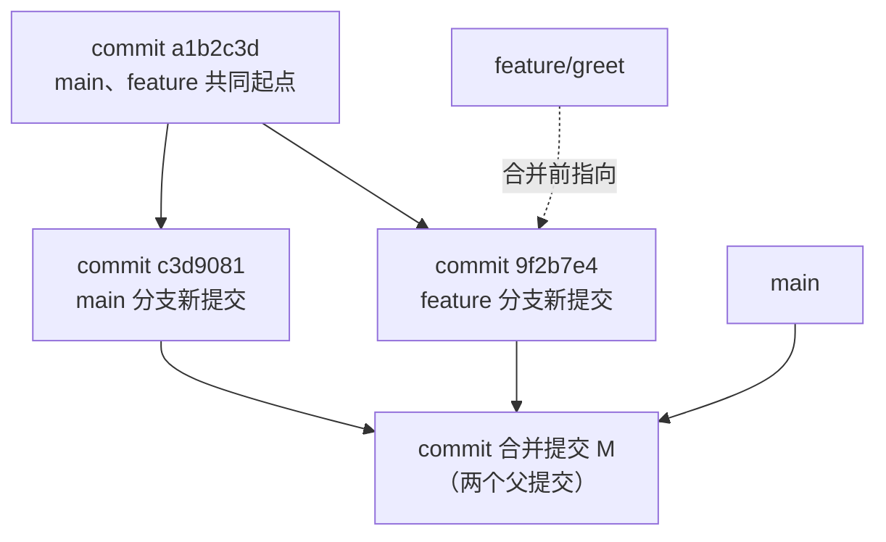
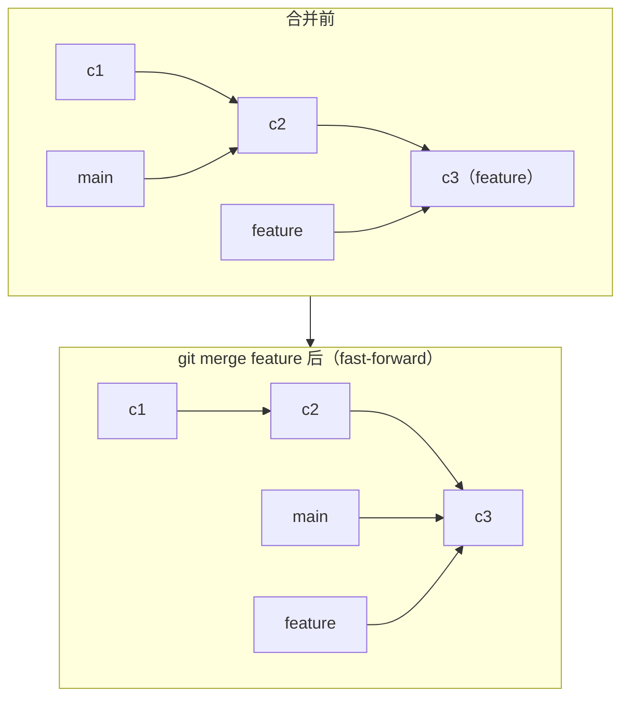
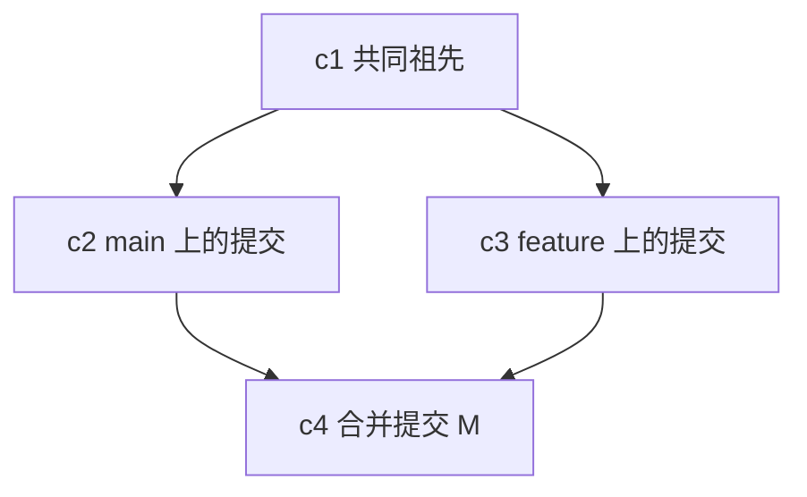
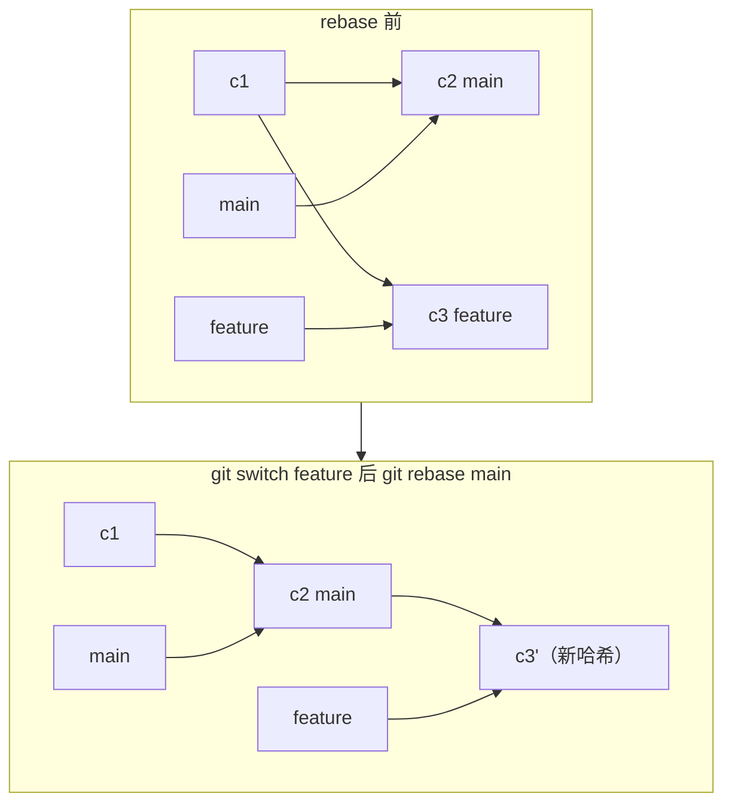
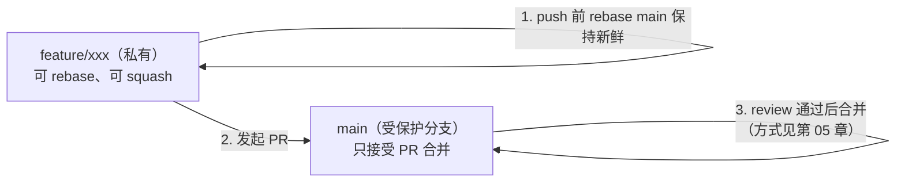

# 3 · 分支完全指南

> 本章配套代码：`projects/git-lab/merge-conflict-setup.sh`（一键制造冲突现场）与 `projects/git-lab/setup-practice-repo.sh`（基础练习仓库）
> 建议学习时长：约 4 小时

## 学习目标

学完本章，你应该能够：

- 说清分支的物理本质（一个 41 字节的指针文件），并据此解释为什么 Git 建分支是「秒级」操作。
- 熟练完成分支的创建、切换、删除，并遵守 `feature/xxx`、`fix/xxx` 命名规范。
- 解释 `switch` 与 `checkout` 的分工，知道 detached HEAD 是什么状态、如何脱困。
- 完整走通一次冲突：制造冲突、读懂 `<<<<<<<` 标记、解决、完成合并。
- 说明 merge 与 rebase 的机制差异，能对「什么场景用哪个」给出理由，并牢记 rebase 黄金法则。

## 3.1 前置知识 / 本章地位

依赖[第 01 章](01-Git核心概念与安装配置.md)的 commit 链模型（1.4.4 节）和[第 02 章](02-Git日常操作完全指南.md)的日常循环。分支是团队协作（第 05 章）与 Pull Request 流程的地基：**PR 本质上就是「请求把一个分支合并进另一个分支」**。

## 3.2 分支的本质：一个可移动的 41 字节指针

第 01 章说过：commit 之间通过 `parent` 字段串成链。**分支并不是「一份代码的副本」，而只是一个文本文件**，内容为一个 40 位哈希加换行符（合计 41 字节），存放在 `.git/refs/heads/` 下。亲眼看看（在练习仓库执行）：

```bash
$ cat .git/refs/heads/main
a1b2c3d4e5f6a7b8c9d0e1f2a3b4c5d6e7f8a9b0
$ git rev-parse main          # 同一信息的正规查看方式
a1b2c3d4e5f6a7b8c9d0e1f2a3b4c5d6e7f8a9b0
```

「创建分支」= 写一个 41 字节的文件；「提交」= 在当前分支指向的 commit 之上新建 commit，然后把分支指针前移到新 commit；「合并」= 把某个分支指针的指向关系记录成新的 commit。**所有分支操作都只是移动指针**，这就是 Git 分支模型快到可以「随手开分支」的原因。

分支的分叉与合并，在指针视角下是这样：



## 3.3 分支基本操作：switch 时代

### 3.3.1 switch 与 checkout 的关系

Git 2.23 把老命令 `checkout` 拆成了两个职责单一的命令，这一拆分解决了 checkout 「既切分支又还原文件」的语义混乱：

| 你想做的事 | 新命令（推荐） | 老命令（仍可用） |
|---|---|---|
| 创建并切换分支 | `git switch -c <分支>` | `git checkout -b <分支>` |
| 切换到已有分支 | `git switch <分支>` | `git checkout <分支>` |
| 回到上一个分支 | `git switch -` | `git checkout -` |
| 丢弃工作区文件改动 | `git restore <文件>`（第 02 章） | `git checkout -- <文件>` |

本教程正文统一用 `switch`/`restore`，读别人的旧脚本时会遇到 `checkout`，知道等价关系即可。

### 3.3.2 创建、切换、删除

```bash
$ git switch -c feature/greet
```

预期输出：

```text
Switched to a new branch 'feature/greet'
```

在新分支上正常提交（与第 02 章循环完全一致），然后查看全景：

```bash
$ git branch -v
```

预期输出示例：

```text
* feature/greet d41c3cc feat: 新增 greet.txt
  main          f829199 feat: 添加第二行
```

星号是当前分支。切换回 main，工作区会自动变成 main 分支的内容——「分支切换」改变的是整个工作区，这也是为什么切换前最好保持干净（或先 stash，见第 02 章 2.7 节）。

删除分支：

```bash
$ git branch -d feature/greet        # 已合并的分支，安全删除
```

预期输出：

```text
Deleted branch feature/greet (was d41c3cc).
```

如果分支上还有**未合并的提交**，`-d` 会拒绝——这是防止你丢工作的保护：

```bash
$ git branch -d not-merged
```

预期输出：

```text
error: the branch 'not-merged' is not fully merged
hint: If you are sure you want to delete it, run 'git branch -D not-merged'
```

确认真不要了才用 `-D` 强删。被强删的分支只要提交过，仍可按第 07 章 reflog 一节找回。

### 3.3.3 分支命名规范

分支名会出现在 URL、PR 列表、CI 日志里，命名要能「望文生义」。本仓库与主流团队约定一致：

| 前缀 | 用途 | 示例 |
|---|---|---|
| `feature/` | 新功能 | `feature/spider-scheduler` |
| `fix/` | 缺陷修复 | `fix/empty-page-crash` |
| `docs/` | 文档 | `docs/git-chapter-03` |
| `hotfix/` | 线上紧急修复 | `hotfix/login-500` |
| `test/` | 实验性改动 | `test/new-parser` |

硬性建议：一律小写、用连字符不用下划线、不含空格和中文；名字里带上对应 Issue 编号（如 `fix/issue-42-empty-page`）可以让第 05 章的 PR 自动关联问题。

## 3.4 HEAD 与 detached HEAD

第 01 章讲过 HEAD 是「当前所在位置」。它有两种形态：

- **附加在分支上**（正常态）：`HEAD` → `main` → `commit`。此时提交会让 main 指针前移。
- **游离态（detached HEAD）**：`HEAD` 直接指向某个 commit，不经过任何分支。

执行 `git checkout HEAD~1` 或 `git checkout <提交哈希>` 就会进入游离态，Git 会明确警告（真实输出节选）：

```text
Note: switching to 'HEAD~1'.

You are in 'detached HEAD' state. You can look around, make experimental
changes and commit them, and you can discard any commits you make in this
state without impacting any branches by switching back to a branch.
...
HEAD is now at f829199 feat: 添加第二行
```

此时 `git status` 显示 `HEAD detached at f829199`。**游离态下可以随意浏览、跑代码、做实验性提交，但切走后这些提交不会被任何分支引用**——它们进入「漂流」状态，一段时间后被垃圾回收。所以规则很简单：

- 只是「看看旧版本」→ 随意，看完 `git switch -` 回去。
- 打算在旧版本基础上改东西 → 立刻 `git switch -c 新分支名` 把工作挂到分支上。

误入游离态并提交了东西、且已经切走了？提交还在（reflog 可查），`git branch <名字> <哈希>` 即可原地复活。

## 3.5 merge 完全解析

`git merge <分支>` 的语义：**把指定分支的提交历史并入当前分支**。合并的结果取决于两条历史的关系，分两种情况。

### 3.5.1 fast-forward：可以直接「快进」

如果从分叉点之后，main 分支**一个提交都没有**，Git 只需把 main 指针前移到 feature 的位置——根本不需要造新提交：



真实输出（在 main 上合并一个快进目标，与练习仓库一致）：

```text
$ git merge feature/greet
Updating f829199..d41c3cc
Fast-forward
 greet.txt | 1 +
 1 file changed, 1 insertion(+)
 create mode 100644 greet.txt
```

历史保持一条直线。加 `--no-ff` 参数可以强制产生一个合并提交（保留「这里发生过一次合并」的痕迹，团队常有此规定）。

### 3.5.2 三方合并：历史分叉了

分叉后两边都有新提交，Git 需要「三方」信息——两条分支的当前快照 + 它们的**共同祖先（merge base）**——来合成结果，并生成一个有**两个父提交**的合并提交（merge commit）：



真实输出：

```text
$ git merge feature/add3
Merge made by the 'ort' strategy.
 app.txt | 2 +-
 1 file changed, 1 insertion(+), 1 deletion(-)
```

`git log --graph` 中它呈现为著名的分叉合拢形状：

```text
*   c298adb fix: 合并 feature/add3
|\
| * 7592510 feat: feature 分支改第三行
* | 19e0847 fix: main 分支改第三行
|/
* f381c48 feat: 初始两行
```

`ort` 是 Git 2.34 起默认的合并策略（递归合并的后继者），名字意为「Ostensibly Recursive's Twin」，以官方文档为准。

### 3.5.3 冲突：合并失败时发生了什么

三方合并逐个文件比对：祖先、main、feature 三方中**只有一方改过**的文件/区域，Git 自动采用改过的版本；**两边都改了同一区域且改法不同**，Git 无法替你做决定，停下并标记冲突。

用配套脚本一键复现（生成两个分支对同一行做不同修改，并停在冲突前一刻）：

```bash
cd /Users/jjy/Documents/linux学习与实战/projects/git-lab
./merge-conflict-setup.sh /tmp/git-conflict-demo
cd /tmp/git-conflict-demo
git merge feature/add-farewell
```

预期输出：

```text
Auto-merging app.txt
CONFLICT (content): Merge conflict in app.txt
Automatic merge failed; fix conflicts and then commit the result.
```

此时查看冲突文件，会看到 Git 插入的冲突标记（真实内容）：

```text
line1
line2
<<<<<<< HEAD
line3-main
=======
line3-feature
>>>>>>> feature/add-farewell
```

逐行解释四个标记：

- `<<<<<<< HEAD`：冲突开始。`HEAD` 侧是**当前分支**（合并命令的执行者）的内容。
- `=======`：分隔线，上下各是一方的版本。
- `>>>>>>> feature/add-farewell`：冲突结束，标注另一方的来源分支。

解决冲突的标准流程：

```bash
$ git status
```

预期输出（Git 此时把每个环节该做什么都写在提示里）：

```text
On branch main
You have unmerged paths.
  (fix conflicts and run "git commit")
  (use "git merge --abort" to abort the merge)

Unmerged paths:
  (use "git add <file>..." to mark resolution)
	both modified:   app.txt
```

1. 打开 `app.txt`，把标记块**改写成你想要的最终内容**（保留一方、融合两方或全新写法，本例改为 `line3-final`），标记行 `<<<<<<<`、`=======`、`>>>>>>>` 必须全部删除。
2. `git add app.txt` —— add 的含义在这里变成「此文件已解决」。
3. `git commit` —— 完成合并提交（Git 已预填好提交信息）。
4. 想放弃这次合并回到原状：`git merge --abort`。

> 编辑器工具（VS Code）会在冲突块上方提供「采用当前更改 / 采用传入更改」按钮，本质仍是帮你改写这段文本。**不要养成不读冲突内容就点按钮的习惯**——合并的语义决定要由你来做。

## 3.6 rebase：把历史改写成一条直线

`git rebase <基分支>` 的字面意思是「变基」：把当前分支上的一串提交**摘下来，逐个重放到目标分支的最新提交之后**，生成一串全新的提交。

### 3.6.1 机制与效果

feature 从 c1 分叉，main 此后新进了 c2；rebase main 后：



真实输出（练习场景）：

```text
$ git rebase main
Rebasing (1/1)Successfully rebased and updated refs/heads/feature.
```

注意 `c3'` 是**新造的提交**：内容相同，但父提交变了，哈希必然不同。rebase 的本质就是「复制一串提交到新位置」——原提交仍在对象库里（reflog 可寻），但不再被任何分支引用。

rebase 后合并变成 fast-forward，历史始终一条直线，这是它最大的好处。

### 3.6.2 黄金法则：公共分支上的提交禁止 rebase

由机制直接推出：rebase 重造哈希。如果某个提交已经被同事 pull 走，你在原提交的位置重放出新哈希的「同款提交」，两份仓库的历史就对不上了——对方再次 pull 时会同时看到新旧两串提交，灾难现场。

**法则：只 rebase 自己独占的分支**（你本地写了一半的 feature 分支、还没 push 的提交）。凡是别人可能已经基于它开发的分支（main、共享开发分支），只能 merge 或 revert，不能 rebase。第 02 章 2.4.4 的「共享分支不 reset」是同一条底层原则：**不要改写别人可能依赖的历史**。

### 3.6.3 interactive rebase 简讲

`git rebase -i <基点>` 会打开编辑器，列出从基点以来的提交，让你对每个提交下达指令后重放：

```text
pick 1a4c553 feat: 实现加减法运算
pick 9f2b7e4 fix: 修复减法运算的偏差
pick c3d9081 feat: 添加除法运算
```

常用指令：`pick`（保留）、`squash`（并入上一个提交，信息合并）、`reword`（改提交信息）、`drop`（丢弃）、`edit`（停在这次提交供修补）。典型用途：push 前把 5 个「修修补补」的提交压成 2 个干净的提交，让 PR 更可读。操作细节以 `git help rebase` 为准，新手务必在**私有分支**上练习。

## 3.7 merge vs rebase：选型与团队策略

| 维度 | merge | rebase |
|---|---|---|
| 历史形状 | 保真：保留真实分叉与合并点 | 线性：分叉被抹平 |
| 提交哈希 | 不变 | **重写**（新哈希） |
| 安全性 | 永远安全 | 仅限私有分支 |
| 合并后主干 | 有 merge commit，图呈辫状 | 快进后一条直线 |
| 适合场景 | 把特性分支并入主干（含 PR 合并） | push 前整理自己的提交、追上主干最新代码 |

不存在「谁正确」，只有团队约定。本教程采用的常见团队策略，也是你接下来第 05 章会在 GitHub 上实操的流程：



要点：main 受保护、任何改动走 feature 分支 + PR；feature 分支私有，作者可任意 rebase 整理；进入 main 的每一步都有 review 记录。个人练手时优先在私有分支练 rebase，merge 在合并回 main 时体会。

## 常见坑与排查（Troubleshooting）

| 报错现象 | 原因 | 解决办法 |
|---|---|---|
| 切分支时 `error: Your local changes ... would be overwritten` | 工作区改动与目标分支冲突 | 先 `git stash`（第 02 章 2.7）或提交后再切 |
| 误入 detached HEAD 后提交、切走找不到提交 | 游离态提交无分支引用 | `git reflog` 找到哈希，`git branch <名> <哈希>` 复活（第 07 章） |
| `CONFLICT (content)` 反复出现 | 上次合并没做完就又开始新操作 | `git status` 看未合并文件；或 `git merge --abort` 重来 |
| 合并后忘了删标记行，`<<<<<<<` 被提交了 | 标记未清理干净 | 全局搜索 `<<<<<<<`；规范流程：解决后先 `grep -rn "<<<<<<<" .` 再 add |
| `git branch -D` 删错分支 | 强删绕过保护 | `git reflog` 找回（第 07 章） |
| rebase 中途冲突想放弃 | 重放过程卡住 | `git rebase --abort` 回到 rebase 前状态 |
| rebase 后 push 被拒 `non-fast-forward` | 远程同名分支是重写前的旧历史 | 只允许在私有分支上：`git push --force-with-lease`（比 `--force` 安全，仍需谨慎） |
| `fatal: 'feature/xxx' does not point to a branch` | 分支名拼写错误或本地不存在 | `git branch -a` 查看全部分支确认名字 |

## 动手练习

### 练习 1：指针实验

在练习仓库执行：`git switch -c experiment` → 提交一次 → `cat .git/refs/heads/experiment` → `git rev-parse experiment` → 切回 main 再做一次对比。

验收标准：能解释「两次 `cat` 结果为什么不同」「main 与 experiment 两个文件内容的差值说明了什么」。

<details>
<summary>提示</summary>

切回 main 后 experiment 的哈希不变——分支指针只在「它的分支上有新提交」时才移动，这就是「分支=指针」的直接证据。
</details>

### 练习 2：fast-forward 与 --no-ff 对照

在 main 落后于 feature 分支时分别尝试 `git merge feature/greet` 和 `git merge --no-ff feature/greet`（各用一次独立场景），对比 `git log --graph` 的形状。

验收标准：能说出两者的提交数差异，以及 `--no-ff` 多出来的那个提交叫什么、有两个父提交吗。

<details>
<summary>提示</summary>

用 `git reset --hard` 在两个场景间重置，或用脚本重建两份练习仓库，避免互相污染。
</details>

### 练习 3：完整冲突解决

运行 `merge-conflict-setup.sh`，按 3.5.3 的四步流程手工解决冲突，提交后用 `git log --graph --oneline -4` 观察。

验收标准：历史中存在一个有两个父提交的合并提交，`grep -rn "<<<<<<<" .` 无结果。

<details>
<summary>提示</summary>

卡住时 `git status` 的提示本身就是操作清单；实在乱了就 `git merge --abort` 重来，合并操作可以无限次重来。
</details>

### 练习 4：squash 合并提交

在私有 feature 分支上连续提交 3 次「小步快跑」，然后 `git rebase -i main` 把其中两个 `squash` 成一个。

验收标准：`git log --oneline main..feature/xxx` 从 3 行变 2 行，且提交信息是你指定的。

<details>
<summary>提示</summary>

编辑器里**行的顺序就是提交的顺序**，`squash` 是并入「它上面那一行」。第一次操作建议复制一份仓库目录练手。
</details>

## 小结与自检清单

- [ ] 我能说出分支文件的位置和大小，并演示「创建分支只是写指针」。
- [ ] 我使用 switch/restore 完成日常分支操作，并知道 checkout 的等价写法。
- [ ] 我能解释 detached HEAD 是什么、何时危险、如何脱困。
- [ ] 我能画出 fast-forward 与三方合并的前后指针图，并读懂 merge commit 的两个父提交。
- [ ] 我独立解决过一次真实冲突，能解释四个标记行各自的含义。
- [ ] 我能背出 rebase 黄金法则，并解释它为什么成立（哈希重写）。
- [ ] 我理解本教程团队策略：main 受保护 + feature 分支 + PR（下一章实操）。

## 延伸阅读

- [Pro Git 中文版第 3 章「Git 分支」](https://git-scm.com/book/zh/v2) —— 分支指针模型的权威出处，3.2 节与本文 3.2 节互为印证。
- [Git 官方文档：git-merge](https://git-scm.com/docs/git-merge) —— ort 策略与冲突标记的完整说明。
- [Atlassian Git Tutorial：Merging vs. Rebasing](https://www.atlassian.com/git/tutorials/merging-vs-rebasing) —— 对选型问题的另一份经典论述（英文），可与本文 3.7 节表格对照。
- 下一章：[第 04 章 远程仓库与 GitHub 入门](04-远程仓库与GitHub入门.md) —— 分支如何推上云端、与他人同步。
