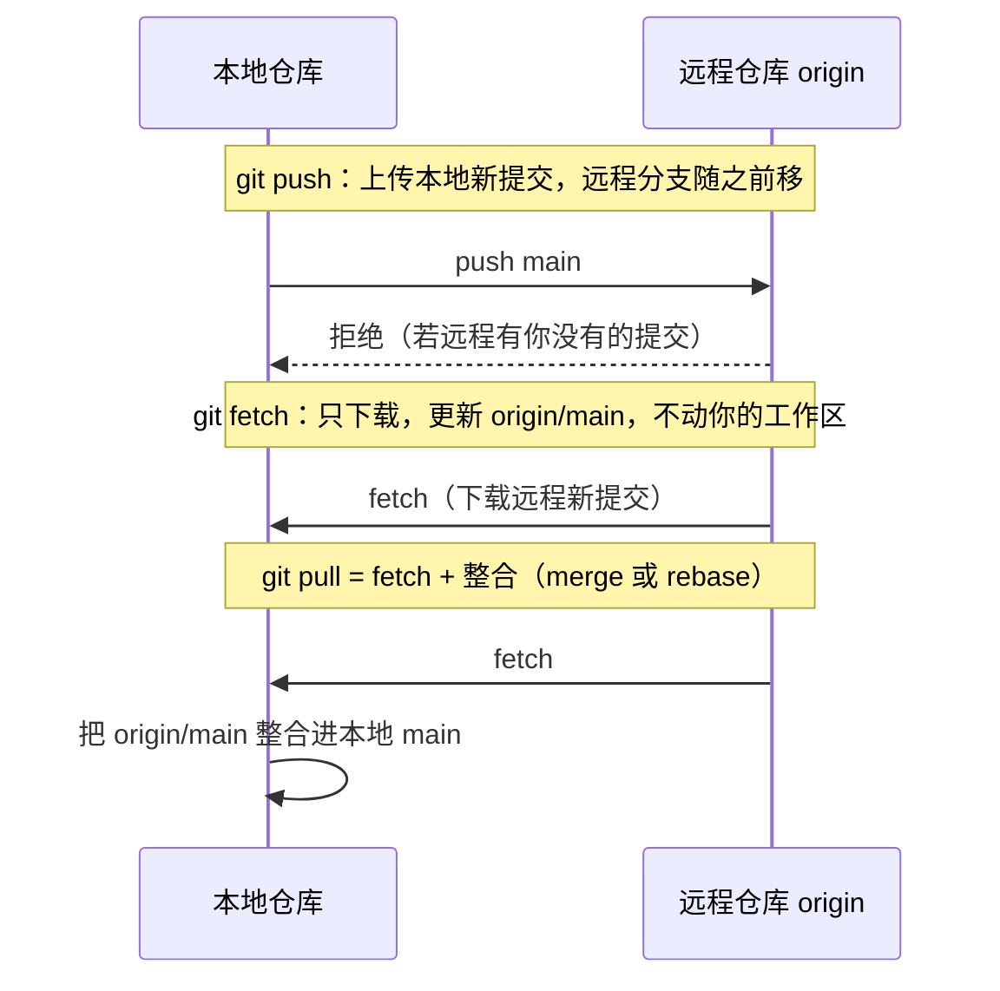

# 4 · 远程仓库与 GitHub 入门

> 本章配套代码：`projects/git-lab/setup-practice-repo.sh` 生成的仓库（本章在其上练习远程操作）
> 建议学习时长：约 3.5 小时

## 学习目标

学完本章，你应该能够：

- 解释 `origin` 是什么，熟练使用 `remote add / -v / remove` 管理远程仓库。
- 画出 push / fetch / pull 的数据流向，说明 `-u` 参数干了什么，理解 fetch+rebase 工作流的好处。
- 在 GitHub 配置 SSH 密钥并用 `ssh -T git@github.com` 验证通过。
- 依据对比表为公司/个人双账号配置 `~/.ssh/config`。
- 使用 GitHub CLI（`gh`）完成登录、建仓、查看仓库等操作，并把本教程仓库推上你自己的 GitHub。

## 4.1 前置知识 / 本章地位

依赖[第 02 章](02-Git日常操作完全指南.md)的日常循环与[第 03 章](03-分支完全指南.md)的分支操作。至此所有操作都在本地，本章开始接入云端——它是[第 05 章](05-团队协作实战（Issue-PR-CodeReview）.md)团队协作的技术前提。

## 4.2 remote：远程仓库的本地别名

### 4.2.1 origin 是什么

「远程仓库（remote）」是另一台机器（通常是 GitHub 服务器）上的仓库副本。本地通过**名字**引用它——`origin` 不是什么特殊保留字，只是 `git clone` 自动给你下载的那个远程起的默认名，相当于「来源（origin）」。你也可以叫别的名字，团队里常见第二远程名是 `upstream`（上游官方仓库，fork 工作流用，第 05 章）。

### 4.2.2 管理远程

```bash
$ git remote add origin git@github.com:<your-username>/linux-learning.git
$ git remote -v
```

预期输出（`-v` 同时列出取回 fetch 与推送 push 两个地址，通常相同）：

```text
origin	git@github.com:<your-username>/linux-learning.git (fetch)
origin	git@github.com:<your-username>/linux-learning.git (push)
```

> 真实演示：本教程仓库当前是纯本地仓库，你在其根目录执行 `git remote -v` 会得到**空输出**——这完全正常，说明还没有配置任何远程。等你在 4.5 节用 `gh repo create` 配好远程后，这里就会出现上面两行。

其他管理命令：

```bash
git remote remove origin      # 删除远程配置（不影响远端数据）
git remote rename origin upstream
git remote set-url origin git@github.com:<your-username>/new-repo.git
```

## 4.3 push / fetch / pull：三者关系与数据流

三个命令都是「本地与远程之间搬运提交」，方向和自动化程度不同：



关键认知：

1. **fetch 是 pull 的前半段，且更安全**。fetch 只更新本地的「远程跟踪分支」（`origin/main`——它记录「上次同步时远程 main 在哪」），完全不改你的分支和工作区。pull 则 fetch 完立刻整合，可能当场产生合并或冲突。
2. `git branch -vv` 能看到每个本地分支在跟踪哪个远程分支：

```text
* main a1b2c3d [origin/main] feat: 计算器支持浮点数
```

### 4.3.1 -u 参数：建立跟踪关系

第一次推送时：

```bash
$ git push -u origin main
```

预期输出（本地路径远程的实测示例；GitHub 远程还会显示「创建 PR」的提示链接）：

```text
To /tmp/gitlab-test/origin
 * [new branch]      main -> main
branch 'main' set up to track 'origin/main'.
```

`-u`（`--set-upstream`）只在**首次推送**需要：它把本地 main 与 origin/main 绑定为跟踪关系。之后 `git push`、`git pull` 不带任何参数就知道去哪推、从哪拉。跟踪关系建立后，`git status` 还会提示领先/落后：

```text
Your branch is ahead of 'origin/main' by 2 commits.
```

### 4.3.2 分叉拉取：git 2.54 的真实行为

本地与远程各有新提交（历史分叉）时直接 `git pull`，Git 现在会**拒绝猜测**并要求你声明整合策略（真实输出）：

```text
hint: You have divergent branches and need to specify how to reconcile them.
hint: You can do so by running one of the following commands sometime before
hint: your next pull:
hint:
hint:   git config pull.rebase false  # merge
hint:   git config pull.rebase true   # rebase
hint:   git config pull.ff only       # fast-forward only
hint:
fatal: Need to specify how to reconcile divergent branches.
```

三种策略的选择建议（配置一次，全局生效）：

```bash
git config --global pull.rebase true
```

推荐 `pull.rebase true`：每次 pull 都把自己本地未推送的提交「重放」到远程最新提交之上，主干历史保持线性（rebase 机制见第 03 章 3.6 节）。你本地的这些提交尚未共享，rebase 它们不违反黄金法则。声明后，同样的分叉场景执行 pull 的真实输出：

```text
From /tmp/gitlab-test/pullremote
 * branch            main       -> FETCH_HEAD
Rebasing (1/1)Successfully rebased and updated refs/heads/main.
```

而不声明策略、显式指定 `git pull --no-rebase` 时走合并路线，真实输出：

```text
From /tmp/gitlab-test/pullremote
 * branch            main       -> FETCH_HEAD
Merge made by the 'ort' strategy.
 b.txt | 1 +
 1 file changed, 1 insertion(+)
```

**fetch + rebase 工作流**（把「同步远程」与「整理自己」拆开做，最清晰）：

```bash
git fetch origin                       # 先看远程发生了什么
git log --oneline main..origin/main    # 预览远程新提交（不碰本地）
git rebase origin/main                 # 把本地提交重放到远程之上
```

## 4.4 SSH 密钥配置完整流程

推拉代码需要向 GitHub 证明「我是我」。SSH 密钥是最省心的方式：配一次，永久免输密码。

### 4.4.1 第一步：生成密钥对

```bash
ssh-keygen -t ed25519 -C "your-email@example.com"
```

预期输出（真实格式；回车接受默认路径，passphrase 可留空，设了则每次使用需解锁）：

```text
Generating public/private ed25519 key pair.
Enter file in which to save the key (/Users/jjy/.ssh/id_ed25519):
Enter passphrase (empty for no passphrase):
Your identification has been saved in /Users/jjy/.ssh/id_ed25519
Your public key has been saved in /Users/jjy/.ssh/id_ed25519.pub
The key fingerprint is:
SHA256:35QcIx28+OelBmZTQyucbDUdG8vlmav/YasL8PLsi1E your-email@example.com
The key's randomart image is:
+--[ED25519 256]--+
|           ..  +o|
|           ...=.O|
|          .++= O.|
|          .oB++ .|
|        S. E+o o |
|         .+o* o .|
|          * . * o|
|          * . * o|
|         ..=.+ooo|
+----[SHA256]-----+
```

解释：`-t ed25519` 指定椭圆曲线算法（比老式 RSA 更安全、密钥更短，GitHub 支持；如果服务器过老不认 ed25519 再退回 `rsa -b 4096`）；`-C` 只是给密钥加个备注。**私钥**（`id_ed25519`）永不出门，**公钥**（`.pub`）才是贴给 GitHub 的：

```bash
cat ~/.ssh/id_ed25519.pub
```

预期输出示例：

```text
ssh-ed25519 AAAAC3NzaC1lZDI1NTE5AAAAIENsYeGXuW6+J0l0ZlCtmrGCIGIrEf+UkqG581EXdIdR your-email@example.com
```

### 4.4.2 第二步：把公钥添加到 GitHub

1. GitHub 右上角头像 → **Settings** → **SSH and GPG keys** → **New SSH key**。
2. Title 随意（建议标明设备名，如 `macbook-jjy`），Key 粘贴上面整行公钥，保存。

### 4.4.3 第三步：验证

```bash
$ ssh -T git@github.com
```

预期输出（首次连接会问 `Are you sure you want to continue connecting`，答 yes；`<your-username>` 处会显示你的 GitHub 用户名）：

```text
Hi <your-username>! You've successfully authenticated, but GitHub does not provide shell access.
```

> 输出为示例格式，用户名以实际为准。看到这句话即成功——GitHub 不提供 shell 是正常的，它只借 SSH 通道传输 Git 数据。

### 4.4.4 （可选）ssh-agent 管理密钥与 passphrase

给私钥设了 passphrase 的用户，可让 agent 缓存解锁结果，避免每次输入：

```bash
eval "$(ssh-agent -s)"          # 启动 agent（macOS 会自动加载）
ssh-add --apple-use-keychain ~/.ssh/id_ed25519   # macOS：存进钥匙串
ssh-add -l                      # 列出已托管的密钥指纹
```

Ubuntu 上把 `eval "$(ssh-agent -s)"` 写进 `~/.bashrc` 或使用 `ssh-add` 默认会话缓存。细节以 `man ssh-agent` 为准。

### 4.4.5 多账号：公司/个人双账号配置

一台机器同时推公司 GitLab（或公司 GitHub 组织）与个人 GitHub，需要两对密钥 + `~/.ssh/config` 按主机名分流：

```sshconfig
# ~/.ssh/config
# 个人 GitHub 账号（默认）
Host github.com
    HostName github.com
    User git
    IdentityFile ~/.ssh/id_ed25519
    IdentitiesOnly yes

# 公司账号：用一个假主机名 github-work 作为分流开关
Host github-work
    HostName github.com
    User git
    IdentityFile ~/.ssh/id_ed25519_work
    IdentitiesOnly yes
```

用法：个人仓库照常 `git@github.com:xxx.git`；公司仓库把地址里的主机名换成别名，`git@github-work:company/repo.git`。SSH 连接 `github-work` 时实际连的是 github.com，但会自动选用工作私钥。`IdentitiesOnly yes` 强制只用指定密钥，防止 agent 里的其他密钥抢先被试。仓库里还可配合第 01 章 1.7.1 的仓库级 `user.name/user.email` 把署名也分开。

### 4.4.6 HTTPS vs SSH vs GitHub CLI 凭据对比

| 方式 | 地址形态 | 认证方式 | 适用场景 |
|---|---|---|---|
| HTTPS | `https://github.com/user/repo.git` | 推送时输用户名 + Personal Access Token（密码已不可用，以 GitHub 官方文档为准）；可由凭据管理器缓存 | 受限网络环境、临时克隆 |
| SSH | `git@github.com:user/repo.git` | 密钥对，配置一次永久免输 | 日常开发首选 |
| GitHub CLI | `gh` 自动接管 HTTPS 凭据 | `gh auth login` 一次性授权 | 已在用 `gh` 的用户，配置成本最低 |

三选一即可，本章主线用 SSH；`gh` 见下一节。

## 4.5 GitHub CLI（gh）实战

`gh` 是 GitHub 官方命令行工具，把「开浏览器上 GitHub 网页」的操作搬进终端。安装：macOS `brew install gh`，Ubuntu 按官方仓库说明用 apt 源（以 <https://github.com/cli/cli> 为准）。本书撰写时实测版本 2.100.0。

### 4.5.1 登录

```bash
$ gh auth login
```

交互流程：依次选择 `GitHub.com` → `SSH`（选用 SSH 协议，gh 可顺手帮你上传或生成密钥）→ 按提示在浏览器输入一次性代码完成授权。完成后验证：

```bash
$ gh auth status
```

预期输出示例：

```text
github.com
  ✓ Logged in to github.com account <your-username> (keyring)
  - Active account: true
  - Git operations protocol: ssh
```

### 4.5.2 在本教程仓库目录创建远程仓库

这是本章的落地练习：把你面前这个教程仓库变成你自己的 GitHub 仓库（不会影响任何人）。

```bash
cd /Users/jjy/Documents/linux学习与实战

# 创建私有远程仓库 <repo-name>，并把当前本地仓库推送上去
gh repo create <repo-name> --private --source=. --remote=origin --push
```

参数逐个解释：`--private` 建私有仓库（练习期建议私有，想公开用 `--public`）；`--source=.` 以当前目录为源仓库；`--remote=origin` 自动添加名为 origin 的远程；`--push` 顺手把当前分支推上去。命令成功后输出示例：

```text
✓ Created repository <your-username>/<repo-name> on github.com
✓ Added remote git@github.com:<your-username>/<repo-name>.git
✓ Pushed branch "main" to origin (main)
```

此后 `git remote -v` 就有了 4.2.2 节的两行输出，`git push` / `git pull` 直接可用。**注意：仓库当前可能还没有任何提交，`--push` 需要至少一个提交才能成功**——先做一次提交（如 `git add STYLE_GUIDE.md && git commit -m "docs: 收录写作规范"`），或省略 `--push` 待有提交后再推。

### 4.5.3 日常查看

```bash
gh repo view                  # 浏览器打开当前仓库主页（--web）
gh repo view --web
gh repo list                  # 列出你的仓库
gh repo clone <your-username>/<repo-name>   # 等效 git clone，但更短
gh repo view <your-username>/<repo-name>    # 终端里看 README 和热门 issue
```

## 4.6 常用协作命令串讲：把本章串成肌肉记忆

完成本章配置后，你与任何 GitHub 仓库的日常关系就是这四条：

```bash
git clone git@github.com:<your-username>/<repo>.git   # 初次
git pull                                               # 每次开工前同步
# ……写代码、git add/commit（第 02 章）……
git push                                               # 收工推送
git log --oneline origin/main..main                    # 看看还没推出去什么
```

## 常见坑与排查（Troubleshooting）

| 报错现象 | 原因 | 解决办法 |
|---|---|---|
| `Permission denied (publickey)` | GitHub 上没有你的公钥，或本地用错了密钥 | `ssh -vT git@github.com` 看它试了哪些密钥；核对 4.4.1-4.4.3 三步 |
| `ERROR: The key you are authenticating with has been marked as read only`（或推送到他人仓库无权限） | 推送目标仓库没有写权限 | fork 后推自己的 fork，走第 05 章的 PR 流程 |
| HTTPS 推送要求密码且总失败 | GitHub 已停用密码推送，需用 Token 或改用 SSH | 生成 Personal Access Token，或转 4.4 SSH 流程 |
| `remote origin already exists` | 重复执行 remote add | `git remote set-url origin <新地址>` |
| `git push` 被拒 `fetch first` / `non-fast-forward` | 远程有你没有的提交 | 先 `git pull`（4.3.2 节选好策略）再推；确认不是误用 force |
| 多账号互串，公司仓库推成了个人身份 | SSH 默认只认一个密钥 | 4.4.5 的 `Host` 别名 + `IdentitiesOnly yes`；仓库级 `user.email` 分署名 |
| `ssh-add` 提示 Could not open a connection | agent 未启动 | 先 `eval "$(ssh-agent -s)"` 再 `ssh-add` |
| push 很慢或超时 | 网络到 GitHub 的链路问题 | 尝试 SSH 443 端口方案或代理配置，以 GitHub 官方文档为准 |

## 动手练习

### 练习 1：SSH 通道全流程

完成 4.4 全部三步，最终 `ssh -T git@github.com` 打印出带你用户名的欢迎语。

验收标准：`ssh -T` 成功输出；`cat ~/.ssh/id_ed25519.pub` 的内容与 GitHub「SSH keys」页面里的 key 一致。

<details>
<summary>提示</summary>

失败时用 `ssh -vT git@github.com`（-v 输出调试日志），重点看 `Offering public key` 与 `Server accepts key` 两行——它明确告诉你「试了哪个密钥、服务器收没收」。
</details>

### 练习 2：把练习仓库推上 GitHub

对 `setup-practice-repo.sh` 生成的仓库执行 4.5.2 同款命令，推送到你的 GitHub；然后在网页端确认能看到提交历史。

验收标准：`gh repo view --web` 打开的主页能看到 `git lg` 里的全部提交；本地 `git branch -vv` 显示 `[origin/main]`。

<details>
<summary>提示</summary>

脚本生成的仓库没有远程，`gh repo create --source=. --remote=origin --push` 一次配齐；推完在本地执行 `git log --oneline origin/main` 体会「远程跟踪分支」也是一条真实的分支引用。
</details>

### 练习 3：fetch 与 pull 的差异现场

在 GitHub 网页端直接编辑练习仓库的 README（制造一个远程提交），回到本地依次执行：`git fetch` → `git status` → `git log --oneline main..origin/main` → `git pull` → `git status`。

验收标准：能指出「fetch 后 status 提示 behind 但本地 main 未动；pull 后才动」的具体输出行。

<details>
<summary>提示</summary>

`git status` 在 fetch 后会显示 `Your branch is behind 'origin/main' by 1 commit`——此时工作区还是旧的，这正是 fetch「只下载不整合」的现场证明。
</details>

### 练习 4：本仓库的远程化

按 4.5.2 把本教程仓库推到你自己的 GitHub（先做一次提交保证非空），推完后回看第 01 章练习 3 的 `git lg` 输出，找到 `origin/main` 出现的位置。

验收标准：`git remote -v` 两行、`git push` 无参数可用、`git log --decorate` 中出现 `origin/main` 装饰。

<details>
<summary>提示</summary>

如果 `--push` 报 `src refspec main does not match any`，说明还没有任何提交——这正是「远程仓库也需要本地先把历史造出来」的提示。
</details>

## 小结与自检清单

- [ ] 我能解释 origin 只是别名，并用 `remote -v` 查看当前配置。
- [ ] 我能画出 push / fetch / pull 的数据流向，并说出 fetch 比 pull 安全在哪。
- [ ] 我的 `push -u` 建立的跟踪关系仍在生效（`git branch -vv` 可见）。
- [ ] 我知道 git 2.54 对分叉 pull 要求声明策略，且全局配置了 `pull.rebase true`（或能说出理由选择其他策略）。
- [ ] 我的 SSH 密钥已配置，`ssh -T git@github.com` 验证通过。
- [ ] 我能写出双账号 `~/.ssh/config` 的分流结构，并解释 `IdentitiesOnly` 的作用。
- [ ] 我已用 `gh` 登录，并把本教程仓库（或练习仓库）推送到了自己的 GitHub。

## 延伸阅读

- [GitHub Docs：Connecting to GitHub with SSH](https://docs.github.com/zh/authentication/connecting-to-github-with-ssh) —— 本章 4.4 节的官方完整版，含故障排查专页。
- [GitHub Docs：gh CLI 手册](https://cli.github.com/manual/) —— `gh repo`、`gh pr`、`gh issue` 等全部命令的权威说明。
- [Pro Git 中文版第 2.5 节「远程仓库的使用」](https://git-scm.com/book/zh/v2) —— 远程跟踪分支的底层解释，比本文更细。
- 下一章：[第 05 章 团队协作实战](05-团队协作实战（Issue-PR-CodeReview）.md) —— 把本章的 push/pull 升级成 Issue + PR + Review 的完整协作流程。
