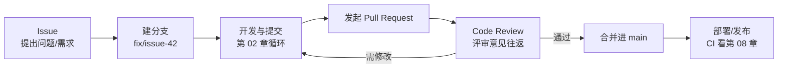

# 5 · 团队协作实战（Issue · PR · Code Review）

> 本章配套代码：`projects/git-lab/`（练习仓库；本章的 Issue/PR 练习在你的 GitHub 账号上完成，第 04 章已把仓库推上去）
> 建议学习时长：约 4 小时

## 学习目标

学完本章，你应该能够：

- 完整叙述并实际走通「Issue → 分支 → 提交 → PR → Review → 合并」的协作闭环。
- 按规范撰写 Issue 与 PR 描述，用 `fix #N` 语法让提交自动关联、关闭 Issue。
- 判断 Fork 工作流与共享仓库工作流哪个适合自己的场景。
- 作为被评审者，读懂 comment / approve / request changes 三类评审意见，并会用 GitHub 的 suggested changes。
- 说出三种合并方式（merge / squash / rebase）的差异并理解团队为何要限制选择。
- 理解分支保护规则与 CODEOWNERS 的作用，能为一支小团队写出合理配置。

## 5.1 前置知识 / 本章地位

依赖[第 03 章](03-分支完全指南.md)（分支与合并、rebase 黄金法则）和[第 04 章](04-远程仓库与GitHub入门.md)（远程同步、gh CLI、SSH 配置）。前四章把「Git 会用」的问题解决了，本章解决「一群人怎么用得不乱」——这正是企业开发与开源贡献的通用流程，也是你提交第一个真实 PR 前的最后一课。

## 5.2 协作总览：一需求的完整生命周期

现代团队协作的标准链路如下，本章按此顺序展开：



一个流程管两件事：**变更本身**（代码从哪来、怎么合入）与**变更的上下文**（为什么改、谁批准的）。Git 负责前者，Issue 和 PR 承载后者——半年后追溯「这行为什么这么写」时，链路是：`git blame`（谁改的）→ PR（怎么评审的）→ Issue（为什么改）。

## 5.3 Issue：一切变更从「说清楚问题」开始

### 5.3.1 Issue 是什么

Issue 是仓库里的任务/问题跟踪单元。纪律良好的团队规定：**任何 PR 都应该对应至少一个 Issue**（微小笔误除外）。这保证了「为什么做这件事」有处可查。

### 5.3.2 Bug 模板与 Feature 模板

GitHub 支持在仓库 `.github/ISSUE_TEMPLATE/` 下放置模板。两份最小可用模板：

```markdown
<!-- .github/ISSUE_TEMPLATE/bug_report.md -->
---
name: Bug 报告
about: 报告一个缺陷
labels: bug
---
## 现象
（一句话说清哪里错了）

## 复现步骤
1. 执行 `...`
2. 触发 ...

## 期望行为
（应该是什么样）

## 环境
- OS / 版本：
- Python 版本：
```

```markdown
<!-- .github/ISSUE_TEMPLATE/feature_request.md -->
---
name: 功能建议
about: 提出一个新需求
labels: enhancement
---
## 背景与动机
（谁在什么场景下需要它）

## 建议方案
（你设想的实现方式）

## 验收标准
- [ ] 做到 X
- [ ] 做到 Y
```

模板只是格式约束，**核心纪律是「验收标准可判定」**：「优化性能」不是合格的 Issue，「pandas 读取 100 万行 CSV 的时间从 30s 降到 5s 以内」才是。

### 5.3.3 Labels 与关联语法

常用 label 约定：`bug`（缺陷）、`enhancement`（新功能）、`docs`（文档）、`good first issue`（适合新人）、`help wanted`（欢迎社区接手）、`blocked`（被其他事挡住）。

提交信息里写关联语法（第 02 章的提交规范在这里发挥威力）：

```bash
git commit -m "fix(spider): 空页响应时不再抛出未捕获异常"
```

在 PR 描述或提交信息正文里写：

```text
Closes #42
```

合并进默认分支时，GitHub 会**自动关闭 Issue #42** 并在两边建立双向链接。可用的关键词：`Closes / Fixes / Resolves`（多个写 `Closes #42, closes #43`）。若只是「相关但不应关闭」，用 `Refs #42`。

## 5.4 两种协作模式：Fork 工作流 vs 共享仓库工作流

| 维度 | 共享仓库（Shared Repository） | Fork 工作流 |
|---|---|---|
| 结构 | 团队成员对同一仓库都有 push 权限 | 贡献者 fork 出个人副本，push 只能进自己的 fork |
| 分支保护 | main 保护 + feature 分支 | main 保护（fork 的 PR 才能合入） |
| 适用 | 公司内部团队（成员可控） | 开源项目、外部贡献者（写权限不可下放） |
| 远程布局 | 单 remote：`origin` | 双 remote：`origin`（你的 fork）+ `upstream`（官方仓库） |
| 同步上游 | `git pull` | `git fetch upstream && git rebase upstream/main` |

公司日常基本是共享仓库工作流；给开源项目贡献代码必须走 Fork 工作流，因为它把「谁有资格直接写主干」收紧为零。两者的 PR 机制完全相同，下面统一展开。

## 5.5 Pull Request 全流程实操

PR（Pull Request）=「请求把我的分支合并进目标分支」，它的真正价值不在合并本身，而在**合并前的强制评审点**。

### 5.5.1 创建 PR

```bash
# 分支开发完成后推送（第 04 章）
git push -u origin fix/issue-42-empty-page

# 用 gh 一条命令创建 PR（也可以走网页端 Compare 界面）
gh pr create --title "fix(spider): 空页响应时不再抛出未捕获异常" --body "Closes #42"
```

`gh pr create` 交互模式还会询问目标分支。创建成功后输出示例：

```text
Creating pull request for fix/issue-42-empty-page into main in <your-username>/<repo-name>

https://github.com/<your-username>/<repo-name>/pull/1
```

### 5.5.2 PR 描述怎么写

描述是评审者看的「变更说明书」，推荐骨架（可与仓库 `.github/pull_request_template.md` 固化）：

```markdown
## 做了什么
（3 句以内概述变更内容）

## 为什么这么做
（关联 Issue：Closes #42；说明取舍，为什么不用方案 B）

## 怎么验证的
（跑过哪些测试/手工验证步骤；有截图贴截图）

## 风险与影响面
（动了哪些公共接口/配置；需要谁特别注意）
```

Draft PR：开发到一半想先让同事看到方向，创建时勾选「Create as draft」（或 `gh pr create --draft`）。Draft 状态下 CI 照常运行但评审者默认不通知；就绪后 `gh pr ready` 转正。**让评审者在正确的时机介入**，是减少无效往返的关键。

### 5.5.3 Review 的三种意见

评审者对 PR 逐一查看 diff（可按文件、可写行内评论），最终表态必须是三者之一：

| 类型 | 含义 | 对作者意味着 |
|---|---|---|
| Comment | 仅留言，不表态 | 自行决定是否合并（若仓库允许） |
| Approve | 批准 | 达到合并条件（配合分支保护） |
| Request Changes | 要求修改 | **必须修改后重新请求评审** |

往返的正确姿势：作者针对每条意见**回复说明或推新提交**（PR 会自动纳入后续 push 的提交），全部处理完点「Re-request review」。评审意见的回复记录全部留在 PR 里，构成变更档案。

**Suggested changes**：评审者可以在行内评论里直接给出修改建议代码，作者在 PR 页面点「Commit suggestion」一键采纳——这是 GitHub 最高效的往返方式，作者应当优先回应带建议的评论。

### 5.5.4 解决 PR 中的冲突

PR 提示「This branch has conflicts that must be resolved」时的两条路：

```bash
# 方式一（推荐）：本地解决后推回，PR 自动更新
git fetch origin
git switch fix/issue-42-empty-page
git rebase origin/main            # 或 git merge origin/main，按团队约定
# ……逐个解决冲突（第 03 章 3.5.3 的四步流程）……
git push                          # rebase 后用 --force-with-lease（私有分支）
```

方式二：网页端点「Resolve conflicts」编辑器手工改，适合极小的冲突。**冲突越早解决成本越低**——分支活得越久、与 main 差距越大，冲突面越大，这是「分支要小、生命周期要短」的直接理由。

### 5.5.5 三种合并方式

PR 合并按钮的三种选项（仓库设置可限制可用项），行为差异如下：

| 方式 | 历史效果 | 提交数变化 | 适用 |
|---|---|---|---|
| Create a merge commit | main 上多一个双父提交的合并节点（第 03 章 3.5.2） | feature 的全部提交 + 1 个合并提交 | 想保留分支的完整故事 |
| Squash and merge | main 上多**一个**新提交，内容为整个 PR | N 个提交压成 1 个 | feature 提交碎片化，想要干净的主干（最常见默认） |
| Rebase and merge | 把 PR 提交逐个重放到 main，无合并节点 | 与 feature 提交数相同，哈希全变 | 主干严格线性且每个提交都有独立价值 |

选型的团队含义：squash 让 `git log` 一行一个 PR，可读性最好，代价是主干上看不到分支内的演进细节（细节永远可以从 PR 页面回溯）。本教程仓库建议对小 PR 用 squash、对精心整理过的提交序列用 merge commit。

## 5.6 分支保护规则与 CODEOWNERS

### 5.6.1 分支保护建议

在仓库 Settings → Branches（菜单名以 GitHub 当前界面为准）为 `main` 添加保护规则，小团队的合理起点：

- Require a pull request before merging：禁止直接 push main。
- Required approvals: 1（双人以上团队可设 2）。
- Require status checks to pass：CI 不绿不许合（见[第 08 章](08-GitHub Actions持续集成入门.md)）。
- Require branches to be up to date：合并前必须与 main 同步，消灭「合完才发现冲突」。
- 禁止 force push 与删除 main。

这些规则把第 03 章 3.7 节的「团队策略」从口头约定变成机制强制——**好的流程不依赖自觉**。

### 5.6.2 CODEOWNERS

`CODEOWNERS` 文件把「谁必须评审哪部分代码」固化下来：命中规则的文件变更，PR 会自动请求对应 owner 评审，规则也常配合「需要 owner 批准」的保护项使用。放置位置：仓库根目录或 `.github/` 下。示例（对应本仓库结构）：

```text
# CODEOWNERS —— 语法：模式    @用户或@团队（空格分隔多个）
# 最后一行匹配的规则生效；行内以 # 开头为注释

# 默认：所有文件默认由仓库主负责
*                               @<your-username>

# 数据采集相关代码由爬虫负责人把关
/projects/crawler-lab/          @<your-username>
/projects/book-insight/crawler/ @<your-username>

# 写作规范改动需要全组谨慎，单独指派
/STYLE_GUIDE.md                 @<your-username>
```

路径写法遵循 gitignore 风格的匹配规则，细节以 GitHub 官方文档为准。

## 5.7 GitHub Projects 看板简讲

Issue 解决「单个事情说清楚」，Projects 解决「一堆事情的排期与状态」。它是一块可配置的表格/看板，字段（状态、优先级、负责人、迭代）自由定义，支持从 PR 页面把 PR 加进看板与 Issue 同步流转。最小用法：

1. 建一个 Project，视图选 Board，按 Status 分列：`Backlog → In Progress → In Review → Done`。
2. 把 Issue 拖进列即改状态；Issue 挂上 `In Progress` 时开分支、挂 `In Review` 时开 PR。
3. 用 `gh` 命令行也能操作（`gh issue list`、`gh issue view` 等，Projects 编辑仍以网页端为主）。

个人学习者把它当「透明化的待办清单」用即可；两列（Todo / Done）也好过没有。团队规则先于工具：先约定「什么状态该出现在哪一列」，再选工具。

## 5.8 开源贡献礼仪

给开源项目提第一个 PR 前，通用礼仪按优先级排列：

1. **先搜再提**：翻 Issue 列表和已合并/被拒绝的 PR，确认问题没被提过、方案没被否过。重复 Issue 是维护者最烦的事。
2. **大改先开 Issue 对齐**：新增功能、重构这类「维护者可能有不同想法」的变更，先开 Issue 描述方案得到认可再动手，避免几十小时的编码换来「这不是我们想要的方向」。
3. **小 PR 好过大 PR**：一个 PR 只做一件事，几百行以内的 PR 评审质量远高于上千行的。宁可拆成三个串行 PR。
4. **遵守项目约定**：读 README 与 CONTRIBUTING.md，遵循其提交信息与代码风格（第 06 章规范在这里直接生效）。
5. **描述里给验证证据**：修 bug 就附复现与修复前后对比，评审者不需要替你验证。
6. **被要求修改是常态**：Request Changes 不是否定你这个人；响应及时、每条意见有着落，贡献者口碑就是这么攒的。

## 常见坑与排查（Troubleshooting）

| 报错现象 | 原因 | 解决办法 |
|---|---|---|
| PR 合并时提示无权限/未满足要求 | 分支保护未通过（缺评审/CI 未绿） | 按 Settings → Branches 的检查项逐条补齐 |
| `Closes #42` 没有关闭 Issue | 关键词没写在 PR 描述正文里，或 PR 合并到了非默认分支 | 移到描述正文（不是评论）；确认目标分支 |
| PR 里意外混入了别人的提交 | 分支基点太旧或误用了共享分支 | rebase 到最新 main 再清理（第 03 章私有分支原则） |
| push 后 PR 不更新 | 推错了分支名 | `gh pr view` 看头部分支；`git branch -vv` 核对跟踪关系 |
| Draft PR 被同事漏看 | 草稿状态不通知评审者 | 就绪后立刻 `gh pr ready`，或手动指派评审人 |
| suggestion 一键采纳后 CI 变红 | 采纳的代码与本地后续改动冲突或未实测 | 采纳后在本地 pull 并重跑测试（第 08 章 CI） |
| squash 合并后找不到原来的提交 | 压缩只保留一个新提交 | 分支内提交在 PR 页面永久可查；重要细节写进 PR 描述 |

## 动手练习

### 练习 1：单人全流程（在你自己的仓库）

在你 4.5.2 推送的仓库上：开一个 Issue（用 5.3.2 模板）→ 建 `fix/issue-1` 分支修一个小问题 → 提交（信息含 `Refs #1`）→ push → `gh pr create` → 自己 approve → 用 squash 合并。

验收标准：合并后 Issue 自动关闭；`git log --oneline` 主干上出现且仅出现一个 squash 后的新提交。

<details>
<summary>提示</summary>

个人仓库要体验「 approve」需在 PR 页面手动指派自己为 reviewer；单人模式里三种评审意见只能看到 UI 展示，机制与多人时完全相同。
</details>

### 练习 2：写一份合格的 PR 描述

给练习 1 的 PR 补写 5.5.2 骨架的完整描述（在合并前编辑）。

验收标准：四节齐全，「怎么验证的」包含可复现的命令。

<details>
<summary>提示</summary>

反向检验法：假装你是三个月后翻档案的陌生人，只看这份描述能否回答「改了什么、为什么、怎么证明改对了」。
</details>

### 练习 3：制造并解决 PR 冲突

用两个分支分别改同一文件的不同版本，先后创建两个 PR；处理第二个 PR 的冲突（5.5.4 方式一，本地 rebase 解决后推回）。

验收标准：两个 PR 都能合并；第二个 PR 的「commits」标签页能看到 rebase 后的新哈希。

<details>
<summary>提示</summary>

第二个 PR 的分支在 rebase 后需要 `--force-with-lease` 推送——私有分支上的合法场景，体会它与裸 `--force` 的区别。
</details>

### 练习 4：给本仓库配置评审基建

在本教程仓库（你自己的副本）添加 `.github/pull_request_template.md`、`.github/ISSUE_TEMPLATE/bug_report.md` 和一份 `CODEOWNERS`，提交并推送（提交信息遵循第 06 章规范，如 `chore(github): 新增 PR 与 Issue 模板`）。

验收标准：新建 Issue 时出现模板选择；新建 PR 时描述预填骨架；CODEOWNERS 被 GitHub 识别（Settings → CODEOWNERS 路径检查通过）。

<details>
<summary>提示</summary>

三个文件都提交在 `.github/` 下，目录不存在就创建；验证 CODEOWNERS 生效最快的方式是看 PR 页面是否自动出现 reviewer 请求。
</details>

## 小结与自检清单

- [ ] 我能完整画出 Issue → 分支 → 提交 → PR → Review → 合并的流程图，并说清每一步的产物。
- [ ] 我写过带验收标准的 Issue，并知道 `Closes #N` 在什么位置、什么条件下生效。
- [ ] 我能判断一个项目该用 Fork 工作流还是共享仓库工作流，并说出双 remote 布局。
- [ ] 我知道三种评审表态的含义，以及收到 Request Changes 后的标准动作。
- [ ] 我能说出三种合并方式对历史的差异，以及 squash 为什么最常被设为默认。
- [ ] 我理解分支保护规则的意义：把流程约定变成机制强制。
- [ ] 我了解给开源项目提 PR 的六条礼仪，且知道「大改先开 Issue」排第一。

## 延伸阅读

- [GitHub Docs：About pull requests（中文）](https://docs.github.com/zh/pull-requests/collaborating-with-pull-requests/proposing-changes-to-your-work-with-pull-requests/about-pull-requests) —— PR 机制的官方总览，含本文各功能的入口链接。
- [GitHub Docs：About code owners](https://docs.github.com/zh/repositories/managing-your-repositorys-settings-and-features/customizing-your-repository/about-code-owners) —— CODEOWNERS 完整匹配语法。
- [GitHub Docs：Planning and tracking with Projects](https://docs.github.com/zh/issues/planning-and-tracking-with-projects) —— Projects 官方教程。
- [开源指南（Open Source Guides）：How to Contribute to Open Source](https://opensource.guide/zh/how-to-contribute/) —— 本文 5.8 节的展开版，GitHub 官方出品。
- 下一章：[第 06 章 Commit 规范与团队工程实践](06-Commit规范与团队工程实践.md) —— 把本章 PR 里的提交信息升级为可机器校验的团队规范。
