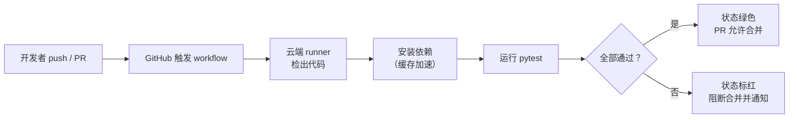

# 8 · GitHub Actions 持续集成入门

> 本章配套代码：仓库根目录 `.github/workflows/ci.yml`（本仓库的持续集成配置，本章逐行讲解）；练习仓库 `projects/git-lab/`
> 建议学习时长：约 3 小时

## 学习目标

学完本章，你应该能够：

- 说清 CI/CD 解决什么问题，并画出「push → CI → 测试 → 部署」的完整流程。
- 读懂 workflow 文件的层级结构（on / jobs / steps / runs-on / uses / with），能手写一个最小可用的 workflow。
- 逐行解释本仓库 `ci.yml` 的每个选择：为什么用 pytest、为什么缓存 pip、为什么用版本矩阵。
- 正确使用 secrets 注入密钥，而不是把密钥写进 yaml（本仓库安全红线）。
- 给 README 加 CI 状态徽章，并说清 Actions 的计费边界。

## 8.1 前置知识 / 本章地位

依赖[第 05 章](05-团队协作实战（Issue-PR-CodeReview）.md)（分支保护里的「Required status checks」就是本章的 CI 结果）和[第 06 章](06-Commit规范与团队工程实践.md)（提交规范的机器校验也靠 CI）。本章是本篇的收尾：前七章建立了「人如何协作」，本章引入「机器如何把关」——CI 是把流程约定变成自动执行的关键设施。

## 8.2 CI/CD 概念与价值

**持续集成（Continuous Integration，CI）**：每次代码推送都自动触发「拉代码 → 装依赖 → 跑测试 → 报结果」的流水线。**持续交付/部署（Continuous Delivery / Deployment，CD）**：测试通过后自动打包乃至发布。本章聚焦 CI，CD 留给后端篇。

没有 CI 的团队，质量把关靠「记得在本地跑测试」——总有人忘记，坏提交合进 main，全组一起还债。CI 的价值正在于**把纪律从人的自觉变成机器的强制**：

- 每个 PR 自动验证，红了的 PR 不允许合并（配合[第 05 章](05-团队协作实战（Issue-PR-CodeReview）.md)分支保护）。
- 问题在合入前暴露，修复成本最低（bug 越晚发现越贵，这是软件工程的基本规律）。
- 流水线本身即文档：仓库「怎么才算健康」的定义写在版本库里的 yaml 文件中。



## 8.3 workflow 文件结构与语法

GitHub Actions 的全部定义放在仓库的 `.github/workflows/` 目录下，每个 `.yml` 文件是一条流水线（workflow）。先建立层级心智模型：

```text
workflow（.yml 文件）
├── name            显示名
├── on              触发条件（什么事件启动）
└── jobs            任务列表（并行执行）
    └── <job-id>    单个任务
        ├── runs-on 跑在什么系统
        └── steps   步骤（顺序执行）
            ├── uses  引用现成动作
            └── run   执行 shell 命令
```

最小可用示例（逐行注释）：

```yaml
name: Hello CI                     # workflow 显示名，可省略（省略时用文件路径）

on: [push]                         # 触发器：每次 push 都跑

jobs:
  build:                           # job 的 id，自定义
    runs-on: ubuntu-latest         # 云端虚拟机规格（GitHub 托管）
    steps:
      - uses: actions/checkout@v5  # 复用官方动作：检出本仓库代码
      - run: echo "代码已检出"      # 直接执行 shell 命令
```

关键语法四要素：

- **on 触发器**：`on: [push, pull_request]`（多事件）；带过滤的形式 `on: { push: { branches: [main] } }`（仅 main 分支的 push）；定时触发用 `schedule`（cron 语法）。
- **runs-on**：`ubuntu-latest`、`macos-latest`、`windows-latest` 或带版本号（如 `ubuntu-24.04`）。ubuntu 最常用且额度消耗最低。
- **uses**：引用别人写好的动作（Action），`@` 后是版本——**务必固定版本**（如 `@v5`），不加版本号等于用最新版，上游更新可能突然破坏你的流水线。动作生态在 [github.com/marketplace](https://github.com/marketplace?type=actions)。
- **with**：给 `uses` 的动作传参数，键名由该动作自己定义。

## 8.4 本仓库的 CI 逐行讲解（重点）

本教程仓库的持续集成配置位于仓库根目录 `.github/workflows/ci.yml`，完整内容如下（与仓库一起版本化，任何人都能审计流水线做了什么）：

```yaml
name: CI

on:
  push:
    branches: [main]
  pull_request:

jobs:
  test:
    runs-on: ubuntu-latest
    strategy:
      fail-fast: false
      matrix:
        python-version: ["3.12", "3.13", "3.14"]

    steps:
      - uses: actions/checkout@v5

      - name: Set up Python ${{ matrix.python-version }}
        uses: actions/setup-python@v6
        with:
          python-version: ${{ matrix.python-version }}
          cache: pip

      - name: Install dependencies
        run: |
          python -m pip install --upgrade pip
          pip install -r requirements.txt

      - name: Run tests
        run: pytest -v
```

逐段解释——这份配置里的每个选择都有明确理由：

**1. 触发器：push 限 main，PR 全开。** `push.branches: [main]` 表示只有推到 main 才跑（feature 分支的中间推送不浪费额度）；`pull_request` 不带过滤，任何 PR 都跑——PR 检查正是分支保护所要求的（[第 05 章](05-团队协作实战（Issue-PR-CodeReview）.md)）。两级配合，保证「进 main 的每个提交都被测过」且不重复烧额度。

**2. `runs-on: ubuntu-latest`。** 教程目标服务器是 Ubuntu（见 [STYLE_GUIDE](../../STYLE_GUIDE.md)），测试环境与部署环境一致能避免「本机能跑服务器跑不了」的环境漂移。

**3. 版本矩阵 `matrix`。** 一个 job 声明 `strategy.matrix` 后，GitHub 会为每个组合**各起一个并行 job**。这里三个 Python 版本并行测试：本教程本地 venv 用 3.14，但 Ubuntu 24.04 仓库里常见 3.12/3.13，读者环境五花八门——矩阵保证代码在三个版本下都成立。`fail-fast: false` 让某个版本失败时其余版本继续跑完：一次 push 同时暴露三个版本的兼容情况，而不是漏一个就得再修再推。`${{ matrix.python-version }}` 是表达式语法，运行时展开为当前组合的值。

**4. `actions/checkout@v5`。** runner 是全新虚拟机，第一步必须把仓库代码拉下来。这是官方动作，用 `uses` 复用，版本钉在 v5。

**5. `actions/setup-python@v6` + `cache: pip`。** runner 每次都是新机器，不缓存的话每次都要从 PyPI 重新下载全部依赖（pandas、numpy 这些包并不小），流水线白白多几分钟。`cache: pip` 的机制是：安装后把 pip 缓存目录按 `requirements.txt` 的哈希存成缓存；下次 `requirements.txt` 没变就直接命中缓存，只有变了才重新下载。**缓存键与依赖文件绑定**是标准做法——依赖没变，缓存永远有效。

**6. `pytest -v`。** 为什么选 pytest：断言即 Python 原生 `assert`（无需记忆新断言 API）、fixture 机制管理测试数据、生态插件覆盖全面，是 Python 社区事实标准（本教程工具链统一使用 pytest 9.2.0，见 [STYLE_GUIDE 版本事实表](../../STYLE_GUIDE.md)）。`-v` 让日志逐条列出测试名，CI 界面里失败点一目了然。流水线要求仓库根目录有 `requirements.txt` 与可被 pytest 发现的测试（`tests/` 目录，第 05 章的 PR 描述模板正是围绕这个验证流程写的）。

一个 job 内的 steps 顺序执行、失败即停：依赖装不上就轮不到测试，测试红了后面没有步骤——这个「短路」语义正是 CI 门槛的含义。

## 8.5 secrets 与环境变量：绝不把密钥写进 yaml

workflow 文件在仓库里**对有读权限的人完全可见**，写进 yaml 等于公开。需要密钥的步骤（如部署、通知服务）使用 GitHub 的 secrets 机制：

1. 仓库 Settings → Secrets and variables → Actions → New repository secret，命名（如 `DEPLOY_TOKEN`）并存值。
2. workflow 里通过上下文引用：

```yaml
      - name: Deploy
        run: ./deploy.sh
        env:
          DEPLOY_TOKEN: ${{ secrets.DEPLOY_TOKEN }}   # 值在日志中被自动打码
```

规则与红线：

- **密钥只经 secrets 注入，绝不写进 yaml、绝不 echo 出来**；Actions 会把 secrets 的值在日志中替换为 `***`，但你打印它派生变量的方式仍可能泄露，保持最小输出。
- 本仓库的教学项目一律采用 `.env` + `.gitignore` 方案管理本地密钥（见[第 02 章 .gitignore 解读](02-Git日常操作完全指南.md)），CI 里则换成 secrets——两条链路都遵守「密钥不进版本库」红线（STYLE_GUIDE 第 7 节）。
- fork 发起的 PR 默认**读不到 secrets**（防止恶意 PR 偷取仓库密钥），这是平台内建的默认保护，配置详情以官方文档为准。

## 8.6 给 README 加 CI 徽章

流水线跑起来后，在 `README.md` 顶部加一行状态徽章，仓库健康度一眼可见：

```markdown

```

推上去后徽章实时反映最近一次运行结果：绿色通过、红色失败。徽章 URL 的构成：`https://github.com/<你的用户名>/<仓库名>/actions/workflows/<workflow文件名>/badge.svg`。这也是[第 04 章](04-远程仓库与GitHub入门.md)建好的远程仓库上第一个「活起来」的元素。

## 8.7 Actions 免费额度说明

计费规则概要（数字随 GitHub 政策调整，**以官方文档为准**，不要引用教程里的快照数字做决策）：

- **公共仓库：免费**（额度无上限的公开流水线），本章练习零成本。
- **私有仓库：按用量计费**——每月有随账户级别（Free/Pro/Team）变动的免费额度，超出后按 runner 规格（Linux 最便宜，macOS 数倍）扣费或停止执行。
- 省额度的常用手段：触发器收窄（如 8.4 节 push 只限 main）、合理使用 pip 缓存、砍掉不必要的矩阵组合。

练习建议：全部实验放在公共仓库或用足免费额度，私有仓库先看 Settings → Billing 的当前配额再跑矩阵。

## 常见坑与排查（Troubleshooting）

| 报错现象 | 原因 | 解决办法 |
|---|---|---|
| workflow 完全没触发 | 文件不在 `.github/workflows/` 下，或 yaml 语法错误 | GitHub 仓库 Actions 页看是否出现 workflow；本地用 `python -c "import yaml,sys; yaml.safe_load(open(sys.argv[1]))" .github/workflows/ci.yml` 校验语法 |
| `pip install` 步骤超时或失败 | 依赖装不进 runner 环境（版本不兼容/网络） | 矩阵里各版本分开看日志；`requirements.txt` 钉住版本 |
| 本地能过 CI 却红 | 环境差异：Python 版本、操作系统、依赖未声明 | 把 CI 的 Python 版本对齐到本地；依赖一律写进 requirements.txt，不依赖全局预装 |
| 缓存没生效 | `requirements.txt` 变了（缓存键随之变）或首次运行 | 属预期行为；连续两次运行对比耗时确认 |
| pytest 报 `no tests ran` | 测试文件命名不符约定（需 `test_*.py`）或目录没被收集 | 按 pytest 默认发现规则命名；CI 里先 `pytest --collect-only -q` 看收集到什么 |
| secrets 引用为空 | secret 名拼写不符，或来自 fork PR（默认无 secrets） | 核对名称大小写；fork PR 不给 secrets 是安全默认 |
| 矩阵 job 全红但本地全绿 | `fail-fast: false` 下并行暴露了多版本差异 | 看每个 job 的独立日志，先修最早报错的版本 |
| 徽章显示 404 | URL 中的用户名/仓库名/文件名不符 | 徽章 URL 三段逐一核对；workflow 文件名要与实际文件一致 |

## 动手练习

### 练习 1：给你的仓库装上 CI

在你[第 04 章](04-远程仓库与GitHub入门.md)推送的练习仓库中创建 `.github/workflows/ci.yml`（可直接用 8.4 节配置，矩阵先砍到 `["3.12"]`），加一个最小测试 `tests/test_smoke.py`（内容一行 `def test_ok(): assert True`），随同 `requirements.txt` 一起提交推送。

验收标准：Actions 页面出现绿色运行记录；故意在测试里 `assert False` 再推一次，看到红色并定位失败日志。

<details>
<summary>提示</summary>

提交信息遵循第 06 章规范（`ci: 新增 pytest 流水线`）；红色运行页点进 job 可展开每一步的完整日志，找标红的那一步。
</details>

### 练习 2：读懂缓存收益

对练完的 workflow 各跑两次 push（第一次冷启动，第二次无改动），对比两次「Install dependencies」步骤的耗时差。

验收标准：能指出第二次跑时哪一步命中了缓存（该步日志出现 Cache hit 字样），并解释缓存键由什么决定。

<details>
<summary>提示</summary>

缓存命中与否在 setup-python 步骤的日志里明示；把 requirements.txt 加个空行再推一次，观察缓存键变化。
</details>

### 练习 3：矩阵行为实验

把矩阵恢复为 `["3.12", "3.13"]` 并设 `fail-fast: false`，故意提交一个「只在 3.13 上失败」的用例（如使用 3.12 不存在的语法特性），观察两个 job 的独立结果。

验收标准：两个 job 一绿一红且互不影响；能解释如果没有 `fail-fast: false` 会少看到什么。

<details>
<summary>提示</summary>

3.12 不支持 3.13 的部分新语法，一个 `match` 之外的例子是 PEP 695 的 `type` 别名语句（3.12 已支持；可改用 3.13 的实验性特性做失败样本，以 Python 官方文档为准）。
</details>

### 练习 4：徽章与保护规则联动

给 README 加徽章（8.6 节），再按[第 05 章](05-团队协作实战（Issue-PR-CodeReview）.md)给你的仓库开启「Required status checks」指向本 workflow，然后提交一个故意失败的 PR。

验收标准：PR 的合并按钮被 CI 阻止；修复后 PR 变绿可合并——「机器强制流程」完整闭环。

<details>
<summary>提示</summary>

保护规则里 status check 的名字与 workflow 的 job 名对应（本例是 `test`），填错名字保护会永远等不到检查结果。
</details>

## 小结与自检清单

- [ ] 我能向别人解释 CI 解决什么问题，以及它与[第 05 章](05-团队协作实战（Issue-PR-CodeReview）.md)分支保护的联动关系。
- [ ] 我能默写 workflow 的层级结构，并说出 on / runs-on / uses / with 各自的作用。
- [ ] 我能逐行讲出本仓库 ci.yml 的五个设计选择（触发器收窄、Ubuntu、矩阵、pip 缓存、pytest）。
- [ ] 我知道密钥走 secrets 注入，且 fork PR 默认拿不到 secrets 是保护而非故障。
- [ ] 我给 README 加过徽章，并知道徽章 URL 的构成。
- [ ] 我了解公共仓库免费、私有仓库有额度，且知道去官方文档确认现行数字。

## 延伸阅读

- [GitHub Actions 官方文档（中文）](https://docs.github.com/zh/actions) —— workflow 语法、计费与安全模型的权威出处，本文所有细节以其现行版本为准。
- [Workflow syntax for GitHub Actions](https://docs.github.com/zh/actions/writing-workflows/workflow-syntax-for-github-actions) —— yaml 全部字段的参考手册，写复杂流水线时必备。
- [Caching dependencies 官方指南](https://docs.github.com/zh/actions/writing-workflows/choosing-what-your-workflow-does/caching-dependencies-to-speed-up-workflows) —— 8.4 节 pip 缓存机制的官方说明。
- [pytest 官方文档](https://docs.pytest.org/en/stable/) —— 测试发现规则与 fixture 的完整说明。
- [STYLE_GUIDE 版本事实表](../../STYLE_GUIDE.md) —— 本仓库统一约定的 pytest 与 Python 版本，写 workflow 时对照使用。
