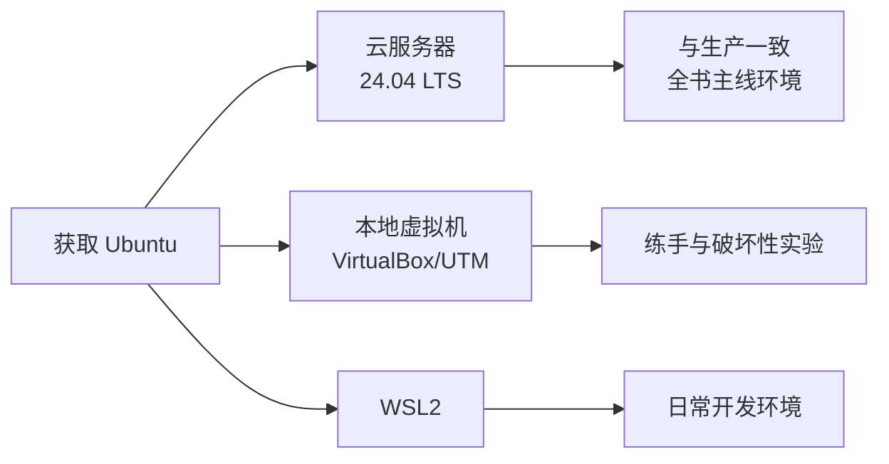

# 第 1 章 · Ubuntu 安装与远程连接

> 本章配套代码：无固定仓库代码。所有命令在你的 Ubuntu 服务器与本地终端（macOS/Windows）完成，练习文件建议放在 `/tmp/install-lab/`。涉及本仓库项目的部署路径见 `projects/book-insight/`（第 7 章起使用）。
> 建议学习时长：约 3 小时

## 学习目标

学完本章，你能够：

1. 说清 LTS 与中间版的区别，并为「部署爬虫/数据分析/FastAPI 项目」这个目标选出合适的 Ubuntu 版本；
2. 通过云服务器、本地虚拟机或 WSL2 三条途径中的至少一条，获得一台可用的 Ubuntu 24.04 LTS 环境；
3. 从本地终端用 SSH 密钥（ed25519）免密登录服务器，并能解释 `known_hosts` 防中间人攻击的原理；
4. 独立完成一份服务器安全加固清单：禁 root 登录、禁密码登录、UFW 放行最小端口、fail2ban 防爆破、自动安全更新；
5. 把 apt 源切换到国内镜像，并且知道怎么恢复官方默认源。

## 1.1 前置知识 / 本章地位

本教程的最终目标是：把你的爬虫、数据分析、FastAPI 项目部署到 Ubuntu 云服务器上正式对外提供服务。从本章开始，我们进入服务器世界。

后续所有章节（文件系统、systemd、Nginx、MySQL……）都默认你已经具备两个前提：

- 你有一台能 SSH 登录的 Ubuntu 24.04 LTS 机器（云服务器、虚拟机或 WSL2 均可）；
- 这台机器已经做过基本安全加固，不会被扫描器在几天内攻破。

本章解决的就是这两个前提。它是全书的地基：**安全加固部分（1.7 节）是本教程的特色内容，请逐条照做，不要跳过**——公网上的一台裸奔服务器，平均每天会收到成百上千次针对 22 端口的暴力破解尝试。

对读者的假设：你会基本的终端操作（打开终端、输入命令），其余所需知识本章都会讲到。

## 1.2 版本怎么选：LTS vs 中间版

Ubuntu 每 6 个月发布一个新版本。但不是每个版本都适合当服务器——**选错版本类型，是新手最常见的第一个坑**。

两类版本的区别在于支持周期（Support Lifecycle）：

- **LTS（Long Term Support，长期支持版）**：每两年一版（偶数年的 4 月），Canonical 官方提供 5 年的免费安全更新，服务器场景的标准选择。
- **中间版（Interim Release）**：每半年一版（奇数年的 4 月和 10 月），只维护 **9 个月**，主要给桌面尝鲜者和新特性测试用。

本书撰写时各版本的生命周期如下（以 Ubuntu 官方Wiki 的发布时间表为准）：

| 版本 | 类型 | 代号 | 发布时间 | 标准支持至 | 适合部署项目吗 |
|---|---|---|---|---|---|
| 24.04 LTS | LTS | Noble Numbat | 2024-04 | **2029-04** | 是（本教程主线） |
| 25.04 | 中间版 | Plucky Puffin | 2025-04 | 2026-01 | 否，已停止支持 |
| 25.10 | 中间版 | Questing Quokka | 2025-10 | 2026-07 | 否，已停止支持 |
| **26.04 LTS** | LTS | Resolute Raccoon | **2026-04-23** | **2031-05** | 是（新一代 LTS） |
| 26.10 | 中间版 | — | 2026-10 | 约 2027-07 | 否，中间版仅 9 个月 |

三点说明：

1. **为什么教程主线选 24.04 LTS 而不是 26.04？** 24.04 已经稳定运行两年多，云厂商镜像、第三方软件仓库（如 MySQL、Nginx 的打包适配）都最成熟；26.04 刚发布，镜像和软件生态还在磨合期。26.04 作为新 LTS 会一并介绍——如果你现在新开服务器且不在意软件兼容磨合，选 26.04 也完全合理，两者操作方式一致。
2. **中间版的生命周期陷阱**：假设你在 2025 年 11 月装了 25.10，它的安全更新在 2026 年 7 月就停止。跑到生产环境的服务器 9 个月后就不再有安全补丁，这在任何公司都是事故级配置。记住一句话：**服务器只用 LTS，且只用 LTS 的最新或次新版本**。
3. **Ubuntu Pro 延长支持**：Canonical 提供免费的 Ubuntu Pro 订阅（个人最多 5 台机器），可把 LTS 的安全维护（ESM，Expanded Security Maintenance）延长到 10 年以上。企业内网有合规要求时会用到，个人学习阶段不必开启，以官方页面说明为准。

## 1.3 三种获取途径

同一个 Ubuntu，有三种拿到手的方式，按「离真实生产环境的距离」排序介绍。

### 1.3.1 途径一：云服务器（最推荐，与生产环境完全一致）

国内外主流的入门级选择：

| 云厂商 | 入门产品 | 参考价位 | 特点 |
|---|---|---|---|
| 阿里云 | 轻量应用服务器 / ECS | 约 ¥30-100/月 | 国内访问快，需备案才能绑域名开 80/443 |
| 腾讯云 | 轻量应用服务器 / CVM | 约 ¥30-100/月 | 同上，常有新用户优惠 |
| AWS | Lightsail | 约 $3.5-5/月 | 国际大厂，无需备案，国内访问延迟较高 |

购买流程概览（各家控制台细节不同，以厂商文档为准）：

1. **选镜像**：操作系统选 `Ubuntu 24.04 LTS`（64 位）。如果列表里有 26.04 LTS 也可以选，本书命令对两者通用。
2. **选配置**：学习用途 1 核 2G 内存、40G 磁盘足够；要跑 MySQL + FastAPI + 爬虫的建议 2 核 4G。
3. **选区域**：给国内用户访问选国内节点（注意备案问题）；纯学习可选香港/新加坡节点，免备案。
4. **认证方式**：选「SSH 密钥对」而不是「密码」。密钥对创建后浏览器会自动下载一个 `.pem` 私钥文件，**立刻备份到安全位置，云厂商不会替你保管**。
5. **配置安全组**：见 1.4 节。

### 1.3.2 途径二：本地虚拟机（免费，适合反复折腾）

在不花钱的前提下模拟一台服务器，适合练习危险操作（比如故意把 SSH 配坏）。

- **Windows / Intel 芯片的 macOS**：用 VirtualBox。到 `virtualbox.org` 下载安装，再从 Ubuntu 官网下载 `Ubuntu 24.04 LTS Server` 的 ISO 镜像，新建虚拟机时挂载 ISO 安装。内存建议 2G 以上，网络模式选「桥接（Bridged）」或「NAT + 端口转发（把宿主机 2222 转发到虚拟机 22）」。
- **Apple Silicon（M 系列）的 macOS**：VirtualBox 对 ARM 支持不佳，用 **UTM**（`mac.getutm.app`），下载 Ubuntu 的 ARM64 Server 镜像（`ubuntu.com/download/server` 上选择 ARM64 架构）。

虚拟机方案的两个局限，先说清楚：

- 没有公网 IP，无法体验安全组、备案、真实公网扫描这些生产环境特有的问题；
- ISO 安装过程比云服务器慢（云服务器是直接启动做好的镜像）。

### 1.3.3 途径三：WSL2（Windows 用户的开发环境补充）

WSL2（Windows Subsystem for Linux 2）是在 Windows 里运行真 Linux 内核的子系统，适合当**日常开发环境**，不适合当部署目标。

PowerShell（以管理员身份）执行：

```powershell
wsl --install -d Ubuntu-24.04
```

重启后按提示创建 Linux 用户名和密码即完成安装。

需要注意的边界：

- WSL2 没有公网 IP，不能对外提供网站服务，也体验不到云防火墙；
- 较新版本的 WSL2 支持 systemd（在 `/etc/wsl.conf` 中写 `[boot]` 段并设置 `systemd=true` 后 `wsl --shutdown` 重启生效），第 4 章的 systemd 练习才能做，细节以 Microsoft 官方 WSL 文档为准；
- **结论：WSL2 可以用来学第 2、3 章的命令，但第 1、5、9、10 章的安全组、防火墙、HTTPS 内容，必须用云服务器或虚拟机才能真实练习。**

三条途径怎么混搭？本书建议：**日常用 WSL2/虚拟机练命令，同时花小钱租一台最低配云服务器走完部署全流程**。云服务器是本书后续章节的默认环境。

### 1.3.4 三种途径的关系图



## 1.4 云服务器初始化清单

拿到一台全新的云服务器后、开始折腾之前，先按这份清单过一遍。清单的核心思想是**最小暴露面（Minimal Attack Surface）**：一个端口只要不是必须开放，就不要开放。

### 安全组：只放行 22/80/443

安全组（Security Group）是云厂商在网络层做的包过滤防火墙，独立于服务器系统本身（它和主机内 UFW 的关系在第 5 章详述）。在控制台的安全组 / 防火墙规则页里，确保规则如下：

| 方向 | 协议 | 端口 | 来源 | 用途 |
|---|---|---|---|---|
| 入站 | TCP | 22 | 0.0.0.0/0（或你的 IP） | SSH 登录 |
| 入站 | TCP | 80 | 0.0.0.0/0 | HTTP |
| 入站 | TCP | 443 | 0.0.0.0/0 | HTTPS |
| 入站 | 全部 | 全部 | 拒绝 | — |
| 出站 | 全部 | 全部 | 0.0.0.0/0 | 允许 |

**新手最常犯的反向错误是放行太多**：图省事把「全部端口」对「0.0.0.0/0」放行，等于把服务器的门全拆了。3306（MySQL）、6379（Redis）、8000（uvicorn）这类服务端口**一律不要**在安全组放行，它们应该只监听本机、由 Nginx 反代（第 9 章）。

其他初始化事项：

- **时区**：云服务器默认多为 UTC，国内业务建议改为东八区（第 10 章上线清单里也会再查一遍）：

  ```bash
  sudo timedatectl set-timezone Asia/Shanghai
  timedatectl status
  ```

  预期输出中应看到 `Time zone: Asia/Shanghai (CST, +0800)`。

- **确认系统版本**：

  ```bash
  cat /etc/os-release
  ```

  预期输出（节选）：

  ```text
  PRETTY_NAME="Ubuntu 24.04 LTS"
  ```

- **先更新一次系统**（镜像制作日期到你购买时可能隔了几个月，补上期间的安全更新）：

  ```bash
  sudo apt update && sudo apt upgrade -y
  ```

## 1.5 首次 SSH 连接

SSH（Secure Shell）是远程登录服务器的加密协议。你本地是客户端，服务器上跑着 sshd 服务端（云镜像默认已装好并开机自启）。

### 1.5.1 第一次连接与 known_hosts 的原理

在你的本地终端（macOS 用「终端」；Windows 用 PowerShell 或 Windows Terminal）执行：

```bash
ssh ubuntu@<server-ip>
```

`<server-ip>` 替换为你的服务器公网 IP。第一次连接会看到：

```text
The authenticity of host '203.0.113.10 (203.0.113.10)' can't be established.
ED25519 key fingerprint is SHA256:xxxxxxxxxxxxxxxxxxxxxxxxxxxxxxxxxxxxxxxxxxx.
Are you sure you want to continue connecting (yes/no/[fingerprint])?
```

输入 `yes` 后出现：

```text
Warning: Permanently added '203.0.113.10' (ED25519) to the list of known hosts.
```

这一步背后发生了什么？SSH 客户端第一次见到这台服务器时，无法确认「对方真的是你要连的那台，而不是网络中间伪装的攻击者」（即中间人攻击，Man-in-the-Middle）。它把服务器出示的公钥指纹展示给你，你确认后，客户端会把这个指纹**记入本地文件 `~/.ssh/known_hosts`**。以后每次连接，客户端都会核对服务器出示的公钥是否和记录一致——不一致就拒绝连接并报警。这个策略叫 TOFU（Trust On First Use，首次使用时信任）。

因此有一个必须知道的安全信号：**如果你某天连接时突然报 `WARNING: REMOTE HOST IDENTIFICATION HAS CHANGED!`，有两种可能——服务器重装了系统（正常），或者你正在被中间人攻击（异常）**。确认是自己重装系统后，删除旧记录再连：

```bash
ssh-keygen -R <server-ip>
```

### 1.5.2 默认用户名

用哪个用户名登录，取决于镜像来源：

- **Canonical 官方云镜像**（多数国际云、AWS Lightsail 的 Ubuntu）：默认用户是 `ubuntu`；
- **阿里云的 Ubuntu 镜像**：历史上默认直接给 `root`；
- **腾讯云**：可能是 `ubuntu`，轻量服务器部分镜像为 `lighthouse`。

具体以云厂商控制台的登录说明为准。本章以下内容统一假设普通用户为 `ubuntu`，请把后文命令中的 `ubuntu` 替换成你的实际用户名。

用 `root` 身份登录后，第一时间应创建普通工作用户并禁用 root 直登（1.7 节）：

```bash
# 以 root 登录后执行：创建用户并加入 sudo 组
adduser ubuntu        # 按 prompt 设置密码
usermod -aG sudo ubuntu
```

### 1.5.3 本地 ~/.ssh 目录结构

登录成功后回到本地视角，看一眼 SSH 客户端的文件布局（后文会用到）：

```text
~/.ssh/
├── id_ed25519       # 你的私钥（绝不能泄露，等同密码）
├── id_ed25519.pub   # 对应的公钥（可以随便放，放进服务器）
└── known_hosts      # 你信任过的服务器指纹记录
```

权限规则：`~/.ssh` 目录 `700`，私钥 `600`。权限过松时 SSH 会直接拒绝使用该私钥并提示 `UNPROTECTED PRIVATE KEY FILE`。

## 1.6 SSH 密钥登录完整配置

密码登录有两重问题：弱密码可被暴力破解；每次都要输密码让自动化脚本无法工作。密钥登录（Public Key Authentication）的原理是**非对称加密**：私钥留在你本地，公钥放进服务器的 `~/.ssh/authorized_keys`；连接时服务器用公钥发起一个数学挑战，只有持有私钥的一方才能正确应答，全程不传输私钥本身。

### 第 1 步：在本地生成密钥对

```bash
ssh-keygen -t ed25519 -C "jjy-laptop-2026"
```

参数解释：

- `-t ed25519`：密钥类型选 Ed25519，比传统 RSA 更安全且密钥更短，是当前推荐默认（OpenSSH 6.5+ 支持，各平台均已普及）；
- `-C`：注释，方便日后在一堆公钥里认出这是哪台机器的钥匙。

交互过程中：

- 提示保存路径时直接回车用默认 `~/.ssh/id_ed25519`；
- 提示 passphrase（私钥口令）时，建议设置一个口令——这样即使笔记本丢了，私钥也不会被直接利用。设置后每次连接需输一次口令（可用系统钥匙串缓存，macOS 下把 `UseKeychain yes` 写入 `~/.ssh/config`）。

### 第 2 步：把公钥送进服务器

最方便的工具是 `ssh-copy-id`（macOS/Linux 自带）：

```bash
ssh-copy-id -i ~/.ssh/id_ed25519.pub ubuntu@<server-ip>
```

它做的事：把你的公钥追加到服务器的 `~/.ssh/authorized_keys` 文件里（并自动修正权限）。执行时需要输入最后一次密码。

Windows（旧版无 ssh-copy-id）替代命令，在 PowerShell 中：

```powershell
type $env:USERPROFILE\.ssh\id_ed25519.pub | ssh ubuntu@<server-ip> "mkdir -p ~/.ssh && chmod 700 ~/.ssh && cat >> ~/.ssh/authorized_keys && chmod 600 ~/.ssh/authorized_keys"
```

**如果你买服务器时选了密钥对方式**，云厂商已把公钥注入镜像，这一步可跳过——用 `-i 你的.pem私钥` 登录验证即可。

### 第 3 步：验证免密登录

```bash
ssh ubuntu@<server-ip>
```

预期：不再要求密码（设置了 passphrase 则要求口令），直接进入 shell。确认成功后，**保留这个已登录的会话不要退出**——这是加固 SSH 时保命的第二条通道（万一新配置写错把自己锁外面，还能用它救回来）。

### 第 4 步（可选）：用 ~/.ssh/config 简化命令

每次输 `ssh ubuntu@203.0.113.10` 太长，在本地 `~/.ssh/config` 写入：

```text
Host myserver
    HostName <server-ip>
    User ubuntu
    IdentityFile ~/.ssh/id_ed25519
    IdentitiesOnly yes
```

之后只需 `ssh myserver`。第 10 章的部署脚本也会复用这个别名。

## 1.7 安全加固清单（重点，逐条执行）

以下每一条都给出具体配置。执行顺序：**先配好 UFW 放行 SSH，再动 sshd，再上 fail2ban**。每改完 sshd 都保持「新开一个终端测试新连接成功、旧会话不退出」，确认无误再进行下一条。

### 1.7.1 UFW 防火墙：只放行 22

UFW（Uncomplicated Firewall）是 Ubuntu 自带的防火墙管理前端，底层是内核的 netfilter（与 iptables/nftables 同源）。云安全组在网络层挡一道，UFW 在主机内再挡一道，双层防御。

```bash
sudo ufw default deny incoming    # 默认拒绝所有入站
sudo ufw default allow outgoing   # 默认允许所有出站
sudo ufw allow OpenSSH            # 放行 22（用的是应用配置文件名，见第 5 章）
sudo ufw enable                   # 启用
sudo ufw status verbose
```

`enable` 时的提示 `Command may disrupt existing ssh connections. Proceed with operation (y|n)?` 输入 `y`。预期输出：

```text
Status: active
Logging: on (low)
Default: deny (incoming), allow (outgoing), disabled (routed)
New profiles: skip

To                         Action      From
--                         ------      ----
22/tcp                     ALLOW IN    Anywhere
```

UFW 的完整用法（端口规则、限速、应用配置文件）在第 5 章展开，这里只求「开着且只放 22」。

### 1.7.2 禁用 root 直接登录

Ubuntu 云镜像默认 root 多数不能直接密码登录，但显式声明更稳妥。新建 `/etc/ssh/sshd_config.d/00-hardening.conf`：

```bash
sudo nano /etc/ssh/sshd_config.d/00-hardening.conf
```

写入：

```text
PermitRootLogin no
```

为什么文件名叫 `00-`？这里有个 sshd 的反直觉规则：**sshd_config 对每个参数取「第一次出现的值」，而主配置顶部的 `Include /etc/ssh/sshd_config.d/*.conf` 按文件名顺序加载**。云镜像常带有 `50-cloud-init.conf` 之类文件覆盖 `PasswordAuthentication`，所以加固文件要用更小的序号排在最前面才能生效。写完先检查语法与生效值：

```bash
sudo sshd -t                     # 语法检查，无输出即通过
sudo sshd -T | grep -i permitrootlogin   # 查看最终生效值
```

预期输出 `permitrootlogin no`。确认后重载（用 `reload` 不断开已有连接）：

```bash
sudo systemctl reload ssh
```

### 1.7.3 禁用密码登录（PasswordAuthentication no）

这是全书最重要的单条加固。确认 1.6 节密钥登录**已经验证可用**后，在同一个 `00-hardening.conf` 里追加：

```text
PasswordAuthentication no
KbdInteractiveAuthentication no
```

再次 `sudo sshd -t` 通过后 `sudo systemctl reload ssh`，然后**新开一个终端**验证：能免密登录成功，且故意用密码方式（`ssh -o PubkeyAuthentication=no ubuntu@<server-ip>`）会被拒绝（预期输出含 `Permission denied (publickey)`）。注意检查是否存在 `/etc/ssh/sshd_config.d/50-cloud-init.conf`，若其中写了 `PasswordAuthentication yes`，直接删除该行或整个文件。

改完后，哪怕有人猜中 root 密码、哪怕你的普通用户密码泄露，对方都进不了系统——密码通道已从协议层面关闭。

### 1.7.4 修改 SSH 端口（可选）

22 端口是全世界扫描器的默认靶子。改成高位端口（如 22222）不能提升真正的安全性，但能把日志里的噪音降低 99%。属于「可选的锦上添花」：

1. 云安全组先放行新端口；
2. `00-hardening.conf` 追加 `Port 22222`（想双端口并行验证一段时间的，写两行 `Port 22` 和 `Port 22222`）；
3. `sudo ufw allow 22222/tcp`；
4. `sudo sshd -t` → `sudo systemctl reload ssh` → 新终端 `ssh -p 22222 ubuntu@<server-ip>` 验证；
5. 验证通过后再删掉 `Port 22` 行，并把安全组的 22 关掉。

本地 `~/.ssh/config` 里同步加 `Port 22222`。新手容易在「改端口 + 改防火墙」中把自己锁在外面，所以务必按上面顺序、每步验证。

### 1.7.5 fail2ban：自动封禁暴力破解 IP

禁密码登录后爆破已基本无效，但扫描器仍会持续产生失败日志噪音。fail2ban 监控认证日志，对同一 IP 在短时间内失败超过阈值的，自动用防火墙封禁一段时间。

```bash
sudo apt install fail2ban -y
```

创建本地覆盖配置（不要直接改 `jail.conf`，升级时会被覆盖）：

```bash
sudo nano /etc/fail2ban/jail.local
```

写入：

```text
[DEFAULT]
bantime = 1h
findtime = 10m
maxretry = 5
backend = systemd

[sshd]
enabled = true
```

逐行解释：`maxretry`/`findtime`——10 分钟内失败 5 次即触发；`bantime`——封禁 1 小时（可写 `1d`、`1w`）；`backend = systemd`——Ubuntu 22.04 起服务器默认不再把认证日志写进 `/var/log/auth.log` 文件而是 systemd journal，显式指明从 journal 读日志（具体参数以 fail2ban 官方文档为准）。

启动并验证：

```bash
sudo systemctl enable --now fail2ban
sudo fail2ban-client status sshd
```

预期输出：

```text
Status for the jail: sshd
|- Filter
|  |- Currently failed: 0
|  |- Total failed:     0
|  `- Journal matches:  _SYSTEMD_UNIT=sshd.service + _COMM=sshd
`- Actions
   |- Currently banned: 0
   |- Total banned:     0
   `- Banned IP list:
```

以后 `Total banned` 不为 0 就是它在干活。手动解封某 IP 用 `sudo fail2ban-client set sshd unbanip <ip>`。

### 1.7.6 自动安全更新 unattended-upgrades

服务器忘了打补丁是被攻破的另一大主因。Ubuntu 自带 `unattended-upgrades`，可自动安装**安全类更新**（默认不自动升级大版本，安全且克制）：

```bash
sudo apt install unattended-upgrades -y
sudo dpkg-reconfigure -plow unattended-upgrades   # 选 Yes 启用
cat /etc/apt/apt.conf.d/20auto-upgrades
```

预期输出（两个 1 表示每天刷新软件源索引并执行自动升级）：

```text
APT::Periodic::Update-Package-Lists "1";
APT::Periodic::Unattended-Upgrade "1";
```

确认定时器在跑：

```bash
systemctl status apt-daily.timer apt-daily-upgrade.timer
```

### 1.7.7 加固清单汇总

| 序号 | 项目 | 状态自测命令 |
|---|---|---|
| 1 | 云安全组只放 22/80/443 | 控制台核对 |
| 2 | UFW 启用、只放 SSH | `sudo ufw status verbose` |
| 3 | 禁 root 直登 | `sudo sshd -T \| grep permitrootlogin` |
| 4 | 禁密码登录 | `sudo sshd -T \| grep passwordauthentication` |
| 5 | fail2ban 保护 sshd | `sudo fail2ban-client status sshd` |
| 6 | 自动安全更新 | `cat /etc/apt/apt.conf.d/20auto-upgrades` |
| 7 | 时区与时间同步 | `timedatectl status` |
| 8 | 改端口（可选） | 新端口能连、22 已关 |

## 1.8 apt 换源说明

apt 从「软件源（repository）」下载包。Ubuntu 官方源服务器在国外，国内访问慢，换成国内镜像（以清华大学 TUNA 为例）能把 `apt install` 速度从几十 KB/s 提到几十 MB/s。

### 1.8.1 先认识 24.04 的新源格式

**Ubuntu 24.04 起源配置从旧的 `/etc/apt/sources.list` 单行格式，改为新的 deb822 格式**，文件在 `/etc/apt/sources.list.d/ubuntu.sources`。网上大量旧教程还在教改 `sources.list`，在 24.04 上不生效，这是高频踩坑点。

先备份，再查看：

```bash
sudo cp /etc/apt/sources.list.d/ubuntu.sources /etc/apt/sources.list.d/ubuntu.sources.bak
cat /etc/apt/sources.list.d/ubuntu.sources
```

预期输出（节选，`noble` 是 24.04 的套件代号）：

```text
Types: deb
URIs: http://archive.ubuntu.com/ubuntu/
Suites: noble noble-updates noble-backports
Components: main restricted universe multiverse
Signed-By: /usr/share/keyrings/ubuntu-archive-keyring.gpg
```

### 1.8.2 替换为清华源

把文件中所有 `http://archive.ubuntu.com/ubuntu/` 替换为 `https://mirrors.tuna.tsinghua.edu.cn/ubuntu/`：

```bash
sudo sed -i 's|http://archive.ubuntu.com/ubuntu/|https://mirrors.tuna.tsinghua.edu.cn/ubuntu/|g' /etc/apt/sources.list.d/ubuntu.sources
sudo apt update
```

预期输出（结尾几行，无报错即成功）：

```text
Hit:1 https://mirrors.tuna.tsinghua.edu.cn/ubuntu noble InRelease
Get:2 https://mirrors.tuna.tsinghua.edu.cn/ubuntu noble-updates InRelease [126 kB]
Reading package lists... Done
```

两点注意：

- **ARM 架构服务器**（部分轻量云主机）的源在 `ports.ubuntu.com`，对应镜像路径是 `mirrors.tuna.tsinghua.edu.cn/ubuntu-ports`，替换字符串相应改变；
- 26.04 LTS 的套件代号为 `resolute`，源文件结构同理，具体以 TUNA 的 Ubuntu 镜像帮助页为准。

### 1.8.3 恢复默认源

换源是可逆操作。出问题时（比如镜像同步延迟导致某包校验失败）恢复官方源：

```bash
sudo mv /etc/apt/sources.list.d/ubuntu.sources.bak /etc/apt/sources.list.d/ubuntu.sources
sudo apt update
```

如果备份已删，手动把 URIs 改回 `http://archive.ubuntu.com/ubuntu/`（或 `https://`，官方源同样支持）即可。`sudo apt clean` 清掉本地缓存的包文件后再 `apt update`。

## 常见坑与排查（Troubleshooting）

| 报错现象 | 原因 | 解决办法 |
|---|---|---|
| `ssh: connect to host ... port 22: Connection timed out` | 云安全组没放行 22，或服务器没开机 | 先查控制台安全组入站规则，再 `ping` 确认 IP 可达 |
| `Permission denied (publickey,password)` | 用户名错（root vs ubuntu）、公钥没注入、私钥权限过松 | 核对默认用户名；`ssh -v` 看尝试了哪些密钥；本地 `chmod 600 ~/.ssh/id_ed25519` |
| `WARNING: REMOTE HOST IDENTIFICATION HAS CHANGED!` | 服务器重装过系统（正常）或中间人攻击（异常） | 确认重装后 `ssh-keygen -R <server-ip>` 删旧指纹 |
| 改完 sshd 配置后新连接被拒/锁外面 | 语法错或参数值被 `sshd_config.d` 里其他文件抢先覆盖 | 用旧会话救回；`sudo sshd -t` 查语法；`sudo sshd -T` 查生效值；注意 sshd「首个值生效」规则 |
| 24.04 上改 `sources.list` 换源不生效 | 24.04 用 deb822 格式，文件在 `sources.list.d/ubuntu.sources` | 改对文件；改完 `sudo apt update` 看输出里的镜像域名 |
| `apt update` 出现 `404 Not Found` | 套件代号拼错，或用了已停维护的中间版源 | `cat /etc/os-release` 核对代号；换 LTS |
| `ufw enable` 后 SSH 断开 | 放行规则没先加 | 控制台 VNC 登录执行 `sudo ufw allow OpenSSH`，养成「先 allow 后 enable」习惯 |

## 动手练习

1. **完成一条完整链路**：新购/新装一台 Ubuntu 24.04 LTS，走完 1.4-1.7 全部步骤，最终用 `ssh myserver` 免密登录、密码方式登录被拒、`fail2ban-client status sshd` 有输出。
   <details><summary>提示</summary>按 1.7.7 的清单表逐行自测，全部通过才算完成。改 sshd 前先留一个「救命会话」。</details>
2. **故意破坏再修复**：把 `00-hardening.conf` 里故意写一个错误参数（如 `Portabc 22`），观察 `sudo sshd -t` 的报错，再修复它。
   <details><summary>提示</summary>注意 `sshd -t` 会指出文件名和行号。体验「语法检查先行、reload 不断连」的安全工作流。</details>
3. **指纹核对练习**：在服务器上执行 `sudo ssh-keygen -lf /etc/ssh/ssh_host_ed25519_key.pub`，与本地首次连接时记录的指纹比对是否一致。
   <details><summary>提示</summary>两者应一致，这就是 known_hosts 机制校验的值。理解「你信任的到底是什么」。</details>

## 小结与自检清单

- [ ] 我能说清 LTS 与中间版的差别，并解释为什么服务器只选 LTS
- [ ] 我有一台 Ubuntu 24.04 LTS 机器，能 `ssh 别名` 一条命令免密登录
- [ ] 我知道 known_hosts 是什么，遇到指纹变更警告该怎么正确处置
- [ ] `sudo sshd -T` 显示 `permitrootlogin no` 和 `passwordauthentication no`
- [ ] UFW 已启用且入站只放行 SSH（以及将来的 80/443）
- [ ] fail2ban 已启用 sshd jail，我会用 `fail2ban-client` 查看和解除封禁
- [ ] unattended-upgrades 已开启，系统每天自动打安全补丁
- [ ] 我知道 24.04 的源配置文件是 deb822 格式的 `ubuntu.sources`，会换源也会恢复

## 延伸阅读

- [Ubuntu Server 官方文档](https://documentation.ubuntu.com/server/)——本章与后续章节的权威依据，SSH、防火墙均有专页。
- [OpenSSH 手册（sshd_config）](https://man.openbsd.org/sshd_config)——弄懂「首个值生效」等配置语义的原始出处。
- [fail2ban 官方 Wiki](https://github.com/fail2ban/fail2ban/wiki)——jail 参数与后端配置的权威说明。
- [TUNA Ubuntu 镜像帮助](https://mirrors.tuna.tsinghua.edu.cn/help/ubuntu/)——换源配置的官方模板，含 deb822 新格式与 ubuntu-ports。
- [Ubuntu 发行版生命周期](https://ubuntu.com/about/release-cycle)——查任意版本的支持起止日期。
