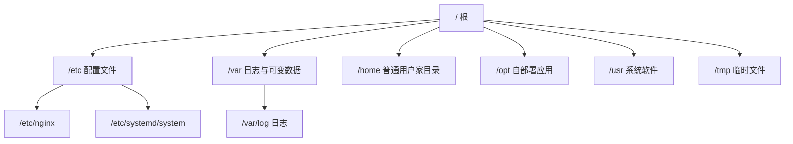

# 第 2 章 · 文件系统与常用命令

> 本章配套代码：所有命令在服务器终端完成，练习目录统一使用 `/tmp/fs-lab/`（临时目录，重启自动清空，正适合反复折腾）。
> 建议学习时长：约 4 小时

## 学习目标

学完本章，你能够：

1. 画出 Linux 目录树的关键部分，说清 `/etc`、`/var`、`/opt`、`/home` 各自放什么，并解释部署项目为什么常放 `/opt` 或 `/srv`；
2. 熟练使用导航与文件操作命令（`ls`/`cp`/`mv`/`rm`/`mkdir -p`），并理解 `rm -rf` 的危险来源；
3. 解释 rwx 权限模型的三组用户，会用数字法与符号法改权限、用 `chown` 改属主，说明 `sudo` 的验证原理；
4. 用 `find` + `grep` 在服务器上定位文件与文件内容，用 `tail -f` 跟踪日志；
5. 使用管道、重定向把小命令组合成文本处理流水线，并能读懂 `awk`/`sed` 的一行式。

## 2.1 前置知识 / 本章地位

上一章你能 SSH 进服务器了，从本章起开始真正「使用」它。Linux 的设计哲学是「一切皆文件」：配置是文件、日志是文件、甚至进程信息也以文件形式暴露在 `/proc` 下。因此**文件系统操作是服务器工作的第一生产力**——后面部署 FastAPI 项目时，你要定位 Nginx 配置文件、查看应用日志、清理磁盘、改文件权限，全都建立在本章的命令之上。

本章不追求罗列命令，而是把命令组织成四个能力：**看清结构（FHS）→ 操作文件 → 管住权限 → 查找与加工文本**。

## 2.2 FHS：Linux 目录结构

Windows 有 C 盘、D 盘多个盘符；Linux 只有一棵树，根是 `/`，所有分区、U 盘、网络盘都「挂载（mount）」到树上某个节点。这棵树长什么样不是随意的，而是由 FHS（Filesystem Hierarchy Standard，文件系统层次标准）约定的。FHS 是社区标准而非强制，但主流发行版都遵守。

部署视角下最该记住的目录：

| 目录 | 放什么 | 部署时你会碰到它吗 |
|---|---|---|
| `/etc` | 系统与应用的**配置文件**（纯文本） | 天天碰：`/etc/nginx/`、`/etc/systemd/system/`、`/etc/ssh/` |
| `/var` | 经常变化的数据：日志、缓存、队列 | `/var/log/` 看日志；`/var/lib/mysql/` 是 MySQL 数据目录 |
| `/home` | 普通用户的家目录，一人一个子目录 | 你的登录用户 `~`，脚本和密钥在这 |
| `/root` | root 用户的家目录 | 普通用户不可读 |
| `/opt` | **第三方/自部署应用**的可选安装目录 | **常用来放你的项目**：`/opt/book-insight/` |
| `/srv` | 对外提供服务的**数据**目录 | 另一个放项目/站点数据的位置 |
| `/usr` | 发行版管理的软件本体（`/usr/bin` 命令、`/usr/lib` 库） | apt 装的东西在这，别手改 |
| `/usr/local` | 本地管理员手动安装的软件（绕过包管理器） | 手动 `make install` 的东西在这 |
| `/tmp` | 临时文件，重启可能清空，通常所有用户可写 | 练习、临时脚本的好地方 |
| `/proc` | 内核与进程的虚拟文件系统（内存中的数据） | `cat /proc/cpuinfo`、`/proc/<pid>/` |
| `/dev` | 设备文件 | 磁盘 `/dev/vda`、`/dev/null` 黑洞 |

**为什么部署项目常放 `/opt` 或 `/srv`，而不是 `/home`？**

1. `/home` 是「人」的地盘：用户改密码、换 shell、离职删号都可能牵连家目录。项目是「服务」不是「人」，混放容易误伤。
2. `/opt` 的语义就是「第三方独立应用」：`/opt/book-insight/` 一看就知道是自部署应用，备份、迁移、权限（属主设为专用服务用户）都清晰。
3. `/srv` 强调「对外服务的数据」；选哪个都行，团队内统一即可。本书统一用 `/opt/<项目名>`。
4. 反例警示：把项目放进 `/usr` 或 `/usr/local` 深层结构里，会和包管理器管辖的文件混在一起，升级时容易冲突——包管理器的地盘不要手工占用。

目录树速览：



## 2.3 导航与查看：pwd / ls / cd

```bash
pwd                    # print working directory，当前在哪
cd /opt                # 切换目录（绝对路径）
cd ..                  # 上一级
cd ~ 或 cd             # 回自己家
cd -                   # 回上一次所在目录（来回横跳很实用）
ls -lah                # 最常用组合
```

`ls -lah` 逐字母解释：`-l` 长格式（权限、属主、大小、时间），`-a` 显示隐藏文件（`.` 开头），`-h` 人类可读大小（K/M/G，配合 `-l`）。预期输出（以 `/tmp/fs-lab` 为例）：

```text
total 8.0K
drwxr-xr-x 2 ubuntu ubuntu 4.0K Nov  4 10:00 .
drwxrwxrwt 1 root   root   4.0K Nov  4 10:00 ..
-rw-r--r-- 1 ubuntu ubuntu   42 Nov  4 10:01 notes.txt
```

先混个眼熟，输出第一列的 `drwxr-xr-x` 是什么，2.6 节拆解。

**绝对路径与相对路径**：以 `/` 开头的是绝对路径（从树根出发，如 `/var/log/nginx/error.log`）；不以 `/` 开头的是相对路径（从当前目录出发）。两个特殊成员：`.` 当前目录，`..` 上一级目录。写脚本时有个关键习惯：**脚本里引用文件尽量用绝对路径**——脚本被 cron、systemd 调用时「当前目录」往往不是你想象的那个。

Tab 键补全、`Ctrl+L` 清屏、`history` 查历史命令（配合 `Ctrl+R` 反向搜索）是效率三件套，建议立刻开始用。

## 2.4 文件操作：cp / mv / rm / mkdir

```bash
mkdir -p /tmp/fs-lab/{logs,data/raw}     # -p 递归创建，父目录不存在也一并建；{} 是展开多个子目录
cp notes.txt notes.bak.txt               # 复制
cp -r data data.bak                      # -r 复制目录（递归）
mv notes.txt /tmp/fs-lab/logs/           # 移动（也可用于改名）
mv notes.bak.txt old-notes.txt           # mv 第二个身份：改名
```

`cp -a`（archive 模式）保留权限、时间戳、属主，备份配置文件时比裸 `cp` 更合适：`sudo cp -a /etc/nginx /etc/nginx.bak-20261104`。

### 通配符（glob）

shell 在把命令交给程序前，会先展开通配符：

| 模式 | 含义 |
|---|---|
| `*.log` | 任意字符任意次的 `.log` 文件 |
| `app-2026-?.log` | `?` 恰好一个字符 |
| `book-[1-3].txt` | 方括号内任一字符 |
| `{a,b}.conf` | 花括号展开为 `a.conf b.conf`（不是 glob，是 shell 展开，但常一起用） |

验证通配符展开结果的安全技巧：先拿 `echo` 试跑（`echo *.log`），看到展开清单确认无误，再换成真命令。

### rm 与 `-rf`：一场持续二十年的事故

`rm` 删除文件**不进回收站**，Linux 服务器上没有回收站。`-r` 递归删目录，`-f` 强制不询问。**`rm -rf` 的危险在于两个字符的组合可以把任意路径连根拔起**，而 shell 通配符会放大风险。

真实事故模型（请在 `/tmp` 里体会，**绝不要在生产照敲**）：

```bash
# 经典事故原型：变量为空时，"$DIR/app" 退化为 "/app"
# 而有人把命令写成 rm -rf $DIR/ app 之类，多一个空格，目标就从 "$DIR/app" 变成了 "$DIR" 和 "app"
DIR=/tmp/fs-lab/data
rm -rf "$DIR"/*.csv     # 正确：加引号，防止路径带空格被拆词
```

防身四条纪律：

1. 删除前先 `ls` 同样的目标，眼见为实：`ls "$DIR"/*.csv` 确认列表，再 `rm` 同样的参数；
2. 变量一律加双引号，杜绝空变量 + 空格事故；
3. 生产删除用绝对路径开头，杜绝依赖当前目录的相对路径；
4. 大规模删除考虑替代品：`trash-cli`（进回收站）或先 `mv` 到一个 `_to_delete/` 目录观察几天再清。云盘快照也是最后一道保险（阿里云/腾讯云控制台可开）。

## 2.5 查看文件内容：cat / less / head / tail / wc

```bash
cat /etc/os-release          # 一次性全部输出，适合短文件
less +F /var/log/syslog      # 长文件用 less 分页浏览；+F 类似 tail -f
head -n 20 access.log        # 前 20 行
tail -n 20 access.log        # 后 20 行（看最新日志）
tail -f error.log            # 持续跟踪文件新增内容，Ctrl+C 退出
wc -l access.log             # 行数；-w 词数，-c 字节数
```

重点讲 **`tail -f`（follow）**：排查线上问题的第一直觉动作。它每秒检查文件是否追加了新行并实时打印。配合 grep 过滤：`tail -f error.log | grep --line-buffered ERROR`（`--line-buffered` 让 grep 不攒缓冲、逐行透传）。

`less` 里的常用键：`/关键词` 向下搜索、`n` 下一个匹配、`g` 跳文件头、`G` 跳文件尾、`q` 退出。大日志文件**不要用 `cat` 硬看**（终端瞬间刷几万行），用 `less`。

## 2.6 权限模型：rwx、chmod、chown、sudo

### 2.6.1 三组用户的读写执行位

回看 `ls -l` 的第一列 `-rw-r--r--`，拆成五段：

```text
 -   rw-   r--   r--   1 ubuntu ubuntu 42 Nov 4 10:01 notes.txt
 │    │     │     │        │      │
 │    │     │     │        │      └── 所属组 group
 │    │     │     │        └─────── 属主 owner
 │    │     │     └── 其他用户 others：r--
 │    │     └── 所属组 group：r--
 │    └── 属主 owner：rw-
 └── 类型：- 文件，d 目录，l 软链接
```

三组人依次是**属主（user）、属组（group）、其他人（others）**，每组三种权限：

- `r`（read，4）：文件可读内容；目录可**列出文件名**（注意：不是读内容）；
- `w`（write，2）：文件可改内容；目录可在其中**创建/删除/改名**文件；
- `x`（execute，1）：文件可执行；目录可**进入（cd）并访问其中文件**。

两个新手必知的语义差异：目录的 `r` 没有 `x` 时只能看文件名列表却进不去；目录没有 `w` 时（即使属主）也不能在其中新建文件。Web 服务器读你的静态文件，靠的是 others 位上的 `r`——所以静态目录常见 `755`（属主全权，其他人只读+进入）。

### 2.6.2 chmod：数字法与符号法

数字法把 rwx 当二进制位相加：`r=4, w=2, x=1`，三位一组：

```bash
chmod 755 deploy.sh      # rwxr-xr-x：脚本可执行
chmod 644 config.yaml    # rw-r--r--：普通配置文件
chmod 600 id_ed25519     # rw-------：私钥只许属主（SSH 硬性要求）
chmod -R 755 /opt/app/static   # -R 递归
```

符号法在「只改某一组」时更精准：

```bash
chmod u+x deploy.sh      # 给属主加执行位
chmod go-w data/         # 去掉组和其他人的写权限
chmod a-r secret.txt     # 所有人去掉读权限
```

数字法覆盖全部三组，符号法做增量修改，按场景选。

### 2.6.3 chown：改属主与属组

部署 FastAPI 时，项目目录通常归一个专用用户所有（比如 `www-data` 或自建的服务用户），而你是 `ubuntu`：

```bash
sudo chown -R www-data:www-data /opt/book-insight
#            属主:属组              目标
sudo chgrp -R www-data /opt/book-insight/logs   # 只改属组
```

只把**日志目录**给服务用户写权限、代码目录保持只读，是良好的最小权限实践（服务被攻破时也写不进代码目录）。

### 2.6.4 sudo 的原理

`sudo`（superuser do）让授权的普通用户以其他身份（默认 root）执行单条命令。它不是「切换成 root」，而是**受审计的临时提权**：

1. 你属于 `sudo` 组（第 1 章 `usermod -aG sudo` 做的事）；
2. 执行 `sudo <命令>` 时输入**你自己的密码**（不是 root 密码）；
3. sudo 依据 `/etc/sudoers` 规则放行，并把每次提权记录到日志（`journalctl -u sudo` 或 `/var/log/auth.log`）；
4. 默认 15 分钟内同一终端再 sudo 不需要重复输密码。

对比直接 `su -` 切 root：sudo 只授权单条命令、有日志、root 密码可以根本不知道——多账户协作时这是安全基线。细粒度规则（比如允许某用户免密只执行 `systemctl restart myapp`）在 `sudoers.d` 里配，第 3 章结合 visudo 讲。

## 2.7 软链接与硬链接

```bash
ln -s /opt/book-insight/releases/v1.2.3 /opt/book-insight/current   # 软链接（符号链接）
ln /tmp/fs-lab/a.txt /tmp/fs-lab/a-hard.txt                          # 硬链接
ls -li /tmp/fs-lab/     # -i 显示 inode 号对比两者
```

| 维度 | 软链接 `ln -s` | 硬链接 `ln` |
|---|---|---|
| 本质 | 一个存着「路径」的新文件 | 同一个 inode 的另一个名字 |
| 跨文件系统 | 可以 | 不可以 |
| 链接目录 | 可以 | 通常不允许（防环） |
| 原文件删除后 | 变成悬空链接（红色失效） | 数据仍在，访问不受影响 |
| `ls -l` 显示 | `l` 开头，带 `->` 箭头 | 与普通文件无异，链接数 +1 |

生产环境里软链接是**发布管理**的核心工具：`current` 指向哪个版本目录，服务就跑哪个版本；回滚就是把箭头改回上一个版本（第 10 章的简易蓝绿部署）。记住判断口诀：**路径级别的替换用软链接，防误删的备份用硬链接**。

## 2.8 查找：find 与 grep

### 2.8.1 find：按属性找文件

```bash
find /var/log -name "*.log"            # 按名字（区分大小写）
find /etc -iname "*nginx*"             # -iname 忽略大小写
find /opt -type f                      # -type f 文件；-type d 目录
find /tmp/fs-lab -mtime -1             # 1 天内修改过的
find /var/log -size +10M               # 大于 10MB 的文件
find /opt -user www-data               # 按属主
```

`-mtime` 的数字语义容易记反：`-1` 是 1 天以内，`+7` 是 7 天以前，`7` 恰好第 7 天那 24 小时。

find 的真正威力在 `-exec`——对每个结果执行命令，`{}` 是占位符，`\;` 结尾：

```bash
# 找出 7 天前的备份并删除（第 8 章数据库备份脚本的原型）
find /home/ubuntu/backups -name "*.sql.gz" -mtime +7 -exec rm {} \;
# 等价且更高效的写法（多个结果一次传给 rm）
find /home/ubuntu/backups -name "*.sql.gz" -mtime +7 -exec rm {} +
```

`-exec` 前先裸跑一遍 find 确认列表，是和 2.4 节 rm 纪律同源的防身习惯。

### 2.8.2 grep：按内容找行

```bash
grep -n "ERROR" error.log              # -n 显示行号
grep -rn "proxy_pass" /etc/nginx/      # -r 递归搜整个目录，-n 行号
grep -i "error" app.log                # -i 忽略大小写
grep -c "GET /api/books" access.log    # -c 只统计匹配行数
grep -v "healthcheck" access.log       # -v 反选：排除健康检查噪音
ps aux | grep uvicorn                  # 经典组合：从进程列表过滤
```

grep 用正则表达式匹配，最常用的两个元字符：`^` 行首、`$` 行尾，如 `grep "^2026-11-04" app.log` 看今天的日志。

### 2.8.3 which

```bash
which python3      # /usr/bin/python3：命令对应的可执行文件路径
which uv           # 查 uv 装在了哪（第 7 章会用到）
```

`which` 只查 PATH 里的可执行文件；想连别名、内建命令一起查用 `type -a <命令>`。

## 2.9 文本处理：管道、重定向与一行式

Linux 哲学的精髓：**每个程序只做好一件事，用文本流把它们串起来**。

### 2.9.1 管道与重定向

```bash
# 管道 |：把前一个命令的标准输出接到后一个命令的标准输入
cat access.log | grep "POST" | wc -l

# 重定向：> 覆盖写，>> 追加写
echo "deploy done $(date)" >> /home/ubuntu/deploy.log

# 2>&1：把标准错误（fd 2）并入标准输出（fd 1）一起落盘
./run_spider.sh > spider.log 2>&1
```

`2>&1` 是必考题：`0` 是标准输入、`1` 是标准输出、`2` 是标准错误。只写 `> spider.log` 时报错仍会打到屏幕；`2>&1` 必须放在重定向之后（顺序反了含义就错了）。第 4 章 systemd 的服务日志由 journal 接管后你会看到，这套 fd 机制是共通的。

/dev/null 是黑洞设备，扔进去的内容消失。故意丢弃输出：`command > /dev/null 2>&1`。

### 2.9.2 sort / uniq / wc 组合示例

统计访问日志里出现最多的 URL（经典流水线）：

```bash
awk '{print $7}' access.log | sort | uniq -c | sort -rn | head -5
```

分步理解：

1. `awk '{print $7}'`：按空白分列取第 7 列（Nginx 默认格式里是 URL）；
2. `sort`：排序——**uniq 只能去重相邻行，所以必须先 sort**；
3. `uniq -c`：相邻去重并计数；
4. `sort -rn`：按数字逆序排；
5. `head -5`：取前 5。

预期输出示意：

```text
    152 /api/books
     47 /static/css/app.css
     12 /api/books/1
      3 /favicon.ico
      1 /
```

### 2.9.3 awk / sed 一分钟入门

awk 是「按列处理」的工具，语法 `awk '模式 {动作}'`：

```bash
df -h | awk 'NR>1 {print $5, $6}'      # 跳过表头，打印使用率列和挂载点
awk -F: '$3 >= 1000 {print $1}' /etc/passwd   # -F: 以冒号分列，取普通用户（uid>=1000）的用户名
```

sed 是「按行编辑」的工具，最常用替换：

```bash
sed -n '1,5p' file.txt                 # 只打印 1-5 行（-n 抑制默认输出，p 打印）
sed 's/DEBUG/INFO/g' app.log           # s/旧/新/g 全局替换（输出到屏幕，不改原文件）
sed -i 's/port=8000/port=8001/g' config.ini   # -i 直接改原文件（先用 sudo 处理权限）
```

`sed -i` 会直接修改文件，改系统配置前务必先 `cp` 备份或去掉 `-i` 预览。这一分钟入门够你看懂 90% 的运维一行式了，深入用法等遇到再说。

## 常见坑与排查（Troubleshooting）

| 报错/现象 | 原因 | 解决办法 |
|---|---|---|
| `Permission denied`（读写文件） | 当前用户无该文件权限 | `ls -l` 看属主与权限位；用 sudo 或 `chown`/`chmod` 处理 |
| `Permission denied`（进目录） | 目录无 `x` 权限 | 目录要执行位才能进入：`chmod +x 目录` |
| `No such file or directory` 但文件明明在 | 相对路径依赖当前目录；或文件名尾部有空格 | `pwd` 确认位置；用绝对路径；`ls -b` 暴露隐藏字符 |
| 脚本在服务器上跑报 `\r: command not found` | Windows 下编辑带了 CRLF 换行符 | `sed -i 's/\r$//' 脚本` 或编辑器切 LF |
| `rm -rf` 后文件还在且报 `Device or resource busy` | 目标是挂载点 | 先 `umount` 再删 |
| `df` 显示还有空间但写文件失败 | inode 用尽（海量小文件） | `df -i` 查看 inode 使用率 |
| `mv` 跨文件系统大目录很慢 | 跨设备等于复制+删除 | 同盘内 mv 是瞬时改名，跨盘要预留时间 |
| `tail -f` 日志没新内容 | 应用写的是另一个文件，或 logrotate 轮转后 fd 变了 | `ls -l /proc/<pid>/fd` 确认进程实际打开的文件；`tail -F` 可跟随轮转 |

## 动手练习

1. **搭一个模拟项目目录**：在 `/tmp/fs-lab` 下创建 `/opt` 风格的项目结构（`releases/v1.0.0`、`releases/v1.0.1`、`current` 软链接、`logs/`），把 `current` 从 v1.0.0 切到 v1.0.1 再切回，体会软链接发布。
   <details><summary>提示</summary>`ln -sfn releases/v1.0.1 current`（`-n` 处理目标是目录的软链接替换）。`readlink current` 查看当前指向。</details>
2. **权限手术**：创建用户组 `devs`（`sudo groupadd devs`），把你的用户加进去（`sudo usermod -aG devs $USER`，重新登录生效），然后建一个 `chown root:devs`、`chmod 664` 的共享文件，验证组内可写、组外只读。
   <details><summary>提示</summary>`id` 命令确认组成员身份已生效；用另一个普通用户验证组外权限。</details>
3. **日志流水线**：对 `/var/log/nginx/access.log`（没有就先 `sudo apt install nginx` 造点访问）统计状态码分布前 5 名。
   <details><summary>提示</summary>`awk '{print $9}' access.log | sort | uniq -c | sort -rn | head -5`，第 9 列是状态码。</details>
4. **磁盘侦探**：用 `du` 找出 `/var/log` 下最大的 5 个文件，再用 find 列出 7 天前修改的 `.gz` 轮转日志。
   <details><summary>提示</summary>`sudo du -ah /var/log | sort -rh | head -5`；`sudo find /var/log -name "*.gz" -mtime +7`。</details>

## 小结与自检清单

- [ ] 我能默写 FHS 中 `/etc` `/var` `/opt` `/home` `/usr` `/tmp` 的分工，并说出项目放 `/opt` 的理由
- [ ] 我习惯用 `ls -lah` 查看文件，知道 `rm -rf` 的四条防身纪律
- [ ] 我能解释 `-rw-r--r--` 每一位的含义，会用 `chmod 755/644/600` 和 `chown user:group`
- [ ] 我能说清 sudo 的验证与审计原理，知道它和 `su` 的区别
- [ ] 我会软链接 `ln -s`，知道它和硬链接的差别与用途分工
- [ ] 我能用 find 的 `-name/-type/-mtime/-size/-exec` 完成查找+批量动作
- [ ] 我能写出「统计日志 top N」的 `sort | uniq -c | sort -rn` 流水线
- [ ] 我理解 `> >> 2>&1` 的区别，`tail -f` 是我排查日志的第一反应

## 延伸阅读

- [Filesystem Hierarchy Standard（Pathname Labs 存档）](https://refspecs.linuxfoundation.org/FHS_3.0/fhs/index.html)——FHS 3.0 官方规范原文，每个目录的语义出处。
- [GNU Coreutils 手册](https://www.gnu.org/software/coreutils/manual/coreutils.html)——本章绝大多数命令（ls/cp/mv/rm/chmod）的权威文档。
- [GNU Findutils 手册](https://www.gnu.org/software/findutils/manual/html_node/find_html/)——find 的完整表达式语法。
- [GNU Grep 手册](https://www.gnu.org/software/grep/manual/grep.html)——正则与常用选项详解。
- [鸟哥的 Linux 私房菜（基础学习篇）](http://linux.vbird.org/)——中文世界最经典的 Linux 基础教程，目录与权限章节可作辅助阅读。
