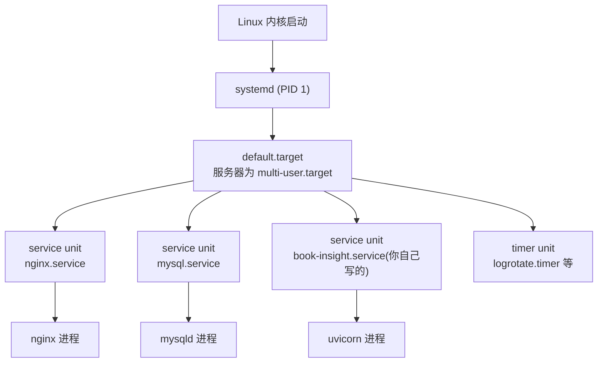

# 第 4 章 · 软件包管理 apt 与系统服务 systemd

> 本章配套代码：`/opt/pydemo/`（本章新建的最简 systemd 演示服务）与 `/etc/systemd/system/pydemo.service`；定时备份脚本骨架见 4.6 节，正式脚本在第 8 章落地。
> 建议学习时长：约 4 小时

## 学习目标

学完本章，你能够：

1. 说清 `apt update` 与 `apt upgrade` 的区别，熟练使用 apt 的安装/卸载/查询全家桶，理解 deb、dpkg、snap、PPA 的关系与风险；
2. 画出 systemd 的 unit/target 架构，解释「服务」在 Linux 里的准确定义；
3. 熟练使用 systemctl 的 status/start/stop/restart/reload/enable/disable，并知道 daemon-reload 什么时候必须执行；
4. **从零手写一个 systemd 服务文件**（本章用 `python http.server` 演示，掌握后换成 uvicorn 只需改一行）；
5. 用 journalctl 查服务日志，用 systemd timer 或 cron 实现定时任务（如每天 3 点备份数据库）。

## 4.1 前置知识 / 本章地位

部署一个 Python 项目到服务器，工程上只涉及两大系统机制：

- **把软件装进来**——包管理（apt 装系统级依赖：Nginx、MySQL、编译工具）；
- **让程序长期稳定地跑**——服务管理（systemd 托管你的 uvicorn 进程）。

第 3 章结尾说过 `nohup` 的四个局限，本章的 systemd 是它们的完整答案。这一章是全书「工程含金量」最高的一章，4.4 节的手写服务文件会在第 7、9、10 章反复复用。

## 4.2 apt 生态

### 4.2.1 apt update 与 apt upgrade：高频混淆点

先明确 apt 的工作模型：系统里维护着一份「软件源目录」（记录每个源里有哪些包、什么版本），`/var/lib/apt/lists/`；实际安装的包记录在 dpkg 数据库 `/var/lib/dpkg/status`。

```bash
sudo apt update
```

预期输出（节选）：

```text
Hit:1 https://mirrors.tuna.tsinghua.edu.cn/ubuntu noble InRelease
Get:2 https://mirrors.tuna.tsinghua.edu.cn/ubuntu noble-updates InRelease [126 kB]
Reading package lists... Done
Building dependency tree... Done
```

**`apt update` 只是刷新「货架目录」**：从软件源拉取最新的包索引到本地，不安装、不升级任何东西。这就是为什么它常常输出一堆 `Get:`/`Hit:` 后就结束。

```bash
sudo apt upgrade
```

预期输出（节选，会先列出将要升级的包并询问）：

```text
The following packages will be upgraded:
  nginx nginx-common openssl
3 upgraded, 0 newly installed, 0 to remove and 0 not upgraded.
Do you want to continue? [Y/n]
```

**`apt upgrade` 才真正把已安装的软件升级到目录里的新版本**（在依赖不变的前提下）。

一句话区分：**update 更新的是「目录」，upgrade 更新的是「软件」**。所以先 update 后 upgrade 是固定动作顺序——不 update 就 upgrade，装到的还是旧索引里的版本。两者配合日常补丁是：

```bash
sudo apt update && sudo apt upgrade -y
```

关联命令 `apt full-upgrade`（旧名 dist-upgrade）在依赖冲突时允许移除/替换包，适合大版本演进（如 24.04 → 26.04 的 do-release-upgrade 流程），日常补丁用 `upgrade` 就够。

### 4.2.2 安装、卸载与查询全家桶

```bash
sudo apt install nginx           # 安装（自动装依赖），-y 跳过确认
sudo apt remove nginx            # 卸载程序，保留配置文件
sudo apt purge nginx             # 卸载并删除配置文件（purge = remove + 清配置）
sudo apt autoremove              # 清理「因依赖被装、现已无人引用」的包
sudo apt search "mysql server"   # 按关键词搜源里的包
apt show nginx                   # 看某包的版本、依赖、简介
apt list --installed | grep -i mysql   # 列出已安装包（配合 grep 过滤）
apt list --upgradable            # 列出哪些包可以升级
```

`remove` 与 `purge` 的区别值得多看一眼：`apt remove nginx-common` 后再重装，旧配置还在；`purge` 连 `/etc/nginx` 一起清。「卸载干净重来」要用 purge，这是排查配置问题的标准手段之一。

### 4.2.3 deb 包与 dpkg：apt 的底层

apt 不是从零工作的，它操作的对象是 **deb 包**（Debian 系的二进制软件包格式，内含程序文件、元数据、安装脚本），而真正执行「解包、写入文件、登记数据库」的是 **dpkg**。关系类比：apt 是「带依赖求解的包管理器」，dpkg 是「单包安装器」。

```bash
sudo dpkg -i some-package.deb    # 安装本地 deb 文件（不解决依赖）
sudo apt install ./some-package.deb   # 推荐：apt 也能装本地 deb，且自动补依赖
dpkg -l | grep nginx             # dpkg 视角的已安装列表
dpkg -L nginx                    # 某包在系统里装了哪些文件
dpkg -S /etc/nginx/nginx.conf    # 反查某文件属于哪个包
```

日常都用 apt，直接碰 dpkg 的场景主要是：厂商官网只发 deb 文件（如某些 SDK），此时优先 `apt install ./xx.deb` 让依赖问题自动解决。

### 4.2.4 snap 简述与争议

snap 是 Canonical 主推的另一种打包体系：每个应用带全套依赖、运行在沙箱里、自动更新。Ubuntu 24.04 里 Firefox 默认就是 snap 包。

```bash
snap list          # 查看已装的 snap
sudo snap install hello-world
```

**争议与取舍**（客观陈述）：优点是依赖自包含、跨发行版、老旧库也能跑；缺点是首次启动慢、占空间大、自动更新不可精细关闭、部分软件沙箱限制造成兼容问题。服务器场景的社区习惯是：**能用 apt 就用 apt，仅在 apt 没有或版本太旧时考虑 snap**，以各自官方文档为准。

### 4.2.5 PPA：个人软件源与它的风险

PPA（Personal Package Archive）是 Canonical 托管的第三方软件源，常见于「Ubuntu 官方源里没有/版本太旧」的场景，比如安装新版 Python 的 deadsnakes PPA（第 7 章会用到）。

```bash
sudo add-apt-repository ppa:deadsnakes/ppa   # 添加 PPA
sudo apt update
sudo apt install python3.13                  # 安装该 PPA 提供的包
sudo add-apt-repository --remove ppa:deadsnakes/ppa   # 移除
```

风险必须说透：**PPA 的包由维护者个人编译，不由 Canonical 审查**。装 PPA 意味着把 root 级别的信任交给一个陌生账号。纪律：①只用于知名、长期维护的 PPA（如 deadsnakes）；②能用官方源的包就不上 PPA；③生产服务器加 PPA 前先在测试机验证；④用完即删，不要囤积。

## 4.3 systemd：现代 Linux 的服务管家

### 4.3.1 它是什么

systemd（注意小写 d 结尾）是 Ubuntu 的 **1 号进程（PID 1）与初始化系统**：开机时内核启动的第一个进程就是它，之后所有服务都由它拉起、监管。你敲的 `sudo reboot`、`journalctl` 背后都是 systemd。

它管理的基本对象叫 **unit（单元）**，最常用的三类：

- **service**：一个守护进程/服务（主角，如 `nginx.service`）；
- **timer**：定时器，替代 cron 的官方方案（4.6 节）；
- **target**：一组 unit 的集合，类似旧世界的「运行级别」，开机进入的默认 target 是 `graphical.target`（桌面）或 `multi-user.target`（服务器）。

架构关系：



unit 文件的搜索路径有三个层级（后者覆盖前者）：`/usr/lib/systemd/system/`（包管理器装的）、`/run/systemd/system/`（运行时生成）、`/etc/systemd/system/`（**管理员手写，优先级最高**）。你的服务文件永远放最后这个目录。

### 4.3.2 systemctl 全套

```bash
systemctl status nginx        # 状态总览（最常用，出问题先看它）
sudo systemctl start nginx    # 启动
sudo systemctl stop nginx     # 停止
sudo systemctl restart nginx  # 重启（断连接）
sudo systemctl reload nginx   # 重读配置不断服务（要求服务支持，nginx 支持）
sudo systemctl enable nginx   # 注册开机自启
sudo systemctl disable nginx  # 取消自启
sudo systemctl enable --now nginx   # 自启 + 立刻启动，一步到位
systemctl list-units --type=service --state=running   # 列出运行中的服务
systemctl list-unit-files --type=service | grep enabled   # 列出注册自启的服务
sudo systemctl daemon-reload  # unit 文件改动后重载 systemd 配置
```

预期输出示范（`status`，节选）：

```text
● nginx.service - A high performance web server and a reverse proxy server
     Loaded: loaded (/usr/lib/systemd/system/nginx.service; enabled; preset: enabled)
     Active: active (running) since Mon 2026-11-04 10:12:33 CST; 2h 5min ago
   Main PID: 845 (nginx)
      Tasks: 3 (limit: 4519)
     Memory: 6.5M
        CPU: 210ms
     CGroup: /system.slice/nginx.service
             ├─845 "nginx: master process /usr/sbin/nginx -g daemon off;"
             └─872 "nginx: worker process"
```

会读这屏信息，运维就成功了一半：`Loaded ... enabled` 表示已注册自启；`Active: active (running)` 是健康态；`Main PID` 是主进程；`Memory/CPU` 是实时开销。故障时这里会显示 `failed` 并附最后几行日志。

`restart` 与 `reload` 的区别是面试题级别：restart 杀掉重开（服务短暂中断），reload 发信号让进程重读配置（不中断）。改完 Nginx 配置用 reload，改 systemd 服务文件本身用 daemon-reload（因为要重载的是 systemd 自己的配置）。

**enable 和 start 是两个正交维度**：start 管「现在跑不跑」，enable 管「开机跑不跑」。装完服务只 start 不 enable，重启服务器后它就不会回来——新手常见事故。

## 4.4 【重点实战】手写一个最简 systemd 服务

用 `python http.server` 当主角——它不需要任何依赖，但换成本书项目时只需把 ExecStart 换成 uvicorn。目标：把 `/opt/pydemo` 目录变成一个开机自启、崩溃自愈的静态文件服务。

### 第 1 步：准备内容目录

```bash
sudo mkdir -p /opt/pydemo
echo "<h1>hello from systemd</h1>" | sudo tee /opt/pydemo/index.html
sudo chmod -R 755 /opt/pydemo     # 让服务用户可读
```

### 第 2 步：编写 unit 文件

```bash
sudo nano /etc/systemd/system/pydemo.service
```

完整内容（逐行注释在下方）：

```ini
[Unit]
Description=PyDemo static HTTP server (python http.server)
After=network.target

[Service]
Type=simple
User=www-data
WorkingDirectory=/opt/pydemo
ExecStart=/usr/bin/python3 -m http.server 8000 --bind 127.0.0.1
Restart=on-failure
RestartSec=3

[Install]
WantedBy=multi-user.target
```

逐行讲解：

**[Unit] 段**——单元的元信息与依赖关系：

- `Description`：`systemctl status` 显示的名字，写清楚是给三个月后的你看的；
- `After=network.target`：**排序声明**——本服务在网络子系统就绪后再启动。注意 After 只保证启动顺序，不表示依赖（那是 Requires 的职责）；服务器场景写 `After=network.target` 是通用保守做法。

**[Service] 段**——进程怎么跑、怎么管：

- `Type=simple`：ExecStart 直接就是主进程，前台运行，systemd 跟踪它的生死。**你的程序必须在前台常驻，不要自己 fork 到后台**——uvicorn、python http.server 都符合；`Type=forking` 是给老式自守护化程序留的，新服务一律 simple；
- `User=www-data`：以低权限用户运行（进程安全的地基，呼应第 3 章）。用 root 跑服务是明确的反面实践；
- `WorkingDirectory`：进程的工作目录。程序里用相对路径读写文件时，决定它们落在哪。第 2 章说过脚本要用绝对路径，这里补上另一半：**服务的相对路径基准由这里定**；
- `ExecStart`：启动命令，**必须用可执行文件的绝对路径**（systemd 不走你的 shell PATH）。`which python3` 确认路径；参数直接跟在后面。这一行换成 `ExecStart=/opt/book-insight/.venv/bin/uvicorn main:app --host 127.0.0.1 --port 8000` 就成了 FastAPI 服务（第 7 章）；
- `Restart=on-failure`：**进程异常退出（非零返回码、被信号杀死）时自动拉起**。这是相对 nohup 的决定性优势；`always` 则连主动 stop 后的意外退出也重启（stop 本身不触发），按需选择；
- `RestartSec=3`：崩溃后等 3 秒再拉，避免「崩溃-重启」风暴空转 CPU。

**[Install] 段**——enable 时的挂载点：

- `WantedBy=multi-user.target`：执行 `systemctl enable` 时，会在 `multi-user.target.wants/` 里建立指向本 unit 的软链接（还记得第 2 章的软链接吗），服务器开机进入 multi-user.target 时就会顺带启动本服务。写死这一行即可，它就是「开机自启」的机制本体。

### 第 3 步：三连击启动

```bash
sudo systemctl daemon-reload        # 新建/修改 unit 文件后必须重载
sudo systemctl enable --now pydemo  # 注册自启并立刻启动
systemctl status pydemo
```

预期输出（节选）：

```text
● pydemo.service - PyDemo static HTTP server (python http.server)
     Loaded: loaded (/etc/systemd/system/pydemo.service; enabled; preset: enabled)
     Active: active (running) since Mon 2026-11-04 14:00:01 CST; 5s ago
   Main PID: 15203 (python3)
```

### 第 4 步：验证服务真的在工作

```bash
curl -s http://127.0.0.1:8000/
```

预期输出：

```text
<h1>hello from systemd</h1>
```

### 第 5 步：验证「崩溃自愈」

```bash
pgrep -f "http.server 8000"          # 找到 PID
sudo kill -9 <PID>                   # 模拟进程被杀
sleep 5
systemctl status pydemo              # systemd 已把它重新拉起，Main PID 变了
```

预期：status 显示 `active (running)` 且 PID 更新——这正是 nohup 做不到的事。从此**你对「服务挂了怎么办」的回答固定为：看 status、看 journal、让 systemd 负责**。

生产项目的完整形态（改属主、换专用用户）：

```bash
sudo chown -R booksvc:booksvc /opt/book-insight   # 第 3 章创建的系统用户
```

unit 里对应 `User=booksvc`。权限细节（代码只读、日志可写）见第 10 章清单。

## 4.5 journalctl：systemd 世界的日志入口

systemd 托管的服务，stdout/stderr 自动进入 journal（二进制集中日志库），不再需要你自己重定向文件。

```bash
journalctl -u pydemo             # 看指定 unit 的全部日志
journalctl -u pydemo -f          # 实时跟踪（等价 tail -f）
journalctl -u pydemo -n 50       # 最近 50 行
journalctl -u pydemo --since today           # 今天以来的
journalctl -u pydemo --since "2026-11-04 10:00" --until "2026-11-04 11:00"
journalctl -u pydemo -p err      # 只看错误级别及以上
journalctl --disk-usage          # journal 占了多少磁盘
sudo journalctl --vacuum-size=200M   # 把 journal 压到 200M 以内
```

`journalctl -u pydemo -f` 预期输出（http.server 的访问日志会实时滚动）：

```text
Nov 04 14:02:11 myserver pydemo[15203]: 127.0.0.1 - - [04/Nov/2026 14:02:11] "GET / HTTP/1.1" 200 -
```

**日志持久化**：journal 默认落在 `/run/log/journal/`（内存盘），Ubuntu 服务器版通常已建好 `/var/log/journal/` 实现持久化（重启不丢）。验证方法：`ls /var/log/journal` 存在即已持久；若不存在，把 `/etc/systemd/journald.conf` 中 `Storage=` 设为 `persistent` 后重启 journald（`sudo systemctl restart systemd-journald`），细节以 `man journald.conf` 为准。日志会无限膨胀，生产上配 `SystemMaxUse=500M` 上限或定期 `--vacuum-*`。

## 4.6 定时任务：systemd timer 与 cron

### 4.6.1 两种方案对比

| 维度 | systemd timer | cron（crontab） |
|---|---|---|
| 表达能力 | OnCalendar 语法（同 cron 风格）+ 秒级、开机后延迟等 | 5 字段 cron 表达式 |
| 日志 | 进 journal，`journalctl -u xxx.timer` 可查 | 默认只写邮件，要自己重定向到文件 |
| 依赖管理 | 可声明 After/Requires，错峰、防重叠 | 无内建机制 |
| 错过的任务 | Persistent=true 补跑 | 简单实现不补跑（anacron 部分弥补） |
| 上手成本 | 要写两个 unit 文件 | 一行搞定 |

**结论**：简单的一次性定时（备个份、跑个脚本）cron 最快；需要日志、防重叠、依赖编排的正式任务用 timer。本书为了和后续章节的 crontab 备份脚本保持简单直观，主线用 cron，timer 给出对照。

systemd timer 的最小样例（每分钟 ping 一次健康检查，任务文件 + 定时器文件成对出现）：

```ini
# /etc/systemd/system/healthcheck.service   （任务本体，注意 [Install] 可省略）
[Unit]
Description=Service health check
[Service]
Type=oneshot
ExecStart=/home/ubuntu/scripts/check_service.sh
```

```ini
# /etc/systemd/system/healthcheck.timer
[Unit]
Description=Run healthcheck every minute
[Timer]
OnCalendar=*-*-* *:*:00
Persistent=true
[Install]
WantedBy=timers.target
```

```bash
sudo systemctl daemon-reload && sudo systemctl enable --now healthcheck.timer
systemctl list-timers    # 查看所有定时器与下次触发时间
```

### 4.6.2 crontab 五字段速记

```bash
crontab -e      # 编辑当前用户的定时任务（第一次会让你选编辑器）
crontab -l      # 查看
```

五个字段，从左到右：

```text
┌──────── 分钟 (0-59)
│ ┌────── 小时 (0-23)
│ │ ┌──── 日 (1-31)
│ │ │ ┌── 月 (1-12)
│ │ │ │ ┌ 星期几 (0-7，0 和 7 都是周日)
│ │ │ │ │
* * * * * 要执行的命令
```

速记符：`*` 每一，`*/5` 每 5 个单位，`1,3,5` 枚举，`1-5` 区间。

### 4.6.3 实例：每天 3 点备份数据库

先写好脚本（完整版在第 8 章，这里给骨架）：

```bash
mkdir -p ~/scripts ~/backups
nano ~/scripts/backup_db.sh
```

```bash
#!/usr/bin/env bash
# 每日数据库备份（骨架版，MySQL 细节见第 8 章）
set -euo pipefail
BACKUP_DIR="$HOME/backups"
mkdir -p "$BACKUP_DIR"
# %F 即 YYYY-MM-DD；注意 crontab 中 % 必须转义，所以日期逻辑放进脚本而不写在 crontab 里
OUT="$BACKUP_DIR/db_$(date +%F).sql.gz"
echo "backup start $(date)" 
# mysqldump --single-transaction book_insight | gzip > "$OUT"   # 第 8 章启用
ls -lh "$BACKUP_DIR"
```

注册进 crontab：

```bash
chmod +x ~/scripts/backup_db.sh
crontab -e
```

追加一行：

```text
0 3 * * * /home/ubuntu/scripts/backup_db.sh >> /home/ubuntu/backups/backup.log 2>&1
```

三个工程细节，都是真实踩坑点：

1. **路径写绝对路径**：cron 的 PATH 极简（默认 `/usr/bin:/bin`），且不继承你的 shell 环境变量，脚本内也尽量用绝对路径或自行定义；
2. **cron 里 `%` 是特殊字符**（被解释为换行），`date +%F` 这种写法直接放 crontab 会被截断——把日期逻辑写进脚本就是为绕开它；
3. **输出重定向**：`>> 文件 2>&1` 把 stdout 和 stderr 都落盘，否则失败了你永远不知道。

验证 cron 已排上：`crontab -l`。手动先跑一遍脚本确认无错，再看第二天的 `backup.log`——**定时任务上线必须「先手动跑通，再交给 cron」**。

## 常见坑与排查（Troubleshooting）

| 报错/现象 | 原因 | 解决办法 |
|---|---|---|
| 改了 unit 文件但行为没变 | 没 daemon-reload | `sudo systemctl daemon-reload` 后再 restart |
| `Failed to execute command: No such file or directory` | ExecStart 用了相对路径/命令名 | 一律绝对路径（`which <命令>` 确认） |
| 服务 `status=203/EXEC` 或 `216/GRP` | 可执行文件不存在/无执行位，或用户无权读取 | `ls -l` 核对路径、`chmod +x`、检查 User 权限 |
| 服务启动后秒退，status 显示 `Main process exited, code=exited, status=1/FAILURE` | 应用自身报错 | `journalctl -u <服务> -n 50` 看具体报错，通常是配置/路径/权限 |
| enable 了但重启服务器后服务没起来 | 只 enable 没 start（或反之），或依赖没写 After | `systemctl status` 核对 enabled 与 active；补 `After=` |
| `apt upgrade` 时提示 `Could not get lock /var/lib/dpkg/lock-frontend` | 另一个 apt 在跑（常为自动更新） | `ps aux | grep apt` 确认，等它结束；不要随手 kill |
| cron 任务不执行 | PATH 缺失、% 未转义、脚本无执行位 | 绝对路径 + 手动跑通 + `>> log 2>&1` 留痕 |
| journalctl 提示 `-- Logs begin at ...` 但没有内容 | 该 unit 没有日志或 journal 未持久化重启丢了 | 见 4.5 节持久化配置 |

## 动手练习

1. **给 pydemo 换内核**：把 ExecStart 换成 `python3 -m http.server 8001 --bind 127.0.0.1 --directory /opt/pydemo`，完整走 daemon-reload → restart → curl 验证。
   <details><summary>提示</summary>`--directory` 可省去 WorkingDirectory 依赖，但两者保留更清晰。改完 status 应看到新的启动时间与命令行。</details>
2. **制造并修复一次启动失败**：把 ExecStart 的路径故意改错（如 `/usr/bin/python4`），restart 后观察 status 的 `status=203/EXEC`，再用 journalctl 找到原因并修复。
   <details><summary>提示</summary>体验「status 看现象 → journalctl 看原因」的排查顺序，这是第 10 章故障套路的前半段。</details>
3. **用 timer 重写备份任务**：把 4.6.3 的 cron 备份改成 systemd timer（OnCalendar=`*-*-* 03:00:00`），对比 `systemctl list-timers` 的「下次触发时间」是否正确。
   <details><summary>提示</summary>timer 触发的任务日志在 `journalctl -u <任务名>.service`，比 cron 的裸日志好查得多。</details>
4. **limit 练习（选做）**：给 pydemo 加上 `MemoryMax=50M`，重启后访问几次，观察 http.server 是否因超限被 systemd 掐掉并按 Restart=on-failure 拉起。
   <details><summary>提示</summary>unit 里加一行再 daemon-reload + restart；被 OOM 掐时 journalctl 里能看到 systemd 的记录。资源限制是防止应用拖垮整机的护栏。</details>

## 小结与自检清单

- [ ] 我能一句话说清 apt update 与 apt upgrade 的区别
- [ ] 我知道 remove/purge/autoremove 的差别，会用 search/show/list --installed
- [ ] 我能解释 deb、dpkg、apt 三者关系，并对 snap/PPA 有明确的风险认知
- [ ] 我能画出 systemd → default.target → service unit → 进程 的结构
- [ ] 我熟练使用 systemctl 的 start/stop/restart/reload/enable，并知道 enable 与 start 是两个维度
- [ ] **我能独立写出一个含 Unit/Service/Install 三段的 service 文件，并逐行解释每个字段**
- [ ] 改 unit 文件后我的固定动作是 daemon-reload
- [ ] 我会用 journalctl 的 -u/-f/--since/-p 排查服务问题
- [ ] 我会写五字段 crontab，知道 cron 的路径、% 转义、重定向三个坑

## 延伸阅读

- [systemd 官方文档目录](https://systemd.io/)——systemd 项目主页，各组件手册入口。
- [systemd.service 手册](https://www.freedesktop.org/software/systemd/man/latest/systemd.service.html)——Type/Restart/ExecStart 等字段的权威定义。
- [systemd.timer 手册](https://www.freedesktop.org/software/systemd/man/latest/systemd.timer.html)——OnCalendar 语法与 Persistent 语义。
- [Debian apt 用户手册](https://www.debian.org/doc/manuals/apt-guide/index.zh-cn.html)——apt 官方指南（有中文版）。
- [Ubuntu Server 文档：日志](https://documentation.ubuntu.com/server/how-to/software/journald/)——journald 持久化与容量管理的官方做法。
