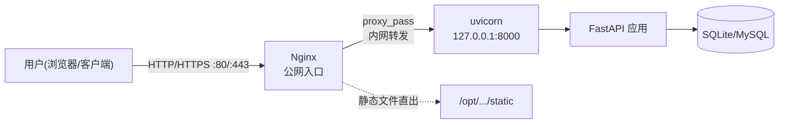

# 第 9 章 · Nginx 安装与反向代理

> 本章配套代码：Nginx 站点配置 `/etc/nginx/sites-available/book-insight.conf`（软链到 sites-enabled）；反代目标即第 7 章的 `book-insight.service`（uvicorn 127.0.0.1:8000）。
> 建议学习时长：约 4 小时

## 学习目标

学完本章，你能够：

1. 说清 Nginx 在架构中的位置，解释为什么生产不直接暴露 uvicorn；
2. 掌握 `/etc/nginx` 目录结构，理解 sites-available/sites-enabled 的软链发布机制；
3. 读懂 server/location 配置语法，**独立写出一份 FastAPI 反向代理配置**（upstream + proxy_set_header 全套，逐行注释）；
4. 用 `location /static/` + alias 托管静态文件；
5. 用 certbot 一键完成 HTTPS 证书签发，并验证自动续期；
6. 面对最常见的 502/504/403 报错，能在几分钟内定位原因。

## 9.1 前置知识 / 本章地位

第 7 章结束时，你的 FastAPI 应用在 `127.0.0.1:8000` 上活着——但只有服务器自己能访问。本章让全世界访问到它，并且以**正确的姿势**：用户看到的是 80/443 上的 Nginx，真正的应用藏在后面。

前置：第 4 章（systemd 管住 uvicorn）、第 5 章（UFW 放行 80/443）、第 7 章（book-insight 服务在跑）。验收本章的标准命令：`curl -I http://<server-ip>/api/books` 从你本地发出，返回 200。

## 9.2 Nginx 在架构中的位置



Nginx 是**Web 服务器 / 反向代理（reverse proxy）**：正向代理替「客户端」出门，反向代理替「服务端」接客。用户的所有请求先到 Nginx，Nginx 决定：静态文件自己给、动态请求转给 uvicorn、把响应带回给用户。

### 为什么生产不直接暴露 uvicorn

uvicorn 是 ASGI 应用服务器，能力边界在「跑 Python 应用」；直接 `--host 0.0.0.0` 暴露它，会同时放弃五件事：

1. **静态文件性能**：Nginx 用事件驱动直出静态文件效率极高；让 uvicorn 的 Python 工作进程去送 CSS/JS，是拿最贵的资源干最便宜的活；
2. **缓冲与慢客户端保护**：慢速客户端（弱网手机）会一点点占住 uvicorn 连接；Nginx 在中间缓冲响应，应用进程快速吐完就解放；
3. **TLS 终结**：HTTPS 证书、协议版本、加密套件由 Nginx 统一管理，应用保持纯 HTTP 内网通信；
4. **多站点/多服务路由**：一台服务器上 book-insight API、将来的分析面板各占一个域名/路径，都从 Nginx 分流，uvicorn 们只监听 127.0.0.1 各自端口；
5. **统一日志与限流**：访问日志、带宽限制、请求体大小上限在 Nginx 一层全覆盖。

结论：**uvicorn 永远只监听 127.0.0.1，公网大门只有 Nginx**——第 5 章「8000 不放行」的伏笔在此闭环。

## 9.3 安装与目录结构

```bash
sudo apt install nginx -y
sudo systemctl enable --now nginx
systemctl status nginx
curl -I http://127.0.0.1/          # 本机冒烟测试
```

预期输出（节选）：

```text
HTTP/1.1 200 OK
Server: nginx/1.24.0
Content-Type: text/html
```

然后放行防火墙（第 5 章的应用档案机制）：

```bash
sudo ufw allow "Nginx Full"    # 80 + 443
sudo ufw status verbose
```

### 9.3.1 /etc/nginx 目录地图

```text
/etc/nginx/
├── nginx.conf                  # 主配置：全局参数 + include 引入下面的文件
├── mime.types                  # 扩展名 → Content-Type 映射
├── conf.d/                     # 额外片段（*.conf 自动加载）
├── sites-available/            # 「候选」站点配置（写在这里，不生效）
└── sites-enabled/              # 「启用」站点（软链到 available，才生效）
```

`nginx.conf` 里两行关键 include（Ubuntu 打包特色）：

```nginx
include /etc/nginx/conf.d/*.conf;
include /etc/nginx/sites-enabled/*;
```

### 9.3.2 sites-available vs sites-enabled：软链发布机制（重点）

Ubuntu 把 Nginx 站点管理做成了「写稿区 vs 上线区」：

- 配置**写**在 `sites-available/`——改坏了也不影响线上；
- 要启用，就 `ln -s` 一条软链到 `sites-enabled/`——nginx.conf 的 include 只认 enabled 目录；
- 要下线，删软链（available 里的原稿还在，随时可再上线）。

```bash
sudo ln -s /etc/nginx/sites-available/book-insight.conf /etc/nginx/sites-enabled/
sudo rm /etc/nginx/sites-enabled/default      # 下线默认欢迎页（可选）
sudo nginx -t && sudo systemctl reload nginx  # 测试语法 → 平滑重载
```

这套机制你已在三处见过同构设计：软链接发布（第 2 章）、systemd 的 `.wants/` 软链（第 4 章）、现在是 sites-enabled。**「原稿 + 软链开关」是 Linux 配置管理的通用范式**。另一个易混点：`reload`（重读配置，不断连接）用于一切配置变更；`restart` 仅在改了 nginx.conf 的全局参数等少数场景需要。

## 9.4 server 与 location 语法详解

Nginx 配置由指令（分号结尾）与块（花括号）构成，核心两级：

- **server 块**：一个虚拟站点，按「监听地址 + server_name（域名）」匹配请求；
- **location 块**：server 内按**路径前缀/正则**分流，每条路径一套处理逻辑。

```nginx
# /etc/nginx/sites-available/demo.conf —— 语法演示（不部署）
server {
    listen 80;                        # IPv4 80 端口
    listen [::]:80;                   # IPv6
    server_name api.example.com;      # 本块响应哪个域名（写你的域名占位）

    root /var/www/demo;               # 站点根目录（root 指令=拼路径）
    index index.html;

    location /static/ {               # 前缀匹配：以 /static/ 开头的请求
        expires 7d;                   #   浏览器缓存 7 天
    }

    location = /healthz {             # = 精确匹配：只匹配这一字面路径
        return 200 "ok\n";
    }

    location ~* \.(png|jpg)$ {        # ~* 正则匹配（不区分大小写）
        access_log off;               #   图片访问不记日志
    }
}
```

location 匹配优先级（高频考点）：`= 精确` > `^~ 前缀短路` > `~ / ~* 正则` > `普通前缀（最长前缀胜）`。`server_name` 匹配顺序：精确名 > 前缀通配 > 后缀通配 > 正则 > 默认 server（第一个命中 listen 的块）。读懂优先级，多数「我的 location 不生效」都能自己破案。

## 9.5 【重点实战】FastAPI 反代完整配置

前置确认：`systemctl status book-insight` 为 running（第 7 章），`curl -s http://127.0.0.1:8000/health` 返回 `{"status":"ok"}`。

`sudo nano /etc/nginx/sites-available/book-insight.conf`：

```nginx
# book-insight API 反向代理配置
# 逐行注释版：上生产时可删注释，但先保证每行都看懂

# ---- upstream：给后端起个名字，后续 proxy_pass 用名字引用 ----
upstream book_insight_backend {
    server 127.0.0.1:8000;        # 第 7 章的 uvicorn；将来多进程时在此追加行即可负载均衡
}

server {
    listen 80;                    # 只配 80；443 由 certbot 稍后自动追加（9.6 节）
    listen [::]:80;
    server_name api.example.com;  # 占位符：替换为你的域名；纯 IP 调试阶段可写 _ 匹配所有

    # ---- 动态请求：全部转给 uvicorn ----
    location / {
        proxy_pass http://book_insight_backend;   # 转发到 upstream 名字（注意不带末尾路径）

        proxy_set_header Host $host;              # 告诉后端「用户访问的原始域名」，
                                                  # 否则 uvicorn 只知道 127.0.0.1，
                                                  # 依赖域名的路由/CSRF/重定向会错乱

        proxy_set_header X-Real-IP $remote_addr;  # 用户的真实来源 IP，
                                                  # 否则应用日志里所有用户都长着 127.0.0.1 的脸

        proxy_set_header X-Forwarded-For $proxy_add_x_forwarded_for;  # 代理链标准头：
                                                  # 若前面还有代理，把已有值追加而非覆盖

        proxy_set_header X-Forwarded-Proto $scheme;   # 告诉后端用户走的是 http 还是 https，
                                                      # FastAPI 生成绝对 URL/重定向时需要

        # ---- 超时与缓冲（API 服务常用默认值，按需调整）----
        proxy_connect_timeout 5s;     # 连后端超时
        proxy_read_timeout 60s;       # 等后端响应超时（长耗时接口要调大）
        client_max_body_size 10m;     # 限制上传体积，防大包打爆内存
    }

    # ---- 静态文件：Nginx 直出，不进 Python（9.5.1 节）----
    location /static/ {
        alias /opt/book-insight/app/projects/book-insight/static/;  # alias=直接替换前缀
        expires 7d;                   # 静态资源带缓存头
        access_log off;               # 静态访问不刷日志
    }
}
```

启用并验证：

```bash
sudo ln -s /etc/nginx/sites-available/book-insight.conf /etc/nginx/sites-enabled/
sudo rm /etc/nginx/sites-enabled/default
sudo nginx -t                  # syntax is ok / test is successful 才继续
sudo systemctl reload nginx
```

从**你本地**（不是服务器）验收：

```bash
curl -I http://<server-ip>/api/books?limit=1
```

预期输出：

```text
HTTP/1.1 200 OK
Server: nginx/1.24.0
Content-Type: application/json
```

### 9.5.1 root 与 alias 的区别（易错）

- `root /data/www;` + `location /static/`：实际路径 = root + 完整 URI → `/data/www/static/app.css`；
- `alias /data/www/static/;` + `location /static/`：URI 中 location 前缀被**替换** → `/data/www/app.css`。

用 alias 时末尾斜杠必须成对（location 和 alias 都带或都不带），配错就是经典的 404。FastAPI 侧的静态目录约定与 `StaticFiles` 挂载方式以 FastAPI 官方文档为准，本节只保证 Nginx 侧正确。

## 9.6 HTTPS：certbot 一键 Let's Encrypt

### 9.6.1 前置条件

1. 一个真实域名（占位符 `<your-domain>`，下文用 `api.example.com` 演示）；
2. 域名的 **A 记录已指向服务器公网 IP**：本地 `dig +short api.example.com` 返回你的 IP（第 5 章 5.7.3）；国内服务器还需域名备案（第 1 章 1.3.1）；
3. UFW 与安全组均已放行 80/443。

Let's Encrypt 签发时会对域名做校验（certbot --nginx 默认走 HTTP-01：临时在 80 端口放置校验文件），前置不满足必然失败。

### 9.6.2 签发全流程

```bash
sudo apt install certbot python3-certbot-nginx -y
sudo certbot --nginx -d api.example.com        # -d 可多个：再加 -d www.example.com
```

交互过程（预期）：

```text
Enter email address (used for urgent renewal and security notices): <your-email>
- - - - - - - - - - - - - - - - - - - - - - - - - - - - - - - - - - - - - - - -
Please read the Terms of Service...: (Y)es/(N)o: Y
Would you be willing to share your email...: (Y)es/(N)o: N
Which names would you like to activate HTTPS for? ...  (对应选择你的 server)
Please choose whether or not to redirect HTTP traffic to HTTPS:
1: No redirect   2: Redirect       ← 选 2，全站强制 HTTPS
- - - - - - - - - - - -
Successfully received certificate.
Certificate is saved at: /etc/letsencrypt/live/api.example.com/fullchain.pem
Key is saved at:         /etc/letsencrypt/live/api.example.com/privkey.pem
Deploying certificate
Successfully deployed certificate for api.example.com
Congratulations! You have successfully enabled HTTPS
```

certbot 自动完成了三件事：**签发证书、改写你的 server 块**（追加 443 监听、SSL 参数、80→443 跳转）、**注册自动续期**。验收：

```bash
curl -I https://api.example.com/health      # 注意是 https
```

预期输出：

```text
HTTP/2 200
```

### 9.6.3 验证自动续期

Let's Encrypt 证书有效期 90 天，certbot 通过 systemd timer 自动续（第 4 章 timer 的真实案例）：

```bash
systemctl list-timers | grep certbot    # 确认 certbot.timer 存在且有下次触发时间
sudo certbot renew --dry-run            # 演练续期，全部 simulated 成功即通过
sudo certbot certificates               # 查看已有证书与剩余天数
```

预期输出（节选）：

```text
Certificate Name: api.example.com
  Domains: api.example.com
  Expiry Date: 2027-02-02 03:21:56+00:00 (VALID: 89 days)
```

`--dry-run` 用 Let's Encrypt 的测试环境演练，不会真签。证书续期后 Nginx 会由 certbot 钩子自动 reload——**部署三个月后你不需要做任何事**，但第 10 章的故障演练里我们还是会演练「证书过期」的处理。

## 9.7 配置检查、重载与日志

```bash
sudo nginx -t                 # 每次改配置后必跑：语法与语义检查
sudo systemctl reload nginx   # -t 通过后平滑加载（不断连接）
sudo journalctl -u nginx -n 20        # 服务级日志
sudo tail -f /var/log/nginx/access.log    # 访问日志（谁在访问什么、状态码）
sudo tail -f /var/log/nginx/error.log     # 错误日志（配置错、上游挂、权限错都在这）
```

access.log 单行解读：

```text
203.0.113.50 - - [04/Nov/2026:16:40:02 +0800] "GET /api/books?limit=1 HTTP/1.1" 200 156 "-" "curl/8.7.1"
```

依次是：来源 IP、时间、请求行、**状态码**、响应字节数、Referer、UA。配合第 2 章的流水线即可出统计报表：`awk '{print $9}' /var/log/nginx/access.log | sort | uniq -c | sort -rn`。

## 9.8 常见报错排查表

### 502 Bad Gateway（最高频）

Nginx 说：「我收到了请求，但转给后端时它没能给出有效响应」。按序检查：

```bash
systemctl status book-insight            # ① 后端活着吗
sudo ss -tlnp | grep 8000                # ② 监听地址/端口对吗（127.0.0.1:8000）
curl -s http://127.0.0.1:8000/health     # ③ 服务器本机直连后端通吗
sudo tail -n 20 /var/log/nginx/error.log # ④ 看 Nginx 记录的具体原因
```

error.log 典型行与含义：`connect() failed (111: Connection refused)`——后端没起/端口错；`no live upstreams`——upstream 全部不可用。90% 的 502 停留在第 ① 步（服务挂了或没 enable）。

### 504 Gateway Timeout

后端太慢，Nginx 等到 `proxy_read_timeout`（默认 60s）放弃。先查应用日志 `journalctl -u book-insight -n 50` 找慢因（慢 SQL？外部 API 卡死？），确认是长任务而非故障后再调大该 location 的超时——**盲目调大超时是把故障延迟而非修复**。

### 403 Forbidden

Nginx 说：「路径存在，但我（进程）没权限读」。三个经典原因：

```bash
# ① 文件权限：others 无读权限（第 2 章 rwx 语义）
ls -l /opt/book-insight/app/projects/book-insight/static/
# ② 目录链缺 x：/opt、/opt/book-insight 等每级目录都要 x（可进入）
namei -l /opt/book-insight/app/projects/book-insight/static/app.css
# ③ SELinux 不适用 Ubuntu；多见于 alias 路径写错时以 403 形式报出
```

### 其他常见

| 现象 | 原因 | 解决 |
|---|---|---|
| 访问域名跳到「Welcome to nginx」默认页 | sites-enabled 里 default 还在且 server_name 抢匹配 | `rm /etc/nginx/sites-enabled/default` |
| `nginx: [emerg] could not open error log file` | 改配置引入了无权限路径 | `nginx -t` 看行号定位 |
| 证书续期失败邮件 | 80 端口被 UFW/安全组关了（HTTP-01 校验需要） | 恢复 80 放行后 `certbot renew` |
| 端口被占 `Address already in use` | 8000 之类与自家服务冲突（Nginx 通常只用 80/443） | 第 3 章 `lsof -i` 定位 |

## 常见坑与排查（Troubleshooting）汇总

| 报错/现象 | 原因 | 解决办法 |
|---|---|---|
| 502 Bad Gateway | uvicorn 未运行/监听不符 | 9.8 四步法；重点 `systemctl status` |
| 504 Gateway Timeout | 后端慢于 proxy_read_timeout | 先修慢因，再调超时 |
| 403 Forbidden | 文件或目录链权限不足 | `ls -l` + `namei -l` 逐级补权限 |
| 本地访问超时而非 502 | 安全组/UFW 未放行 80/443 | 第 5 章双层闸门排查 |
| 应用拿到的 IP 全是 127.0.0.1 | 没配 X-Real-IP / X-Forwarded-For | 补 proxy_set_header（9.5） |
| certbot 签发失败 | 域名未解析到本机 / 80 未放行 | `dig` 验证 A 记录；核对双层防火墙 |
| `nginx -t` 报 `unknown directive` | 指令放错了块层级（如 proxy_pass 放在 server 顶层） | 按官方文档核对指令所属上下文 |
| reload 后行为没变 | 浏览器缓存/没真的 reload | curl 验证；`systemctl status nginx` 看启动时间 |

## 动手练习

1. **反代上线并全链路验收**：完成 9.5 全部步骤，从本地 `curl -I http://<server-ip>/api/books?limit=1` 得到 200；再用 `tail -f` 双开 access.log 与 `journalctl -u book-insight -f`，观察一条请求在两份日志里的轨迹。
   <details><summary>提示</summary>一边 Nginx 记录来源 IP（你本地的），一边 uvicorn 收到的请求——对照 9.5 的 proxy_set_header 理解链路。</details>
2. **制造一次 502 并修复**：`sudo systemctl stop book-insight` 后本地访问观察 502，按 9.8 四步法逐层排查到根因，再 start 恢复。
   <details><summary>提示</summary>error.log 会出现 `connect() failed (111: Connection refused)`；把「现象→日志→根因」三段话记下来，第 10 章演练复用。</details>
3. **静态文件 403 实验**：把 static 目录 chmod 700 后访问，观察 403；用 `namei -l` 找到缺 x 的一级，修好。
   <details><summary>提示</summary>目录要 x 才能进入。这是权限语义（第 2 章）与 Web 服务（本章）的串联实验。</details>
4. **HTTPS 上线**：准备真实域名（或先用自签名证书体验 443），完成 9.6 签发与 `certbot renew --dry-run`，记录 `list-timers` 里 certbot 的下次触发时间。
   <details><summary>提示</summary>没有域名时可在 Nginx 官方文档了解自签名证书的 openssl 命令练手；正式上线必须用真实域名 + Let's Encrypt。</details>

## 小结与自检清单

- [ ] 我能画出「用户→Nginx→uvicorn→FastAPI→DB」的链路，并说出五条不直接暴露 uvicorn 的理由
- [ ] 我理解 sites-available/enabled 的软链机制，改配置的固定动作是 nginx -t → reload
- [ ] 我能独立写出 upstream + proxy_pass + 四个 proxy_set_header 的完整反代配置
- [ ] 我能说清 root 与 alias 的路径拼接差异
- [ ] HTTPS 已上线（或已演练），`certbot renew --dry-run` 通过，续期 timer 在跑
- [ ] 遇到 502/504/403 我有明确的排查顺序，而不是重启碰运气
- [ ] 我知道两份日志的分工：/var/log/nginx/{access,error}.log 与 journalctl -u
- [ ] 应用与数据库的端口（8000/3306）依然没有暴露在公网——Nginx 是唯一入口

## 延伸阅读

- [Nginx 官方文档](https://nginx.org/en/docs/)——http 模块全部指令的权威定义（proxy_set_header、alias 等）。
- [Nginx Beginner's Guide](https://nginx.org/en/docs/beginners_guide.html)——官方入门教程，server/location 语义的最佳起点。
- [Certbot 官方指南（nginx 插件）](https://certbot.eff.org/instructions)——按发行版与 Web 服务器生成的官方安装指引。
- [Let's Encrypt 官方文档](https://letsencrypt.org/zh-cn/docs/)——证书有效期、速率限制与 HTTP-01 校验原理。
- [FastAPI 官方：Behind a Proxy](https://fastapi.tiangolo.com/advanced/behind-a-proxy/)——X-Forwarded-* 头在 FastAPI 侧的正确消费方式。
