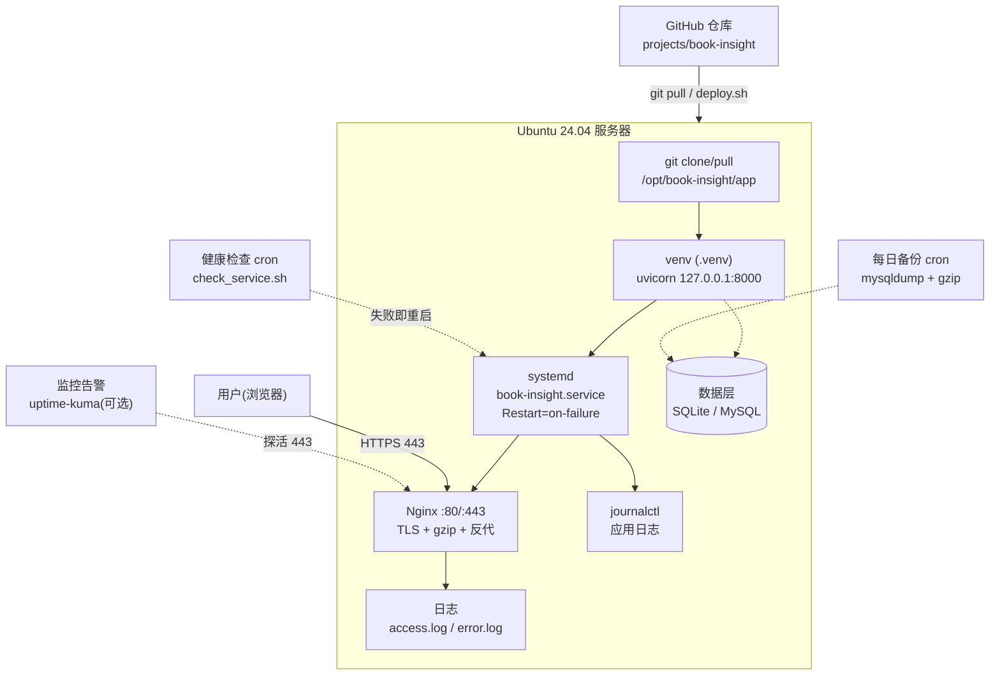

# 第 10 章 · 生产部署清单与运维 Monitor

> 本章配套代码：演练脚本与配置——`~/scripts/check_service.sh`（第 6 章）、`~/scripts/deploy.sh`（第 6 章）、`~/scripts/backup_mysql.sh`（第 8 章）、`/etc/logrotate.d/book-insight`（本章 10.3）、`/etc/systemd/system/book-insight.service`（第 7 章）；部署目录 `/opt/book-insight/`。
> 建议学习时长：约 5 小时

## 学习目标

学完本章，你能够：

1. 画出从 GitHub 到用户的完整生产链路图，并指出每一环的守护者（systemd/Nginx/备份/监控）；
2. **逐项执行并勾选 5 组共 30+ 项的上线 Checklist**，把一台服务器从「能跑」带到「敢上线」；
3. 面对故障按固定套路排查（ss → journalctl → nginx log → df → free），并演练过 5 个真实故障场景；
4. 用 git tag + 软链接切换实现可回滚的简易蓝绿发布；
5. 从一台空服务器出发，按命令时间线把 book-insight 完整重新上线一次（整合前九章全部技能）。

## 10.1 前置知识 / 本章地位

这是 Ubuntu 篇的收官章：前九章的每一块砖（加固、进程、服务、网络、脚本、Python、数据库、Nginx）在本章拼成完整建筑。本章的产出物有两个：

1. 一份**可复用的上线 Checklist**——以后每次部署新项目都从它过一遍；
2. 一套**故障肌肉记忆**——出事时不翻书，按套路走。

## 10.2 全链路架构回顾



每个箭头背后是一章的功力：代码怎么来（第 1、6、7 章）、进程谁守护（第 4 章）、请求谁接待（第 5、9 章）、数据谁备份（第 8 章）、故障怎么发现（本章）。

## 10.3 上线 Checklist（核心，5 组 30+ 项）

使用方法：每项给出**自测命令/位置**，逐条执行打勾。这不是一次性的——每个新项目上线都重走一遍。

### 组一：系统与安全基线

- [ ] 1.1 云安全组只放行 22/80/443 —— 控制台逐条核对（第 1 章 1.4）
- [ ] 1.2 UFW 启用，入站默认 deny —— `sudo ufw status verbose`
- [ ] 1.3 SSH 密钥登录验证通过，密码登录已禁用 —— `sudo sshd -T | grep passwordauthentication` 应为 no
- [ ] 1.4 root 禁止直登 —— `sudo sshd -T | grep permitrootlogin` 应为 no
- [ ] 1.5 fail2ban sshd jail 激活 —— `sudo fail2ban-client status sshd`
- [ ] 1.6 自动安全更新开启 —— `cat /etc/apt/apt.conf.d/20auto-upgrades` 两个 "1"
- [ ] 1.7 系统补丁已打满 —— `sudo apt update && sudo apt upgrade -y` 后提示 0 upgraded
- [ ] 1.8 时区为业务时区、NTP 同步正常 —— `timedatectl status` 显示 `System clock synchronized: yes`
- [ ] 1.9 swap 已配置（2G 内小内存机必做，防 OOM 一击致命）—— `free -h` 的 Swap 行非 0
- [ ] 1.10 磁盘余量充足（<80% 使用率）—— `df -h /`

swap 配置（1.9）三分钟做法：

```bash
sudo fallocate -l 2G /swapfile
sudo chmod 600 /swapfile
sudo mkswap /swapfile
sudo swapon /swapfile
echo '/swapfile none swap sw 0 0' | sudo tee -a /etc/fstab    # 开机自动挂载
free -h    # 验证 Swap 行出现 2.0Gi
```

### 组二：Python 应用

- [ ] 2.1 项目部署在 /opt/<项目>，属主为专用服务用户（nologin）—— `ls -ld /opt/book-insight`；`id booksvc`
- [ ] 2.2 venv 隔离，无系统 pip 污染 —— `.venv/bin/pip list` 只含项目依赖
- [ ] 2.3 依赖锁定（uv.lock / requirements 锁定版），部署用同步命令 —— `uv sync --frozen` 可复现
- [ ] 2.4 `.env` 与密钥绝不入库 —— `git ls-files | grep -c "\.env$"` 应为 0；仓库 `.gitignore` 已含 `.env`
- [ ] 2.5 systemd 服务文件三段齐全，User 为服务用户 —— `cat /etc/systemd/system/book-insight.service`
- [ ] 2.6 `Restart=on-failure` + `daemon-reload` 后 enable --now —— `systemctl is-enabled book-insight`
- [ ] 2.7 崩溃自愈验证过：kill 主进程 5 秒内恢复 —— 第 7 章练习 3
- [ ] 2.8 服务监听 127.0.0.1，不直接暴露公网 —— `sudo ss -tlnp | grep 8000`

### 组三：数据库与数据

- [ ] 3.1 数据库仅监听 127.0.0.1 —— `sudo ss -tlnp | grep 3306`
- [ ] 3.2 应用用户最小化授权，无 root 直连 —— `SHOW GRANTS FOR 'bookapp'@'localhost';`
- [ ] 3.3 库字符集 utf8mb4 —— `SHOW CREATE DATABASE book_insight\G`
- [ ] 3.4 每日备份 cron 在跑，文件带日期 gzip 压缩 —— `crontab -l`；`ls ~/backups/mysql/`
- [ ] 3.5 **备份恢复演练通过**（恢复到 restore 库并 COUNT 对比）—— 第 8 章练习 2
- [ ] 3.6 保留策略生效（7 天前自动清理）—— `find ~/backups/mysql -mtime +7` 应无结果
- [ ] 3.7 SQLite 场景：data 目录已纳入 backup_dir.sh 且排除在生产 git 之外

### 组四：Web 层

- [ ] 4.1 Nginx 反代配置逐行自审（proxy_set_header 四件套齐全）—— 第 9 章 9.5
- [ ] 4.2 `nginx -t` 通过后 reload —— 无输出错误即通过
- [ ] 4.3 HTTPS 已签发，HTTP 强制跳转 —— `curl -I http://<your-domain>` 返回 301
- [ ] 4.4 `certbot renew --dry-run` 通过，续期 timer 在跑 —— `systemctl list-timers | grep certbot`
- [ ] 4.5 gzip 压缩开启（见下方配置）
- [ ] 4.6 静态文件由 Nginx 直出，带缓存头 —— `curl -I https://<your-domain>/static/...` 看 `Cache-Control`
- [ ] 4.7 sites-enabled 已移除 default 站点 —— `ls /etc/nginx/sites-enabled/`

gzip 在 `/etc/nginx/nginx.conf` 的 http 块内（Ubuntu 默认模板已有骨架，确认未注释并补充类型）：

```nginx
gzip on;
gzip_vary on;
gzip_min_length 1024;
gzip_types text/plain text/css application/json application/javascript application/xml image/svg+xml;
```

### 组五：日志、监控与发布

- [ ] 5.1 logrotate 规则就位（见下方示例）—— `sudo logrotate -d /etc/logrotate.d/book-insight` 干跑无错
- [ ] 5.2 journal 容量上限已设 —— `sudo journalctl --disk-usage`；`/etc/systemd/journald.conf` 配 SystemMaxUse
- [ ] 5.3 健康检查脚本挂 cron（每分钟探活失败重启）—— `crontab -l`；`journalctl -t healthcheck`
- [ ] 5.4 部署脚本 deploy.sh 可一键发布且记录新旧 commit —— 第 6 章 6.7 例三
- [ ] 5.5 监控告警就位（至少外部拨测一个 URL）—— 见 10.5 uptime-kuma
- [ ] 5.6 CI 自动部署思路已评估（见 10.5）—— 至少明确「当前靠 SSH + deploy.sh」的边界
- [ ] 5.7 回滚方案演练过（10.6 的 tag + 软链切换）—— 演练记录在案
- [ ] 5.8 五个故障场景（10.7）全部亲手演练过 —— 逐个打勾

logrotate 示例 `/etc/logrotate.d/book-insight`（针对应用自己写文件日志的场景；走 journald 的日志由 journald 自管，不需要它）：

```text
/opt/book-insight/logs/*.log {
    daily              # 每天轮转
    rotate 14          # 保留 14 份
    compress           # 旧日志 gzip
    delaycompress      # 最近一份不压缩（排查方便）
    missingok          # 无日志也不报错
    notifempty         # 空文件不轮转
    copytruncate       # 先复制再清空原文件：应用持着文件句柄继续写也不丢
}
```

`copytruncate` 是给「一直握着文件描述符写」的应用准备的（第 2 章坑表提过 fd 问题）；`sudo logrotate -d`（dry run）先看它会做什么再上线。

## 10.4 故障排查套路：先看谁

固定五连（顺序就是信息量排序）：

```bash
sudo ss -tlnp                          # ① 网络层：服务在不在、监听对不对
journalctl -u book-insight -n 50       # ② 应用层：自己的服务最后说了什么
sudo tail -n 50 /var/log/nginx/error.log   # ③ Web 层：Nginx 转发/权限层报什么
df -h                                  # ④ 资源层：磁盘满没满（日志/数据库炸盘是高频根因）
free -h && uptime                      # ⑤ 内存与负载：OOM/过载
```

### 五个真实故障场景演练（请逐个亲手做）

**场景一：502 Bad Gateway**

```bash
sudo systemctl stop book-insight       # 制造故障
curl -I http://127.0.0.1/api/books     # 预期 502
```

排查走 9.8 四步法：status 看到 inactive → 根因明确 → `sudo systemctl start book-insight` 恢复，curl 回到 200。**延伸：如果 status 显示 failed 而 start 也起不来，就是 journalctl 里应用报错（配置/依赖/权限），按第 7 章坑表处理。**

**场景二：磁盘满**

```bash
# 模拟：先看现状，再找元凶
df -h                       # Use% 100% 时服务常出现诡异写入失败
sudo du -sh /var/* 2>/dev/null | sort -rh | head    # 逐层下钻找大目录
sudo journalctl --disk-usage
sudo journalctl --vacuum-size=200M      # journal 是常见膨胀源，先回收
sudo find /var/log -name "*.gz" -mtime +7 -delete   # 老轮转日志清理
df -h                       # 恢复
```

预期心得：磁盘满的第一嫌疑人是 journal、Nginx 日志、备份文件、数据库数据四个方向；长期解法是 10.3 的 5.1/5.2 两项（logrotate + journald 上限）。

**场景三：进程被 OOM 杀掉**

```bash
journalctl -k | grep -i -E "out of memory|oom"   # 内核日志找 OOM killer 记录
# 典型记录："Out of memory: Killed process 12345 (uvicorn) ..."
free -h                            # 确认内存水位；Swap 是否为 0
```

处置三步：先确认是 OOM（不是代码崩）→ 短期给服务加内存护栏与 swap → 长期找内存泄漏或限流。systemd 层面可给 unit 加 `MemoryMax=800M` 让它在失控前被有序治理（第 4 章练习 4），并确认 `Restart=on-failure` 把服务拉回。

**场景四：端口占用**

```bash
# 现象：重启服务报 Address already in use
sudo lsof -i:8000                  # 谁占着：PID、进程名一目了然
sudo ss -tlnp | grep 8000          # 同等信息，ss 视角
sudo kill <旧PID>                  # 确认是残留旧进程后清理
sudo systemctl restart book-insight
systemctl status book-insight      # 恢复 active
```

**场景五：证书过期**

```bash
curl -vI https://<your-domain> 2>&1 | grep -E "expire|SSL certificate problem"
sudo certbot certificates          # 看 Expiry Date
sudo certbot renew                 # 正常自动续期失败了就手动来一次
sudo systemctl reload nginx        # 续期后确保 Nginx 加载新证书
sudo certbot renew --dry-run       # 修好后续期链路回归验证
```

复盘价值：五个场景覆盖了「网络层、磁盘、内存、端口、TLS」五大类故障，且每个都能在十分钟内按套路闭环——上线后第一次半夜报警，你会感谢这份肌肉记忆。

## 10.5 监控与告警

**最小可用监控 = 外部拨测 + 服务器侧自愈 + 你能收到通知**。分三档落地：

1. **零成本档（本教程默认）**：`check_service.sh`（第 6 章）每分钟本机探活失败即重启，事件进 journal；配合第 2 章的日志统计流水线人工巡检。
2. **自托管拨测：Uptime Kuma**（开源监控面板，可发邮件/Telegram/Webhook 告警）：一台监控机（或同一台低配部署）上一条 Docker 命令即可起服务，添加「HTTP(s) 探活 https://\<your-domain\>/health，60 秒间隔」，URL 失败连续 N 次即告警。安装方式以其官方文档为准（https://github.com/louislam/uptime-kuma），本教程不展开容器操作。
3. **云厂商免费监控**：阿里云/腾讯云/AWS 都提供实例级 CPU/内存/磁盘告警，控制台配阈值即可，作为「拨测看不到的主机内部问题」的补充。

选型提示：**拨测从公网视角探测（能发现 Nginx 挂、证书过期、安全组问题），主机监控从内部探测（能发现磁盘、OOM）**，两者互补，缺一不可。告警发出去没人看等于没有——把通知接到你真正会看的地方。

**CI 自动部署思路**（评估项 5.6）：当前流程是「本地 ssh → 跑 deploy.sh」。进阶方向是 GitHub Actions 在 push 到 main 时自动 SSH 到服务器执行同样的 deploy.sh（用 Actions Secrets 存私钥，`appleboy/ssh-action` 类方案），获得「合入即上线 + 全程留痕」。判断标准：单人项目 SSH + deploy.sh 已够用且更简单；多人协作、发布频繁、需要评审后再部署时再引入 CI——**自动化是手段，可回滚与可审计才是目的**。

## 10.6 回滚策略：git tag + 软链简易蓝绿

蓝绿部署的本质：**新旧两套版本目录同时存在，流量切换靠改一个软链接**（第 2 章 2.7 的伏笔在此回收）。

### 目录布局

```text
/opt/book-insight/
├── releases/
│   ├── v1.2.2/          # 上一版（回滚目标）
│   └── v1.2.3/          # 当前版
├── current -> releases/v1.2.3   # systemd 只认 current
└── shared/              # 跨版本共享：.env、日志、数据
```

### 发布与回滚流程

```bash
# 发布：每次发布打 tag，checkout 到版本目录
cd /opt/book-insight
sudo -u booksvc git clone <你的仓库地址> releases/v1.2.3 2>/dev/null || true
cd releases/v1.2.3 && sudo -u booksvc git fetch --tags && sudo -u booksvc git checkout v1.2.3

# 建环境与依赖（在版本目录内）
sudo -u booksvc uv venv --python 3.12
sudo -u booksvc uv sync --frozen

# 切换流量：软链原子指向新版本
sudo ln -sfn releases/v1.2.3 /opt/book-insight/current
sudo systemctl restart book-insight
curl -fsS --max-time 5 http://127.0.0.1:8000/health   # 健康检查门禁

# 回滚：一条软链命令回到上一版
sudo ln -sfn releases/v1.2.2 /opt/book-insight/current
sudo systemctl restart book-insight
```

对应 systemd 调整：`WorkingDirectory=/opt/book-insight/current`、`ExecStart=/opt/book-insight/current/.venv/bin/uvicorn ...`——**服务文件从此不变，变的是软链**。`ln -sfn` 的原子性保证切换瞬间完成、无中间态。纪律：**任何发布前先确认上一个 tag 在 releases 里可回滚**，再动手切新版本；回滚演练（Checklist 5.7）就是真实执行一遍 `ln -sfn` 回旧版 + 健康检查通过。

## 10.7 完整上线演练：空服务器 → book-insight 上线时间线

以下按顺序整合前九章命令（细节回顾对应章节）。全新 Ubuntu 24.04 服务器，从你本地终端开始：

```bash
# ===== 第 0 幕：登录与系统基线（第 1 章）=====
ssh ubuntu@<server-ip>                       # 01 首次连接（确认指纹）
sudo timedatectl set-timezone Asia/Shanghai  # 02 时区
sudo apt update && sudo apt upgrade -y       # 03 补丁打满
sudo cp /etc/apt/sources.list.d/ubuntu.sources{,.bak}        # 04 换源（可选）
sudo sed -i 's|http://archive.ubuntu.com/ubuntu/|https://mirrors.tuna.tsinghua.edu.cn/ubuntu/|g' /etc/apt/sources.list.d/ubuntu.sources

# ===== 第 1 幕：安全加固（第 1、5 章）=====
ssh-keygen -t ed25519 -C "deploy-2026"       # 05 本地生成密钥
ssh-copy-id -i ~/.ssh/id_ed25519.pub ubuntu@<server-ip>   # 06 上传公钥
# 07 本地 ~/.ssh/config 写 Host 别名 myserver，验证 ssh myserver 免密
sudo ufw default deny incoming               # 08 UFW 策略
sudo ufw default allow outgoing
sudo ufw allow OpenSSH
sudo ufw enable
sudo nano /etc/ssh/sshd_config.d/00-hardening.conf
#   09 写入：PermitRootLogin no / PasswordAuthentication no / KbdInteractiveAuthentication no
sudo sshd -t && sudo systemctl reload ssh    # 10 语法检查 + 重载（新终端验证再继续）
sudo apt install fail2ban -y                 # 11 fail2ban
sudo nano /etc/fail2ban/jail.local           #   （按第 1 章 1.7.5 内容）
sudo systemctl enable --now fail2ban
sudo dpkg-reconfigure -plow unattended-upgrades   # 12 自动安全更新
# 13 云控制台：安全组只放 22/80/443

# ===== 第 2 幕：用户与目录（第 2、3 章）=====
sudo adduser --system --group --home /opt/book-insight --shell /usr/sbin/nologin booksvc   # 14 服务用户
sudo mkdir -p /opt/book-insight && sudo chown booksvc:booksvc /opt/book-insight            # 15 项目目录
sudo visudo -f /etc/sudoers.d/deploy         # 16 部署用户免密 restart 白名单（第 3 章语法）

# ===== 第 3 幕：装基础设施（第 4、8、9 章）=====
sudo apt install nginx -y                    # 17 Nginx
sudo systemctl enable --now nginx
sudo apt install mysql-server -y             # 18 MySQL（若项目需要）
sudo systemctl enable --now mysql
sudo mysql_secure_installation               # 19 逐项安全初始化
sudo mysql                                   # 20 建库建用户（utf8mb4 + 最小授权，第 8 章 8.4）

# ===== 第 4 幕：代码与环境（第 7 章）=====
sudo -u booksvc git clone <你的仓库地址> /opt/book-insight/app   # 21 拉代码
cd /opt/book-insight/app/projects/book-insight
sudo -u booksvc bash -c 'export PATH="$HOME/.local/bin:$PATH" && uv venv --python 3.12'  # 22 venv
sudo -u booksvc bash -c 'export PATH="$HOME/.local/bin:$PATH" && cd /opt/book-insight/app/projects/book-insight && uv sync'   # 23 锁定安装依赖
sudo -u booksvc /opt/book-insight/app/projects/book-insight/.venv/bin/python crawler/crawl_books.py --limit 5   # 24 产出数据

# ===== 第 5 幕：服务化（第 4、7 章）=====
sudo nano /etc/systemd/system/book-insight.service   # 25 服务文件（第 7 章 7.7 完整内容）
sudo systemctl daemon-reload                 # 26
sudo systemctl enable --now book-insight     # 27
curl -s http://127.0.0.1:8000/health         # 28 本机验收 {"status":"ok"}

# ===== 第 6 幕：Nginx 反代 + HTTPS（第 9 章）=====
sudo nano /etc/nginx/sites-available/book-insight.conf   # 29 反代配置（第 9 章 9.5 完整内容）
sudo ln -s /etc/nginx/sites-available/book-insight.conf /etc/nginx/sites-enabled/   # 30
sudo rm /etc/nginx/sites-enabled/default     # 31
sudo nginx -t && sudo systemctl reload nginx # 32
sudo ufw allow "Nginx Full"                  # 33 放行 80/443
sudo apt install certbot python3-certbot-nginx -y        # 34 HTTPS（域名 A 记录先就位）
sudo certbot --nginx -d api.example.com      # 35（替换为你的域名，选 Redirect）
sudo certbot renew --dry-run                 # 36 续期链路验证

# ===== 第 7 幕：运维闭环（第 6、8、10 章）=====
sudo fallocate -l 2G /swapfile               # 37 swap（第 10.3 组一 1.9）
sudo chmod 600 /swapfile && sudo mkswap /swapfile && sudo swapon /swapfile
echo '/swapfile none swap sw 0 0' | sudo tee -a /etc/fstab
mkdir -p ~/scripts ~/backups                 # 38 备份三件套
sudo nano ~/scripts/backup_mysql.sh          #   （第 8 章 8.6.2 完整脚本）
chmod +x ~/scripts/backup_mysql.sh && ~/scripts/backup_mysql.sh   # 39 手动跑通
sudo nano ~/scripts/check_service.sh         # 40 健康检查（第 6 章 6.7 例二）
chmod +x ~/scripts/check_service.sh
sudo crontab -e                              # 41 两条 cron：3 点备份 + 每分钟探活（第 4 章 4.6.3）
sudo nano /etc/logrotate.d/book-insight      # 42 日志轮转（10.3 组五 5.1）
sudo logrotate -d /etc/logrotate.d/book-insight
sudo nano /etc/systemd/journald.conf         # 43 journal 上限：SystemMaxUse=500M
sudo systemctl restart systemd-journald

# ===== 终幕：外部验收 =====
curl -I https://api.example.com/health       # 44 本地发 HTTPS 请求，HTTP/2 200
curl -s "https://api.example.com/api/books?limit=2"   # 45 数据链路通
# 46 对照 10.3 Checklist 逐项打勾；47 部署监控拨测（10.5）；48 打 tag 归档首个版本
```

这份时间线就是本教程的「毕业考试」：48 步全部打勾，你就具备把任何 FastAPI + 数据库项目部署上线的完整能力。

## 常见坑与排查（Troubleshooting）

| 报错/现象 | 原因 | 解决办法 |
|---|---|---|
| 上线后某天突然 502 | uvicorn 被 OOM/崩溃且 Restart 配置缺失 | 场景三套路；核对 Restart=on-failure 与内存护栏 |
| 磁盘悄悄涨满 | journal/日志/备份无上限 | 10.3 的 5.1/5.2/3.6 三项就是预防针 |
| 半夜收到证书过期告警 | certbot.timer 停了或 80 端口被关 | 场景五套路；`list-timers` 与防火墙常态化核对 |
| 换了服务器，老脚本行为异常 | 忘了 Checklist 前两组（加固差异/时区/swap） | 每次迁移都完整重走 10.3 |
| 回滚后页面还是新版 | 浏览器缓存/静态资源指纹 | 强刷验证；静态文件版本化命名 |
| deploy.sh 假成功 | 健康检查没接进发布门禁 | 6.7 例三的结构：失败必须 exit 1 |

## 动手练习

1. **通关 Checklist**：对（或新开）一台服务器完整执行 10.3 的 30+ 项，逐条留下「命令输出截图或文本」。最终验收：全部打勾且每项有证据。
   <details><summary>提示</summary>做成一份可复用的 Markdown 清单存进你的仓库（不要放密钥证据），下个项目直接复用。</details>
2. **五场景连演**：一次性完成 10.4 的五个故障演练，每个记录「现象 → 排查命令 → 根因 → 恢复动作」四段式。
   <details><summary>提示</summary>控制顺序：先演练低风险的 502 与端口占用；磁盘满场景用 journal vacuum 演示即可，不要真写满生产盘。</details>
3. **蓝绿发布实战**：把 book-insight 迁移到 10.6 的 releases/current 结构，走一次「发 v1 版 → 健康检查 → 发 v2（改一行 main.py 提交新 tag）→ 切换 → 故意回滚到 v1」的完整闭环。
   <details><summary>提示</summary>关键是 systemd 改用 /opt/book-insight/current 路径后先验证、再玩切换；`readlink current` 随时确认指向。</details>
4. **监控上线**：部署 Uptime Kuma（或先用云厂商免费告警），对 https://\<your-domain\>/health 配 60 秒拨测，然后 `sudo systemctl stop nginx` 亲手触发一次告警，验证你能收到通知。
   <details><summary>提示</summary>告警触达是监控的灵魂——收到通知才算配置成功；测完记得恢复 nginx 并确认告警解除。</details>

## 小结与自检清单

- [ ] 我能画出并讲解 GitHub→git→venv→systemd→Nginx→用户 的全链路图，指出每环的守护机制
- [ ] 10.3 的五组 Checklist 我执行过一遍，每项有自测证据
- [ ] 我的固定排查五连是 ss → journalctl → nginx log → df → free
- [ ] 五个故障场景（502/磁盘满/OOM/端口占用/证书过期）我都亲手演练并恢复过
- [ ] 我有每日备份且**演练过恢复**，有每分钟健康检查，有 logrotate 与 journal 上限
- [ ] 我会用 git tag + current 软链做发布与秒级回滚，发布前先确认可回滚
- [ ] 我从空服务器按 48 步时间线独立完成过一次 book-insight 完整上线
- [ ] 我理解监控的目标是「公网视角 + 主机视角」双覆盖且告警可达

## 延伸阅读

- [Uptime Kuma 官方仓库](https://github.com/louislam/uptime-kuma)——自托管拨测监控的安装与告警渠道配置。
- [Ubuntu Server 文档](https://documentation.ubuntu.com/server/)——前九章各主题的官方总入口，本章清单的依据回溯。
- [systemd 资源控制手册（systemd.resource-control）](https://www.freedesktop.org/software/systemd/man/latest/systemd.resource-control.html)——MemoryMax/CPUQuota 等护栏的权威定义。
- [logrotate 手册页](https://linux.die.net/man/8/logrotate)——copytruncate/rotate 等指令的精确语义。
- [The Twelve-Factor App（中文）](https://12factor.net/zh_cn/)——配置、进程、日志、可弃性的方法论源头，本章多项实践的理论背景。
- [GitHub Actions 文档](https://docs.github.com/zh/actions)——CI 自动部署（10.5 评估项）的官方起点。
