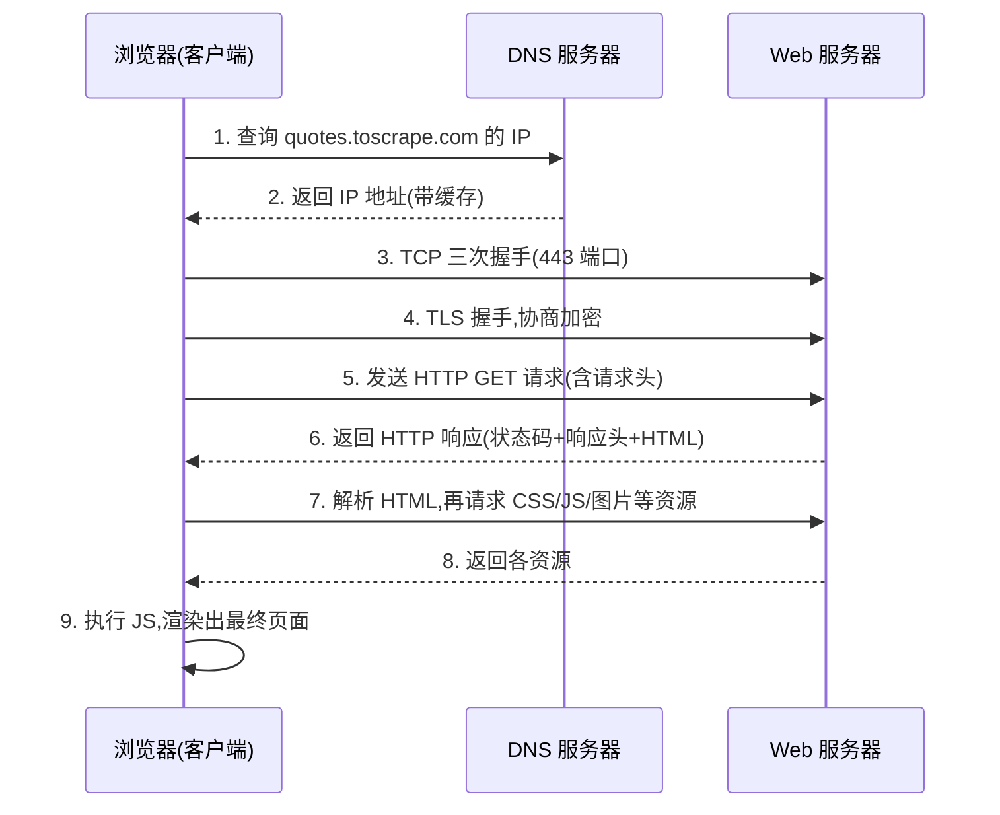
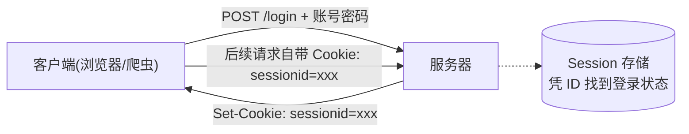

# 第 1 章 · HTTP 与网页结构基础

> 本章配套代码：`projects/crawler-lab/01_fetch_robots.py`
> 建议学习时长：约 3 小时

## 学习目标

学完本章，你能够：

1. 画出一次 HTTP 请求的完整时序（DNS → TCP → 请求 → 响应 → 渲染），并解释爬虫活动在其中的哪一段；
2. 拆解一个 URL 的结构，说清 GET/POST 的区别与常见状态码的含义；
3. 读懂 User-Agent、Cookie、Referer、Content-Type 这些请求头在爬虫场景下意味着什么，理解 Cookie 与 Session 的配合原理；
4. 用浏览器开发者工具的 Network 面板找到页面背后的 XHR 数据接口；
5. 读懂 robots.txt 的语法，并运行本章 lab 脚本抓取两个练习站点的 robots.txt 做出合规判断。

## 1.1 前置知识 / 本章地位

这是爬虫篇的第一章。全篇 8 章的主线是：**先懂网页（本章）→ 会发请求（第 2 章）→ 会解析（第 3 章）→ 会存储（第 4 章）→ 上框架（第 5 章）→ 懂合规与反爬（第 6 章）→ 动态页面（第 7 章）→ 工程化（第 8 章）**。

很多初学者一上来就背 requests 的 API，遇到「为什么我拿到的页面和浏览器看到的不一样」这类问题时束手无策——因为缺少 HTTP 与网页结构的底层模型。本章不写真正的采集代码，只做一件事：**把你将要自动化的对象（网页）和你要说的语言（HTTP）讲清楚**。

本章以及全篇的实战目标站点只有两个：`quotes.toscrape.com` 与 `books.toscrape.com`。它们是 Scrapy 官方维护的爬虫练习站，内容为虚构名言与虚构图书，明确欢迎抓取。**本教程所有可运行代码只针对这两个站点**，原因与法律边界详见第 6 章。

## 1.2 HTTP：爬虫与网站之间的对话语言

### 1.2.1 一次完整请求的时序

当你在浏览器输入 `https://quotes.toscrape.com/` 并回车，背后发生的事情比「打开网页」多得多：



爬虫做的事，就是把第 1~6 步用代码完成，然后跳过第 9 步直接解析第 6 步拿到的 HTML。**这个差异正是第 7 章「动态页面」问题的根源**：如果页面内容是第 9 步由 JavaScript 拼出来的，那么爬虫在第 6 步拿到的 HTML 里就没有这些内容——requests 用户对此的感受通常是「页面是空的」。

### 1.2.2 请求与响应的两段式结构

HTTP 报文分请求和响应，各自由「起始行 + 头部 + 正文」组成。一次真实的 GET 请求（可用 `curl -v` 看到）：

```http
GET / HTTP/1.1
Host: quotes.toscrape.com
User-Agent: curl/8.7.1
Accept: */*

```

响应：

```http
HTTP/1.1 200 OK
Content-Type: text/html; charset=utf-8
Content-Length: 11064

<!DOCTYPE html>
<html lang="en">
...
```

爬虫视角的关键点：

- **请求头由客户端说了算**，服务器据此判断「来访者是谁、想要什么」。requests 里改请求头就是传一个字典（第 2 章大量用到）；
- **响应头由服务器给出**，其中 `Content-Type` 告诉你正文是什么类型、`charset` 告诉你怎么解码——**第 2 章有一个真实案例：books.toscrape.com 不返回 charset，requests 猜错编码导致中文注释以外的英文文本正常、特殊字符乱码**，那里会专门处理；
- 正文才是数据所在：HTML 页面、JSON 字符串、图片二进制。

### 1.2.3 URL 结构

以一个练习站的详情页 URL 为例：

```text
https://books.toscrape.com/catalogue/category/books/travel_2/index.html
└─┬──┘ └──────┬────────┘└──────────────┬─────────────────────────┘
scheme      host                      path（含资源路径与 Slug）
```

完整成分还包括查询参数（`?page=2&order=price`）和锚点（`#section-3`，仅浏览器用，不会发给服务器）。爬虫常用的两类 URL 规律：

1. **路径规律**：`/page/1/`、`/page/2/`……分页直接遍历（第 2 章实战用到）；
2. **查询参数规律**：`/api/list?page=1` 这类接口分页，改参数即可翻页。

## 1.3 方法、状态码与请求头/响应头

### 1.3.1 常用方法

| 方法 | 语义 | 爬虫场景 |
|---|---|---|
| GET | 获取资源，无副作用 | 绝大多数采集任务 |
| POST | 提交数据（表单、登录） | 模拟登录、提交查询表单 |
| HEAD | 只要响应头不要正文 | 探测资源是否存在、看文件大小 |
| PUT/DELETE/PATCH | 修改/删除资源 | 爬虫几乎不用，属于接口开发范畴 |

GET 与 POST 的本质区别不在「参数放哪」，而在于语义：GET 是**读取**，应当幂等且可缓存；POST 是**提交**，会改变服务器状态。浏览器把 GET 参数放进 URL、POST 参数放进正文，只是两者的默认载体不同。

### 1.3.2 状态码速查表

| 状态码 | 含义 | 爬虫视角的解读 |
|---|---|---|
| 200 OK | 成功 | 正常采集 |
| 301/302 | 永久/临时重定向 | requests 默认自动跟随，注意 `resp.url` 已是最终地址 |
| 404 Not Found | 资源不存在 | robots.txt 返回 404 是特殊情形（见 1.7） |
| 403 Forbidden | 服务器拒绝 | 常见于 UA 检查/IP 封禁，第 6 章展开 |
| 429 Too Many Requests | 请求过于频繁 | **你的爬虫太快了，立刻降速**，而不是重试 |
| 5xx | 服务器内部错误 | 退避重试（第 2 章的重试封装） |

规律：**4xx 是「你的问题」，5xx 是「它的问题」**。看到 429 还加速重试，等于在别人喊停时继续敲门。

### 1.3.3 爬虫必须懂的头部字段

| 头部 | 方向 | 作用 | 爬虫注意点 |
|---|---|---|---|
| User-Agent | 请求 | 声明客户端身份 | 本仓库规范：标明教育用途，不伪装浏览器（见 1.8 与第 6 章） |
| Referer | 请求 | 从哪个页面跳来 | 有的站点校验防盗链；练习站不校验 |
| Cookie | 请求 | 携带会话凭证 | 登录态全靠它；用 Session 自动管理（1.5） |
| Content-Type | 两者 | 正文类型与编码 | `application/json` 接口用 `resp.json()` 解析 |
| Location | 响应 | 重定向目标 | 配合 301/302 出现 |

### 1.3.4 Cookie 与 Session：服务器如何「记住你」

HTTP 本身无状态——服务器天生不记得上一个请求是谁发的。Cookie 与 Session 是配套的补救方案：

1. 你第一次登录，服务器验证账号密码后，在自己这边建一条会话记录（Session），得到一个随机 ID；
2. 服务器通过响应头 `Set-Cookie: sessionid=abc123` 把这个 ID 发给你；
3. 浏览器存下 Cookie，之后每次请求同站自动带上 `Cookie: sessionid=abc123`；
4. 服务器凭 ID 查到会话记录，就知道你是已登录的谁。



对爬虫的含义：**登录后的采集，必须让「拿 Cookie」和「用 Cookie」发生在同一个会话对象里**。requests 的 `Session` 对象（第 2 章）和 Selenium 的 `driver`（第 7 章）都替你做了这件事；手动只复制一个 Cookie 字符串也能用，但容易在过期/轮换时失效。

## 1.4 HTML、DOM 与 CSS 选择器速成

### 1.4.1 HTML 是树

浏览器把 HTML 解析成一棵 DOM 树（Document Object Model，文档对象模型）。看练习站的一小段真实 HTML（来自 `quotes.toscrape.com`）：

```html
<div class="quote" itemscope itemtype="http://schema.org/CreativeWork">
    <span class="text" itemprop="text">“The world as we have created it is a process of our thinking.”</span>
    <span>by <small class="author" itemprop="author">Albert Einstein</small>
    <a href="/author/Albert-Einstein">(about)</a>
    </span>
    <div class="tags">
        <a class="tag" href="/tag/change/page/1/">change</a>
        <a class="tag" href="/tag/deep-thoughts/page/1/">deep-thoughts</a>
    </div>
</div>
```

树状结构是：

```text
div.quote
├── span.text          → 名言正文
├── span
│   ├── small.author   → 作者（text 节点）
│   └── a              → (about) 链接
└── div.tags
    ├── a.tag          → 标签 change
    └── a.tag          → 标签 deep-thoughts
```

爬虫解析的全部工作就是两件事：**定位到树上的节点（选择器），取出节点的文本或属性**。第 3 章的 BeautifulSoup 就是干这个的。

### 1.4.2 CSS 选择器速查

| 选择器 | 含义 | 本站示例 |
|---|---|---|
| `tag` | 按标签名 | `span` 选中所有 span |
| `.class` | 按 class | `.quote` 选中名言容器 |
| `#id` | 按 id | `#username`（登录表单输入框） |
| `A B` | A 的后代 B（任意深度） | `div.quote small.author` |
| `A > B` | A 的**直接**子元素 B | `div.tags > a.tag` |
| `[attr]` | 有该属性 | `a[href]` |
| `[attr^="x"]` | 属性值以 x 开头 | `a[href^="/author/"]` |
| `:first-child` 等 | 伪类 | `li.next a` 常配合翻页提取 |

最容易踩的坑是 `A B` 与 `A > B` 的区别：后代选择器穿透任意层，直接子代只认一层。第 3 章 lab 里有一段 XPath 演示专门让你体会这种差异（`/small` 扑空、`//small` 命中）。

## 1.5 开发者工具 Network 面板：找接口的基本功

写爬虫前先当一次「人肉爬虫」。以 Chrome 为例，按 `F12`（或右键 → 检查）打开开发者工具，切到 **Network（网络）** 面板，然后刷新页面：

1. **筛 Fetch/XHR**：页面静态资源（CSS/图片）先排除，只看异步数据请求；
2. **按大小排序**：JSON 数据接口通常体积明显大于其他小请求；
3. **逐个点开**：看 Headers（请求方法、参数）与 Preview（响应内容）；
4. **判断数据来源**：响应是完整的 JSON 数据 → 直接调接口（最省事）；响应里只有 HTML 壳 → 数据由 JS 拼装或另有一个数据接口没抓到 → 翻页/点击触发新 XHR，继续找。

判断「数据是直接在 HTML 里还是 JS 渲染出来的」还有一个粗暴办法：**右键 → 查看网页源代码**（`view-source:`），在源码里搜页面上肉眼可见的关键词。搜得到 → 数据就在 HTML 里，requests 能直接拿到；搜不到但页面显示正常 → JS 渲染，参考第 7 章。

**一个必须知道的事实**：右键「检查」看到的元素是渲染后的 DOM，与「查看源代码」看到的原始 HTML 可能不同。找数据时以「查看源代码」为准判断 requests 可行性，以「检查」为准分析渲染后的结构（配合第 7 章 Selenium）。

## 1.6 robots.txt：站点的公开意愿声明

### 1.6.1 语法

robots.txt 放在站点根目录（`https://example.com/robots.txt`），是人可读的纯文本，四类字段：

```text
User-agent: *              # 规则适用的爬虫（* 表示所有）
Disallow: /private/        # 禁止抓取的路径前缀
Allow: /public/            # 在 Disallow 范围里开例外
Crawl-delay: 2             # 建议两次抓取间隔 2 秒
Sitemap: https://example.com/sitemap.xml   # 站点地图位置
```

解读规则：

- 规则按 `User-agent` 分组，匹配你的 UA 组（没有专属组就看 `*` 组）；
- `Disallow: /` 表示全站禁抓；`Disallow:`（空值）表示全站允许；
- 匹配按路径前缀进行，`Allow` 优先级高于同组 `Disallow`（最长前缀匹配，细节以 RFC 9309 为准）。

### 1.6.2 三种获取结果，三种态度

| 获取结果 | 含义 | 应对 |
|---|---|---|
| 200 | 站点声明了规则 | 逐条遵守 |
| 404 | 未部署 robots.txt | 语义是「未声明限制」，**不等于「欢迎狂抓」**，仍要限速、标识身份 |
| 401/403 | robots.txt 本身不可读 | 按 RFC 9309 应保守处理，视为不允许抓取 |

robots.txt 是行业自律约定（RFC 9309 定义），不是法律本身；但它是判断「网站是否欢迎你」最直接的证据，也是司法实践中的重要参考（第 6 章的案例讨论会回到这一点）。本仓库的硬性规范：**Scrapy 项目 `ROBOTSTXT_OBEY = True` 不得关闭**（第 5 章）。

## 1.7 【实战】运行 lab：抓取并解读 robots.txt

脚本 `projects/crawler-lab/01_fetch_robots.py` 演示标准读法：请求两个练习站的 robots.txt，按状态码分类解读，200 时逐段解析字段。换到任何站点这段逻辑都能直接用。

```bash
source ~/opt/jjyv/bin/activate
python projects/crawler-lab/01_fetch_robots.py
```

预期输出（撰写时实测）：

```text
== https://quotes.toscrape.com/robots.txt -> HTTP 404
   404 -> 站点未部署 robots.txt，语义为「未声明限制」，并非「欢迎狂抓」

== https://books.toscrape.com/robots.txt -> HTTP 404
   404 -> 站点未部署 robots.txt，语义为「未声明限制」，并非「欢迎狂抓」
```

两个练习站都没部署 robots.txt。按上表的规则：这**不是**「可以放开抓」的许可，我们的应对仍然写死在代码里——UA 标明教育用途（`crawler-lab-edu/1.0 (educational use only)`）、请求间隔 ≥ 0.3s、只抓公开页面。第 2 章的实战脚本里你会看到这三条如何落地。

想看「真有规则」的站点长什么样，可以在浏览器访问任意大站的 `/robots.txt`（多数站点都有），把 URL 填进 `SITES` 列表再跑一次即可——脚本对 200 响应会逐条打印 Disallow 规则。注意：**对真实站点只看 robots.txt，不做采集**。

## 常见坑与排查（Troubleshooting）

| 现象 | 原因 | 解决办法 |
|---|---|---|
| requests 拿到的 HTML 和浏览器看到的不一样 | 内容由 JS 渲染（1.2.1 第 9 步缺失） | 先用「查看源代码」确认；确实 JS 渲染则走第 7 章 Selenium 或找 XHR 接口 |
| 在「检查」里能看到节点，代码里解析不到 | 检查面板显示的是渲染后 DOM | 用「查看源代码」核对原始 HTML |
| 爬虫请求 403，浏览器访问正常 | 服务器校验 UA/Referer/Cookie | 核对请求头与浏览器的差异（本教程练习站不会出现；真实站点还涉及合规判断，见第 6 章） |
| 分页爬到重复数据 | URL 规律猜错（`?page=2` 实际不影响结果） | 抓两页对比正文是否变化；优先用页面上的「下一页」链接 |
| robots.txt 拿到 403，误以为「不让看规则」 | 部分站点对无 UA 的请求统一 403 | 带 UA 请求；仍 403 则按保守策略处理 |
| CSS 选择器在代码里匹配不到 | 选择器写的是渲染后结构，或父子层级理解错（`A B` vs `A > B`） | 从最近的稳定容器逐层往下写，第 3 章有系统训练 |

## 动手练习

1. **拆 URL**：分别写出 `https://quotes.toscrape.com/tag/deep-thoughts/page/2/` 和 `https://quotes.toscrape.com/api/quotes?page=3` 的 scheme/host/path/查询参数，并判断各自适合哪种分页遍历方式。
   <details><summary>提示</summary>前者是路径分页（页码在 path 里），后者是参数分页（页码在查询串里）。前者改路径，后者改参数。</details>
2. **人肉找接口**：打开 `quotes.toscrape.com/js/` 页面，用「查看源代码」搜 `The world as we have created`，再「检查」同一个元素，把两种视角的差异写下来（3 句话以内）。
   <details><summary>提示</summary>源码里搜不到正文，检查里能看到——数据由 JS 渲染，requests 直拿不行。这正是第 7 章的主场。</details>
3. **读一份真实 robots.txt**：在浏览器打开任意一个你常用网站的 `/robots.txt`，找出：针对所有爬虫的 Disallow 规则有几条？有没有 Crawl-delay？有没有针对特定爬虫（如 Googlebot）的专属组？
   <details><summary>提示</summary>注意 User-agent 分组，规则只对匹配的组生效。找不到该文件（404）也是一种观察结果，对照 1.6.2 的表格解读。</details>
4. **跑通 lab 并改造**：运行 01_fetch_robots.py，然后给 `SITES` 加一个站点观察输出变化；再把脚本里对 200 的解析部分加一行，统计该文件共有多少条 Disallow 规则。
   <details><summary>提示</summary>解析循环里已有 Disallow 分支，加个计数器即可；运行后与文件原文对照验证。</details>

## 小结与自检清单

- [ ] 我能画出 HTTP 请求的 9 步时序，并指出爬虫代替浏览器做到了第几步
- [ ] 我能拆解 URL 的 scheme/host/path/查询参数，并区分两类分页规律
- [ ] 我记住 4xx 是自己的问题、5xx 是服务器的问题、429 是明确的降速信号
- [ ] 我能解释 Cookie 与 Session 的配合原理，知道登录态为什么要放进同一个会话对象
- [ ] 我会用「查看源代码」判断数据是否需要 JS 渲染，会用 Network 面板找 XHR 接口
- [ ] 我能读懂 robots.txt 的四类字段，知道 404/401/403 三种结果的合规含义
- [ ] 我理解本教程为什么只对两个练习站写可运行代码（第 6 章会展开法律细节）

## 延伸阅读

- [MDN：HTTP 概述](https://developer.mozilla.org/zh-CN/docs/Web/HTTP/Overview)——HTTP 报文结构与方法语义的权威中文文档，本章 1.2/1.3 的展开版。
- [MDN：HTTP 状态码](https://developer.mozilla.org/zh-CN/docs/Web/HTTP/Reference/Status)——全部状态码的官方释义，收藏备查。
- [RFC 9309：Robots Exclusion Protocol](https://www.rfc-editor.org/rfc/rfc9309.html)——robots.txt 协议的正式标准，1.6 的解读以此为准。
- [MDN：CSS 选择器](https://developer.mozilla.org/zh-CN/docs/Web/CSS/CSS_selectors)——选择器完整语法，第 3 章会继续用到。
- [Scrapy 官方教程](https://docs.scrapy.org/en/latest/intro/tutorial.html)——两个练习站正是为它而建，学完第 5 章回看会很有共鸣。
- 下一章：[requests 爬虫实战](02-requests爬虫实战.md)——用代码发出你的第一个采集请求。
