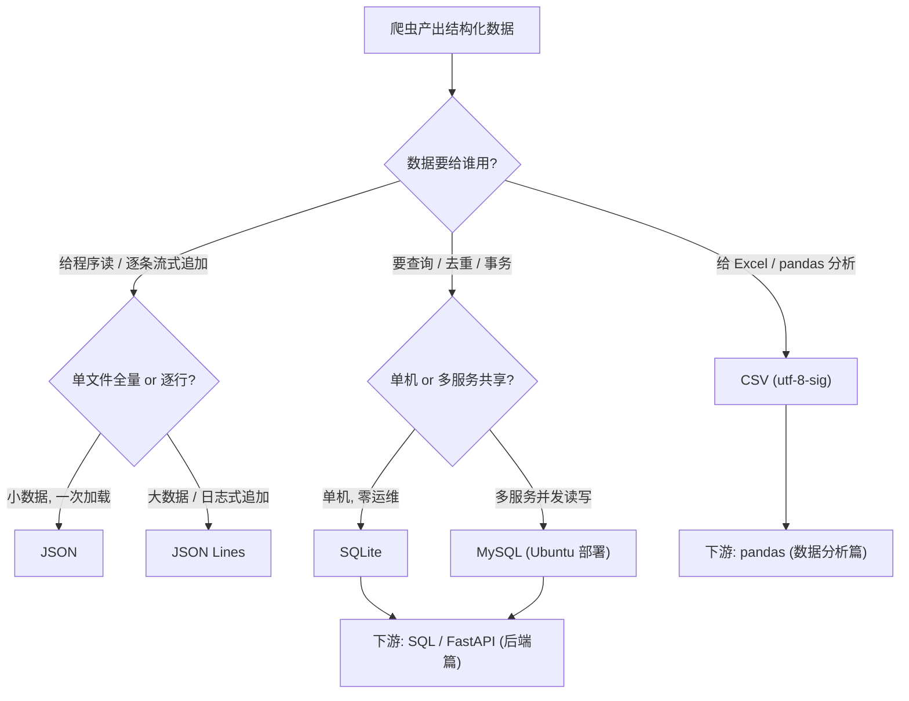

# 第 4 章 · 数据存储（CSV / JSON / SQLite / MySQL）

> 本章配套代码：`projects/crawler-lab/04_store_sqlite.py`
> 建议学习时长：约 3.5 小时

## 学习目标

学完本章，你能够：

1. 用决策树为一次采集任务选择存储格式（CSV / JSON / JSON Lines / SQLite / MySQL），并说出理由；
2. 写出 Excel 打开不乱码的 CSV（`utf-8-sig`），解释 BOM 的作用；
3. 完成 SQLite 的建表、参数绑定写入、UPSERT 幂等入库、事务提交与验证查询的完整流程；
4. 坚守本仓库硬规范——**SQL 一律参数绑定**——并能在代码评审时指出字符串拼接 SQL 的注入与碎裂风险；
5. 设计去重策略（数据库 UNIQUE + UPSERT 为骨架），理解增量爬取的基本思想；
6. 用 pymysql 写出 `%s` 绑定的 MySQL 写入代码（部署准备见 Ubuntu 篇第 8 章）。

## 4.1 前置知识 / 本章地位

第 2、3 章解决了「拿到数据」，本章解决「数据放哪里」。存储决策直接决定下游能做什么：CSV 进 Excel/pandas、JSON 进程序、SQLite/MySQL 进 SQL 与多表关联。本章以 `quotes.json`（第 2 章实战产出，100 条名言）为输入，把同一份数据分别写成三种格式并入库 SQLite，输出全部落在 `projects/crawler-lab/data/`。

## 4.2 存储选型决策树



速记版：

| 格式 | 优势 | 短板 | 典型场景 |
|---|---|---|---|
| CSV | 通用、Excel/pandas 直接吃 | 嵌套结构要拍平、转义易错 | 表格型数据的分析交付 |
| JSON | 保真嵌套结构、程序友好 | 全量单文件、追加写要整读整写 | 配置、中小规模结果交付 |
| JSON Lines | 每行独立、流式追加、断行只坏一行 | 不能一次 `json.load` | 大规模采集的落地格式、日志 |
| SQLite | 零部署的单文件数据库、SQL 查询去重事务全套 | 并发写弱、不适合网络共享 | 单机爬虫的标准落库（本篇主线） |
| MySQL | 多客户端并发、成熟运维生态（Ubuntu 篇第 8 章部署） | 需要服务器与账号管理 | 团队/服务化场景 |

## 4.3 CSV：Excel 不乱码的关键是 utf-8-sig

CSV 本身没有官方标准（RFC 4180 是事实标准），坑集中在**编码**与**转义**两处。直接用 UTF-8 写出的 CSV，在 Windows Excel 双击打开默认按 GBK/ANSI 解读——中文全成乱码。解法是 `utf-8-sig`：文件头多写 3 字节 BOM（Byte Order Mark，`EF BB BF`），Excel 看到 BOM 就知道是 UTF-8：

```python
import csv
from pathlib import Path

quotes = [{"text": "…", "author": "Albert Einstein", "tags": ["change", "world"]}]

path = Path("data/quotes.csv")
with path.open("w", newline="", encoding="utf-8-sig") as f:
    writer = csv.writer(f)
    writer.writerow(["text", "author", "tags"])          # 表头
    for q in quotes:
        writer.writerow([q["text"], q["author"], "|".join(q["tags"])])
```

三个细节：

1. **`newline=""` 必须加**：否则 Windows 上每行后面多一个空行（csv 模块自己管换行）；
2. **嵌套结构要拍平**：CSV 没有数组概念，`tags` 列表用 `|` 拼成一个字符串，读回来再 `split("|")`；选择 `|` 而不是逗号，是为了避免与 CSV 分隔符撞车；
3. **csv 模块自动处理转义**：名言里的逗号、引号会被正确加引号包裹，不要手写拼接 CSV 行。

验证乱码修没修好：`file data/quotes.csv` 应显示 `UTF-8 Unicode (with BOM) text`；Excel 双击中文正常即通过。

## 4.4 JSON 与 JSON Lines

### 4.4.1 JSON 全量文件

```python
import json

result = {"source": "https://quotes.toscrape.com", "count": len(quotes), "quotes": quotes}
Path("data/quotes.json").write_text(
    json.dumps(result, ensure_ascii=False, indent=2), encoding="utf-8"
)
```

- **`ensure_ascii=False` 必须显式写**：默认 True 会把所有非 ASCII 字符转成 `\uXXXX` 转义，中文在文件里不可读（数据没坏，但没法用编辑器直接查看）；
- 采集元数据（`source`、`crawled_at` 时间戳）写进顶层——三个月后你会感谢这行「数据从哪来」的记录；
- `indent=2` 是给人看的，数据量大时去掉可省一半以上磁盘。

### 4.4.2 JSON Lines

每行一个独立 JSON 对象，行间没有逗号：

```jsonl
{"text": "…", "author": "Albert Einstein", "tags": ["change"]}
{"text": "…", "author": "J.K. Rowling", "tags": ["abilities"]}
```

```python
with Path("data/quotes.jsonl").open("w", encoding="utf-8") as f:
    for q in quotes:
        f.write(json.dumps(q, ensure_ascii=False) + "\n")
```

它真正的价值在**追加模式**：爬虫跑几天、结果按行 append，进程崩了已写的行完好（JSON 全量文件则会整个损坏）；处理时逐行 `json.loads` 流式消费，内存占用恒定。Scrapy 的 FEEDS 导出 JSON Lines 只要 `"format": "jsonlines"`（第 5 章）。

## 4.5 SQLite：单机爬虫的标准落库

SQLite 是嵌入式的单文件数据库——没有服务进程、没有账号、`sqlite3` 标准库自带，`import` 即用。写入流程四步：连接 → 建表 → 参数绑定写入 → 提交。

### 4.5.1 硬规范：参数绑定，禁止拼接 SQL

**本仓库硬性规范：任何含外部数据的 SQL 必须用占位符绑定，禁止 f-string/`+` 拼接。** 先看危险写法（反面案例，**禁止出现在真实代码中**）：

```python
# ❌ 危险！仅作警示，两种死法：
sql = f"INSERT INTO quotes (text, author) VALUES ('{text}', '{author}')"
cur.execute(sql)
```

1. **SQL 碎裂**：名言正文里出现 `O'Brien` 的单引号，SQL 立刻语法错误；数据里出现逗号引号反斜杠，防不胜防；
2. **SQL 注入**：如果 `text` 来自页面，攻击者构造的数据可以**改写你的 SQL 语义**（比如补一个 `'); DROP TABLE quotes; --`）。在数据生产环节埋注入点，是真实事故的高发形态。

正确写法——SQL 是常量字符串，数据全部通过 `?` 占位符由驱动转义：

```python
import sqlite3

conn = sqlite3.connect("data/quotes.db")
try:
    cur = conn.cursor()
    cur.execute(
        """
        CREATE TABLE IF NOT EXISTS quotes (
            id     INTEGER PRIMARY KEY AUTOINCREMENT,
            text   TEXT NOT NULL UNIQUE,   -- 名言全文唯一 -> 数据库层去重防线
            author TEXT NOT NULL,
            tags   TEXT NOT NULL           -- 教学简化;规范库设计见 4.7
        )
        """
    )
    upsert_sql = """
        INSERT INTO quotes (text, author, tags)
        VALUES (?, ?, ?)
        ON CONFLICT(text) DO UPDATE SET tags = excluded.tags
    """
    params = [(q["text"], q["author"], ",".join(q["tags"])) for q in quotes]
    cur.executemany(upsert_sql, params)   # 批量绑定:一条语句形式,多次传参
    conn.commit()                         # 写操作必须 commit 才落盘
finally:
    conn.close()
```

| 驱动 | 占位符 | 绑定方式 |
|---|---|---|
| sqlite3 | `?` | `cur.execute(sql, (a, b, c))` |
| pymysql（MySQL） | `%s` | `cur.execute(sql, (a, b, c))` |
| SQLAlchemy 2.0 | `:name` | `conn.execute(text(sql), {"name": v})` |

三个 MySQL 场景要点（部署与账号准备按 Ubuntu 篇第 8 章完成，本章不重复）：占位符是 `%s` 不是 `?`；连库用 `pymysql.connect(host=..., user=..., password=..., database=..., charset="utf8mb4")`——**密码从环境变量读**（`.env` 方案见第 8 章 8.8 节与全仓库密钥安全规范），绝不写进代码；写操作同样要 `conn.commit()`。

### 4.5.2 UPSERT 与幂等

爬虫重跑是常态（断点续爬、增量更新、手动重试），入库必须**幂等**：同一批数据跑两遍，库的状态不变。手段是「UNIQUE 约束 + `ON CONFLICT ... DO UPDATE`」：

- `text TEXT NOT NULL UNIQUE` 声明唯一约束——数据库层的最后防线，重复行物理上进不来；
- `ON CONFLICT(text) DO UPDATE SET tags = excluded.tags` 遇到重复时不报错，改为更新指定字段（`excluded` 指代「本次被拒之门外的那条新数据」）。

只想去重不更新，用 `ON CONFLICT(text) DO NOTHING`。

### 4.5.3 事务：commit 的时机

sqlite3 默认开启隐式事务：`execute` 的写操作先进缓冲，`commit()` 才真正落盘。工程折中是**分批提交**（第 5 章 Pipeline 里 BATCH_COMMIT_SIZE=100）：全量一条事务性能最好但中途崩溃全丢；每条一提交最安全但慢；每 100 条一提交，崩溃最多丢一小批。最后记得 `finally: conn.close()`（close 前未 commit 的写会回滚）。

### 4.5.4 验证查询

SELECT 无需 commit，但同样支持参数绑定（`WHERE tags LIKE ?` 传 `("%books%",)`）。常用验证三连：`COUNT(*)` 总数、`GROUP BY author ORDER BY COUNT(*) DESC` 聚合排行、`LIMIT` 抽样核对。

### 4.5.5 sqlite3 命令行：不用 Python 也能查库

服务器上排查数据问题不需要写 Python——SQLite 自带 CLI（Ubuntu 上 `sudo apt install sqlite3`），这也呼应 Ubuntu 篇的命令行习惯。几个高频命令：

```bash
sqlite3 projects/crawler-lab/data/quotes.db
```

```sql
-- 打开交互台后
.tables                                  -- 列出所有表
.schema quotes                           -- 看建表语句
SELECT COUNT(*) FROM quotes;             -- 总数
SELECT author, COUNT(*) n FROM quotes
GROUP BY author ORDER BY n DESC LIMIT 3; -- 聚合排行
.quit                                    -- 退出
```

预期输出（以本仓库数据为例，撰写时实测）：

```text
sqlite> .tables
quotes
sqlite> SELECT author, COUNT(*) n FROM quotes
   ...> GROUP BY author ORDER BY n DESC LIMIT 3;
Albert Einstein  10
J.K. Rowling     9
Marilyn Monroe   7
```

一次性查询的 `-line` 模式适合看单条记录（每列一行，长字段不折断）：

```bash
sqlite3 -line projects/crawler-lab/data/quotes.db "SELECT * FROM quotes LIMIT 1;"
```

第 5 章实战的验收命令（`sqlite3 data/books.db "SELECT COUNT(*), COUNT(DISTINCT upc) FROM books;"`）用的正是这套——把「验证查询」从 Python 里搬进 shell，是服务器运维的日常。

## 4.6 去重策略与增量爬取思想

去重有三道防线，按成本从低到高排：

1. **内存 set**：进程内 `seen = set()`，快，但重启就丢（第 5 章 Pipeline 的第一道）；
2. **数据库 UNIQUE 约束 + UPSERT**：跨进程、跨重跑都有效，是**可靠性担当**（本章主线）；
3. **指纹去重**：对内容做哈希（如 `hashlib.sha256(text.encode()).hexdigest()`）替代全文做唯一键——字段太长、或要跨字段组合判重时用。

**增量爬取**是去重思想的延伸：第二次运行时不再全量抓，而是跳过已知记录。最小可行实现（本篇第 8 章 8.5 节给出完整代码）：

- 采集前从库中加载已抓的键集合（如已存在的 `text` 或 URL 列表）；
- 请求层跳过已抓 URL（省带宽与请求次数），存储层靠 UPSERT 兜底（防漏网）；
- 数据带 `crawled_at` 时间戳字段，区分「首采」与「更新」。

原则总结：**URL 去重省请求，内容去重保数据，数据库约束做最后防线**——三层各司其职。

## 4.7 【实战】运行 lab：一份 quotes，三种落盘 + 幂等验证

`projects/crawler-lab/04_store_sqlite.py` 把本章核心全部落地：同一份 `data/quotes.json` 写 CSV（utf-8-sig）、写 JSON Lines、UPSERT 进 SQLite 并查询验证，最后**重复入库一遍验证幂等**。前置：先跑第 2 章 lab。

```bash
source ~/opt/jjyv/bin/activate
python projects/crawler-lab/04_store_sqlite.py
```

预期输出（撰写时实测）：

```text
[csv]    写入 100 行 -> quotes.csv
[jsonl]  写入 100 行 -> quotes.jsonl
[sqlite] UPSERT 100 行 -> quotes.db

== 验证：名言总数 = 100
== 作品最多的 5 位作者：
   Albert Einstein        10 条
   J.K. Rowling           9 条
   Marilyn Monroe         7 条
   Mark Twain             6 条
   Dr. Seuss              6 条
== 含 'books' 标签的样例：
   - “The person, be it gentleman or lady, who has not pl ...
   - “Good friends, good books, and a sleepy conscience:  ...
[sqlite] UPSERT 100 行 -> quotes.db

重复入库后总数仍为 100（UNIQUE 约束 + UPSERT 保证幂等）
```

三个验收观察点：作者排行与站点实际内容相符（爱因斯坦 10 条最多）；「含 books 标签」的样例返回的是**与图书相关**的名言（LIKE 参数绑定生效）；重复入库后总数不变（幂等成立）。用命令行再确认 CSV 编码：

```bash
file projects/crawler-lab/data/quotes.csv
```

预期输出：

```text
projects/crawler-lab/data/quotes.csv: UTF-8 Unicode (with BOM) text, with very long lines (355), with CRLF line terminators
```

## 常见坑与排查（Troubleshooting）

| 现象 | 原因 | 解决办法 |
|---|---|---|
| Excel 打开 CSV 中文全乱码 | 用了 `utf-8` 而非 `utf-8-sig`，Excel 不认无 BOM 的 UTF-8 | `open(..., encoding="utf-8-sig")` 重写 |
| CSV 每行之间有空行 | `open()` 没传 `newline=""` | csv 文件句柄必须 `newline=""`（4.3 节） |
| `sqlite3.IntegrityError: UNIQUE constraint failed` | 表有 UNIQUE 但没用 UPSERT，重跑撞唯一键 | 改 `ON CONFLICT(...) DO UPDATE/DO NOTHING` |
| 写完 SQLite 数据查不到（另一连接/重启后为空） | 忘了 `conn.commit()` | 写操作后 commit；分批提交见 4.5.3 |
| `sqlite3.ProgrammingError: Incorrect number of bindings` | 占位符个数与参数元组长度不一致 | 数一下 `?` 与元组元素；executemany 传的是元组的列表 |
| SQL 里中文/单引号数据导致语法错误 | 字符串拼接 SQL（本仓库禁止的反面案例） | 全部改参数绑定，见 4.5.1 |
| pymysql 占位符用了 `?` 报错 | MySQL 驱动占位符是 `%s` | 换 `%s`；SQL 里确需字面 `%` 时写 `%%` |
| JSON 文件打开满屏 `\uXXXX` | `json.dumps` 默认 `ensure_ascii=True` | 写入时 `ensure_ascii=False` |
| 大文件 `json.load` 内存吃紧 | 全量 JSON 一次性加载 | 换 JSON Lines 逐行读，见 4.4.2 |
| 重跑爬虫数据翻倍 | 只在内存去重，没建数据库唯一约束 | UNIQUE + UPSERT（内存 set 只是第一道快筛，不是防线） |

## 动手练习

1. **三格式互转**：把 `quotes.db` 里的数据读出来，分别再写出 CSV 与 JSON Lines（不读 quotes.json），用 `diff` 对比与 lab 产出是否一致。
   <details><summary>提示</summary>SELECT text, author, tags 后 tags 用 split(",") 还原列表。注意 lab 写库时把列表拼成了逗号串。</details>
2. **指纹去重**：给 `quotes` 表加一列 `fingerprint`（text 的 sha256 前 16 位），改为按 fingerprint 建唯一索引 + UPSERT，重跑验证幂等；再观察长文本判重时指纹方案的存储收益。
   <details><summary>提示</summary>`ALTER TABLE quotes ADD COLUMN fingerprint TEXT` + `CREATE UNIQUE INDEX ... ON quotes(fingerprint)`；hashlib 计算放 Python 侧。</details>
3. **MySQL 练习**（按 Ubuntu 篇第 8 章完成部署后）：把 100 条名言写入 MySQL 的 `quotes` 表（pymysql + `%s` 绑定 + executemany），密码从环境变量 `MYSQL_PASSWORD` 读取；重复写入验证幂等。
   <details><summary>提示</summary>表结构参照 4.5.1 改成 MySQL 语法（AUTO_INCREMENT 主键、UNIQUE KEY）；`os.environ["MYSQL_PASSWORD"]` 取密码，用 `export` 或 .env 注入。</details>
4. **增量爬取雏形**：修改第 2 章 lab，启动时先从 `quotes.db` 加载已入库 text 集合；解析后先在内存过滤已知记录再打印「新增 N 条」，全部已知则提前结束翻页。重跑观察输出。
   <details><summary>提示</summary>新增为 0 时 break 即可提前结束；注意仍要保留 UPSERT 兜底，防第一层判断有漏洞。</details>

## 小结与自检清单

- [ ] 我能按决策树为任务选存储格式，说出 CSV/JSON/JSONL/SQLite/MySQL 各自的定位
- [ ] 我写 CSV 默认 `utf-8-sig` + `newline=""`，知道 BOM 是给 Excel 的信号
- [ ] 我写 JSON 默认 `ensure_ascii=False`，知道 JSON Lines 在追加与流式场景的优势
- [ ] 我能默写 SQLite 写入四步（连接/建表/绑定/提交），并解释分批 commit 的取舍
- [ ] **我没有任何一处字符串拼接 SQL**，能给同事讲清反面案例的碎裂与注入两种死法
- [ ] 我理解三道去重防线与 UPSERT 幂等的机制，重跑数据不翻倍
- [ ] 我知道 MySQL 用 `%s`、密码走环境变量，部署按 Ubuntu 篇第 8 章
- [ ] 我跑通了 lab，幂等验证输出「重复入库后总数仍为 100」

## 延伸阅读

- [SQLite 官方文档：UPSERT](https://www.sqlite.org/lang_upsert.html)——`ON CONFLICT` 语法的权威定义（SQLite 3.24+ 支持）。
- [Python sqlite3 官方文档](https://docs.python.org/zh-cn/3/library/sqlite3.html)——占位符、事务控制行为（含 `isolation_level`）的官方说明。
- [pymysql 官方文档](https://pymysql.readthedocs.io/en/latest/)——MySQL 连接与 `%s` 参数化查询的参考。
- [RFC 4180](https://www.rfc-editor.org/rfc/rfc4180.html)——CSV 的「事实标准」格式定义，转义规则出处。
- [JSON Lines 官网](https://jsonlines.org/)——该格式的约定与动机。
- 上一章：[HTML 解析（BeautifulSoup 与 lxml）](03-HTML解析(BeautifulSoup与lxml).md)；下一章：[Scrapy 框架完全指南](05-Scrapy框架完全指南.md)。
