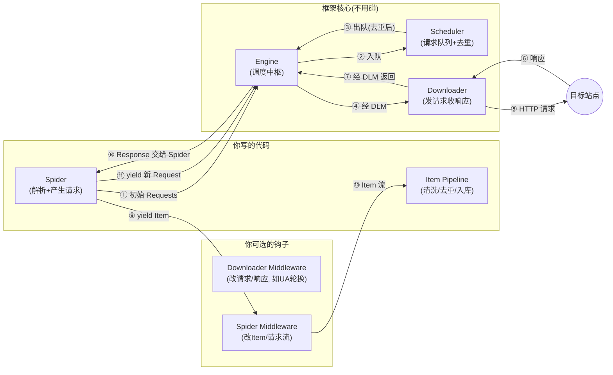

# 第 5 章 · Scrapy 框架完全指南

> 本章配套代码：`projects/crawler-lab/book_scrapy/`（完整 Scrapy 项目，运行命令见 5.9 节）
> 建议学习时长：约 5 小时

## 学习目标

学完本章，你能够：

1. 说清 Scrapy 相比「requests + bs4 脚本」解决了什么问题，以及什么场景不该用它；
2. 画出 Scrapy 六大组件的数据流（Engine / Scheduler / Downloader / Spider / Pipeline / Middleware）；
3. 用 `startproject` 建项目，写 Spider 理解 `yield Item` 与 `yield Request` 的双轨语义；
4. 用 CrawlSpider 的 `Rule + LinkExtractor` 声明式完成全站抓取（翻页、跨分类、进详情）；
5. 写 Item Pipeline 落库 SQLite（参数绑定 + 去重 + 分批提交），配置 FEEDS 双导出；
6. 配好礼貌三件套：`ROBOTSTXT_OBEY=True`（硬规范，不得关闭）、`DOWNLOAD_DELAY`、AutoThrottle；
7. 用 scrapy shell 交互式调试选择器，把「改代码 → 重跑 → 猜为什么」的循环压缩到秒级；
8. 完成本章实战：books.toscrape.com 全站 1000 本图书采集入库（真实运行统计见 5.9.3）。

## 5.1 前置知识 / 本章地位

前四章你用「requests + 解析 + 存储」三件套写出了完整爬虫——但都是**脚本**：单线程、自己管理翻页队列、自己写重试、自己挑请求顺序。Scrapy 把这些工程问题全部框架化：异步并发引擎、去重队列、重试与限速、管道化数据流、命令行与日志。它的定位类似 Web 世界的 Django：**约定多于配置，学会组件划分后，换个站点只是改 Spider 的选择器**。

版本事实（撰写时实测，以官方仓库为准）：Scrapy 2.13.3，Python 3.14.0。依赖前置：第 1 章 HTTP 模型（Scheduler/Middleware 的行为都建立在它之上）、第 3 章 CSS/XPath（Spider 里就是这两样）、第 4 章 SQLite 参数绑定（Pipeline 直接复用）。

**什么时候不用 Scrapy**：只抓三五页的一次性任务（脚本更快）；需要操作浏览器交互的 JS 页面（第 7 章的 Selenium，虽然 Scrapy 也有 scrapy-playwright 等扩展，超出本教程范围）；需要精细控制每个请求时序的复杂场景。Scrapy 的价值在「多页面、需调度、要持续维护」的采集任务。

## 5.2 架构：数据流与六大组件



一句话读懂每个组件的职责：

| 组件 | 职责 | 你要不要写代码 |
|---|---|---|
| Engine | 总调度：在 Scheduler、Downloader、Spider 之间搬运请求与响应 | 不写 |
| Scheduler | 请求队列管理 + **URL 去重**（dupefilter）+ 可选磁盘持久化 | 通常不写（可换队列后端） |
| Downloader | 真正发 HTTP；处理并发、延迟、超时、重试 | 不写（配置它） |
| Spider | 你的业务：解析响应，`yield` Item 或新 Request | **核心工作区** |
| Item Pipeline | Item 的质检与仓储：清洗、去重、入库 | **核心工作区** |
| Downloader Middleware | 出站请求/入站响应的拦截器（UA 轮换、代理、重试策略） | 按需写 |
| Spider Middleware | Spider 输入输出的 Item/Request 流过滤 | 少用 |

框架的收益全部来自这套分工：**并发、限速、去重、重试、重定向、gzip 解压**这些苦活 Engine/Scheduler/Downloader 默认就做了——你在脚本章手写的 `fetch_with_retry`（第 2 章）和翻页 while 循环，在 Scrapy 里分别是「内置重试中间件 + 一个 `yield`」。

## 5.3 项目结构与三个文件

```bash
cd projects/crawler-lab
scrapy startproject book_scrapy
cd book_scrapy
scrapy genspider books books.toscrape.com
```

生成结构（本仓库 `projects/crawler-lab/book_scrapy/` 已是完成的实战项目）：

```text
book_scrapy/
├── scrapy.cfg                  # 部署配置:告诉 scrapy 命令 settings 模块在哪
└── book_scrapy/                # Python 包(与外层同名是 Scrapy 的约定)
    ├── __init__.py
    ├── items.py                # 数据结构声明
    ├── middlewares.py          # 中间件(本项目:UA 轮换)
    ├── pipelines.py            # Item 管道(本项目:SQLite 入库)
    ├── settings.py             # 全部开关
    └── spiders/
        ├── __init__.py
        └── books.py            # Spider:解析与翻页逻辑
```

初学者只需要盯住四个文件：**spiders/books.py（怎么抓）→ items.py（抓什么）→ pipelines.py（怎么存）→ settings.py（抓多快、守什么规矩）**。

## 5.4 Spider：yield 的双轨语义

### 5.4.1 Item 与 Request

Spider 回调返回的必须是两种东西之一：**Item**（一条数据）或 **Request**（一个新请求）。这个双轨设计就是 Scrapy 的灵魂——「解析」与「调度」被统一成一个生成器流：

```python
import scrapy
from myproject.items import MyItem

class ExampleSpider(scrapy.Spider):
    name = "example"
    start_urls = ["https://quotes.toscrape.com/"]

    def parse(self, response):
        # 轨道一:数据流。response 自带 css/xpath(第 3 章的两套 API 直接可用)
        for q in response.css("div.quote"):
            item = MyItem()
            item["text"] = q.css("span.text::text").get()
            item["author"] = q.css("small.author::text").get()
            yield item
        # 轨道二:请求流。翻页就是再 yield 一个 Request,callback 指定谁来解析
        next_href = response.css("li.next a::attr(href)").get()
        if next_href:
            yield response.follow(next_href, callback=self.parse)
```

要点：

- `response.css("...::text")` 的 `::text` / `::attr(href)` 是 Scrapy 扩展的伪元素写法，直接取文本/属性（对应第 3 章 `get_text()` 与 `["href"]` 的角色）；
- `response.follow(href, callback=...)` 自动处理相对路径拼接，比手写 `urljoin` 稳；
- Spider 里**不要**调 `time.sleep`、不要自己发 requests——节奏归 Engine 管（`DOWNLOAD_DELAY`/AutoThrottle），自己 sleep 既破坏限速模型也拖慢并发。

### 5.4.2 CrawlSpider：声明式全站抓取

全站抓取的链接规律（分类页、翻页、详情页）用普通 Spider 写是一堆 if-else；CrawlSpider 把它变成规则声明。本仓库实战 Spider `book_scrapy/book_scrapy/spiders/books.py` 全文：

```python
import scrapy
from scrapy.linkextractors import LinkExtractor
from scrapy.spiders import CrawlSpider, Rule

from book_scrapy.items import BookItem

RATING_MAP = {"One": 1, "Two": 2, "Three": 3, "Four": 4, "Five": 5}

class BooksSpider(CrawlSpider):
    name = "books"
    allowed_domains = ["books.toscrape.com"]
    start_urls = ["https://books.toscrape.com/"]

    rules = (
        # 规则 1:分类列表页(含分页 page-N.html)——只跟进链接,不产出 Item
        Rule(
            LinkExtractor(allow=(r"/catalogue/category/books/", r"/catalogue/category/books_1/")),
            follow=True,
        ),
        # 规则 2:图书详情页——交给 parse_book 解析;follow=False 不再扩散
        Rule(
            LinkExtractor(
                allow=r"/catalogue/[^/]+/index\.html",
                deny=r"/catalogue/category/",
            ),
            callback="parse_book",
            follow=False,
        ),
    )

    def parse_book(self, response: scrapy.http.Response):
        price_text = response.css("p.price_color::text").get("")
        rating_word = response.css("p.star-rating::attr(class)").re_first(r"star-rating (\w+)")
        stock_text = response.xpath(
            '//th[contains(text(), "Availability")]/following-sibling::td/text()'
        ).get("")
        qty = "".join(ch for ch in stock_text if ch.isdigit()) or "0"

        item = BookItem()
        item["upc"] = response.xpath('//th[text()="UPC"]/following-sibling::td/text()').get()
        item["title"] = response.css("div.product_main h1::text").get()
        item["category"] = response.css("ul.breadcrumb li a::text")[-1].get()
        item["price"] = float(price_text.replace("£", "").strip()) if "£" in price_text else None
        item["rating"] = RATING_MAP.get(rating_word, 0)
        item["in_stock"] = "in stock" in stock_text.lower()
        item["stock_qty"] = int(qty)
        item["url"] = response.url
        yield item
```

Rule 的三个参数语义（全站抓取的心智模型）：

- `LinkExtractor(allow=..., deny=...)`：从每个已抓页面里**筛出符合正则的链接**；
- `follow=True/False`：命中的页面**要不要继续从中提取链接**。分类页要（里面有翻页与详情链接），详情页不要（叶子节点）；
- `callback="parse_book"`：命中的页面交给哪个回调解析。

两条 Rule 的分工即全站策略：**规则 1 吃下所有分类页与翻页（`/catalogue/category/books...`），规则 2 吃下所有详情页（`/catalogue/<slug>/index.html` 且不在 category 路径下）**。`allowed_domains` 是最后一道边界——跨域链接一律不跟。

### 5.4.3 items.py：数据的合同

```python
import scrapy

class BookItem(scrapy.Item):
    upc = scrapy.Field()        # 全站唯一 -> 用作去重键
    title = scrapy.Field()
    category = scrapy.Field()
    price = scrapy.Field()      # 浮点,已去掉货币符号
    rating = scrapy.Field()     # 1-5 整数
    in_stock = scrapy.Field()
    stock_qty = scrapy.Field()
    url = scrapy.Field()
```

清洗放在 Spider 层（`£` 去掉、评分转 int、库存转数字），让 Item 一产出就是「干净形状」，Pipeline 只做校验与入库——职责分离让排查问题时不用两头翻。

## 5.5 Pipeline：SQLite 入库（参数绑定）与三层去重

`book_scrapy/book_scrapy/pipelines.py` 的完整逻辑（节选自实战项目，SQL 处理遵循第 4 章硬规范）：

```python
UPSERT_SQL = """
INSERT INTO books (upc, title, category, price, rating, in_stock, stock_qty, url)
VALUES (?, ?, ?, ?, ?, ?, ?, ?)
ON CONFLICT(upc) DO UPDATE SET
    price = excluded.price,
    rating = excluded.rating,
    in_stock = excluded.in_stock,
    stock_qty = excluded.stock_qty
"""

class SQLitePipeline:
    BATCH_COMMIT_SIZE = 100

    def open_spider(self, spider):
        self.conn = sqlite3.connect(DATA_DIR / "books.db")
        self.cur = self.conn.cursor()
        self.cur.execute("CREATE TABLE IF NOT EXISTS books (upc TEXT PRIMARY KEY, ...)")
        self.conn.commit()
        self.seen_upcs: set[str] = set()

    def process_item(self, item, spider):
        adapter = ItemAdapter(item)
        upc = adapter.get("upc")
        if not upc:
            raise DropItem(f"缺少 upc，丢弃: {adapter.get('title')!r}")
        if upc in self.seen_upcs:
            raise DropItem(f"重复 upc: {upc}")
        self.cur.execute(UPSERT_SQL, (upc, adapter.get("title"), ...))  # 参数绑定
        self.seen_upcs.add(upc)
        if self.saved % self.BATCH_COMMIT_SIZE == 0:
            self.conn.commit()
        return item      # 必须 return,否则 FEEDS/后续 Pipeline 拿不到数据

    def close_spider(self, spider):
        self.conn.commit()
        ...
```

设计讲解：

- **三阶段钩子**：`open_spider`（建连接建表）→ 每个 Item 一次 `process_item` → `close_spider`（收尾提交与统计）；
- **三层去重的两层在此**：内存 `seen_upcs` set 快筛 + 数据库 `upc TEXT PRIMARY KEY` + UPSERT 兜底（第三层是 Scheduler 的 URL 去重，框架自带，5.2 节）；
- **`raise DropItem`** 丢弃数据并计入统计（日志里 `item_dropped_count`）；**`return item`** 让 Item 继续流向下一个 Pipeline 或 FEEDS 导出——忘记 return 是 Pipeline 最常见的「数据凭空消失」事故；
- **分批提交**（第 4 章 4.5.3 的取舍在此落地）：每 100 条 commit，崩溃最多丢一小批。

`settings.py` 里注册才能生效（数字是执行顺序，小的先跑）：

```python
ITEM_PIPELINES = {
    "book_scrapy.pipelines.SQLitePipeline": 300,
}
```

## 5.6 settings：礼貌与合规三件套（硬规范）

`book_scrapy/book_scrapy/settings.py` 里与合规直接相关的配置，**这些是本仓库的硬性规范，不是可选项**：

```python
# 1. 遵守 robots.txt —— 不得关闭。本站 robots.txt 返回 404(语义为"未声明限制",
#    见第 1 章 1.6.2),但开关必须开着:换到任何真实站点它就是第一道合规防线。
ROBOTSTXT_OBEY = True

# 2. 同域请求最小间隔(秒)。0.3 是练习站的底线。
DOWNLOAD_DELAY = 0.3
CONCURRENT_REQUESTS = 8
CONCURRENT_REQUESTS_PER_DOMAIN = 8

# 3. AutoThrottle:按响应速度自动调节延迟(目标并发 2)
AUTOTHROTTLE_ENABLED = True
AUTOTHROTTLE_START_DELAY = 0.3
AUTOTHROTTLE_MAX_DELAY = 5.0
AUTOTHROTTLE_TARGET_CONCURRENCY = 2.0

# 身份标识:教育用途 UA(真实项目请附联系方式)
USER_AGENT = "book-scrapy-edu/1.0 (Scrapy tutorial; educational use only)"

# 保险丝:达到 1000 条 Item 自动停止,防止规则配错导致无限抓取
CLOSESPIDER_ITEMCOUNT = 1000
```

- **`DOWNLOAD_DELAY` 是同域两次请求的间隔下限**；`CONCURRENT_REQUESTS_PER_DOMAIN` 是同域同时在飞的请求上限——两者配合就是「礼貌不压垮对方」的量化；
- **AutoThrottle** 在此之上做动态调节：响应快时延迟适度收紧、响应慢或出错时自动放宽（最高 5s）。它防止的是「静态参数在真实负载下失真」这一类事故；
- **`CLOSESPIDER_ITEMCOUNT` 是保险丝**：万一 `allow` 正则写错把外站、重复页面圈进来，1000 条封顶，损失可控。任何新爬虫首次全量跑都建议先挂保险丝；
- `COOKIES_ENABLED = False`（本站不需要登录态）与 `TELNETCONSOLE_ENABLED = False`（默认开启的 6023 调试端口是不必要的安全面，呼应 Ubuntu 篇的安全习惯）。

## 5.7 Downloader Middleware：UA 轮换

中间件是 Engine 与 Downloader 之间的拦截器，`process_request` 里能改写每一个出站请求。本项目的 `middlewares.py` 实现教育用途 UA 池轮换：

```python
import random

EDUCATIONAL_USER_AGENTS = [
    "book-scrapy-edu/1.0 (Scrapy tutorial; educational use only)",
    "crawler-lab-edu/1.0 (Python tutorial; educational use only)",
    "crawler-lab-edu/1.0 (student exercise; educational use only)",
]

class RandomUserAgentMiddleware:
    def __init__(self, user_agents: list[str]):
        self.user_agents = user_agents

    @classmethod
    def from_crawler(cls, crawler):
        # 标准入口:从 settings 读配置,便于换池子不改代码
        return cls(user_agents=crawler.settings.getlist("EDUCATIONAL_USER_AGENTS",
                                                           EDUCATIONAL_USER_AGENTS))

    def process_request(self, request, spider):
        request.headers["User-Agent"] = random.choice(self.user_agents)
        return None   # None = 继续走正常流程
```

注意本仓库的立场（呼应第 6 章）：UA 轮换在这里的用途是**分散负载特征**，池里每一项都如实标明 educational use——**不伪装成真实浏览器**。「用 UA 池伪装身份突破封锁」是合规红线之外的动作，本教程不提供。

注册（400 紧跟默认 UserAgentMiddleware 之后，确保覆盖其值）：

```python
DOWNLOADER_MIDDLEWARES = {
    "book_scrapy.middlewares.RandomUserAgentMiddleware": 400,
}
```

## 5.8 scrapy shell：选择器的秒级调试台

改一行代码重跑一次全站爬虫是初学者在 Scrapy 里最亏时间的做法。scrapy shell 给你一个加载了真实响应的交互台，第 3 章的 css/xpath 直接试：

```bash
cd projects/crawler-lab/book_scrapy
scrapy shell "https://books.toscrape.com/catalogue/its-only-the-himalayas_981/index.html"
```

在交互提示符里（`>>>`）：

```python
>>> response.css("div.product_main h1::text").get()
"It's Only the Himalayas"
>>> response.css("p.star-rating::attr(class)").re_first(r"star-rating (\w+)")
'Two'
>>> response.xpath('//th[text()="UPC"]/following-sibling::td/text()').get()
'a22124811bfa8350'
>>> response.css("ul.breadcrumb li a::text").getall()
['Home', 'Books', 'Travel']
```

（以上为撰写时在该页面的实测结果，与你运行时该页数据一致。）验证选择器的习惯流程：**shell 里试到满意 → 搬进 Spider → 只跑一页验证**（`scrapy parse --spider=books <url>` 或临时把 `start_urls` 换成单页）。顺手记住两条命令：`scrapy list`（列出爬虫）、`scrapy crawl books -a category=travel`（传参数给 Spider）。

## 5.9 【实战】全站采集 books.toscrape.com

### 5.9.1 运行命令

```bash
source ~/opt/jjyv/bin/activate
cd projects/crawler-lab/book_scrapy
scrapy crawl books
```

产出两个文件（由 FEEDS 与 Pipeline 同时写入，settings 里 `DATA_DIR` 指向 `crawler-lab/data/`）：

- `data/books.db`——SQLite 主存储（Pipeline，UPSERT 幂等，重跑不翻倍）；
- `data/books.json`——FEEDS 导出的 JSON 副本（`overwrite: True`）。

### 5.9.2 运行日志关键行（撰写时实测）

启动段（框架与中间件自检，`ROBOTSTXT_OBEY=True` 生效——第一件事就是请求 robots.txt）：

```text
2026-11-04 00:47:50 [scrapy.utils.log] INFO: Versions: Scrapy 2.13.3 ...
2026-11-04 00:47:50 [scrapy.middleware] INFO: Enabled downloader middlewares: [...]
2026-11-04 00:47:50 [scrapy.middleware] INFO: Enabled item pipelines: ['book_scrapy.pipelines.SQLitePipeline']
2026-11-04 00:47:50 [scrapy.core.engine] INFO: Spider opened
2026-11-04 00:47:50 [scrapy.extensions.logstats] INFO: Crawled 0 pages (at 0 pages/min), scraped 0 items (at 0 items/min)
```

Pipeline 收尾统计：

```text
2026-11-04 00:54:55 [book_scrapy.pipelines] INFO: SQLitePipeline 完成：本次入库 1000 条，去重丢弃 0 条，表内共 1000 条 -> .../data/books.db
```

结尾统计段（节选，读者对照自查）：

```text
 'downloader/response_count': 1143,
 'dupefilter/filtered': 8508,
 'elapsed_time_seconds': 425.01434,
 'finish_reason': 'closespider_itemcount',
 'item_scraped_count': 1000,
 'items_per_minute': 141.1764705882353,
 'request_depth_max': 49,
 'response_received_count': 1143,
 'robotstxt/response_status_count/404': 1,
2026-11-04 00:54:55 [scrapy.core.engine] INFO: Spider closed (closespider_itemcount)
```

### 5.9.3 真实运行统计解读

| 指标 | 值 | 解读 |
|---|---|---|
| item_scraped_count | 1000 | 全站恰好 1000 本图书，与站点自述一致 |
| downloader/response_count | 1143 | 1142 个有效页面（约 50 分类页+翻页+1000 详情页）+ 1 个 robots.txt 探测 |
| elapsed_time_seconds | 425s（约 7 分钟） | 1000 页 ÷ 141 本/分钟；延迟主要来自 DOWNLOAD_DELAY 0.3 与 AutoThrottle 动态调节——**这是礼貌的成本，也是本分** |
| finish_reason | closespider_itemcount | **保险丝生效**：到 1000 条 Item 主动收工，而非队列自然耗尽 |
| dupefilter/filtered | 8508 | Scheduler 丢弃了 8508 个重复 URL（同一本书从多个分类页被反复发现）——框架级去重的价值 |
| request_depth_max | 49 | 链接深度上限的观测值（分类页→翻页的链式深度） |
| robotstxt/response_status_count/404 | 1 | robots.txt 拉到 404（本站未部署），按 RFC 9309 语义继续、但不放松限速 |

SQLite 验收（第 4 章的技能立刻复用）：

```bash
sqlite3 data/books.db "SELECT COUNT(*), COUNT(DISTINCT upc) FROM books;
SELECT category, COUNT(*) n FROM books GROUP BY category ORDER BY n DESC LIMIT 3;"
```

预期输出（撰写时实测）：

```text
1000|1000
Default|152
Nonfiction|110
Sequential Art|75
```

一个会让你怀疑采集出错、其实没有的真实观察：分类里有 `Default`（152 本）和 `Add a comment`（67 本）这类怪名字。它们是站点**真实存在**的分类（访问 `catalogue/category/books/add-a-comment_18/index.html` 可验证，该站数据本身就是故意做杂的）——**看到「脏数据」先验证是站点的问题还是代码的问题**，这是排查纪律。

### 5.9.4 幂等验证

Pipeline 的 UPSERT 设计允许直接重跑验证：再次 `scrapy crawl books`，结束后 `SELECT COUNT(*)` 仍是 1000（新一批 Item 走 `ON CONFLICT DO UPDATE` 更新而非新增）。这正是第 4 章 4.6 节「增量爬取思想」在框架里的形态。

## 常见坑与排查（Troubleshooting）

| 现象 | 原因 | 解决办法 |
|---|---|---|
| `Filtered offsite request to` 日志刷屏，没有数据 | 链接不在 `allowed_domains` 或写错域名 | 核对域名（不带 `www` 前缀写法要一致）；用 offsite 中间件日志定位被滤掉的 URL |
| 明明有匹配，`css(...).get()` 返回 None | `::text`/`::attr()` 忘写；或层级多/少一层 | scrapy shell 里逐层验证（5.8 节）；`getall()` 看全部命中 |
| Item 数据进了 Pipeline 但 FEEDS 文件是空 | `process_item` 忘了 `return item` | 必须 return（或 DropItem），见 5.5 |
| `sqlite3.IntegrityError: UNIQUE constraint failed` | Pipeline 用了 INSERT 没用 UPSERT | `ON CONFLICT ... DO UPDATE`（第 4 章 4.5.2） |
| 重跑数据翻倍 | 表没有唯一键，或没走 UPSERT | upc 建主键/UNIQUE；重跑验证幂等 |
| `twisted.internet.error.TimeoutError` 零星出现 | 单页响应慢超过 DOWNLOAD_TIMEOUT | 帧内重试已由框架处理；频繁出现则降速（调高 delay），而不是调大并发 |
| 采集速度远低于预期 | AutoThrottle 在慢响应下自动放宽延迟（设计行为） | 练习站慢是礼貌；确需提速先看目标站负载，**不是调小 delay**（第 6 章的边界） |
| Windows 控制台 Scrapy 日志中文乱码 | 控制台编码非 UTF-8 | `chcp 65001`；日志文件方案见第 8 章 logging 模板 |
| `Spider closed (closespider_itemcount)` 没抓完就停 | 保险丝 CLOSESPIDER_ITEMCOUNT 生效 | 预期行为；全量跑完需要调大或删除该项（本站恰好 1000 本） |
| 改了 Spider 不生效 | 改错了文件（同名 spider 在别的目录）；或缓存 | `scrapy list` 确认；`scrapy crawl books -L INFO` 看启动日志中的 spider 路径 |

## 动手练习

1. **quotes 站 Scrapy 化**：把第 2 章的 quotes 采集改写成 Scrapy 项目（普通 Spider 即可，不需要 CrawlSpider）：yield QuoteItem，Pipeline 落 SQLite（复用第 4 章表结构），翻页用 `response.follow`。验收：100 条入库，重跑数量不变。
   <details><summary>提示</summary>翻页链接 `li.next a::attr(href)`；`start_urls` 只写第 1 页，后续全靠 follow。对比脚本版，注意你删掉了哪些自己手写的机械代码（重试/翻页循环/Session）。</details>
2. **给 books 爬虫加 JSON Lines 导出**：在 FEEDS 里再加一路 `books.jsonl`（`"format": "jsonlines"`），重跑后 `wc -l books.jsonl` 应为 1000。
   <details><summary>提示</summary>FEEDS 是字典，两个键两路输出；注意与 4.4.2 的 JSON Lines 知识对上。</details>
3. **保险丝实验**：把 `CLOSESPIDER_ITEMCOUNT` 改成 30，重跑观察 `finish_reason` 与日志统计（item 数应停在一模一样的 30）；改回 1000 恢复。
   <details><summary>提示</summary>注意实验完一定改回去。观察 dupefilter/filtered 在短跑里的占比——被滤掉的比例高说明分类页间互相引用很密。</details>
4. **统计页校验**：写一个独立小脚本读 `books.db`：总本数、分类数、均价、评分分布（1-5 各多少本）、缺货书数量，输出一张小报表。
   <details><summary>提示</summary>全部是 GROUP BY/聚合查询；评分分布 `GROUP BY rating`；缺货 `WHERE in_stock=0`。与站点分类页的数量交叉验证。</details>

## 小结与自检清单

- [ ] 我能画出 Engine/Scheduler/Downloader/Spider/Pipeline 的数据流，说出每个组件要不要我写代码
- [ ] 我理解 yield 的双轨语义：Item 走数据管道，Request 回到调度队列
- [ ] 我能用 Rule + LinkExtractor 声明全站抓取策略，说清 follow 与 callback 的分工
- [ ] 我的 Pipeline 有内存去重 + UNIQUE 约束 + UPSERT，commit 分批，return item 从不遗漏
- [ ] **我的 settings 里 ROBOTSTXT_OBEY=True 没关，DOWNLOAD_DELAY ≥ 0.3，AutoThrottle 开启**
- [ ] 我会给项目挂 CLOSESPIDER_ITEMCOUNT 保险丝，理解它防什么
- [ ] 我会用 scrapy shell 秒级调试选择器，不再改代码重跑全站
- [ ] 我完整跑通了 books 全站采集：1000 本入库、7 分钟、重跑幂等，统计与文档一致
- [ ] 我知道「Default/Add a comment」这类怪分类是站点真实数据，先验证再怀疑代码

## 延伸阅读

- [Scrapy 官方教程](https://docs.scrapy.org/en/latest/intro/tutorial.html)——官方入门，quotes 站正是它的教学站，与本章互为补充。
- [Scrapy 架构文档](https://docs.scrapy.org/en/latest/topics/architecture.html)——六大组件与数据流的权威图示（5.2 节的出处）。
- [Scrapy settings 文档](https://docs.scrapy.org/en/latest/topics/settings.html)——全部配置项的官方说明（ROBOTSTXT_OBEY、AUTOTHROTTLE_* 等）。
- [Scrapy Item Pipeline 文档](https://docs.scrapy.org/en/latest/topics/item-pipeline.html)——Pipeline 钩子与 DropItem 的语义。
- [Scrapy Contracts 与调试](https://docs.scrapy.org/en/latest/topics/contracts.html)——Spider 的轻量单元测试机制，本章 scrapy shell 的进阶。
- 上一章：[数据存储（CSV / JSON / SQLite / MySQL）](04-数据存储(csv-json-SQLite-MySQL).md)；下一章：[反爬应对与爬虫合规](06-反爬应对与爬虫合规.md)。
