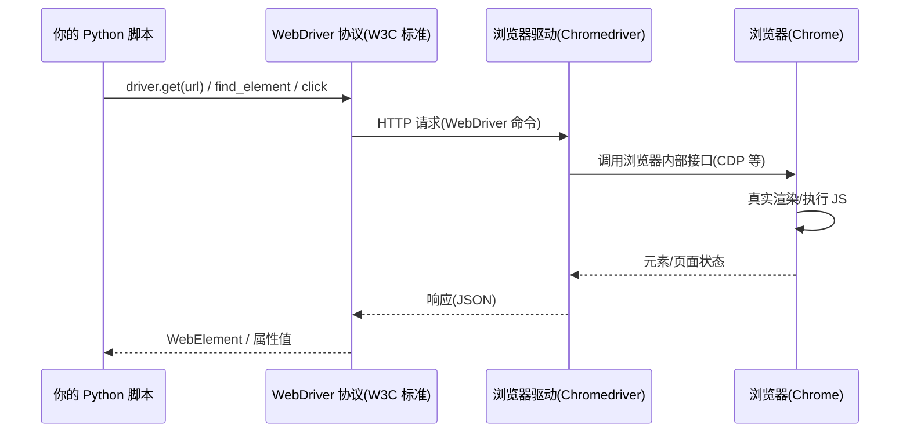

# 第 7 章 · 动态页面抓取（Selenium）

> 本章配套代码：`projects/crawler-lab/07_selenium_demo.py`
> 建议学习时长：约 3.5 小时

## 学习目标

学完本章，你能够：

1. 判断一个页面是否「必须上浏览器」，以及还有哪些更轻的替代路线；
2. 说清 Selenium 的工作原理（WebDriver 协议 + 浏览器驱动），知道 Selenium Manager 帮你做了什么；
3. 使用八大元素定位策略，并按稳定性排序做出选择；
4. 用显式等待（WebDriverWait + EC）替代 sleep，解释为什么 sleep 是自动化的大敌；
5. 完成表单填写、点击导航等交互操作，并处理「点了没反应」这类真实故障；
6. 把渲染后的页面源码交给 BeautifulSoup，复用第 3 章的全部解析技能；
7. 在 requests 与 Selenium 之间做正确的技术选型。

## 7.1 前置知识 / 本章地位

第 2 章 requests 拿到的是服务器返回的原始 HTML；当页面内容由 JavaScript 拼装（第 1 章 1.2.1 的第 9 步）时，原始 HTML 里没有数据。Selenium 的思路是**让真浏览器替你渲染**，然后从渲染完成的页面里取数据。它解决的正是 6.4 节说的第二条路线，且属于「正常浏览器能力」——自动化一个真浏览器做正常浏览可以做的事，与「绕过访问控制」有本质区别；**能用它做的事，以「人用浏览器手动也能做到」为限**（第 6 章的边界依然适用）。

版本事实（撰写时实测，以官方仓库为准）：Selenium 4.44.0 + 本机 Chrome。Selenium 4 内置 **Selenium Manager**：不再需要手动下载 chromedriver，`webdriver.Chrome()` 会自动找到或下载匹配你浏览器版本的驱动——老教程里「先配 driver 路径」的步骤可以整体跳过。

## 7.2 什么时候必须上浏览器

按成本从低到高，先试前者：

| 路线 | 适用 | 成本 |
|---|---|---|
| 直接调 XHR 接口 | 数据有 JSON 接口（第 1 章 Network 面板能找到） | 最低，首选 |
| requests 拿静态 HTML | 数据就在源码里（第 2、3 章） | 低 |
| **浏览器渲染（本章）** | 数据由 JS 生成、或需要交互（登录、点击、滚动）才出现 | 高（启动浏览器、等待渲染） |
| 逆向接口参数 | 接口带复杂签名 | 高，且属第 6 章划出的对抗区，本教程不提供 |

「必须上浏览器」的三个信号：源码里搜不到数据（1.5 节的判断法）；数据要**交互后**才出现（点击、登录、滚动加载）；页面用了 Web Components/前端框架在运行时拼 DOM。练习站为我们准备了标准实验场：`quotes.toscrape.com/js/` 的内容由 JS 渲染，requests 拿到的是空壳。

## 7.3 Selenium 工作原理



三个关键认知：

1. **你的代码不直接操作浏览器**，而是通过 WebDriver 协议指挥驱动，驱动再操作浏览器——中间隔两层，所以单次操作比 requests 慢几个数量级；
2. **浏览器是真的**：完整的 JS 引擎、网络栈、渲染管线。页面上发生的一切与真人访问一致；
3. Selenium 4 的 Selenium Manager 自动下载匹配版本的驱动，`make_driver()` 里不需要任何驱动路径配置。

环境检查（本机需装有 Chrome；Firefox/Edge 同理装对应浏览器即可）：

```bash
source ~/opt/jjyv/bin/activate
python -c "import selenium; print(selenium.__version__)"   # 4.44.0
```

## 7.4 八大定位策略

| 策略 | 写法（`By.X`） | 稳定性 | 使用建议 |
|---|---|---|---|
| ID | `By.ID, "username"` | 高 | 页面 id 稳定时首选 |
| NAME | `By.NAME, "password"` | 较高 | 表单元素常用 |
| CSS 选择器 | `By.CSS_SELECTOR, "input.btn"` | 高 | **通用首选**，第 3 章选择器知识直接复用 |
| XPath | `By.XPATH, '//th[text()="UPC"]'` | 中 | 需要按文本/轴定位时用 |
| 链接文本 | `By.LINK_TEXT, "Travel"` | 中 | 精确匹配链接文字 |
| 部分链接文本 | `By.PARTIAL_LINK_TEXT, "Trav"` | 中低 | 文字可能变化，少用 |
| 类名 | `By.CLASS_NAME, "quote"` | 中 | **只支持单个 class**（多 class 会报错），不如 CSS |
| 标签名 | `By.TAG_NAME, "h1"` | 低 | 只在配合过滤时用 |

选型口诀：**有稳定 id 用 id；否则 CSS 选择器；需要「按文本找」或轴关系才上 XPath**。与第 3 章的结论一致：定位表达式越接近「页面的语义结构」（id、class 语义名），越抗改版。

## 7.5 等待：为什么「不许 sleep」

### 7.5.1 问题：操作跑在渲染前面

浏览器渲染需要时间，`driver.get()` 返回不代表元素已出现。sleep(3) 这种「固定等待」有两个致命伤：网络慢时 3 秒不够（报错），网络快时 3 秒全浪费（变慢）。**正确姿势是显式等待：等到「某个条件成立」为止，最多等 N 秒**。

### 7.5.2 WebDriverWait + expected_conditions

```python
from selenium.webdriver.support.ui import WebDriverWait
from selenium.webdriver.support import expected_conditions as EC
from selenium.webdriver.common.by import By

wait = WebDriverWait(driver, 10)   # 统一超时 10s
username = wait.until(EC.visibility_of_element_located((By.ID, "username")))
```

`wait.until(条件)` 每 0.5 秒轮询一次条件，成立立刻返回，超时抛 `TimeoutException`。常用 EC 条件：

| 条件 | 含义 |
|---|---|
| `presence_of_element_located` | 元素出现在 DOM（未必可见） |
| `visibility_of_element_located` | 出现且可见 |
| `element_to_be_clickable` | 可见且可点击 |
| `url_contains` / `url_changes` | URL 变化（等待跳转完成） |
| `presence_of_all_elements_located` | 多元素出现（列表页） |

注意 EC 的参数是**一个元组** `(By.X, "value")`，漏括号是新手高频错误。另外还有隐式等待（`implicitly_wait`，全局生效），与显式等待混用会造成「意外叠加超时」，本教程统一只用显式等待。

## 7.6 交互操作与「点了没反应」的真实处理

常用交互 API：

```python
element.clear()               # 清空输入框(先清再输,防拼接)
element.send_keys("demo_user")
element.click()
driver.execute_script("arguments[0].scrollIntoView({block: 'center'});", element)  # 滚动到元素
element.text                  # 可见文本
element.get_attribute("href") # 属性
driver.current_url            # 当前 URL
driver.page_source            # 渲染后的完整 HTML
driver.quit()                 # 结束必调,否则浏览器进程残留
```

「点了没反应」是无头模式下的真实高频故障，lab 里就发生并处理了：无头 Chrome 跨页会话后偶发**原生点击事件被吞**（点击执行了、页面无遮挡，但跳转没发生）。工程做法是三步兜底：

```python
# 1. 滚动到元素居中,消除视口因素
driver.execute_script("arguments[0].scrollIntoView({block: 'center'});", link)
# 2. 原生点击 + 等待"状态变化"(不是固定时长)
link.click()
WebDriverWait(driver, 5).until(EC.url_contains("travel_2"))
# 3. 仍失败:JS 点击兜底——把事件直接派发到元素上,绕开输入管线
driver.execute_script("arguments[0].click();", link)
WebDriverWait(driver, 5).until(EC.url_contains("travel_2"))
```

核心思想与 7.5 一致：**等待的永远是「状态」（URL 变了、元素出现了），不是固定秒数**。重试 + 状态校验 + 兜底手段，三层防线让自动化在真实环境里站得住。

## 7.7 无头模式与 lab 实战

### 7.7.1 无头配置

无头（headless）= 浏览器不显示窗口，CI 服务器上的标准形态：

```python
from selenium.webdriver.chrome.options import Options

options = Options()
options.add_argument("--headless=new")     # Selenium 4 用 new 模式
options.add_argument("--window-size=1440,900")
options.add_argument("--disable-gpu")
driver = webdriver.Chrome(options=options) # Selenium Manager 自动管驱动
```

`--window-size` 建议保留：无头模式默认窗口极小，响应式页面会折叠成移动端布局，导致元素找不到或点击落点偏移。

### 7.7.2 运行 lab

`projects/crawler-lab/07_selenium_demo.py` 用两个练习站演示本章全部要点：quotes 站真实填写登录表单（练习站接受任意账号密码）、books 站点击分类导航（含 7.6 的点击兜底）、`/js/` 页渲染后把 `page_source` 交给 BeautifulSoup。

> 说明：本机已装有 Chrome，以下为撰写时实测输出；若你的机器没有 Chrome（或运行环境无浏览器），安装 Chrome 后再运行即可，脚本本身无需修改。

```bash
source ~/opt/jjyv/bin/activate
python projects/crawler-lab/07_selenium_demo.py
```

预期输出（撰写时实测；演示 2 的重试行是 7.6 节点击兜底机制在真实环境的触发记录，你的运行可能一次点击就成功）：

```text
== 演示 1：quotes.toscrape.com 登录交互 ==
  登录后 URL: https://quotes.toscrape.com/
  页面头部出现: Logout

== 演示 2：books.toscrape.com 分类点击导航 ==
  第 1 次原生点击未跳转（URL: https://books.toscrape.com/），重试
  第 2 次原生点击未跳转（URL: https://books.toscrape.com/），重试
  跳转后 URL: https://books.toscrape.com/catalogue/category/books/travel_2/index.html
  Travel 分类图书数: 11
  第一本书: It's Only the Himalayas
  第二本书: Full Moon over Noah’s Ark: An Odyssey to Mount Ararat and Beyond

== 演示 3：渲染后源码 -> BeautifulSoup ==
  /js/ 页渲染后可解析的名言数: 10
  第一条: “The world as we have created it is a pr ...
  第一位作者: Albert Einstein

总耗时 21.3s（含 3 次页面加载）
```

演示 3 的交接模式值得单独看——它是「Selenium 负责『拿到』、BeautifulSoup 负责『解析』」的分工范式（重活不交给两层 API 混写）：

```python
wait.until(EC.presence_of_element_located((By.CSS_SELECTOR, "div.quote")))  # 等渲染完成
soup = BeautifulSoup(driver.page_source, "lxml")
quotes = soup.select("div.quote span.text")   # 第 3 章技能原样复用
```

### 7.7.3 Cookie 与会话管理

driver 会话内自动维持 Cookie（第 1 章 1.3.4 的原理），必要时可以读取与注入：

```python
driver.get_cookies()                      # 当前全部 Cookie
driver.add_cookie({"name": "k", "value": "v"})  # 注入前必须已在该域名的页面上
```

典型用法：登录一次后把 Cookie 存下来，下次启动直接注入跳过登录流程（注意有效期与敏感性——登录态 Cookie 等同账号凭证，按第 8 章 .env 的密钥纪律保管，绝不写进代码或仓库）。

### 7.7.4 截图：调试自动化的第一现场

```python
driver.save_screenshot("data/debug.png")     # 全页当前视口
element.screenshot("data/element.png")       # 单元素
```

无头模式下看不到页面，截图就是你的「眼睛」：元素定位不到、点击没反应时，先截一张图看浏览器里实际是什么样子——多数「灵异问题」在截图里一眼现形（弹窗遮挡、移动端布局、图片没加载完）。

## 7.8 requests 与 Selenium 的取舍

| 维度 | requests | Selenium |
|---|---|---|
| 速度 | 毫秒级/请求 | 秒级/页面（含渲染） |
| 资源 | 极低 | 一个完整浏览器进程 |
| JS 渲染 | 不支持 | 支持 |
| 交互（登录/点击/滚动） | 要逐层模拟协议 | 原生支持 |
| 反爬特征 | 特征明显（易识别为脚本） | 真浏览器特征（但自动化行为仍可被识别，见第 6 章） |
| 适用 | 静态页、JSON 接口 | JS 页面、交互流程、渲染后解析 |

决策顺序重申 7.2 的原则：**接口 → 静态 → 浏览器**，Selenium 是当页面真的非渲染不可时的工具，不是默认起点。另有 Playwright（新一代浏览器自动化，多浏览器支持与自动等待更完善）与本教程场景重叠，本仓库未安装、只做文字提及，需要时以 [Playwright 官方文档](https://playwright.dev/python/) 为准。

## 常见坑与排查（Troubleshooting）

| 现象 | 原因 | 解决办法 |
|---|---|---|
| `SessionNotCreatedException: This version of ChromeDriver only supports Chrome version XX` | 驱动与浏览器版本不匹配（多见于老教程手动装的驱动） | 删掉手动装的 chromedriver，用 Selenium 4 的 Selenium Manager 自动匹配 |
| `NoSuchElementException` 明明页面上有 | 操作跑在渲染前；或元素在 iframe/shadow DOM 里 | 加显式等待；iframe 先 `driver.switch_to.frame(...)`；shadow DOM 需逐层展开 |
| `TimeoutException` 超时 | 条件永远不成立（选择器错/页面变了/网络慢） | 先 `print(driver.page_source)` 看当前真实状态，再核对选择器 |
| `ElementNotInteractableException` | 元素在 DOM 里但不可见/不可点 | 等待用 `element_to_be_clickable`；或先滚动到元素 |
| 点击后页面没变化（lab 演示 2 实测遇到） | 无头模式事件被吞/落点偏移 | 7.6 节三层兜底：滚动 → 重试 → JS 点击 |
| `element.click()` 报 `stale element reference` | 页面刷新后旧元素引用失效 | 重新定位再操作；循环里每次迭代重新 find |
| 任务跑几小时后越来越慢/崩掉 | driver 长会话累积内存、弹窗与僵尸标签页 | 分批任务每批新开 driver 并 quit；处理 `driver.window_handles` 清理多余标签页 |
| 无头模式下布局/元素位置不对 | 默认窗口太小触发移动端布局 | `--window-size=1440,900` 固定窗口 |
| Chrome 进程残留吃内存 | 只关窗口没退出 driver | `finally: driver.quit()`；用 `with webdriver` 上下文写法更保险 |
| 页面是英文但数据乱码 | 渲染前编码正常，取属性时得到转义实体 | 交给 BeautifulSoup/lxml 处理实体（第 3 章）；或确认页面 charset |
| 启动报 `DevToolsActivePort file doesn't exist` | 无头参数组合问题/环境缺依赖 | 加 `--disable-gpu`、`--no-sandbox`（容器环境）；逐个排查参数 |

## 动手练习

1. **登录态复用**：改写 lab 演示 1，登录成功后访问 `quotes.toscrape.com` 首页，用 BeautifulSoup 确认页面上出现了「Logout」链接，并打印登录前后 `driver.get_cookies()` 的差异。
   <details><summary>提示</summary>登录前后各 print 一次 get_cookies()；对照第 1 章 1.3.4 的 Session 原理，你能看到 sessionid 类的 cookie 出现了。</details>
2. **滚动加载实验**：给 `quotes.toscrape.com/scroll` 写脚本：初始只有 2 条名言，循环「滚到底 → 等新元素出现」直到 100 条，用 `EC.presence_of_all_elements_located` + 数量条件判断停止。
   <details><summary>提示</summary>`driver.execute_script("window.scrollTo(0, document.body.scrollHeight);")`；停止条件 `len(driver.find_elements(By.CSS_SELECTOR, "div.quote")) == 100`；记得设最大循环次数防死循环。</details>
3. **渲染前后对比报告**：分别用 requests 和 Selenium 抓 `/js/` 页，把两份 HTML 存下来，各统计 `div.quote` 出现次数，用一行结论记录差异（预期：0 vs 10）。
   <details><summary>提示</summary>requests 版记得也先跑一遍选择器确认是 0——这个对比是「为什么需要浏览器」的最直接证据。</details>
4. **等待超时演练**：把 lab 演示 3 的等待条件故意改成不存在的元素，观察 `TimeoutException` 的抛出位置与耗时（约 10s），再修复；体会显式等待的「代价上限」。
   <details><summary>提示</summary>异常栈里能看到 `until` 方法——所有等待失败的收敛点；对比 sleep 方案「永远等固定时长」，显式等待失败也有明确上限。</details>

## 小结与自检清单

- [ ] 我能按「接口 → 静态 → 浏览器」排序选择抓取路线，说清浏览器是最后手段
- [ ] 我理解 WebDriver 协议的两层中转（脚本 → 驱动 → 浏览器），知道为什么 Selenium 慢
- [ ] Selenium 4 的 Selenium Manager 替我管驱动，我不再手动下载 chromedriver
- [ ] 我会按稳定性选择定位策略：稳定 id > CSS 选择器 > XPath
- [ ] 我写自动化只用显式等待，能解释 sleep 为什么是设计缺陷（快时浪费、慢时不够）
- [ ] 我掌握点击失败的三层兜底：滚动 → 重试等状态 → JS 点击
- [ ] 我会把渲染后的 page_source 交给 BeautifulSoup，两套工具各干各的活
- [ ] 我跑通了 lab，三个演示输出与文档一致（或理解了输出差异的原因）

## 延伸阅读

- [Selenium 官方文档（Python）](https://www.selenium.dev/documentation/webdriver/)——WebDriver API、等待策略、浏览器选项的权威参考。
- [Selenium：Waits 官方说明](https://www.selenium.dev/documentation/webdriver/supporting_features/waits/)——显式/隐式等待语义，7.5 节的出处。
- [W3C WebDriver Standard](https://www.w3.org/TR/webdriver/)——协议本身，7.3 节时序图背后的规范。
- [MDN：WebDriver](https://developer.mozilla.org/en-US/docs/Web/WebDriver)——MDN 视角的协议与命令清单。
- 上一章：[反爬应对与爬虫合规](06-反爬应对与爬虫合规.md)；下一章：[爬虫工程化（并发 / 调度 / 监控）](08-爬虫工程化(并发-调度-监控).md)。
