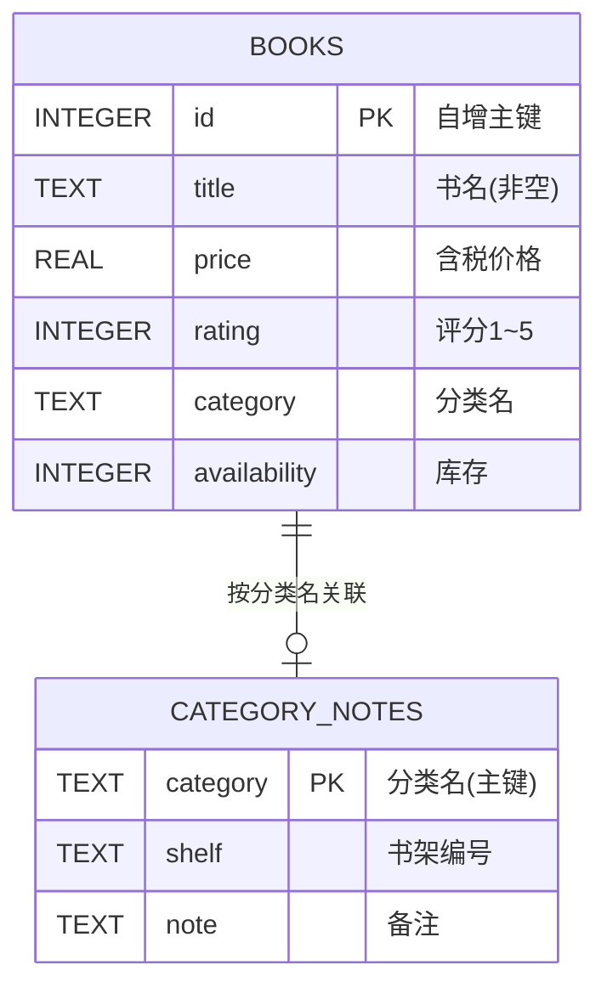
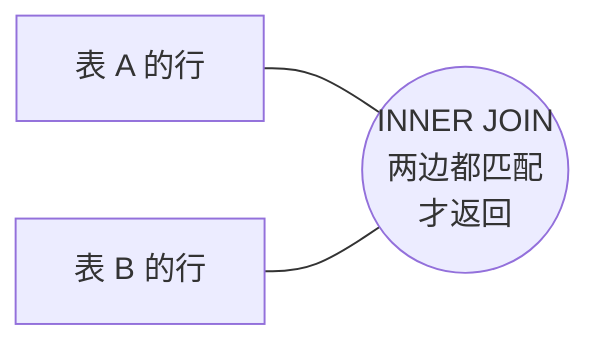
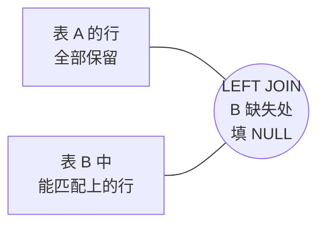
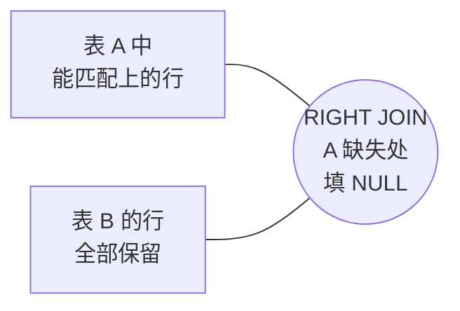
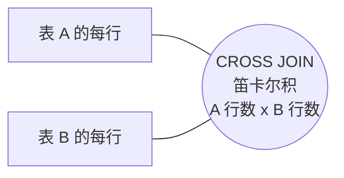

# 第 1 章 · SQL 从入门到进阶（MySQL）

> 本章配套代码：`projects/data-analysis-lab/01_sql_basics.py`
> 建议学习时长：约 4 小时

## 学习目标

学完本章，你能够：

1. 用关系模型的术语（表、行、主键、外键）描述一个业务系统，并看懂 Mermaid ER 图；
2. 写出覆盖 WHERE / ORDER BY / LIMIT / GROUP BY / HAVING 的完整查询，并说清 WHERE 与 HAVING 的执行顺序差异；
3. 用 INNER / LEFT / RIGHT / CROSS 四种 JOIN 组合两张表，知道 LEFT JOIN ... IS NULL 这个「反连接」惯用法；
4. 用子查询、CTE、窗口函数（MySQL 8+）解决「每组 Top-N」「累计值」这类经典问题；
5. 坚守本仓库硬规范——**SQL 一律参数绑定**，能在代码评审中一眼指出拼接 SQL 的注入风险；
6. 会用 EXPLAIN 看执行计划，理解索引让查询从全表扫描变成索引查找的原理。

## 1.1 前置知识 / 本章地位

数据分析篇（本篇第 01~07 章）是全路线「采集 → 存储 → 分析 → 可视化 → 后端」的中间一环：爬虫篇（第 03 篇第 4 章）已把 1000 本图书存进 SQLite，本章开始用 SQL 把数据「问出来」。SQL 是 pandas、SQLAlchemy、FastAPI 三个后继环节的共同底座——第 02 章的 ORM 生成的就是 SQL，第 03~05 章 pandas 的 `read_sql` 直接吃 SQL，第 06 篇 ECharts 大屏的数据也来自 SQL 聚合。

本章的实验全部用 SQLite 实际运行验证（零部署、开箱即用），MySQL 的语法差异单独标注；MySQL 服务器的部署与运维见 [Ubuntu 篇第 8 章](../02-linux-ubuntu/08-MySQL部署与数据库运维.md)。

## 1.2 关系模型 10 分钟

关系数据库的一切建立在三个概念上：

- **表（Table）**：一个二维结构，一行（Row）是一条记录，一列（Column）是一个属性，每列有确定的类型；
- **主键（Primary Key）**：唯一标识一行的列（或列组合），不允许重复、不允许为空。`books` 表用自增整数 `id`；
- **外键（Foreign Key）**：A 表的某列引用 B 表的主键，用来表达表之间的关系。

本章主角是图书表 `books`（1000 行），假设我们要给它配一张「书架备注表」`category_notes`，两表的关系是「一个分类最多一条备注，一条备注只属于一个分类」——一对一。画成 ER 图（Entity-Relationship，实体关系图）：



读图方式：`BOOKS ||--o| CATEGORY_NOTES` 表示「每本 book 对应 0 或 1 条备注」；一对多记作 `||--o{`（如「一个分类 : 多本书」），多对一则在子表列上标 FK。

> 本篇用的 `books.toscrape.com` 数据把分类名直接冗余在 `books.category` 列里（未做外键拆表），这是采集型单表数据的常见形态；1.6 节演示 JOIN 时我们会补一张备注表来构造真实的多表场景。

三句话记住关系模型的核心约束：**每列类型固定、每行主键唯一、表间靠键关联**。SQL 的全部本事，就是在这个约束下高效地问数据问题。

## 1.3 SQLite 与 MySQL：本篇的双引擎策略

教程同时使用两个引擎：**学习/分析阶段用 SQLite**（单文件、零部署、Python 标准库自带），**服务化阶段用 MySQL**（Ubuntu 服务器部署，见 Ubuntu 篇第 8 章）。两者都实现了 SQL 标准，90% 的语句完全一致，差异集中在少数语法与函数上：

| 维度 | SQLite | MySQL 8.0 |
|---|---|---|
| 形态 | 嵌入式，一个文件就是一个库 | C/S 服务，需部署与账号管理 |
| Python 驱动 | 标准库 `sqlite3` | `pymysql`（本教程实测 1.1.2） |
| 占位符 | `?` | `%s`（pymysql/MySQLdb 风格） |
| 自增主键 | `INTEGER PRIMARY KEY AUTOINCREMENT` | `INT AUTO_INCREMENT PRIMARY KEY` |
| 字符串拼接 | `\|\|` | `CONCAT()` |
| 日期取年份 | `strftime('%Y', col)` | `YEAR(col)` |
| 大小写敏感 | `LIKE` 默认不敏感（ASCII） | 取决于排序规则（`utf8mb4_0900_ai_ci` 不敏感） |
| RIGHT/FULL JOIN | 3.39+ 才支持 | 一直支持 |
| 窗口函数 | 3.25+ 支持 | 8.0+ 支持 |
| 引用限制 | 一次查询默认 ≤999 参数（`SQLITE_MAX_VARIABLE_NUMBER`） | 默认 65535 |

本书撰写时实测环境：Python 3.14.0 自带 SQLite 3.50，MySQL 示例以 8.0 兼容写法为准。本章每个 SQL 都在 SQLite 上真实跑过，涉及 MySQL 写法差异处会明确标注。

## 1.4 SELECT 全套：WHERE / ORDER BY / LIMIT

SELECT 的作用是「从表里挑出满足条件的行、按你想要的顺序、只取前 N 条」。配套实验脚本 `01_sql_basics.py`，先把数据准备好：

```bash
source ~/opt/jjyv/bin/activate
python projects/data-analysis-lab/01_sql_basics.py
```

脚本把 `projects/book-insight/data/books.db` 复制为工作库（源库只读不动），下面所有语句的输出都来自这次真实运行。

**例 1：多条件过滤 + 倒序 + 截取**——找评分不低于 4 星、价格不超过 30 英镑的书，贵的在前，只要 5 本：

```sql
SELECT title, price, rating, category
FROM books
WHERE rating >= ? AND price <= ?
ORDER BY price DESC
LIMIT 5;
```

预期输出（`?` 依次绑定 `(4, 30.0)`，见 1.9 节）：

```text
title   | price   | rating   | category
   Frostbite (Vampire Academy #2) | 29.99 | 5 | Young Adult
   At The Existentialist Café: Freedom, B | 29.93 | 5 | Philosophy
   All the Light We Cannot See | 29.87 | 5 | Historical
   The Hunger Games (The Hunger Games #1) | 29.85 | 5 | Default
   The Land of 10,000 Madonnas | 29.64 | 4 | Young Adult
```

三个子句各自回答一个问题：`WHERE` 留下哪些行（在原始行上过滤）、`ORDER BY` 按什么排（`DESC` 倒序，多列用逗号分隔）、`LIMIT` 取多少条（常与 ORDER BY 搭配做 Top-N）。MySQL 下把 `?` 换成 `%s`，其余完全相同。聚合函数（`COUNT` / `AVG` / `MIN` / `MAX` / `SUM`）整表一算就是 1.4 节例 1 的用法，`AS` 给计算列起别名；要「按列分组各算一次」就轮到下一节的 GROUP BY。

## 1.5 聚合进阶：GROUP BY 与 HAVING

`GROUP BY` 把行按某列分组，聚合函数在**每组内**各算一次。「每个分类有几本书、均价多少」：

```sql
SELECT category,
       COUNT(*) AS n,
       ROUND(AVG(price), 2) AS avg_price,
       ROUND(AVG(rating), 2) AS avg_rating
FROM books
GROUP BY category
HAVING COUNT(*) >= 40
ORDER BY n DESC;
```

预期输出：

```text
category   | n   | avg_price   | avg_rating
   Default | 152 | 34.39 | 2.84
   Nonfiction | 110 | 34.26 | 2.88
   Sequential Art | 75 | 34.57 | 2.97
   Add a comment | 67 | 35.8 | 2.76
   Fiction | 65 | 36.07 | 3.18
   Young Adult | 54 | 35.45 | 3.3
   Fantasy | 48 | 39.59 | 3.08
```

### WHERE 与 HAVING 的区别（重点）

两者都是过滤，但**过滤的对象与时机不同**：`WHERE` 在分组**前**过滤原始行（不能出现聚合函数），`HAVING` 在分组**后**过滤聚合结果（可以出现聚合函数）。同一条件放错位置，结果完全不同。看真实运行的一组对照——「rating = 5 的书有几本」：

```sql
-- WHERE 过滤行：先留下 5 星书，再按分类计数
SELECT category, COUNT(*) AS n5
FROM books
WHERE rating = 5
GROUP BY category
ORDER BY n5 DESC
LIMIT 5;
```

预期输出：

```text
category   | n5
   Default | 29
   Nonfiction | 20
   Fiction | 17
   Young Adult | 15
   Sequential Art | 12
```

```sql
-- HAVING 过滤组：先按分类计数，再留下计数 >= 50 的分类
SELECT category, COUNT(*) AS n
FROM books
GROUP BY category
HAVING COUNT(*) >= 50
ORDER BY n DESC;
```

预期输出：

```text
category   | n
   Default | 152
   Nonfiction | 110
   Sequential Art | 75
   Add a comment | 67
   Fiction | 65
   Young Adult | 54
```

第一条查询的数字是「每类 5 星书的数量」（最大 29），第二条是「每类全部书的数量」（最大 152）——条件一样、位置不同，语义完全不同。记忆口诀：**WHERE 管行，HAVING 管组**。一个完整查询的书写顺序与执行顺序也不同：书写是 `SELECT → FROM → WHERE → GROUP BY → HAVING → ORDER BY → LIMIT`，执行是 `FROM → WHERE → GROUP BY → HAVING → SELECT → ORDER BY → LIMIT`——这就是「SELECT 里的别名不能被同层 WHERE 使用」的原因（WHERE 执行时 SELECT 还没算）。

## 1.6 JOIN：四张连接方式

单表只有 1000 行的图书数据，真实业务的数据总归分散在多张表里，JOIN 负责把它们按关联列拼起来。实验脚本在 SQLite 副本里建了一张 5 行的 `category_notes` 书架备注表（参数绑定写入，见 1.9 节），其中 `Poetry / Fantasy / Mystery / Add a comment` 在 books 里存在，`Archival` 在 books 里不存在——故意留一个「孤儿」，四种 JOIN 的差别立刻可见。

先看示意图（圆圈 A、B 分别代表两张表的行集合）：

**INNER JOIN：只取交集**



**LEFT JOIN：左表全保留，右边缺的补 NULL**



**RIGHT JOIN：右表全保留（把 LEFT 反过来写更常见）**



**CROSS JOIN：两两组合，行数 = A 行数 x B 行数**



### 真实运行对照

```sql
SELECT b.category, COUNT(*) AS n, c.shelf
FROM books b
INNER JOIN category_notes c ON b.category = c.category
GROUP BY b.category, c.shelf
ORDER BY n DESC;
```

预期输出（只有 4 个分类两边都有，`Archival` 被丢弃）：

```text
category   | n   | shelf
   Add a comment | 67 | D-09
   Fantasy | 48 | B-03
   Mystery | 32 | C-02
   Poetry | 19 | A-01
```

```sql
SELECT b.category, c.shelf
FROM books b
LEFT JOIN category_notes c ON b.category = c.category
GROUP BY b.category, c.shelf
ORDER BY b.category
LIMIT 6;
```

预期输出（左表全部保留，没备注的分类 `shelf` 为 NULL）：

```text
category   | shelf
   Academic | None
   Add a comment | D-09
   Adult Fiction | None
   Art | None
   Autobiography | None
   Biography | None
```

LEFT JOIN 最重要的惯用法是**反连接**——「找没有备注的分类」：

```sql
SELECT DISTINCT b.category
FROM books b
LEFT JOIN category_notes c ON b.category = c.category
WHERE c.category IS NULL
ORDER BY b.category
LIMIT 5;
```

预期输出：

```text
category
   Academic
   Adult Fiction
   Art
   Autobiography
   Biography
```

RIGHT JOIN（SQLite 3.39+ 支持，MySQL 全版本支持）以右表为主，本例结果与 INNER JOIN 表面相同，但语义是「没书可配的 `Archival` 也会保留」（这里被 HAVING 过滤掉用于演示）：

```sql
SELECT c.category, c.shelf, COUNT(b.id) AS book_cnt
FROM category_notes c
RIGHT JOIN books b ON b.category = c.category
GROUP BY c.category, c.shelf
HAVING c.category IS NOT NULL;
```

预期输出：

```text
category   | shelf   | book_cnt
   Add a comment | D-09 | 67
   Fantasy | B-03 | 48
   Mystery | C-02 | 32
   Poetry | A-01 | 19
```

CROSS JOIN 产生笛卡尔积（39 个 5 星分类 × 5 条备注 = 195 行，脚本截取 6 行展示）。它很少直接用于业务查询，但生成组合（如「每本书 × 每个促销档位」的骨架表）时很好用。注意：**JOIN 忘写 ON 条件会退化成笛卡尔积**，两张万行表相乘就是一亿行——这是新手最常见的「查询卡死」事故。

## 1.7 子查询与 CTE

**标量子查询**：子查询返回一个值，可以当数字用。「比全站均价贵的书有几本」：

```sql
SELECT COUNT(*) AS n
FROM books
WHERE price > (SELECT AVG(price) FROM books);
```

预期输出：

```text
n
   513
```

**相关子查询**：子查询引用了外层的列，因此对外层每一行各执行一次。「价格高于本分类均价的书」：

```sql
SELECT category, title, price
FROM books AS b
WHERE price > (SELECT AVG(price) FROM books AS i WHERE i.category = b.category)
ORDER BY category, price DESC
LIMIT 6;
```

预期输出：

```text
category   | title   | price
   Add a comment | The Gray Rhino: How to Recognize and A | 59.15
   Add a comment | Watchmen | 58.05
   Add a comment | The Girl Who Kicked the Hornet's Nest  | 57.48
   Add a comment | John Adams | 57.43
   Add a comment | Fun Home: A Family Tragicomic | 56.59
   Add a comment | A Series of Catastrophes and Miracles: | 56.48
```

**CTE（Common Table Expression，公用表表达式）**用 `WITH` 给中间结果起名字，把复杂查询拆成有名字的步骤，可读性远胜层层嵌套的子查询：

```sql
WITH big AS (
    SELECT category, COUNT(*) AS n, AVG(price) AS avg_price
    FROM books
    GROUP BY category
    HAVING COUNT(*) >= 40
)
SELECT category, n, ROUND(avg_price, 2) AS avg_price
FROM big
ORDER BY avg_price DESC;
```

预期输出：

```text
category   | n   | avg_price
   Fantasy | 48 | 39.59
   Fiction | 65 | 36.07
   Add a comment | 67 | 35.8
   Young Adult | 54 | 35.45
   Sequential Art | 75 | 34.57
   Default | 152 | 34.39
   Nonfiction | 110 | 34.26
```

CTE 与子查询在大多数引擎里性能相同（优化器会改写），选型的依据是**可读性**：超过两层嵌套就改写 CTE。MySQL 8.0 起支持 CTE，5.7 及更早版本只能用子查询或临时表。

## 1.8 窗口函数入门（MySQL 8+）

普通聚合把 N 行折叠成 1 行；**窗口函数（Window Function）**在保留每一行的同时，附上「在它的窗口（分组/排序范围）里算出来的值」。这是 MySQL 8.0 与 SQLite 3.25+ 的能力，5.7 及更早 MySQL 没有。

**ROW_NUMBER：每组 Top-N 的标准解法**。「每个分类最贵的 2 本书」用 GROUP BY 做不到（聚合后书名信息丢了），窗口函数两步解决——先在子查询里编号，再在外层过滤：

```sql
SELECT category, title, price
FROM (
    SELECT category, title, price,
           ROW_NUMBER() OVER (PARTITION BY category ORDER BY price DESC) AS rn
    FROM books
)
WHERE rn <= 2
ORDER BY category, price DESC
LIMIT 8;
```

预期输出：

```text
category   | title   | price
   Academic | Logan Kade (Fallen Crest High #5.5) | 13.12
   Add a comment | The Gray Rhino: How to Recognize and A | 59.15
   Add a comment | Watchmen | 58.05
   Adult Fiction | Fifty Shades Freed (Fifty Shades #3) | 15.36
   Art | Feathers: Displays of Brilliant Plumag | 49.05
   Art | Art and Fear: Observations on the Peri | 48.63
   Autobiography | Life Without a Recipe | 59.04
   Autobiography | Approval Junkie: Adventures in Caring  | 58.81
```

`PARTITION BY` 是「窗口里的 GROUP BY」，`ORDER BY` 决定窗口内的排序。排名函数里 `ROW_NUMBER()` 强制名次不重复，`RANK()` 给并列行同名次并跳号——做排行榜前先想清楚要哪种。

**累计窗口**：`SUM(...) OVER (ORDER BY ...)` 做 running total，「按价格升序的累计金额」：

```sql
SELECT title, price,
       ROUND(SUM(price) OVER (ORDER BY price, id), 2) AS running_total
FROM books
ORDER BY price, id
LIMIT 5;
```

预期输出：

```text
title   | price   | running_total
   An Abundance of Katherines | 10.0 | 10.0
   The Origin of Species | 10.01 | 20.01
   The Tipping Point: How Little Things C | 10.02 | 30.03
   Patience | 10.16 | 40.19
   Greek Mythic History | 10.23 | 50.42
```

`OVER` 里不写 `PARTITION BY` 就是全表一个窗口；写 `PARTITION BY category` 就「每类各自累计」。常用的还有 `LAG`/`LEAD`（取上/下一行的值，算环比）、`NTILE`（分桶）。入门阶段记住 ROW_NUMBER + PARTITION BY 这一个组合就能解决 80% 的需求。

## 1.9 写操作与参数绑定（硬规范）

读之外还有三件写操作：`INSERT` 插入、`UPDATE` 改、`DELETE` 删。它们都走事务（Transaction）：`conn.commit()` 才落库，`conn.rollback()` 撤销本事务全部改动。实验脚本演示了完整的「插入 → commit 生效 → 再插入 → rollback 撤销」：

```python
cur.execute("SELECT COUNT(*) FROM category_notes")
before = cur.fetchone()[0]
cur.execute(
    "INSERT INTO category_notes (category, shelf, note) VALUES (?, ?, ?)",
    ("Temp", "X-00", "待会回滚"),
)
conn.commit()
# ... rollback 演示同理
```

### 本仓库硬规范：任何含外部数据的 SQL，必须参数绑定

占位符（Placeholder）是数据库驱动提供的安全机制：SQL 模板先编译，数据后绑定，数据永远只当**数据**处理，不会被解析成 SQL 语法。SQLite 用 `?`，pymysql 用 `%s`，SQLAlchemy `text()` 用 `:name`——形式不同，原则相同。

> ⚠️ **反面案例（禁止写进真实代码，仅作警示）**：
>
> ```python
> # ❌ 危险！用户输入 name = "Poetry'; DROP TABLE books; --" 时，
> # 拼接结果变成一条全新的 SQL，books 表可能被整表删除（SQL 注入）。
> category = input("要查哪个分类？")
> sql = "SELECT * FROM books WHERE category = '" + category + "'"
> cur.execute(sql)
> ```
>
> 这段代码同时踩了三个雷：SQL 注入（安全）、书名自带引号时语法报错（可用性）、每次输入不同导致执行计划无法复用（性能）。**正确写法**只有一行之差，风险归零：
>
> ```python
> # ✅ 参数绑定：模板与数据彻底分离
> cur.execute("SELECT * FROM books WHERE category = ?", (category,))
> ```
>
> 评审代码时看到「f-string / `+` / `%` 格式化出现在 SQL 附近」一律打回，没有例外。`%s` 与 Python 的 `%` 格式化长得像但机理完全不同——绑定发生在数据库驱动层，字符串早已定型。

批量写入用 `executemany` 一次绑定多组参数，比循环单条快一个量级（脚本里插入 5 行备注就是这么写的）：

```python
cur.executemany(
    "INSERT INTO category_notes (category, shelf, note) VALUES (?, ?, ?)",
    notes,  # list[tuple]
)
conn.commit()
```

MySQL 侧完全对应：`cursor.executemany("INSERT INTO t (a, b) VALUES (%s, %s)", rows)`。

## 1.10 索引基础与 EXPLAIN 初见

没有索引时，`WHERE rating = 5` 只能从第 1 行扫到第 1000 行（**全表扫描，SCAN**）；索引（Index）是基于某列构建的有序查找结构（B+ 树），让引擎像查字典一样直接定位（**索引查找，SEARCH**）。代价是写入变慢、磁盘变多——所以索引建在「高频查询条件列」上，而不是无脑全建。

SQLite 用 `EXPLAIN QUERY PLAN`，MySQL 用 `EXPLAIN`（在语句前加一个词即可，如 `EXPLAIN SELECT ...`），都能看到引擎打算怎么执行。脚本在副本库上的真实对照：

```text
-- 建索引前（SCAN books = 全表扫描）:
   SCAN books
-- 执行 CREATE INDEX idx_books_rating ON books (rating); 之后
-- 建索引后（SEARCH ... USING INDEX = 索引查找）:
   SEARCH books USING INDEX idx_books_rating (rating=?)
```

MySQL 的 `EXPLAIN` 输出是表格，重点看 `type` 列（`ALL` 全表扫描 → 换成 `ref`/`range` 即用上了索引）与 `rows`（预估扫描行数，越小越好）。初见阶段只需建立一个条件反射：**看到 SCAN/ALL，先问这条查询会不会常跑，会的话给它建索引**。注意爬虫源库 `books.db` 已经给 `category`、`rating` 两列建了索引（可在 `sqlite_master` 里查到），脚本为了演示先删后建。

## 常见坑与排查（Troubleshooting）

| 报错/现象 | 原因 | 解决办法 |
|---|---|---|
| `sqlite3.ProgrammingError: Incorrect number of bindings` | 占位符个数与参数个数不一致 | 数一遍 `?` 与 tuple 元素；一行一个参数 |
| `pymysql` 里照抄了 `?` 占位符 | 驱动差异 | MySQL 用 `%s`；SQLAlchemy text() 用 `:name` |
| 查询结果行数异常暴涨、越来越慢 | JOIN 少写 ON，退化成笛卡尔积 | 补 ON 条件；用 `EXPLAIN` 看 rows 预估 |
| `SELECT category, COUNT(*) FROM books WHERE n > 10` 报 no such column | WHERE 里引用聚合别名 | 聚合条件写到 HAVING；WHERE 只管原始列 |
| `GROUP BY` 后 SELECT 的非聚合列值「随机」 | 该列未参与分组也未聚合 | 只 SELECT 分组列与聚合列，或再加进 GROUP BY |
| `LEFT JOIN` 后统计数量比预期多 | 右表一对多导致行被复制 | 先聚合右表成子查询/CTE 再 JOIN |
| 中文/特殊字符插入报语法错误 | 手工拼接 SQL，引号被打断 | 改参数绑定（1.9 节），一劳永逸 |
| `database is locked` | 另一个连接长期占写锁 | 缩短事务；检查是否忘了 commit |
| MySQL `ORDER BY` 中文顺序不对 | 排序规则不是中文友好 collation | 建库选 `utf8mb4`；必要时 `CONVERT(... USING gbk)` 对照 |

## 动手练习

用 `projects/data-analysis-lab/data/lab01.db`（跑一遍 `01_sql_basics.py` 即生成）或直接连源库完成：

1. **基础查询**：找出库存不足 3 本且评分 5 星的书，按库存升序输出书名、价格、库存。（验收：共 22 行，首行应为 `While You Were Mine  41.32  1`）
2. **分组聚合**：统计每个评分档的书目数与平均库存，输出平均库存最高的评分档。（提示：GROUP BY rating；验收：5 档合计应为 1000）
3. **反连接**：用 LEFT JOIN ... IS NULL 找出「5 星书数量为 0 的分类」（可先建一张 5 星分类维表再反连，或直接用 NOT IN 子查询对照两种写法）。
4. **窗口函数**：用 ROW_NUMBER() 找出每个评分档里最贵的 2 本书，输出评分、书名、价格、组内名次。（验收：共 10 行，每档恰好 2 行）

<details>
<summary>练习 2 提示</summary>

`SELECT rating, COUNT(*) AS n, ROUND(AVG(availability), 2) AS avg_stock FROM books GROUP BY rating ORDER BY avg_stock DESC;`——本数据集评分与库存几乎无关，实测 5 档 avg_stock 落在 8.36~8.88 之间（4 星 8.88 最高、1 星与 3 星同为 8.36 最低），这本身就是第 07 章要量化验证的结论之一。
</details>

## 小结与自检清单

- [ ] 能画出两表的 ER 图并解释主键、外键、基数符号（`||--o{`）；
- [ ] 能不查资料写出 WHERE + ORDER BY + LIMIT 的 Top-N 查询；
- [ ] 能说清 WHERE 与 HAVING 分别在执行计划的哪一步生效，并举一个「条件放错位置结果不同」的例子；
- [ ] 能用 INNER/LEFT/RIGHT/CROSS 各写一个查询，并解释 LEFT JOIN ... IS NULL 反连接；
- [ ] 能用标量子查询、相关子查询、CTE 三种写法表达「高于本组均值」；
- [ ] 能用 ROW_NUMBER() OVER (PARTITION BY ... ORDER BY ...) 做每组 Top-N；
- [ ] 所有含外部输入的 SQL 都用了占位符绑定，能说出拼接 SQL 的注入原理；
- [ ] 会用 EXPLAIN（SQLite：EXPLAIN QUERY PLAN）判断全表扫描与索引查找。

## 延伸阅读

- [SQLite 官方文档：Query Planning](https://www.sqlite.org/queryplanner.html) —— EXPLAIN QUERY PLAN 输出的权威解读，1.10 节的进阶版；
- [MySQL 8.0 Reference Manual: Window Functions](https://dev.mysql.com/doc/refman/8.0/en/window-functions.html) —— 窗口函数完整语法与更多帧（frame）用法；
- [Use The Index, Luke](https://use-the-index-luke.com/) —— 免费在线书，把索引与执行计划讲得最透的资料；
- [OWASP: SQL Injection Prevention Cheat Sheet](https://cheatsheetseries.owasp.org/cheatsheets/SQL_Injection_Prevention_Cheat_Sheet.html) —— 参数绑定是第一道防线的权威依据。
