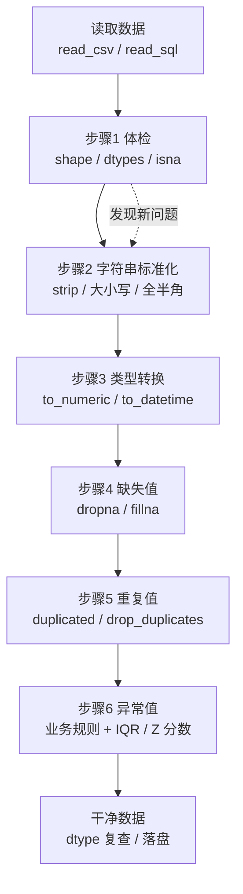

# 第 4 章 · pandas 数据清洗实战

> 本章配套代码：`projects/data-analysis-lab/04_cleaning.py`
> 建议学习时长：约 4 小时

## 学习目标

学完本章，你能够：

1. 按清洗六步法（体检 → 字符串标准化 → 类型转换 → 缺失值 → 重复值 → 异常值）处理一份脏数据；
2. 用 isna/dropna（含阈值）/fillna 处理缺失，说清「删还是补」的判断依据，警惕补填带来的数据泄漏；
3. 用 duplicated/drop_duplicates 按业务键去重，处理大小写变体的「近似重复」；
4. 用 to_numeric / to_datetime（errors="coerce"）把「长得像数字/日期的字符串」变成真类型；
5. 用 .str 全家桶与 apply/map 做文本与逐行变换；
6. 用 IQR 与 Z 分数两种方法定位异常值，并知道两者的适用边界；
7. 用 category dtype 压缩低基数文本列的内存。

## 4.1 前置知识 / 本章地位

第 3 章的四件套体检告诉你数据「长什么样」，本章解决体检发现的问题——现实中的数据几乎从不干净：`£12.99` 是字符串、日期有四种写法、分类名带空格、同一本书录了两遍。「垃圾进，垃圾出」：清洗不做或做错，后面的聚合、图表全部失真。本章先给出清洗的全景流程，然后按六步法逐步清洗一份**故意埋满问题的 CSV**，全程真实运行、输出前后对比。

实验数据是脚本生成的教学构造数据（22 行、问题全部手工埋点、可复现），方法可直接迁移到真实数据集（第 7 章会在真实 books.db 上重走这套流程）。运行方式：

```bash
source ~/opt/jjyv/bin/activate
python projects/data-analysis-lab/04_cleaning.py
```

## 4.2 清洗六步法全景



两条纪律：**顺序基本不可调换**（类型不转好，缺失与异常都看不清）；**每步之后重新体检**（shape、isna、describe 各看一眼），确认这一步消灭了什么、有没有误伤。

## 4.3 构造一份「故意很脏」的数据

脚本内置 22 行图书数据（`title, price, category, rating, stock, published`），埋点覆盖六类问题：价格带 `£` 与千分位逗号、空值、199.9/1299.0 两个异常价；分类名混着 ` Fantasy ` / `fantasy` / `FANTASY`；评分有 `0`、`9`、`four`；日期混用 4 种格式并含不存在的 `2022-02-30`；外加 1 组完全重复行与 1 组大小写变体重复。生成后先读进来做**步骤 1 体检**：

```python
df = pd.read_csv(DIRTY_CSV)
print(df.shape)
print(df.dtypes)
print(df.isna().sum())
```

预期输出：

```text
shape: (22, 6)

各列推断类型:
 title         object
price         object
category      object
rating        object
stock        float64
published     object

缺失统计（read_csv 默认把空串、N/A 读成 NaN）:
 title        1
price        1
category     0
rating       1
stock        4
published    0

category 原始取值（大小写与空格变体）: [' FANTASY ', ' Fantasy', ' Fiction ', ' Poetry ', 'Fiction', 'Historical', 'Memoir', 'Science Fiction', 'fantasy ', 'fiction', 'poetry']
```

三个立刻能学到的点：**字符串列（price/rating）因为混入杂质被推成 object**——「本该是数字的列是 object」本身就是脏信号；**read_csv 默认把空串和 `N/A` 认作 NaN**（可用 `keep_default_na=False` 关掉），所以「缺失统计」在读取时就完成了第一轮；**category 的 11 个原始取值其实只有 6 个真分类**。

## 4.4 步骤 2：字符串标准化（.str 全家桶）

`Series.str` 访问器提供几十个向量化字符串方法，常用的有 `strip / lower / upper / title / replace / contains / split / slice / len`。本步只做两件事：去首尾空格、统一大小写：

```python
df["title"] = df["title"].str.strip()
df["category"] = df["category"].str.strip().str.title()
```

预期输出：

```text
标准化后 category 取值: ['Fantasy', 'Fiction', 'Historical', 'Memoir', 'Poetry', 'Science Fiction']
```

11 个取值收敛成 6 个。注意 `.str.title()` 对这批数据够用，但它按空格分词（`"don't"` 会变 `"Don'T"`），真实英文数据更稳的写法是 `.str.lower()` 存规范化列、展示时再排版。`contains("fantasy", case=False)` 这类方法常用于先探查再决定映射表。

## 4.5 步骤 3：类型转换（to_numeric / to_datetime）

**价格**要过三关：去掉 `£`、去掉千分位逗号、再转数字。`pd.to_numeric(errors="coerce")` 表示「转不动的变 NaN 而不是抛异常」——让杂质现形：

```python
df["price"] = pd.to_numeric(
    df["price"].astype("string").str.replace("£", "", regex=False).str.replace(",", "", regex=False),
    errors="coerce",
)
df["rating"] = pd.to_numeric(df["rating"], errors="coerce")
df["stock"] = pd.to_numeric(df["stock"], errors="coerce")
df["published"] = pd.to_datetime(df["published"], format="mixed", dayfirst=True, errors="coerce")
```

预期输出：

```text
price               Float64
rating              float64
stock               float64
published    datetime64[ns]

转换失败（coerce 成 NaN/NaT）统计:
 price        1
rating       3
stock        4
published    1

无效日期示例: ['In Memoriam'] （2022-02-30 不存在 -> NaT）
```

四个要点：

1. **`regex=False` 必须写**：`£` 与 `,` 都是普通字面量，明确告诉 pandas 不要当正则解释；
2. **`errors="coerce"` 是「让脏数据现形」的手段**：`four`、`five` 变 NaN，进入步骤 4 统一处置；
3. **`format="mixed"` 允许逐元素解析多种格式**（pandas 2.x 特性）；`dayfirst=True` 处理 `01/04/2022` 这类英式日期——但**歧义无法消除**（01/04 可能是 1 月 4 日也可能是 4 月 1 日），拿得到格式规范就别靠猜；
4. price 转完是 `Float64`（大写，可空整数/浮点扩展类型）而不是 `float64`——因为输入是 pandas 的 StringDtype。两者运算兼容，需要原生类型时 `.astype("float64")` 显式转。

`to_datetime` 拿不准格式时的另一个利器是 `errors="coerce"` 后用 `df[pd.to_datetime(df[col], errors="coerce").isna()]` 反查失败行，逐个补格式。

## 4.6 步骤 4：缺失值——先定位，再按业务决定删还是补

缺失处置只有三个动作：**定位**（`isna()`）、**删**（`dropna`）、**补**（`fillna`）。难点不在 API，在判断：

| 处置 | 适用条件 | 本例中的决定 |
|---|---|---|
| `dropna(subset=["title"])` | 关键标识缺失，行已无法使用 | 无标题的行删除（1 行） |
| `fillna(中位数)` | 数值列、缺失占比小、分布偏斜时比均值稳 | price 缺 1 处，用中位数 14.075 补 |
| `fillna(0)` | 业务上「未知=0」成立 | stock 缺 4 处按 0（宁缺勿多订） |
| 保留 NaN | 补无依据（如日期） | published 的 NaT 保留不补 |

脚本真实输出：

```text
全空行数: 0
删除无标题行后 shape: (21, 6)
price 缺失 1 处，用中位数 14.075 补上
rating 缺失留给步骤 6 一并处理（无效值也会变 NaN）
```

`dropna` 的两个进阶参数：`thresh=N`（至少 N 个非空才保留，适合「缺失太严重的行整行丢弃」）、`how="all"`（只删全空行）。**先删行再补列**，避免给将要丢弃的行白算填充值。

> ⚠️ **fillna 与数据泄漏（Data Leakage）**：如果是**建模**场景（训练/测试集划分），填充用的均值、中位数只能从**训练集**算出来，再套用到测试集——先在全集上算统计量再划分，测试集信息就顺着填充值泄漏进了训练过程，评估分数虚高。本例是纯描述统计、不建模，才允许用全集中位数。养成习惯：**看到 fillna，先问一句「这个统计量是在哪个集合上算的」**。

## 4.7 步骤 5：重复值

去重的关键是**按业务键**判断重复，而不是整行：本例「同一本书」的判据是书名（不区分大小写），先造规范化列再查：

```python
df["title_norm"] = df["title"].str.lower()
dup_mask = df.duplicated(subset=["title_norm"])
df = df.drop_duplicates(subset=["title_norm"], keep="first").drop(columns=["title_norm"])
```

预期输出：

```text
检测到的重复行: 2 -> ['the midnight library', 'The Midnight Library']
去重后 shape: (19, 6)
```

`duplicated` 默认「第二次及以后出现才算重复」（`keep="first"`），想先看全部重复行用 `keep=False`。`duplicated().sum()` 应该是每次清洗的例行体检项——重复行会让分组计数、均值全部虚高。**爬虫数据**（如本仓库 books.db）用 URL、UPC 这类天然唯一键判重比标题更可靠（第 7 章就是这么做的）。

## 4.8 步骤 6：异常值——业务规则 + IQR / Z 分数

异常值处理分两层：**业务规则先跑**（明显不可能的值），**统计方法再筛**（分布上离群的值）。

**业务规则**：评分只允许 1~5，`0` 和 `9` 直接判无效（与 `four` 转换失败的 NaN 一并处置后删除）：

```python
df["rating"] = df["rating"].where(df["rating"].between(1, 5))
df = df.dropna(subset=["rating"])
```

预期输出：

```text
无效评分（不在 1~5）已置 NaN，当前 rating 缺失行数: 5
```

**IQR 法（四分位距）**：正常区间 `[Q1 - 1.5*IQR, Q3 + 1.5*IQR]`，区间外视为离群。对中位数稳健、不假设正态，是箱线图的数学内核：

```python
q1, q3 = df["price"].quantile([0.25, 0.75])
iqr = q3 - q1
lo, hi = q1 - 1.5 * iqr, q3 + 1.5 * iqr
outliers = df[(df["price"] < lo) | (df["price"] > hi)]
```

预期输出：

```text
IQR 法：Q1=13.18, Q3=16.35, 正常区间 [8.42, 21.11]
IQR 判定异常:
                   title   price
           Demon Copperhead   199.9
                The Cyclone    7.25
The Atlas Six (Collector's Edition)  1299.0
```

**Z 分数法**：`(x - 均值) / 标准差`，`|z| > 3` 视为离群：

```python
z = (df["price"] - df["price"].mean()) / df["price"].std()
print("Z 分数法 |z|>3 的行数:", int((z.abs() > 3).sum()))
```

预期输出：

```text
Z 分数法 |z|>3 的行数: 1
```

对比两法立刻看到边界：IQR 抓了 3 行，Z 分数只抓到 1 行——**Z 分数对极端值敏感**（199.9 和 1299.0 自己就把均值和标准差拉大了），且假设近似正态；**IQR 基于分位数，天然抗极端值**，小样本/偏态数据优先 IQR。本例还暴露了 IQR 的另一面：7.25 英镑的《The Cyclone》其实是正常低价书，被小样本上的 IQR 误伤——**统计方法的输出只是候选名单，最终删改必须过业务核实**。教学数据里确为录入错误，脚本选择删除（清洗后剩 11 行：删 1 无标题 + 2 重复 + 5 无效评分 + 3 异常价格）。

## 4.9 收尾：category dtype 与落盘复查

低基数字符串列（几十个取值重复上万次）转 `category` 类型可省大量内存，还让分组更快：

```python
df["category"] = df["category"].astype("category")
```

预期输出：

```text
category 改为 category dtype 后内存: 1.6 KB
```

最后把「清洗前 vs 清洗后」打印一遍并落盘（`utf-8-sig` 防 Excel 乱码）：

```text
行数: 22 -> 11（删 1 无标题 + 2 重复 + 5 无效评分 + 3 异常价格）
price 列: 字符串带 £/千分位 -> float64，无缺失
rating: 含 0/9/英文单词 -> 1~5 的 int
category: 大小写空格混杂 -> 规范化 + category dtype，取值 ['Fantasy', 'Fiction', 'Historical', 'Poetry', 'Science Fiction']
清洗结果已写出: output/04_cleaned_books.csv
```

每行删除都对应一个明确理由、能报出数量——**清洗不是「洗到能跑通为止」，而是每一步可解释、可复现**。更工程化的做法是把清洗过程写成函数管线（每步一个函数，输入输出 DataFrame），第 7 章的实战脚本就是这个形态。

## 常见坑与排查（Troubleshooting）

| 报错/现象 | 原因 | 解决办法 |
|---|---|---|
| `to_datetime` 直接抛异常不返回 NaT | 默认 `errors="raise"` | 加 `errors="coerce"`；混合格式加 `format="mixed"` |
| 日期被解析成「月日颠倒」 | `01/04/2022` 类英式日期歧义 | `dayfirst=True`；能拿到源格式规范就别猜 |
| `str.replace` 把 `,` 当正则报错/误替换 | 默认 `regex=True` | 字面量替换显式 `regex=False` |
| `fillna` 之后指标「好得可疑」 | 在全集上算填充统计量（泄漏） | 建模场景只在训练集算统计量（见 4.6） |
| `drop_duplicates` 后仍剩「重复」 | 大小写/空格变体未被规范化 | 先 strip/lower 出规范化列，按它去重 |
| IQR 误删正常值 | 小样本上四分位区间过窄 | 扩大系数（3.0）或交业务核实，别盲删 |
| `astype("category")` 后无法直接字符串比较 | 类型变了 | 先 `.astype(str)` 或用 `.cat.categories` 管理 |
| object 列算不了均值 | 混入非数字 | `to_numeric(errors="coerce")` 先转（见 4.5） |
| 清洗后行数暴跌没解释 | 删除动作无记录 | 每步打印「删了什么、几行、为什么」 |
| `SettingWithCopyWarning` 出现在清洗代码里 | 链式赋值（第 3 章 3.4 节） | 一步到位 `.loc` 掩码赋值 |

## 动手练习

（数据：跑 `04_cleaning.py` 生成 `data/dirty_books.csv`；鼓励直接改脚本观察输出变化）

1. **阈值删除**：改用 `dropna(thresh=4)` 代替「删无标题行」，观察行数变化并解释差异。（验收：thresh=4 下无标题行因 stock/published 非空仍存活 5 个字段，不删除）
2. **填充策略对比**：把 price 的填充从中位数换成均值与前后值填充（`method` 思路用 `ffill`），对比三种填充后的均价。
3. **异常值改判**：把 IQR 系数从 1.5 放宽到 3.0，重新列出异常行——7.25 的《The Cyclone》是否还被误伤？（验收：系数 3.0 后仅 199.9 与 1299.0 两行被判异常）
4. **真数据练手**：对真实 `books.csv` 的 `availability` 列跑 IQR 检查，验证「无异常值」（库存 1~22 全在正常区间），体会干净数据与脏数据的差别。

<details>
<summary>练习 3 提示</summary>

`hi = q3 + 3.0 * iqr`（下界同理）。IQR 法的系数本身就是可调的业务参数：1.5 是 Tukey 经典值，对小样本偏严；放宽到 3.0 相当于只抓「极端离群」。输出应显示 The Cyclone（7.25 > 8.42-... 换算后）回到正常区间。
</details>

## 小结与自检清单

- [ ] 能默画清洗六步法流程图，说清为什么类型转换要在缺失处置之前；
- [ ] 「本该是数字的列是 object」能反应过来去查 to_numeric(errors="coerce")；
- [ ] 能区分 dropna 的 subset / thresh / how 三种用法并各举一例；
- [ ] fillna 之前会先问「统计量在哪个集合上算的」，说得清数据泄漏机理；
- [ ] 能用规范化列（strip/lower）处理大小写变体重复，知道爬虫数据用 URL/UPC 判重更稳；
- [ ] 能手写 IQR 与 Z 分数两段异常检测代码，说清 IQR 更抗极端值的原因；
- [ ] 知道统计方法只出「候选名单」，删改要过业务核实；
- [ ] 清洗每一步都打印行数变化与理由，结果可复现。

## 延伸阅读

- [pandas User Guide: Working with missing data](https://pandas.pydata.org/docs/user_guide/missing_data.html) —— isna/dropna/fillna 与 NA 类型系统的官方完整说明；
- [pandas User Guide: Text data](https://pandas.pydata.org/docs/user_guide/text.html) —— .str 访问器全家桶；
- [pandas API: to_datetime](https://pandas.pydata.org/docs/reference/api/pandas.to_datetime.html) —— format / mixed / dayfirst / errors 的权威参数表；
- [scikit-learn: 6.1 Data Leakage](https://scikit-learn.org/stable/modules/preprocessing.html#data-leakage) —— 预处理与泄漏的机器学习视角（4.6 节的进阶）；
- 下一章：[第 5 章 pandas 分组聚合与透视](05-pandas分组聚合与透视.md)——洗好的数据开始出统计量。
