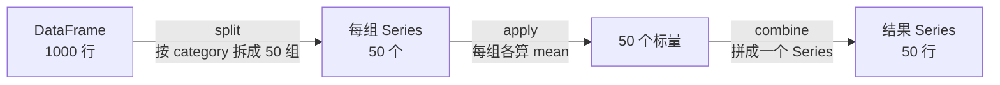

# 第 5 章 · pandas 分组聚合与透视

> 本章配套代码：`projects/data-analysis-lab/05_groupby_pivot.py`
> 建议学习时长：约 4 小时

## 学习目标

学完本章，你能够：

1. 用 split-apply-combine 心智模型解释 groupby 的每一步行为；
2. 熟练使用 `agg`（多函数）、**命名聚合**（自定义列名）、`transform`（聚合结果回到行级）、`filter`（整组淘汰）四个 groupby 配套工具；
3. 用 pivot_table 把长表掰成宽表，用 crosstab 输出交叉频次与占比；
4. 分清 merge（按列值对齐）/ join（按索引对齐）/ concat（拼接）三者适用场景，说清 inner 与 outer 的差别；
5. 用 dt 访问器拆解时间列，用 resample 按时间粒度重采样、rolling 滑动平均。

## 5.1 前置知识 / 本章地位

第 4 章洗好的数据，本章开始产出**统计量**——业务问题几乎都长成「每个 X 的 Y 是多少」：每个分类的均价、每个评分档的数量、每个月的销量。这是数据分析篇的核心章节，第 7 章全流程实战的所有答案都由本章的这几把刀切出来。实验主体使用真实数据 `projects/book-insight/data/books.db`（1000 本图书）；时间序列一节因为真实数据只采集于同一天，使用脚本内构造的 30 天演示序列（会在输出中明确标注）。

```bash
source ~/opt/jjyv/bin/activate
python projects/data-analysis-lab/05_groupby_pivot.py
```

## 5.2 split-apply-combine：groupby 的心智模型

groupby 不是一条命令，而是三段式：



**split** 按键拆行，**apply** 对每组算一个数，**combine** 把结果拼回去。理解这个模型后，「为什么 groupby 后单列索引变成组键」「为什么聚合列名要重起」都自然成立。脚本真实输出：

```python
grouped = df.groupby("category")["price"]
print(type(grouped).__name__, grouped.ngroups)   # 分组对象本身惰性，只记录规则
grouped.mean().round(2).head(5)
```

预期输出：

```text
[split] 分组对象: SeriesGroupBy 共 50 个组
[apply+combine] 每类均价（前 5）:
category
Academic         13.12
Add a comment    35.80
Adult Fiction    15.36
Art              38.52
Autobiography    37.05
```

### 多函数聚合与命名聚合

一次要多个统计量用 `agg`；**想要自定义列名（推荐）用命名聚合**——元组 `(原列, 函数)`：

```python
named = df.groupby("category").agg(
    book_count=("title", "size"),
    avg_price=("price", "mean"),
    avg_rating=("rating", "mean"),
    total_stock=("availability", "sum"),
).round(2).sort_values("book_count", ascending=False)
```

预期输出（前 6 行）：

```text
                book_count  avg_price  avg_rating  total_stock
category                                                      
Default                152      34.39        2.84         1345
Nonfiction             110      34.26        2.88          975
Sequential Art          75      34.57        2.97          686
Add a comment           67      35.80        2.76          516
Fiction                 65      36.07        3.18          588
Young Adult             54      35.45        3.30          464
```

`df.groupby("category")["price"].agg(["count", "mean", "median", "max"])` 也能一次多函数，但列名是函数名、多列聚合时容易混乱；**命名聚合是 pandas 推荐的现代写法**，列名自定、一列一语义，后续 `pivot`/绘图引用不歧义。

## 5.3 transform 与 filter：聚合结果的两种「回流」

### transform：聚合值回到行级

`transform` 与 `agg` 同样逐组计算，但结果**贴回每一行**（行数不变），适合「每行带 上本组统计量」的衍生列：

```python
df2 = df.copy()
df2["cat_avg_price"] = df2.groupby("category")["price"].transform("mean").round(2)
df2["price_vs_cat_avg"] = (df2["price"] - df2["cat_avg_price"]).round(2)
```

预期输出（随机抽 4 行）：

```text
                                                                      title       category  price  cat_avg_price  price_vs_cat_avg
                                                         Soldier (Talon #3)        Fantasy  24.72          39.59            -14.87
Barefoot Contessa at Home: Everyday Recipes You'll Make Over and Over Again Food and Drink  50.62          31.41             19.21
          Red Hood/Arsenal, Vol. 1: Open for Business (Red Hood/Arsenal #1) Sequential Art  25.48          34.57             -9.09
                                  Neither Here nor There: Travels in Europe         Travel  38.95          39.79             -0.84
```

`price - transform("mean")` 一行就完成「组内去均值」——第 1 章 1.7 节用相关子查询写的「价格高于本分类均价」，在 pandas 里就是一个减法。

### filter：整组淘汰

`filter` 对每组返回 True/False，**整组保留或整组丢弃**：

```python
big = df.groupby("category").filter(lambda g: len(g) >= 40)
print(big["category"].nunique(), len(big))
```

预期输出：

```text
[filter] 只保留书目数 >= 40 的分类: 7 个分类， 571 行
```

注意与「按行筛选」的区别：`df[df["n"] >= 40]` 这种写法根本不成立（n 是组级统计量，不在行上）；组级条件只能 groupby 后 filter（或先 agg 再 merge 回来）。**样本量门槛**是数据分析的高频需求——第 7 章的「分类评分排名只纳入书目数 >=20 的分类」就是 `filter(lambda g: len(g) >= 20)` 的直接应用。

## 5.4 pivot_table 与 crosstab：长表变宽表

聚合结果默认是「长表」（一列组键一列值），pivot_table 把它掰成二维宽表——**index 行、columns 列、values 值、aggfunc 聚合方式**：

```python
top4 = df["category"].value_counts().head(4).index.tolist()
sub = df[df["category"].isin(top4)]
pt = sub.pivot_table(index="rating", columns="category", values="price", aggfunc="mean").round(2)
```

预期输出：

```text
category  Add a comment  Default  Nonfiction  Sequential Art
rating                                                      
1                 36.36    33.66       35.74           36.42
2                 39.23    32.96       31.00           33.81
3                 32.80    35.03       32.36           36.06
4                 35.16    38.11       35.99           34.83
5                 36.51    33.66       37.06           31.30
```

这张表本身就是第 6 章热力图/分组柱状图的数据源。`margins=True` 加合计行列，`fill_value=0` 补空组。pivot_table 与 `groupby + unstack` 完全等价，选可读的那个。

**crosstab** 是 pivot_table 的频次特化（默认 aggfunc="size"），配合 `normalize` 直接出占比——「各评分档的低库存率」：

```python
df_low = df.assign(low_stock=df["availability"] <= 5)
ct = pd.crosstab(df_low["rating"], df_low["low_stock"], normalize="index").round(3)
```

预期输出：

```text
        库存>5 占比  库存<=5 占比
rating                   
1         0.540     0.460
2         0.592     0.408
3         0.571     0.429
4         0.637     0.363
5         0.571     0.429
```

五档低库存率 36.3%~46.0% 无单调趋势——又一处「评分与库存无关」的旁证，第 7 章会再验证一次。

## 5.5 merge / join / concat：三张表怎么拼

| 方法 | 对齐依据 | 典型场景 |
|---|---|---|
| `merge` | **列的值**（on=key） | 维表关联：订单表 × 用户表 |
| `join` | **索引**对齐 | 两个共享索引的 DataFrame 拼列 |
| `concat` | 不对齐，直接**堆** | 纵向追加新数据行、横向加列 |

**merge**（最常用）：把第 1 章的 category_notes 维表搬进 pandas 演示左连接——维表里有而事实表没有的组，计数值为 NaN：

```python
merged = meta.merge(stats, on="category", how="left")
```

预期输出：

```text
category shelf  book_count
  Poetry  A-01          19
 Fantasy  B-03          48
 Mystery  C-02          32
```

`how` 参数四种：`inner`（默认，只留两边都有的键）、`left`（左全保留）、`right`、`outer`（并集，缺处 NaN）。inner 与 outer 的一眼对比：

```text
[inner vs outer] inner 只留交集 id: [1] | outer 并集 id: [1, 2, 3]
```

**concat** 不做键匹配，纵向堆行（`axis=0`）或横向堆列（`axis=1`）：

```python
stacked = pd.concat([df.head(2), df.tail(2)], axis=0)[["title", "price"]]
```

预期输出：

```text
                              title  price
               A Light in the Attic  51.77
                 Tipping the Velvet  53.74
1st to Die (Women's Murder Club #1)  53.98
  1,000 Places to See Before You Die  26.08
```

选型口诀：**有键要匹配 → merge；索引天然对齐 → join；纯拼接 → concat**。merge 后行数暴涨几乎总是「键在对方表里不唯一」——先对右表 `drop_duplicates(subset=key)`。

## 5.6 时间序列：dt 访问器、resample、rolling

pandas 的时间类型是 `datetime64[ns]`，`pd.to_datetime` 把字符串列转过去后，`.dt` 访问器拆出年月日时分秒。真实数据的采集时间跨度只有 14 分钟，正好用来按分钟统计采集节奏：

```python
ts = pd.to_datetime(df["crawled_at"])
per_min = ts.dt.floor("min").value_counts().sort_index()
```

预期输出（前 5 分钟，真实数据）：

```text
采集时间跨度: 2026-11-03 16:05:32+00:00 -> 2026-11-03 16:19:55+00:00 （共 14 分钟）
每分钟采集完成的书（前 5 分钟）:
crawled_at
2026-11-03 16:05:00+00:00    33
2026-11-03 16:06:00+00:00    69
2026-11-03 16:07:00+00:00    72
2026-11-03 16:08:00+00:00    70
2026-11-03 16:09:00+00:00    69
```

（除首分钟外稳定在每分钟约 70 本——对应爬虫 0.3s 间隔的节奏，这个数字可以反查采集脚本是否退化。）

**resample 与 rolling** 需要跨天数据，真实数据只有一天，脚本构造了 30 天模拟日销序列演示（输出中已标注「非真实数据」）：

```python
idx = pd.date_range("2026-10-01", periods=30, freq="D")
daily = pd.Series(np.random.default_rng(42).integers(8, 20, size=30).cumsum(), index=idx)
daily.resample("W").sum()      # 按周重采样汇总
daily.rolling(7).mean()        # 7 日滑动平均
```

预期输出：

```text
周汇总 resample('W'):
2026-10-04     130
2026-10-11     748
2026-10-18    1467
2026-10-25    2164
2026-11-01    1985
Freq: W-SUN

7 日均值 rolling(7)（最后 3 个值）: [352.1, 367.0, 382.3]
```

记忆方式：**resample 是时间轴上的 groupby**（换粒度，`W`/`M`/`D`/`H`），**rolling 是窗口滑动**（不去行，每行带邻域统计量，与第 5.3 节 transform 精神相同）。做趋势图时先 rolling 平滑再画，是第 6 章的常规操作。

## 常见坑与排查（Troubleshooting）

| 报错/现象 | 原因 | 解决办法 |
|---|---|---|
| 聚合结果列名混乱、引用报错 | `agg(["mean",...])` 自动命名 | 用命名聚合 `agg(新名=("列", 函数))`（见 5.2） |
| `TypeError: 'mean' is not a valid function` | 对非数值列求均值 | 指定列 `df.groupby(k)["num_col"].mean()` |
| groupby 后 sum 结果「凭空」变多 | 组键有 NaN 组/重复行 | 先 `dropna(subset=[键])`、`drop_duplicates` |
| `transform` 报长度不匹配 | 想一次传多列但键不对应 | transform 逐列调用；多列用命名聚合 + merge |
| merge 后行数暴涨 | 右表键不唯一 | 右表先 `drop_duplicates(subset=key)`；确认 inner/left |
| `merge` 报 `KeyError` 或全 NaN | 两表键列名/类型不一致 | 统一列名与 dtype（字符串 vs 数字） |
| `concat` 后索引重复 0,1,0,1 | 各片段保留了原索引 | `ignore_index=True` 重建索引 |
| `resample` 报 only valid with DatetimeIndex | 行索引不是时间类型 | `set_index(pd.to_datetime(col))` 再 resample |
| `rolling(7).mean()` 前 6 个是 NaN | 窗口不满 | `min_periods=1` 或接受 NaN（不画前 N-1 个点） |
| 分组统计与 SQL 结果对不上 | SQL 里 COUNT(*) vs pandas size 语义、NaN 差异 | 对照第 1 章 1.5 节同款查询逐列核对 |

## 动手练习

（数据：真实 `books.db`，`pd.read_sql("SELECT * FROM books", conn)` 读入）

1. **命名聚合**：输出每个分类的 `n / avg_price / avg_rating / total_stock`，按 `avg_rating` 降序，取前 8。（验收：榜首 Young Adult 3.30 星，n=54）
2. **transform 差价**：给每行加 `price_vs_cat_avg` 列，找出比本类均价贵最多的 3 本书。（验收：第一名 `The Barefoot Contessa Cookbook`，Food and Drink 分类，贵 28.51 英镑）
3. **透视表**：对书目数前 4 的分类做 `pivot_table(index="rating", columns="category", values="availability", aggfunc="mean")`。（验收：Sequential Art 的 5 星档平均库存 8.1，全表最高档是 Nonfiction 的 2 星档 10.1）
4. **crosstab 占比**：`pd.crosstab(df["rating"], df["availability"] <= 5, normalize="index")`，指出低库存率最高与最低的评分档。（验收：最高 1 星 46.0%，最低 4 星 36.3%）

<details>
<summary>练习 2 提示</summary>

`df.assign(cat_avg=df.groupby("category")["price"].transform("mean")).assign(diff=lambda d: d["price"] - d["cat_avg"]).nlargest(3, "diff")`——`nlargest` 比 sort_values().head() 更直接；注意比的是「组内差」而非绝对价格，所以贵价书未必上榜。
</details>

## 小结与自检清单

- [ ] 能对着输出讲清 split-apply-combine 三段，解释为什么 groupby 对象是惰性的；
- [ ] 命名聚合的语法 `agg(新列名=("列", 函数))` 已形成肌肉记忆；
- [ ] 能说清 agg 与 transform 的返回形状差异（组数 vs 行数）并各举一个使用场景；
- [ ] 组级条件（样本量门槛）会用 groupby().filter 实现；
- [ ] pivot_table 四要素（index/columns/values/aggfunc）能徒手写出，crosstab 会用 normalize 出占比；
- [ ] merge/join/concat 三者按「对齐依据」选型不混淆，知道 merge 行数暴涨先查键唯一性；
- [ ] dt 访问器、resample（时间轴 groupby）、rolling（滑动窗口）三者用途分得清；
- [ ] 分组结果会与 SQL 版（第 1 章 1.5 节）互相验证。

## 延伸阅读

- [pandas User Guide: Group by](https://pandas.pydata.org/docs/user_guide/groupby.html) —— split-apply-combine 官方长文，含 named aggregation 全部示例；
- [pandas User Guide: Reshaping and pivot tables](https://pandas.pydata.org/docs/user_guide/reshaping.html) —— pivot_table/unstack/stack/melt 一族；
- [pandas User Guide: Merger, join, concatenate](https://pandas.pydata.org/docs/user_guide/merging.html) —— merge 的 how/validate 参数与多键合并；
- [pandas User Guide: Time series / date functionality](https://pandas.pydata.org/docs/user_guide/timeseries.html) —— dt 访问器、offset alias（W/M/D/H）与 resample 规则；
- 下一章：[第 6 章 数据可视化（matplotlib）](06-数据可视化(matplotlib).md)——统计量长成图。
