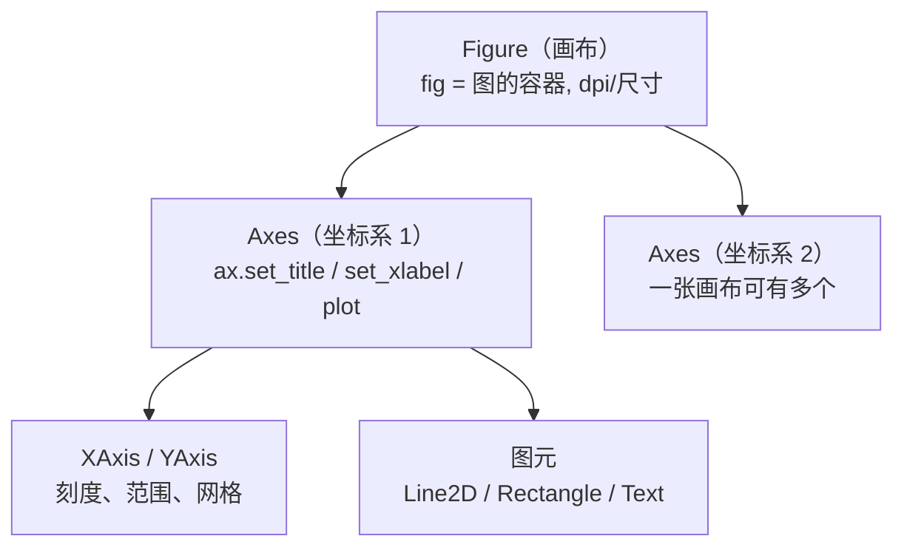
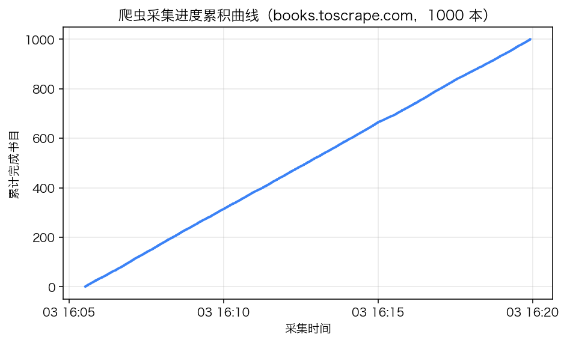
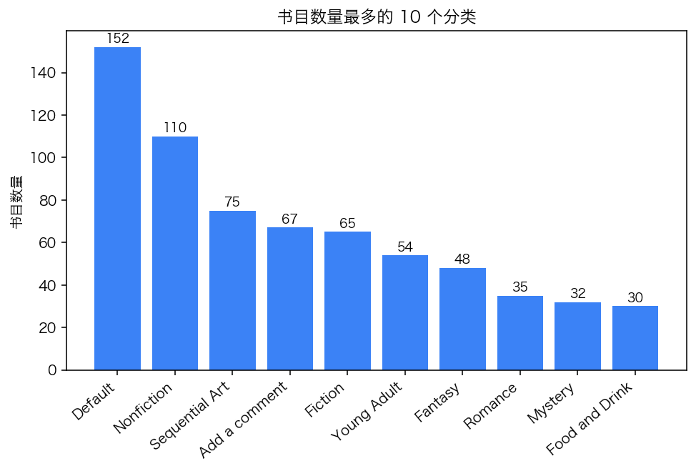
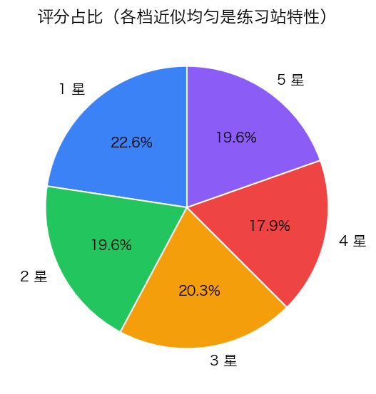
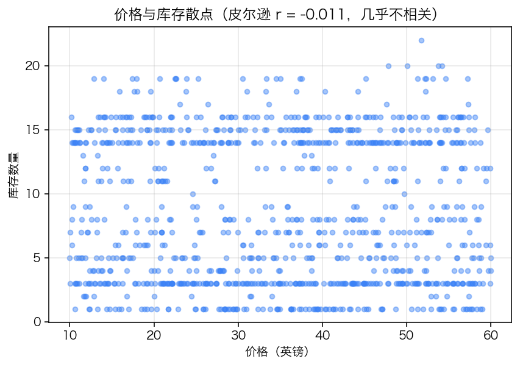
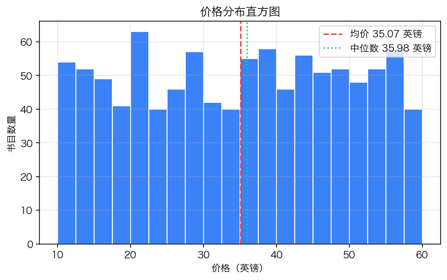
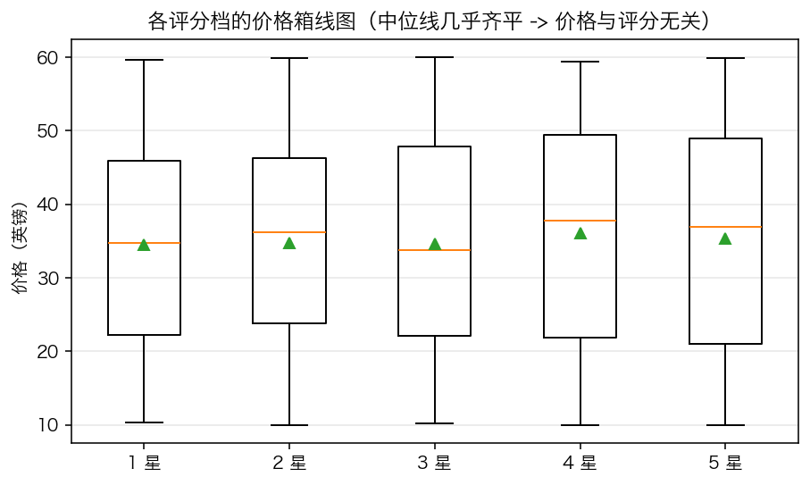
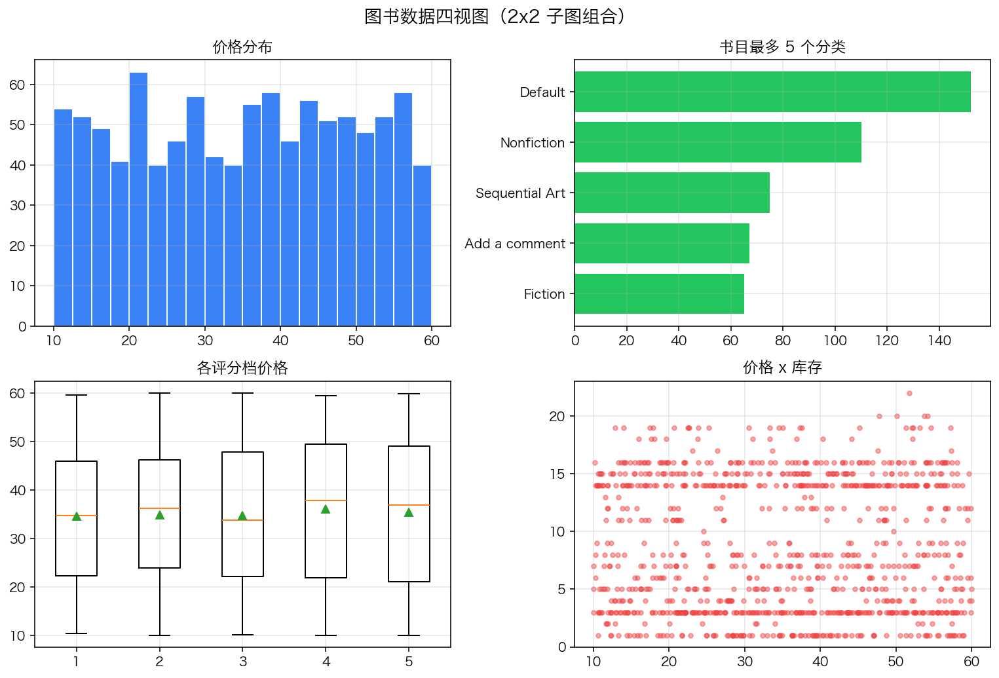

# 第 6 章 · 数据可视化（matplotlib）

> 本章配套代码：`projects/data-analysis-lab/06_matplotlib_charts.py`
> 建议学习时长：约 4 小时

## 学习目标

学完本章，你能够：

1. 建立 fig/ax 面向对象心智模型，不再写 plt 全局态式的「隐式代码」；
2. 按图表选型决策表为数据关系选对图型（分布/比较/构成/关系）；
3. 独立写出折线、柱状、饼图、散点、直方、箱线六种图的完整代码并逐个讲解；
4. 用 subplots 组合 2x2 多图，正确处理共享标题与 tight_layout；
5. 解决 matplotlib 中文乱码（macOS PingFang SC + Ubuntu fonts-noto-cjk 双方案）；
6. 用 rcParams 统一样式，用 savefig 输出可发布的 PNG；
7. 知道 seaborn 是 matplotlib 的什么、什么时候顺手用它。

## 6.1 前置知识 / 本章地位

第 3~5 章产出的统计量要变成「人一眼能看懂的东西」就是可视化。本篇用 matplotlib（实测 3.10.7）——它是 Python 可视化的地基（seaborn、pandas 内置 plot 都构建在它上面），也是唯一必须掌握的静态绘图库；浏览器端交互大屏是第 05 篇 ECharts 的职责。本章全部图表由 `06_matplotlib_charts.py` 用真实图书数据生成，PNG 落在 `projects/data-analysis-lab/output/` 并同步到 `assets/images/data-analysis/`（`1x_` 前缀，避免与 book-insight 项目的既有图冲突），下文直接引用展示。

```bash
source ~/opt/jjyv/bin/activate
python projects/data-analysis-lab/06_matplotlib_charts.py
```

## 6.2 fig / ax 面向对象模型（重点）

matplotlib 有两套 API：**pyplot 隐式接口**（`plt.plot(...)` 直接往「当前图」上画）与**面向对象接口**（先建 `fig, ax = plt.subplots()`，一切操作显式作用于 ax）。教程只用后者，理由是图一多、布局一复杂，隐式接口的「当前图」状态机就是 bug 之源：



记住翻译规则：**Figure 是画布，Axes 是画布上的一块坐标系，画的是 ax.什么，标的是 ax.set_什么**。`plt.subplots()` 一行拿到两样东西：

```python
import matplotlib
matplotlib.use("Agg")          # 无界面环境（脚本/服务器）必需
import matplotlib.pyplot as plt

fig, ax = plt.subplots(figsize=(7.5, 4.2))
ax.plot(ts, range(1, len(ts) + 1), color="#3b82f6", lw=2)
ax.set_title("标题"); ax.set_xlabel("x 轴"); ax.set_ylabel("y 轴")
ax.grid(alpha=0.3)
fig.savefig("out.png", dpi=140, bbox_inches="tight")
```

两个容易忽略的细节：脚本开头 `matplotlib.use("Agg")` 让它在不接显示器的环境（服务器、CI）也能出图；`savefig` 的 `bbox_inches="tight"` 裁掉多余白边，`dpi` 决定像素尺寸（140 dpi 的 7.5x4.2 英寸 ≈ 1050x588 像素）。

### 图表选型决策表

先想「数据里什么关系要给人看」，再选图型：

| 要表达的关系 | 图型 | 本章对应 |
|---|---|---|
| 随时间/顺序的趋势 | 折线图 | 6.3 采集进度曲线 |
| 类目间的数量比较 | 柱状图（横向 barh 适合长类目名） | 6.4 分类书目数 |
| 构成占比（<=5 类） | 饼图 | 6.5 评分占比 |
| 两个数值变量的关系 | 散点图 | 6.6 价格 x 库存 |
| 单变量的分布 | 直方图 | 6.7 价格分布 |
| 分组分布比较/离群值 | 箱线图 | 6.8 各评分档价格 |
| 多图对照总览 | subplots 组合 | 6.9 四视图 |

高频反选型：**时间序列别用柱状**（趋势被柱宽噪声干扰）、**类别多于 6 个别用饼图**（人眼比不了扇形角度差）、**分类名太长记得用 barh 横过来**。

## 6.3 折线图：采集进度累积曲线

数据点：真实 `crawled_at` 时间戳排序后做累积计数。折线图适合「连续推进」的量：

```python
ts = pd.to_datetime(df["crawled_at"]).sort_values()
fig, ax = plt.subplots(figsize=(7.5, 4.2))
ax.plot(ts, range(1, len(ts) + 1), color=ACCENT, lw=2)
ax.set_title("爬虫采集进度累积曲线（books.toscrape.com，1000 本）")
ax.set_xlabel("采集时间"); ax.set_ylabel("累计完成书目")
ax.grid(alpha=0.3)
save_and_copy(fig, "1x_06_line_crawl_progress.png")
```



*图 6-1 采集进度累积曲线：曲线斜率即采集速率，末段变缓对应站点响应变慢。*

多系列时再加一条 `ax.plot(...)` 并配 `label` + `ax.legend()` 即可；曲线是否平滑不影响信息量，别为了好看上插值。

## 6.4 柱状图：分类书目数量 TOP10

```python
top10 = df["category"].value_counts().head(10)
fig, ax = plt.subplots(figsize=(8, 4.4))
ax.bar(top10.index, top10.values, color=ACCENT)
ax.set_title("书目数量最多的 10 个分类")
ax.set_ylabel("书目数量")
ax.tick_params(axis="x", rotation=40)
for i, v in enumerate(top10.values):
    ax.text(i, v + 2, str(v), ha="center", fontsize=9)
plt.setp(ax.get_xticklabels(), ha="right")
save_and_copy(fig, "1x_06_bar_category_count.png")
```



*图 6-2 书目数量最多的 10 个分类：Default 152 本、Nonfiction 110 本居前。*

三个细节：类目名长时 `rotation=40` + `ha="right"` 让标签斜排右对齐；`ax.text` 把数值写在柱顶（`v + 2` 是抬升量，按量级调）；**柱状图的 y 轴必须从 0 开始**（matplotlib 默认如此，别手动画蛇添足改 ylim），否则比例失真。

## 6.5 饼图：评分占比

```python
rating_counts = df["rating"].value_counts().sort_index()
fig, ax = plt.subplots(figsize=(6, 4.6))
ax.pie(rating_counts.values, labels=[f"{r} 星" for r in rating_counts.index],
       autopct="%1.1f%%", colors=PALETTE[:5], startangle=90,
       wedgeprops={"edgecolor": "white"})
ax.set_title("评分占比（各档近似均匀是练习站特性）")
save_and_copy(fig, "1x_06_pie_rating.png")
```



*图 6-3 评分占比：五档 17.9%~22.6% 几乎均匀，练习站人造特性。*

`autopct="%1.1f%%"` 在每块标注百分比；`wedgeprops={"edgecolor": "white"}` 用白缝分块；`startangle=90` 从正上方开始按统一方向排。这张图也直观解释了「练习站评分分布均匀」为什么值得在第 7 章写进可信度声明——真实市场的评分几乎总是右偏（好评多差评少）。

## 6.6 散点图：价格与库存

散点图回答「两个数值变量有没有关系」——相关系数 r 可以算，但**先画图**才能看到非线性结构与离群点：

```python
r = df["price"].corr(df["availability"])
fig, ax = plt.subplots(figsize=(7, 4.5))
ax.scatter(df["price"], df["availability"], s=16, c=ACCENT, alpha=0.45)
ax.set_title(f"价格与库存散点（皮尔逊 r = {r:.3f}，几乎不相关）")
ax.set_xlabel("价格（英镑）"); ax.set_ylabel("库存数量")
ax.grid(alpha=0.3)
save_and_copy(fig, "1x_06_scatter_price_stock.png")
```



*图 6-4 价格与库存散点：1000 个点均匀铺满，r = -0.011，无任何模式。*

点密集时 `s`（点大小）调小、`alpha` 降到 0.4 左右防糊；r 写进标题让「图」与「数」互相印证——这张图的 r=-0.011 与第 7 章 Q4 的结论一致。

## 6.7 直方图：价格分布

直方图把连续变量分桶（bins）数频次，是「分布」的第一视图。它和柱状图长得像但语义不同：**直方图 x 轴是连续区间，柱条相邻不分离**：

```python
fig, ax = plt.subplots(figsize=(7.5, 4.2))
ax.hist(df["price"], bins=20, color=ACCENT, edgecolor="white")
ax.axvline(df["price"].mean(), color="#ef4444", ls="--",
           label=f"均价 {df['price'].mean():.2f} 英镑")
ax.axvline(df["price"].median(), color="#22c55e", ls=":",
           label=f"中位数 {df['price'].median():.2f} 英镑")
ax.set_title("价格分布直方图"); ax.set_xlabel("价格（英镑）"); ax.set_ylabel("书目数量")
ax.legend(); ax.grid(alpha=0.3)
save_and_copy(fig, "1x_06_hist_price.png")
```



*图 6-5 价格分布：10~60 英镑近似平坦，均值 35.07 与中位数 35.98 几乎重合。*

`bins=20` 是起点：bin 太少糊掉结构、太多放大噪声，宁可多试几档。`axvline` 竖参考线 + `label` + `legend()` 是「在图上标注关键统计量」的标准组合。

## 6.8 箱线图：各评分档的价格分布

箱线图一次呈现中位数、四分位、须与离群点，最适合**多组分布对比**：

```python
data = [df.loc[df["rating"] == r, "price"] for r in range(1, 6)]
fig, ax = plt.subplots(figsize=(7.5, 4.2))
ax.boxplot(data, tick_labels=[f"{r} 星" for r in range(1, 6)], showmeans=True)
ax.set_title("各评分档的价格箱线图（中位线几乎齐平 -> 价格与评分无关）")
ax.set_ylabel("价格（英镑）"); ax.grid(axis="y", alpha=0.3)
save_and_copy(fig, "1x_06_box_price_by_rating.png")
```



*图 6-6 各评分档价格箱线图：五档箱体与中位线高度几乎一致，均值点（三角形）都在 34~36 区间。*

这正图是第 7 章 Q3「价格与评分无关」的第一证据：如果价格随评分变化，五只箱的中位线会有明显阶梯。`showmeans=True` 叠加均值标记，弥补箱线图只突出中位数的盲区。

## 6.9 子图组合：2x2 四视图

对比「单图讲一件事」，汇报/复盘时常需要一张图看四个维度。`plt.subplots(2, 2)` 返回二维 axes 数组，用 `[i, j]` 寻址：

```python
fig, axes = plt.subplots(2, 2, figsize=(11, 7.5))
fig.suptitle("图书数据四视图（2x2 子图组合）", fontsize=14)

axes[0, 0].hist(df["price"], bins=20, color=ACCENT, edgecolor="white")
axes[0, 0].set_title("价格分布")

top5 = df["category"].value_counts().head(5)
axes[0, 1].barh(top5.index[::-1], top5.values[::-1], color=PALETTE[1])   # barh 反转自大到小
axes[0, 1].set_title("书目最多 5 个分类")

axes[1, 0].boxplot(data, tick_labels=[f"{r}" for r in range(1, 6)], showmeans=True)
axes[1, 0].set_title("各评分档价格")

axes[1, 1].scatter(df["price"], df["availability"], s=12, c=PALETTE[3], alpha=0.45)
axes[1, 1].set_title("价格 x 库存")

for ax in axes.flat:          # flat 把 2x2 拉平逐个处理
    ax.grid(alpha=0.3)
fig.tight_layout()            # 自动分配边距，防标题互相压盖
save_and_copy(fig, "1x_06_subplots_overview.png")
```



*图 6-7 四视图总览：左上价格分布、右上分类数量、左下评分档价格、右下价格 x 库存。*

`fig.suptitle` 是整图大标题（区别于每块 ax 的 set_title）；`axes.flat` 统一遍历所有子图设样式；`fig.tight_layout()`（或 savefig 的 `bbox_inches="tight"`）处理边距重叠。

## 6.10 中文显示：macOS 与 Ubuntu 双方案

matplotlib 默认字体（DejaVu Sans）不含中文字形，中文会渲染成方框；负号也会变方块。双平台方案一次性配好：

```python
plt.rcParams["font.sans-serif"] = [
    "PingFang SC",         # macOS 系统自带
    "Hiragino Sans GB",    # macOS 备选
    "Noto Sans CJK SC",    # Ubuntu: sudo apt install fonts-noto-cjk
    "SimHei",              # Windows 备选
]
plt.rcParams["axes.unicode_minus"] = False   # 修负号方块
```

两步走：安装字体（macOS 自带 PingFang SC；Ubuntu 装 `fonts-noto-cjk`）→ rcParams 按**优先级列表**写（matplotlib 逐个找，找到即用）。验证当前环境可用字体：

```python
from matplotlib import font_manager
names = {f.name for f in font_manager.ttflist}
print("PingFang SC" in names, "Noto Sans CJK SC" in names)
```

本机（macOS）实测输出 `True True`。改完 rcParams 不生效时，清缓存重启内核：`rm -rf ~/.matplotlib/fontlist*.json`（Linux 为 `~/.cache/matplotlib`）。

## 6.11 样式统一与 savefig 输出规范

项目里图表风格应当一致，做法是把常量与 rcParams 收敛到脚本顶部（本仓库 lab 即如此）：

```python
ACCENT = "#3b82f6"
PALETTE = ["#3b82f6", "#22c55e", "#f59e0b", "#ef4444", "#8b5cf6", "#06b6d4"]

plt.rcParams["figure.dpi"] = 100
plt.rcParams["savefig.dpi"] = 140
```

savefig 三条规范：**dpi 明确写出**（默认 100 偏糊，文档插图 140 起）；**文件名带内容语义**（`1x_06_hist_price.png` 而非 `fig1.png`）；**调色克制**（一个主色 + 少量强调色，每个色有含义——比如红=异常、绿=正常，见第 7 章分类排名图）。需要 SVG/PDF 矢量格式时直接改后缀，matplotlib 按扩展名输出。

## 6.12 seaborn 一页速览

seaborn 是 matplotlib 上的统计绘图封装（jjyv 环境未预装，需要时 `pip install seaborn`）。它的价值是「**统计语义内置**」：一行出图、自动聚合、自动配色。三行感受：

```python
import seaborn as sns

sns.set_theme(style="whitegrid")                      # 全局美化（作用于 matplotlib）
sns.boxplot(data=df, x="rating", y="price")           # 分组箱线一行
sns.heatmap(pt, annot=True, fmt=".1f", cmap="YlGnBu") # 透视表热力图一行（第 5 章 pt）
```

什么时候用它：探索期快速出统计图（箱线/热力/回归线 `lmplot`）；什么时候不用：正式交付需要精细控制每个图元时，seaborn 的抽象反而碍事——好在它的每个 `ax` 都是 matplotlib Axes，随时可以接第 6.2 节的面向对象 API 微调。

## 常见坑与排查（Troubleshooting）

| 报错/现象 | 原因 | 解决办法 |
|---|---|---|
| 中文全部变方框 | 默认字体无中文字形 | 6.10 节 rcParams 字体列表 + 装字体 |
| 负号显示为方块 | 同上 | `axes.unicode_minus = False` |
| 脚本跑完没有弹窗也没有文件 | 忘了 savefig / 后端无界面 | 结尾 `fig.savefig(...)`；脚本开头 `matplotlib.use("Agg")` |
| `RuntimeError: main thread is not in main loop` | 在非主线程/交互环境混用 pyplot | 用面向对象 API；Jupyter 里用 `%matplotlib inline` |
| 图例/标题互相压盖 | 边距自动分配失灵 | `fig.tight_layout()` 或 `constrained_layout=True` |
| 直方图「空白一根柱」 | bins 数与数据范围不匹配 | 显式传 `bins=range(min, max+1)` 试探 |
| 饼图标签重叠成一团 | 类目太多 | 类目 >6 改 barh 或 `radius`/`labeldistance` 调整 |
| x 轴类目标签太长截断 | 水平排布放不下 | rotation + ha="right"，或改 barh |
| 保存的图被裁掉一块 | bbox 未收紧 | `savefig(..., bbox_inches="tight")` |
| 多次运行图越画越多 | plt 全局态残留 | 每张图 `plt.close(fig)`（save_and_copy 已内置） |

## 动手练习

（数据：真实 books.db；图表输出到 `output/`，全部要求中文标题正常显示）

1. **箱线改小提琴**：把图 6-6 的箱线图改成 `ax.violinplot(data, showmeans=True)`，对比两种图传达的信息。（验收：五个「小提琴」轮廓近似一致，与箱线结论相同）
2. **横向条形图**：用 barh 画出「平均库存最高的 10 个分类」（样本数 >=20 的分类中取），数值标签写右端。（验收：Food and Drink 10.6 居首）
3. **双系列柱状图**：对书目数前 5 的分类画「在售均值 vs 全站均值 8.59」的两色并列柱。（提示：x 用 `np.arange(5)`，两组柱各偏移 0.2 宽度）
4. **组合图进阶**：在图 6-7 基础上加第 5 块子图（改 2x3 布局或 3x2），画评分饼图。（验收：六块子图无重叠、共享 suptitle）

<details>
<summary>练习 2 提示</summary>

先复用第 5 章写法：`g = df.groupby("category").agg(n=("title","size"), avg=("availability","mean")).query("n >= 20").nlargest(10, "avg")`，再 `ax.barh(g.index[::-1], g["avg"][::-1])`（反转让最大值在顶）。数值标签用 `ax.text(v + 0.1, i, f"{v:.1f}", va="center")`。
</details>

## 小结与自检清单

- [ ] 能画出 Figure → Axes → 图元 的层级图，并用面向对象 API 写完整一张图；
- [ ] 面对一个数据集，能按「趋势/比较/构成/关系/分布」五问选对图型；
- [ ] 六种基础图（折线/柱/饼/散点/直方/箱线）都能不看资料写出完整代码；
- [ ] 会用 subplots 组合多图，分得清 suptitle / set_title、tight_layout 的作用；
- [ ] macOS 与 Ubuntu 两侧的中文显示都能一次配好，知道去哪查可用字体；
- [ ] savefig 带 dpi、语义化文件名，调色有主次、色有含义；
- [ ] 能说清直方图与柱状图的区别、seaborn 与 matplotlib 的关系。

## 延伸阅读

- [matplotlib 官方教程：Intro to pyplot / OO API](https://matplotlib.org/stable/tutorials/index.html) —— 两种 API 的官方对照与推荐；
- [matplotlib: Anatomy of a figure](https://matplotlib.org/stable/gallery/showcase/anatomy.html) —— 一张图标注入门的完整图解（fig/ax/axis/tick 各叫什么）；
- [matplotlib: Customizing rcParams](https://matplotlib.org/stable/users/explain/customizing.html) —— 样式统一的参数总表；
- [seaborn 官方教程](https://seaborn.pydata.org/tutorial.html) —— 统计图封装与 matplotlib 的关系；
- 下一章：[第 7 章 实战：图书数据全流程分析](07-实战-图书数据全流程分析.md)——本章全部技能的实战检验。
