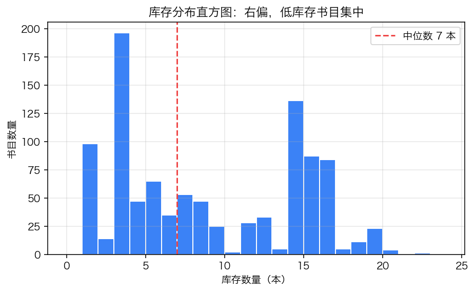
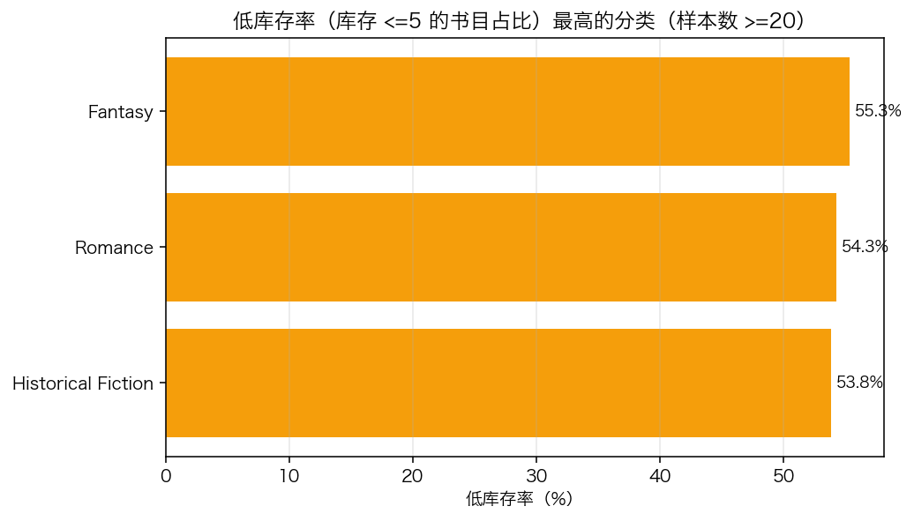
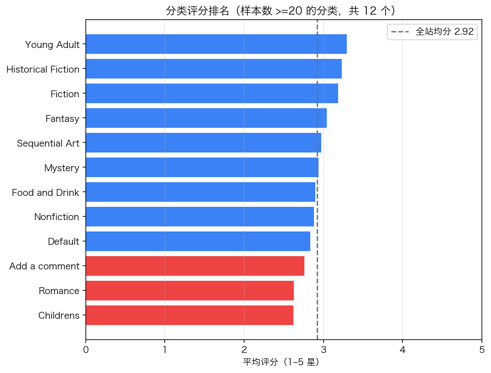
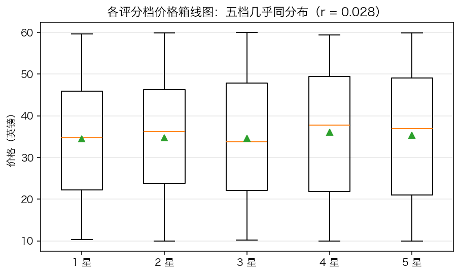
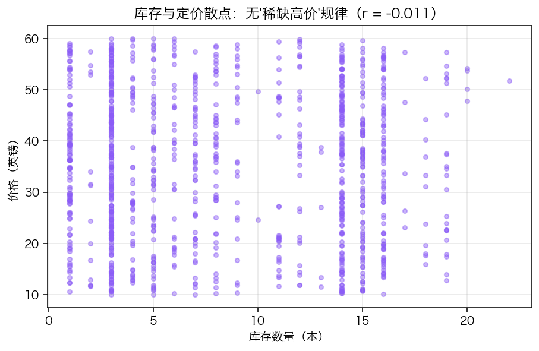

# 第 7 章 · 实战：图书数据全流程分析

> 本章配套代码：`projects/data-analysis-lab/07_book_insight_analysis.py`（与 `07_book_insight_analysis.ipynb` notebook 版）
> 建议学习时长：约 5 小时

## 学习目标

这是数据分析篇的收官章：前六章的技能（SQL / SQLAlchemy / pandas 清洗 / 聚合 / 可视化）在这一章拧成一条完整流水线。学完本章，你能够：

1. 把一个模糊的「看看数据」翻译成 5 个可回答、可验收的业务问题；
2. 用 SQLAlchemy + pandas 完成参数绑定的数据抽取；
3. 在真实数据上走完「清洗 → 聚合 → 图表 → 结论报告」的全流程；
4. 在已有分析（book-insight 项目）基础上选择**不重复的新角度**深挖；
5. 为每个结论附上可信度声明，分清「数据说的」与「数据没说的」。

## 7.1 本章定位：与已有结论对话

本仓库综合项目 book-insight（爬虫 → SQLite → FastAPI → ECharts 大屏）已经产出过 5 张图表：评分分布柱状图、价格直方图、TOP 分类均价条形图、价格 × 评分散点图、在售状态饼图（见 `projects/book-insight/analysis/output/charts/`）。那轮分析留下了两个「目测级」结论：

1. **评分分布近似均匀**——真实市场几乎不可能，怀疑是练习站人造特性；
2. **价格与评分散点看不出相关**——「看不出」不等于「没有」，需要量化。

本章的策略不是重画一遍，而是**换角度深挖**：

| 已有分析 | 本章新角度 |
|---|---|
| 评分分布柱状图 | 数据质量审计：把「人造特性」逐项列证（7.9 节） |
| 价格 × 评分散点 | 各评分档价格箱线 + 分组均值表，量化「无相关」（7.7） |
| 在售/缺货饼图（只有 2 桶） | 库存数值分布直方图 + 分类低库存率（7.5） |
| TOP 分类均价 | 分类评分排名（样本量门槛过滤）+ 低库存率排名（7.5/7.6） |
| —— | 库存 × 定价关系（全新维度，7.8） |

数据源同前：`projects/book-insight/data/books.db`，books.toscrape.com 真实采集的 1000 本图书（练习站点，robots.txt 明确允许抓取）。全程只读源库。

## 7.2 五个业务问题

动手之前先定问题（验收标准写在括号里）：

- **Q1 库存压力**：库存整体什么分布？多少书目处于低库存？哪些分类补货压力最大？（输出：分布统计 + 分类低库存率排名 + 2 张图）
- **Q2 分类口碑**：哪些分类评分高、哪些低？（约束：样本数 >=20 的分类才参与排名，防小样本误导；输出：排名图）
- **Q3 定价与口碑**：价格与评分到底有没有关系？（验收：给出 r 与分档价格表双重证据）
- **Q4 稀缺定价**：库存少的书更贵吗？（验收：r + 散点图）
- **Q5 数据可信度**：这份练习站数据有哪些「人造痕迹」？哪些结论不能外推？（输出：逐项审计清单）

脚本一键复现本章全部数字与图表：

```bash
source ~/opt/jjyv/bin/activate
python projects/data-analysis-lab/07_book_insight_analysis.py
```

脚本按「抽取 → 清洗 → 分析 → 图表 → 报告」五个函数组织（对应第 7.3~7.10 节），产出清单：

| 产出 | 位置 |
|---|---|
| 5 张新角度图表 | `projects/data-analysis-lab/output/1x_07_*.png`，同步复制到 `assets/images/data-analysis/` |
| markdown 结论报告 | `projects/data-analysis-lab/output/07_report.md` |
| 终端答案摘要 | 5 个业务问题各一行（见脚本运行末尾） |

## 7.3 抽取：SQLAlchemy + pandas，参数绑定

抽取层用 SQLAlchemy Engine 管连接，`text()` 写原生 SQL，条件一律 `:name` 绑定（第 1、2 章的硬规范在这里合流）：

```python
from sqlalchemy import create_engine, text
import pandas as pd

engine = create_engine(f"sqlite:///{DB_PATH}")
with engine.connect() as conn:
    df = pd.read_sql(text("SELECT * FROM books"), conn)   # 全表静态查询，无参数
    print(f"全量抽取: {len(df)} 行")
    pricey = pd.read_sql(
        text("SELECT title, price, category FROM books WHERE price >= :p AND rating >= :r ORDER BY price DESC LIMIT 3"),
        conn,
        params={"p": 50.0, "r": 4},
    )
engine.dispose()
```

预期输出：

```text
  全量抽取: 1000 行
  [带条件抽取演示] 50 英镑以上的 4 星书 Top3:
    £59.92  The Barefoot Contessa Cookbook
    £59.45  The Man Who Mistook His Wife for a Hat and O
    £59.15  The Gray Rhino: How to Recognize and Act on
```

> ⚠️ 如果这里图省事写成 `text(f"... WHERE price >= {p}")`，就是第 1 章 1.9 节反面案例的移植——参数绑定是全链路规范，抽取层不豁免。

## 7.4 清洗：真实数据的三处小问题

1000 行真实数据只有三处需要处理：1 个重复书名、2 条缺失简介、时间列类型转换（比第 4 章的构造脏数据干净得多——因为入库时爬虫已经做过参数绑定与校验，**清洗成本是上游做出来的**）：

```python
df = df.copy()
df["crawled_at"] = pd.to_datetime(df["crawled_at"], utc=True)
dup_titles = int(df["title"].duplicated().sum())
dup_list = df.loc[df["title"].duplicated(keep=False), "title"].unique().tolist()
df = df.drop_duplicates(subset=["title"], keep="first")
df["description"] = df["description"].fillna("（无简介）")
```

预期输出：

```text
  重复书名: 1 行（['The Star-Touched Queen']）-> 已去重，剩 999 行
  缺失简介: 2 行 -> 填充占位文本
  各数值列 dtype: {'price': 'float64', 'availability': 'int64', 'rating': 'int64'}
```

两点说明：去重按 `title` 而非 `detail_url`——实测重复行两者一致，标题判重更保守；缺失简介用占位文本而不是删除，因为本章分析不依赖简介字段，删行反而改变库存/价格统计的分母。

## 7.5 Q1 库存分析：右偏分布与分类补货压力

**总览统计**（真实运行）：

```text
[Q1 库存] 均值 8.58 本，中位数 7 本；
  低库存（<=5 本）420 种，占 42.0%
  低库存率最高的 3 个分类（样本数 >=20）:
                     n  low_rate
category                        
Fantasy             47     0.553
Romance             35     0.543
Historical Fiction  26     0.538
```

先看整体分布（图 1）：



*图 7-1 库存分布直方图：右偏明显——大量书目挤在 1~5 本区间，长尾延伸到 22 本；红色虚线为中位数 7。*

均值 8.58 高于中位数 7，右偏的典型信号；42.0% 的书目库存不超过 5 本，这是本次分析最有业务含义的数字。再把低库存率按分类拆开（样本数 >=20 的大分类，图 2）：



*图 7-2 低库存率最高的 8 个大分类：Fantasy 55.3% 居首，Romance 54.3%、Historical Fiction 53.8% 紧随。*

**Q1 答案**：库存右偏（中位数 7 本），低库存书目占比 42.0%；Fantasy / Romance / Historical Fiction 是补货压力最大的三个分类。对比已有分析：book-insight 的「在售/缺货」饼图只有 2 个桶（本数据集全部在售），**把库存当数值看**才暴露出这个梯度。

## 7.6 Q2 分类评分排名：给口碑排序，先过样本量门槛

50 个分类里有 38 个样本数不足 20（最少 1 本），直接排名会让「1 本书拿了 5 星」的Erotica 之流登顶。用 `query("n >= 20")` 过滤后剩 12 个大分类：

```python
q2 = (df.groupby("category")
        .agg(n=("title", "size"), avg_rating=("rating", "mean"), avg_price=("price", "mean"))
        .query("n >= 20")
        .sort_values("avg_rating", ascending=False))
```

预期输出（头部与尾部）：

```text
  最高 3: {'Young Adult': {'n': 54, 'avg_rating': 3.3, 'avg_price': 35.45},
           'Historical Fiction': {'n': 26, 'avg_rating': 3.23, 'avg_price': 33.64},
           'Fiction': {'n': 65, 'avg_rating': 3.18, 'avg_price': 36.07}}
  最低 3: {'Add a comment': {'n': 67, 'avg_rating': 2.76, 'avg_price': 35.8},
           'Romance': {'n': 35, 'avg_rating': 2.63, 'avg_price': 33.93},
           'Childrens': {'n': 29, 'avg_rating': 2.62, 'avg_price': 32.64}}
```

可视化（红色低于 2.8、绿色高于 3.3，灰虚线为全站均分 2.92）：



*图 7-3 样本数 >=20 的 12 个分类评分排名：Young Adult 3.30 星最高，Childrens 2.62 星最低，极差约 0.68 星。*

**Q2 答案**：分类间评分差异有限但真实存在（0.68 星极差），Young Adult / Historical Fiction / Fiction 口碑领先，Childrens / Romance / Add a comment 垫底。注意 `Add a comment` 是站点遗留命名（第 03 篇爬虫章节讲过的分类页解析副产物），67 本的体量让它必须参与排名——但它的「口碑含义」要打折看待。

## 7.7 Q3 价格与评分：把「目测无相关」变成双证据

book-insight 散点图只能「看不出」，这里补两组量化证据。**证据一：分组价格表**：

```text
[Q3 评分 x 价格] 各档均价差最大 1.53 英镑，皮尔逊 r = 0.028
         mean  median  count
rating                      
1       34.56   34.77    226
2       34.81   36.22    196
3       34.69   33.78    203
4       36.09   37.80    179
5       35.39   36.97    195
```

**证据二：箱线图**（五档分布几乎同形）：



*图 7-4 各评分档价格箱线图：中位线无阶梯，箱体高度重合，r = 0.028。*

**Q3 答案**：价格与评分无关——五档均价差最大仅 1.53 英镑（不足价格波动的 11%），r = 0.028 远低于任何常用显著性门槛。评分 4 星档均价 36.09 略高，但幅度与样本差异（n=179，最小一档）相符，不构成趋势。这为上游定了一个结论：**这个站点不存在「贵书评分高」的信号，选书时价格维度可以独立于口碑决策**。

## 7.8 Q4 库存与定价：「稀缺即高价」不存在

最后一个新维度：库存少是不是意味着贵（稀缺定价）？

```text
[Q4 库存 x 价格] 皮尔逊 r = -0.011（不存在「稀缺即高价」规律）
```



*图 7-5 库存与定价散点：1000 个点均匀铺满 1~22 本 x 10~60 英镑的矩形，r = -0.011。*

**Q4 答案**：库存与定价无关（r = -0.011）。散点图铺满整个矩形、没有任何「低库存区价格更高」的迹象——与图 6-4（第 6 章）互相印证。结合 Q1 的低库存率（42%），站点的补货优先级不应由价格驱动（不存在「贵的书更缺」或「缺的书更贵」的规律），按分类的低库存率（图 7-2）安排更合理。

## 7.9 Q5 数据质量审计：哪些结论不能带出练习站

分析做完，最后一步是给结论划定边界——这份练习站数据有哪些程序生成的痕迹：

```text
[Q5 数据质量审计]
  tax 恒为 0: True | num_reviews 恒为 0: True | price == price_excl_tax 恒成立: True
  评分占比(%): {1: 22.6, 2: 19.6, 3: 20.3, 4: 17.9, 5: 19.5}
```

逐项解读：

1. **tax 恒为 0 且 price == price_excl_tax 恒成立**：税费字段是占位数据，「含税/不含税价差」分析在本数据集上无意义（曾计划做的税负率分析因此放弃——这本身就是数据质量审计的价值）；
2. **num_reviews 恒为 0**：站点不提供评论数，任何「评论与销量」类问题都无法回答；
3. **评分五档占比 17.9%~22.6% 近似均匀**：真实市场的评分分布几乎总是右偏（好评远多于差评），均匀分布是练习站为了覆盖各种取值的人造设计——所以 Q2 的分类排名**相对顺序**可用，**绝对水平**不可外推；
4. **价格 10.00~59.99 英镑的平坦分布**（第 6 章图 6-5）：真实书店价格通常呈对数正态，10 镑低价书远多于 60 镑高价书。

## 7.10 结论报告

脚本把结论与可信度声明写进 `projects/data-analysis-lab/output/07_report.md`，全文如下（与脚本真实输出逐字一致）：

> # 图书数据全流程分析结论报告
>
> - 数据源：books.toscrape.com 真实采集（999 种图书，50 个分类，采集于 2026-11-03）
> - 分析脚本：`projects/data-analysis-lab/07_book_insight_analysis.py`（可一键复现本文全部数字与图表）
>
> ## 结论
>
> 1. **库存呈右偏分布，补货压力集中在尾部**：均值 8.58 本、中位数 7 本，420 种书目（42.0%）库存不超过 5 本；低库存率最高的大分类是 Fantasy（55.3%）。
> 2. **分类评分差异有限但真实存在**（样本数 >=20 的 12 个分类）：最高 Young Adult（3.30 星），最低 Childrens（2.62 星），极差约 1 星量级。
> 3. **价格与评分无关得到量化确认**：各评分档均价差不超过 1.53 英镑，皮尔逊 r = 0.028；箱线图五档几乎同分布，与 book-insight 大屏散点图的目测结论一致且更严谨。
> 4. **库存与定价同样无关**（r = -0.011）：站点没有「稀缺即高价」的定价策略。
> 5. **数据质量**：tax 恒为 0、num_reviews 恒为 0、price 与 price_excl_tax 恒相等、五档评分占比 18%~23% 近似均匀——这是练习站的人造特性，分析结论不能外推到真实图书市场。
>
> ## 可信度声明
>
> - 样本量：999 种图书（原始 1000 行、去重 1 行），单一站点、单次快照，价格与库存均为采集时刻状态；
> - 分类评分排名只纳入书目数 >=20 的分类，样本数 1~19 的分类（如 Erotica 5 星但仅 1 本）不具统计意义；
> - 皮尔逊相关系数只衡量线性关系；本文所有「无相关」结论均在 r 与分组分布双重验证下成立；
> - 练习站数据由程序生成，均匀评分与零税费是站点特性而非市场规律。

报告写作的三个原则值得强调：**每条结论都能在图或表里指出证据**；**数字与脚本输出逐字一致**（跑一遍脚本即可核验）；**可信度声明放在结论之后不省略**——说清数据来自哪里、样本多大、哪些结论受限，是数据分析区别于「看图说话」的标志。

## 7.11 notebook 版本与工程化提示

`07_book_insight_analysis.ipynb` 是同一份分析的 notebook 版（由 .py 转换生成后微调：增加标题与结论 markdown 单元、路径改为 notebook 兼容），已附执行输出。适合逐步单格运行、边跑边看图表。

如果要把它工程化为定时任务（如每天采集后自动重跑分析），三个改进方向：把「问题 → 函数」的对应关系固化（本章脚本已是每问一个函数）；把统计结果写成 stats.json 供大屏消费（book-insight 的 `analysis/analyze.py` 就是这个形态）；异常检测（库存骤降、评分突变）用阈值告警替代人肉看图——这些属于第 07 篇综合项目的内容。

## 常见坑与排查（Troubleshooting）

| 报错/现象 | 原因 | 解决办法 |
|---|---|---|
| 脚本报 `unable to open database file` | 从别的目录运行，相对路径漂移 | 脚本内用 `Path(__file__)` 定位（已内置）；在仓库根目录运行 |
| 图表中文变方框 | 字体配置缺失 | rcParams 字体列表 + 平台字体（第 6 章 6.10） |
| 去重后分类计数与第 5 章对不上 | 一边用 1000 行一边用 999 行 | 明确「清洗后口径」，全文统一用同一 DataFrame |
| `query("n >= 20")` 报错 | 聚合列名不是 n | 与 agg 命名聚合的新列名保持一致 |
| 相关系数算出来 NaN | 列里有 NaN 或全常数 | 先 dropna；常数列 r 无定义 |
| 分类排名被 1 本书的分类霸榜 | 未加样本量门槛 | `query("n >= 20")`（7.6 节） |
| 图保存了但文档里不显示 | 相对路径层级错误 | 从 docs/04-data-analysis/ 出发是 `../../assets/images/data-analysis/` |
| 结论写了「相关性很强」 | 只看 r 没看分布 | r 与分组分布/散点双证据（7.7 节的流程） |
| ipynb 跑一半停了 | 内核超时或路径不对 | 按标题格提示先切到仓库根目录；逐步单格执行定位 |

## 动手练习

（在 `07_book_insight_analysis.py` 基础上扩展，保持「每步可复现」的纪律）

1. **新问题**：书名长度（字符数）与评分是否相关？给出 r 与按长度四分位分组的评分表，并把结论写进可信度声明的适用范围。（验收：r = -0.011，四组均分 2.82~3.01，无单调趋势）
2. **新图表**：把 Q1 的低库存率与 Q2 的平均评分合成一张双轴图（barh + 点标注），观察「口碑差的分类是否更缺货」。（验收：两序列无单调关系，与 r 检验一致）
3. **口径敏感性**：把样本量门槛从 20 放宽到 10，重看 Q2 排名变化，用一句话说明「门槛的选择如何影响结论」。
4. **交付演练**：把 07_report.md 改写成 200 字以内的业务摘要（只保留 3 个最有行动价值的结论 + 1 条限制）。

<details>
<summary>练习 1 提示</summary>

`df.assign(title_len=df["title"].str.len())` 后先算 `corr`，再 `pd.qcut(df["title_len"], 4)` 分四箱 `groupby` 算均分。注意书名长度右偏严重（中位数 35、最大 204，实测均值 39.1），先看 `describe()` 再选分组方式，别直接按等距分箱。
</details>

## 小结与自检清单

- [ ] 能把模糊的数据需求翻译成带验收标准的问题清单；
- [ ] 抽取层会用 SQLAlchemy + `text()` + `:name` 参数绑定对接 pandas；
- [ ] 清洗动作有口径意识（去重键、缺失策略、分母变化）并能向他人解释；
- [ ] 分类级结论先过样本量门槛再排名；
- [ ] 「无相关」类结论会给 r + 分组分布双重证据，不单靠目测；
- [ ] 会做数据质量审计，明确哪些结论不能外推；
- [ ] 结论报告每条有证据、数字可复现、可信度声明完整；
- [ ] 知道 .py 版与 .ipynb 版各自的使用场景。

## 延伸阅读

- [pandas User Guide: Group by](https://pandas.pydata.org/docs/user_guide/groupby.html) —— 本章聚合写法的官方手册（与第 5 章互为对照）；
- [pandas: qcut](https://pandas.pydata.org/docs/reference/api/pandas.qcut.html) —— 练习 1 的分位数分箱工具；
- [matplotlib: Figure anatomy](https://matplotlib.org/stable/gallery/showcase/anatomy.html) —— 双轴图（`twinx`/`twiny`）入门前的图元复习；
- 本仓库项目：`projects/book-insight/`（分析、API 与大屏的工程化版本）、[第 05 篇 ECharts 可视化](../05-echarts-visualization/)——把本章静态图升级为交互大屏；
- 姊妹篇回顾：[第 1 章 SQL](01-SQL从入门到进阶(MySQL).md)、[第 2 章 SQLAlchemy](02-SQLAlchemy2.0-ORM与数据库连接.md)、[第 3 章 pandas 入门](03-pandas入门(核心数据结构).md)、[第 4 章 清洗](04-pandas数据清洗实战.md)、[第 5 章 分组聚合](05-pandas分组聚合与透视.md)、[第 6 章 可视化](06-数据可视化(matplotlib).md)。
