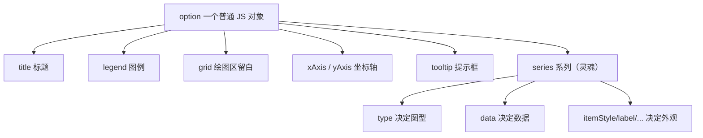

# 05.1 · ECharts 快速上手

> 本章配套代码：`projects/echarts-lab/01_quick_start.html`
> 本地预览：`cd projects/echarts-lab && python -m http.server 8060`，浏览器打开 `http://127.0.0.1:8060/01_quick_start.html`
> ECharts 版本：6.1.0（配置面与 5.x 基本一致；6 新特性集中在第 5 篇介绍）

## 学习目标

- 说清 ECharts 在图表库中的定位，知道什么场景选它
- 用「四步法」画出第一个柱状图与折线图
- 建立 option 的心智模型：`series` 是灵魂，其余都是给 series 服务的
- 避开三个新手必踩的坑（容器无高度、CDN 不达、init 时机）

## 5.1 前置知识 / 本章地位

第 03 章解决了「数据从哪来」，第 04 章解决了「数据怎么算」——现在回答「数据怎么看」。本章是第 07 章实战项目大屏（[ECharts 大屏实战](../07-final-project/04-ECharts大屏实战.md)）的直接前置。

### 为什么选 ECharts（选型速览）

| 库 | 定位 | 适合 | 不适合 |
|---|---|---|---|
| **ECharts** | Apache 顶级项目，中文文档最好 | 数据大屏、业务报表、快速出图 | 极致定制动画 |
| Chart.js | 轻量（~60KB） | 简单图表、移动端 | 复杂大屏 |
| Plotly | 科学计算风格 | 数据科学快速探索 | 深度前端集成 |
| D3 | 底层可视化原语 | 任意自定义可视化 | 快速出图（学习曲线陡） |

一句话：**做数据产品选 ECharts，做可视化艺术选 D3**。

## 5.2 五分钟上手：四步法

完整可运行的 HTML 在 `projects/echarts-lab/01_quick_start.html`，核心只有四步：

```html
<!-- ① 容器：必须有显式高度！ -->
<div id="bar1" style="width:100%;height:360px;"></div>

<script src="https://cdn.jsdelivr.net/npm/echarts@6.1.0/dist/echarts.min.js"></script>
<script>
  // ② init
  const chart = echarts.init(document.getElementById("bar1"));
  // ③ setOption：声明式描述「画什么」
  chart.setOption({
    xAxis: { type: "category", data: ["Python", "JavaScript", "Java", "Go", "Rust"] },
    yAxis: { type: "value" },
    series: [{
      name: "热度", type: "bar", data: [92, 84, 70, 55, 40],
      itemStyle: { color: "#3b82f6", borderRadius: [4, 4, 0, 0] },
      label: { show: true, position: "top" },
    }],
  });
  // ④ resize：窗口变化时自适应
  window.addEventListener("resize", () => chart.resize());
</script>
```

CDN 三选一（按可达性）：

```html
<script src="https://cdn.jsdelivr.net/npm/echarts@6.1.0/dist/echarts.min.js"></script>  <!-- 国际 -->
<script src="https://unpkg.com/echarts@6.1.0/dist/echarts.min.js"></script>             <!-- 国际备选 -->
<script src="https://registry.npmmirror.com/echarts/6.1.0/files/dist/echarts.min.js"></script> <!-- 国内镜像 -->
```

## 5.3 option 心智模型



记住三句话：

1. **`series` 是灵魂**：`type` 换一个词，柱状图变折线图；一切视觉配置都挂在 series 上
2. **坐标轴是 series 的舞台**：类目轴 `category` 配数组，数值轴 `value` 自动算刻度
3. **option 是全量声明式**：改数据只需再调一次 `setOption`（增量合并，不用销毁重建）

## 5.4 理解「setOption 的增量合并」

```js
chart.setOption({ series: [{ data: [10, 20, 30] }] });   // 第一次：全量
chart.setOption({ series: [{ data: [15, 25, 35] }] });   // 第二次：只更新 data，样式保留
```

这就是「动态刷新」的基础——第 3 篇的定时轮询、第 07 章大屏的「刷新数据」按钮都靠它，不需要销毁重建实例。

## 5.5 常见坑与排查

| 现象 | 原因 | 解决 |
|---|---|---|
| 页面空白、无报错 | 容器没有高度（div 默认高度 0） | 给容器显式 `height`，或用 CSS 类 |
| `echarts is not defined` | CDN 加载失败 | 换 CDN 或本地文件；用 `typeof echarts === "undefined"` 兜底（lab 01 内置了该写法） |
| 图只画了一半 / 尺寸不对 | init 时容器还不可见（如 tab 切换） | 显示后再 init，或 init 后手动 `chart.resize()` |
| 控制台警告 `There is a chart instance already initialized on the dom` | 同一容器重复 init | 缓存实例复用 setOption（第 07 章大屏的 `charts{}` 注册表写法） |
| 标签文字重叠 | 类目过多 | `axisLabel: { rotate: 30 }` 或 `interval: 0` |

## 动手练习

1. 把柱状图改成饼图（提示：去掉坐标轴，`series.type: "pie"`，data 变 `{name, value}` 数组）。
2. 给折线图加一条第二条线（两个 series，同一 x 轴）。
3. 试试 `tooltip: { trigger: "item" }` 与 `"axis"` 的区别。

## 小结与自检清单

- [ ] 能不看资料写出四步法
- [ ] 能解释为什么容器必须有显式高度
- [ ] 能说出 series/type 在 option 中的核心地位
- [ ] 本地打开 01_quick_start.html 两张图都正常渲染

## 延伸阅读

- [ECharts 官方 5 分钟上手](https://echarts.apache.org/handbook/zh/get-started/)——本文的权威版本
- [ECharts 配置项手册](https://echarts.apache.org/zh/option.html)——所有 option 字段的字典
- [examples 官方示例库](https://echarts.apache.org/examples/zh/index.html)——找图找灵感的第一站
