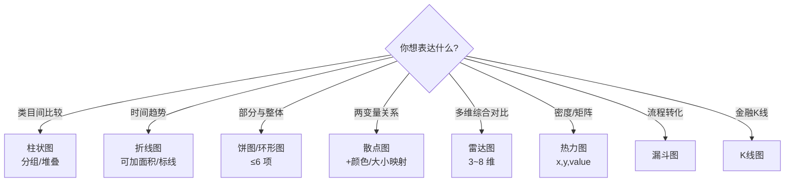

# 05.2 · 常用图表类型详解

> 本章配套代码：`projects/echarts-lab/charts.html`（6 张图一页看全）
> 本地预览：`cd projects/echarts-lab && python -m http.server 8060` 后打开 `charts.html`

## 学习目标

- 用决策树快速选定图表类型（这比记配置重要十倍）
- 掌握 6 类高频图表的关键 option 与「适用/不适用」边界
- 知道每类图「画错」的典型样子（选型错误的图比没图更误导）

## 5.2.1 先决策，再动手



数据可视化里的经典错误就是「用饼图比较 12 个类目」——人眼对角度差异的分辨率远低于对长度差异的分辨率。**比较用柱，趋势用线，占比用饼（且不超过 6 块），关系用散点**，这四句能覆盖 80% 的场景。

## 5.2.2 柱状图（bar）——比较

- **适用**：离散类目间的数量对比；多系列用分组柱（series 数组），看构成用堆叠 `stack: "total"`
- **不适用**：时间趋势（间隔不均匀会误导）
- **关键配置**：

```js
xAxis: { type: "category", data: [...] },
yAxis: { type: "value" },
series: [
  { name: "2025", type: "bar", data: [...], stack: "total",        // stack 同名即堆叠
    itemStyle: { borderRadius: [3, 3, 0, 0] },
    label: { show: true, position: "top" } },
]
```

- 横向变体：交换 x/y 的 type（数值轴在 x），类目多或类目名长时用（第 07 章大屏的分类 TOP10 就是横向）

## 5.2.3 折线图（line）——趋势

- **适用**：时间序列、连续变量趋势、多系列对比
- **不适用**：离散类目比较
- **关键配置**：`smooth` 平滑、`areaStyle` 面积填充、`markLine` 标均值/阈值、`markPoint` 标峰值：

```js
series: [{
  type: "line", smooth: true, data: [...],
  markLine: { data: [{ type: "average", name: "均值" }] },
  markPoint: { data: [{ type: "max", name: "峰值" }] },
}]
```

## 5.2.4 饼图 / 环形图（pie）——构成

- **适用**：部分与整体的关系，**项数 ≤ 6**
- **不适用**：精确比较（人眼读不准角度）、项数多（切片太小）
- **关键配置**：`radius: ["38%", "62%"]` 变环形；标签 `{b}: {d}%` 显示名称与百分比；`roseType` 南丁格尔玫瑰慎用（面积失真）

## 5.2.5 散点图（scatter）——关系

- **适用**：两个数值变量的相关性、聚类；第 07 章大屏的「价格 × 评分」就是它
- **不适用**：单变量分布（用直方图）
- **关键配置**：第三维映射 `symbolSize`（大小）或 `visualMap`（颜色渐变）；大数据量加 `sampling`（见第 5 篇）

## 5.2.6 雷达图（radar）——多维对比

- **适用**：3~8 个**可比**维度的整体权衡（如两套技术方案）
- **不适用**：维度不可比（把「价格」和「用户数」放同一雷达没有意义）
- **关键配置**：

```js
radar: { indicator: [{ name: "性能", max: 100 }, ...] },
series: [{ type: "radar", data: [{ name: "ECharts", value: [90, 85, ...] }] }]
```

## 5.2.7 热力图（heatmap）——密度

- **适用**：两个离散维度交叉的密度/强度（周×时段、城市×指标）
- **不适用**：需要精确读数的场景
- **关键配置**：必须配 `visualMap` 颜色映射，data 是 `[x索引, y索引, value]`

## 5.2.8 漏斗图与 K 线图（一句话版）

- **漏斗（funnel）**：转化率 stages（浏览→加购→下单→支付），数据天然递减时用
- **K 线（candlestick）**：金融 OHLC 数据；`data: [open, close, low, high]`

## 5.2.9 通用设计守则（比配置更重要）

1. 一个图回答一个问题；回答不了就拆成两个图
2. y 轴从 0 开始（柱状图截断 y 轴 = 视觉欺诈）
3. 配色 ≤ 7 色，语义色固定（好=绿/坏=红，全篇一致）
4. 类目名过长换横向条形图，不要旋转 90°
5. 数据来源与单位必须标注（看第 07 章大屏底部的脚注）

## 常见坑与排查

| 现象 | 原因 | 解决 |
|---|---|---|
| 堆叠柱数值对不上 | series 的 stack 名不一致 | 堆叠系列同 `stack: "total"` |
| 饼图标签挤成一团 | 项数太多/值太小 | 减项数、合并为「其他」、改用横向柱 |
| 散点全堆在一起 | 数据没区分度 | symbolSize/visualMap 映射第三维 |
| 雷达图看不出差异 | 各系列量纲没归一 | 统一 max 并归一化 |
| 热力图全是一个颜色 | visualMap 范围不对 | min/max 按数据实际范围设 |

## 动手练习

1. 把 charts.html 的分组柱状图改成堆叠柱状图（一个 `stack` 属性的事）。
2. 用第 04 章分析产出的 stats.json（`projects/book-insight/data/stats.json`）真实数据替换散点图示例数据。
3. 给折线图加 `markLine` 标出均值，体会「标线让结论可见」。

## 小结与自检清单

- [ ] 能默画选型决策树
- [ ] 知道四句口诀：比较用柱、趋势用线、占比用饼（≤6）、关系用散点
- [ ] 每类图能说出一个「不适用」场景
- [ ] 本地打开 charts.html 六张图渲染正常

## 延伸阅读

- [ECharts examples](https://echarts.apache.org/examples/zh/index.html)——每类图的官方示例，可在线改代码
- [数据可视化基础（ECharts 团队出品）](https://data-viz.echarts.apache.org/zh/)——选型背后的原理
