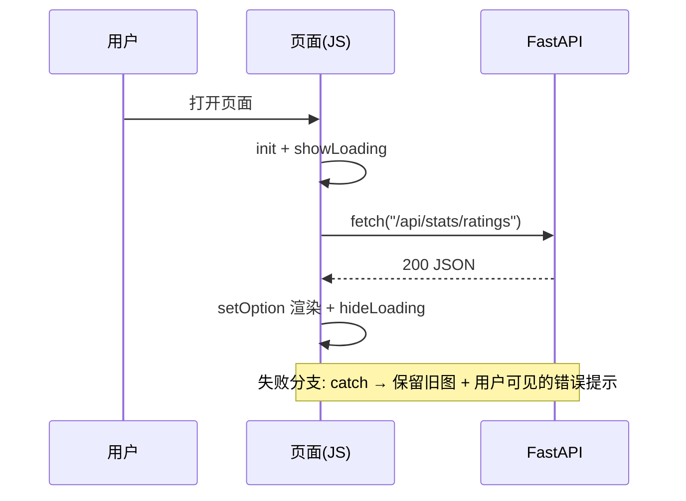

# 05.3 · 异步数据与 API 对接

> 本章配套代码：`projects/echarts-lab/03_async_data.html`（不依赖后端即可运行：内置模拟接口）
> 本地预览：`cd projects/echarts-lab && python -m http.server 8060` 后打开 `03_async_data.html`
> 对接的真实后端：第 07 章实战项目的 FastAPI（[后端实战](../07-final-project/03-FastAPI后端实战.md)）

## 学习目标

- 掌握「init → showLoading → fetch → setOption → hideLoading → 错误兜底」的标准流程
- 会把静态假数据换成真实 FastAPI 接口（含 CORS 注意点）
- 实现定时刷新轮询，并知道什么时候该停（页面隐藏时）
- 理解「契约先行」：图表数据格式的约定是前后端协作的接口文档

## 5.3.1 标准加载流程（五步）



lab 03 的完整实现（可点击「模拟失败」体验错误分支）：

```js
async function load() {
  chart.showLoading({ text: "数据加载中…" });          // ① 加载动画
  try {
    const resp = await fetch("/api/stats/ratings");    // ② 请求
    if (!resp.ok) throw new Error("HTTP " + resp.status);
    const data = await resp.json();
    chart.setOption({ series: [{ data: data.map(d => d.count) }] }); // ③ 渲染
  } catch (err) {
    showError(err);                                    // ④ 兜底：提示 + 保留旧图
  } finally {
    chart.hideLoading();                               // ⑤ 无论成败都关 loading
  }
}
```

三个设计原则：

1. **失败不白屏**：catch 里保留旧数据渲染，用户至少看得到上一次的图
2. **错误要可见**：alert 仅是演示；真实项目用页内提示条（第 07 章大屏的 `#err-box`）
3. **loading 必须收尾**：finally 里 hideLoading，防止异常时转圈到死

## 5.3.2 对接 FastAPI 的真实示例

第 07 章实战项目启动后（`uvicorn api.main:app --reload`），接口真实返回：

```text
$ curl http://127.0.0.1:8000/api/stats/ratings
[{"rating":1,"count":226},{"rating":2,"count":196},
 {"rating":3,"count":203},{"rating":4,"count":179},{"rating":5,"count":196}]
```

前端消费：

```js
const resp = await fetch("/api/stats/ratings");       // 同源部署，相对路径即可
const rows = await resp.json();
chart.setOption({
  xAxis: { data: rows.map(r => r.rating + " 星") },
  series: [{ type: "bar", data: rows.map(r => r.count) }],
});
```

### CORS 什么时候会出现？

- **同源托管**（实战项目方案：FastAPI StaticFiles 托管 web/）→ 完全不需要 CORS
- **前后端分端口开发**（前端 8060 静态服务器 / 后端 8000）→ 后端要配 `CORSMiddleware` 的 `allow_origins` 精确列表（写法见 [FastAPI·安全章](../06-fastapi-backend/04-认证授权与安全(JWT-CORS).md)）
- 常见报错：浏览器 Console 里 `blocked by CORS policy`——别急着改前端，先看后端 origins 配置

### 大屏的聚合接口模式

首屏需要 7 组数据时，逐个 fetch 会形成请求瀑布。第 07 章的做法是后端提供 `/api/charts/all` 一次打包（设计动机见[后端实战](../07-final-project/03-FastAPI后端实战.md)），前端一个 `Promise.all` 都不需要：

```js
const data = await (await fetch("/api/charts/all")).json();
renderKpis(data.summary);
renderRatingDist(data.rating_distribution);
// ... 7 组数据一次到手
```

## 5.3.3 定时刷新轮询

```js
let timer = null;
function startPolling(intervalMs = 60000) {
  timer = setInterval(load, intervalMs);
}
function stopPolling() { clearInterval(timer); timer = null; }
```

两个生产级细节（lab 03 未展开，但实战必须考虑）：

```js
// ① 页面隐藏时暂停轮询，切回时立即刷新一次（省服务器、省流量）
document.addEventListener("visibilitychange", () => {
  document.hidden ? stopPolling() : (load(), startPolling());
});
// ② 并发去重：上一次请求没回来时跳过本轮，防止积压
let inflight = false;
async function load() {
  if (inflight) return;
  inflight = true;
  try { /* ... */ } finally { inflight = false; }
}
```

## 5.3.4 契约先行：数据格式是接口文档

图表字段约定（谁负责四舍五入、抽样多少、空值怎么表达）要在写代码前定好。本项目约定：

| 字段 | 形态 | 约定 |
|---|---|---|
| rating_distribution | `[{rating, count}]` | 后端排好序、rating 非空 |
| price_histogram | `[{bucket, count}]` | 桶名后端定（"0-10"…"60+"），空桶也返回 |
| price_rating_scatter | `[{price, rating}]` | 后端抽样 ≤500 点，float 保留 2 位 |
| summary.avg_price | number | **后端** round(2)，前端不做二次舍入 |

这套约定落在 `api/schemas.py`（Pydantic 模型即文档）+ `/docs` 自动生成的 OpenAPI——**改契约必须先改 schema**，前后端并行开发才不会互相拆台。

## 常见坑与排查

| 现象 | 原因 | 解决 |
|---|---|---|
| Console 报 CORS | 前后端不同源、后端未放行 | 同源托管（推荐）或精确 allow_origins |
| fetch 返回了但图不变 | setOption 的字段路径写错 | Console 打印 data 核对结构；增量 setOption 只更新传入字段 |
| 轮询越积越多 | 上次请求未完成又发新请求 | inflight 标记去重（见上） |
| 页面切走后定时器仍在跑 | 未监听 visibilitychange | 隐藏时 stopPolling |
| 数字显示 35.079999 | 前后端都做了舍入 | 舍入口径归后端，前端只展示 |

## 动手练习

1. 把 lab 03 的 fakeFetch 换成真实 fetch，对接本机跑起来的实战项目 `/api/charts/all`。
2. 实现页面隐藏暂停轮询 + 切回立即刷新。
3. 给 load() 加 10 秒超时（提示：AbortController）。

## 小结与自检清单

- [ ] 能默写五步加载流程
- [ ] 能说清同源托管与 CORS 的关系
- [ ] 会实现带去重与暂停的轮询
- [ ] 理解「契约先行」在本项目的落点（schemas.py + /docs）

## 延伸阅读

- [MDN: fetch](https://developer.mozilla.org/zh-CN/docs/Web/API/Fetch_API/Using_Fetch)
- [ECharts 官方：异步数据加载](https://echarts.apache.org/handbook/zh/concepts/async-data/)
