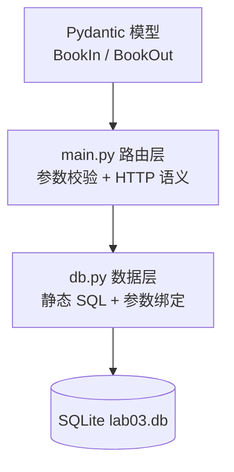

# 06.3 · 数据库集成（SQLAlchemy 与分层）

> 本章配套代码：`projects/fastapi-lab/03_database/`（3/3 测试全绿）
> 对照完整版：实战项目 [book-insight/api/](../../projects/book-insight/)（9 端点 + 14 测试）

## 学习目标

- 建立「路由层 → 数据层」分层直觉，理解为什么 schemas 与模型要分开
- 掌握 yield 依赖管理数据库连接
- 写出完整 CRUD REST 端点（含 404/201/204 语义）
- 知道 SQLite 到 MySQL 的切换点与 ORM 教学对照

## 6.3.1 分层架构



各层职责：

| 层 | 文件 | 职责 | 禁止 |
|---|---|---|---|
| 路由层 | main.py | HTTP 状态码、Pydantic 校验、组织响应 | 出现 SQL |
| 数据层 | db.py | SQL 执行、事务提交 | 出现 HTTP 概念 |
| 契约层 | Pydantic 模型 | 对外字段契约 | 混入内部实现字段 |

**为什么 SQL 集中到一个文件？** 安全审计只需看一个文件；所有语句都是完整静态字面量（本仓库硬规范），变量只能经 `?` 占位符绑定进入。

## 6.3.2 数据层：静态 SQL + 参数绑定

`db.py` 全部 SQL（节选，完整见源码）：

```python
def insert_book(conn, title: str, price: float, rating: int, category: str) -> int:
    t, p, r, c = title, price, rating, category   # 解包为普通局部变量
    cur = conn.execute("INSERT INTO books (title, price, rating, category) VALUES (?, ?, ?, ?)", (t, p, r, c))
    conn.commit()
    return int(cur.lastrowid)

def get_book(conn, book_id: int) -> sqlite3.Row | None:
    bid = book_id
    return conn.execute("SELECT id, title, price, rating, category FROM books WHERE id = ?", (bid,)).fetchone()
```

> ⚠️ **反面案例（禁止模仿）**：
> `conn.execute("SELECT * FROM books WHERE title LIKE '%" + keyword + "%'")`
> ——把变量拼进 SQL 文本。构造 `' OR 1=1 --` 即可让 WHERE 失效拖库。
> 参数绑定的本质：**SQL 结构与数据分离传输**，数据永远不会被解释为 SQL 语法。

## 6.3.3 路由层：完整 CRUD 语义

| 方法 | 端点 | 成功 | 不存在 |
|---|---|---|---|
| GET | /api/books?limit&offset | 200 分页容器 | — |
| GET | /api/books/{id} | 200 | **404** |
| POST | /api/books | **201** | 422 校验失败 |
| PUT | /api/books/{id} | 200 | 404 |
| DELETE | /api/books/{id} | **204 无内容** | 404 |

```python
@app.get("/api/books/{book_id}", response_model=BookOut)
def read_book(book_id: int, conn: Depends = Depends(get_conn)) -> dict:
    row = get_book(conn, book_id)
    if row is None:
        raise HTTPException(status_code=404, detail="book not found")
    return dict(row)

@app.delete("/api/books/{book_id}", status_code=204)
def remove_book(book_id: int, conn: Depends = Depends(get_conn)) -> None:
    if not delete_book(conn, book_id):
        raise HTTPException(status_code=404, detail="book not found")
```

## 6.3.4 实测全流程（真实输出）

```text
$ curl -s -X POST http://127.0.0.1:8102/api/books -H "Content-Type: application/json" \
    -d '{"title":"Sapiens","price":54.2,"rating":5,"category":"History"}'
{"id":1,"title":"Sapiens","price":54.2,"rating":5,"category":"History"}

$ curl -s "http://127.0.0.1:8102/api/books?limit=5"
{"total":1,"limit":5,"offset":0,"items":[...]}

$ curl -s -X PUT http://127.0.0.1:8102/api/books/1 -H "Content-Type: application/json" \
    -d '{"title":"Sapiens (2nd)","price":49.9,"rating":5,"category":"History"}'
{"id":1,"title":"Sapiens (2nd)","price":49.9,...}

$ curl -s -X DELETE http://127.0.0.1:8102/api/books/1 -w "[%{http_code}]"
[]204

$ python -m pytest ../05_tests/test_db_app.py -v
3 passed
```

## 6.3.5 SQLAlchemy 2.0 教学对照

实战项目 [book-insight/api/models.py](../../projects/book-insight/api/models.py) 是 2.0 风格 ORM 模型（教学对照实现）：

```python
class Book(Base):
    __tablename__ = "books"
    id: Mapped[int] = mapped_column(Integer, primary_key=True, autoincrement=True)
    title: Mapped[str] = mapped_column(String(256), nullable=False)
    rating: Mapped[int | None]
```

何时值得上 ORM（而非手写 SQL）？

| 场景 | 建议 |
|---|---|
| 多表关联、事务复杂 | ORM：对象图管理省心 |
| 需要数据库迁移（Alembic） | ORM：模型即迁移基线 |
| 简单只读报表类查询 | 手写 SQL 更直观 |
| 性能敏感的批量写入 | Core 批量 / 数据库原生 |

连接 MySQL 只需改连接串（密码走环境变量）：

```python
DATABASE_URL = os.getenv("DATABASE_URL", "mysql+pymysql://bookapp:<password>@127.0.0.1:3306/books")
engine = create_engine(DATABASE_URL, pool_pre_ping=True)
```

MySQL 部署见 [Ubuntu·MySQL 章](../02-linux-ubuntu/08-MySQL部署与数据库运维.md)。

## 常见坑与排查

| 现象 | 原因 | 解决 |
|---|---|---|
| `no such table` | db 文件路径不对/没建表 | db.connect() 里 executescript 建表；确认 DB_PATH |
| 204 响应带了 body | delete 返回了值 | 204 端点返回 None |
| PUT 后数据没变 | 忘了 conn.commit() | 写操作必须 commit |
| 并发写偶发 database is locked | SQLite 写锁 | 加超时参数/换 MySQL；教学场景可忽略 |
| 路由里出现了 SQL | 分层被破坏 | 挪进 db.py |

## 动手练习

1. 给 GET /api/books 加 `category` 过滤与 `min_rating` 过滤（数据层加参数化条件）。
2. 实现 PATCH（部分更新）：只用传入字段更新（提示：exclude_unset）。
3. 把数据层换写成 SQLAlchemy Core（对照行数与可读性）。

## 小结与自检清单

- [ ] 能画出三层图并说出各层禁止事项
- [ ] 能解释参数绑定防注入的原理
- [ ] CRUD 五种语义（200/201/204/404/422）都写过
- [ ] 知道什么时候从 SQLite 切 MySQL / 从 SQL 切 ORM

## 延伸阅读

- [SQLAlchemy 2.0 官方教程](https://docs.sqlalchemy.org/en/20/tutorial/)
- [FastAPI: SQL 数据库](https://fastapi.tiangolo.com/zh/tutorial/sql-databases/)
