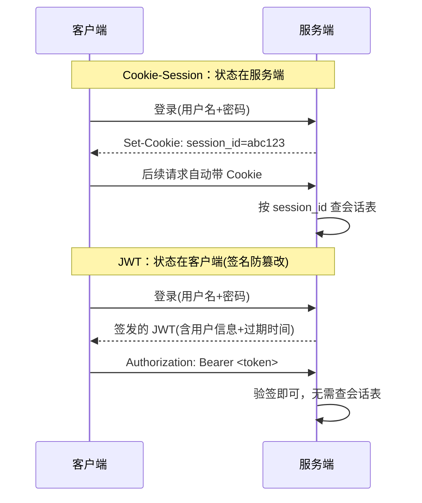

# 06.4 · 认证授权与安全（JWT、CORS 与安全清单）

> 本章配套代码：`projects/fastapi-lab/04_auth/`（注册→登录→受保护路由全流程实测通过）
> 运行：`cd projects/fastapi-lab/04_auth && uvicorn main:app --port 8103 --reload`

## 学习目标

- 说清 Cookie-Session 与 JWT 两种方案的差异与选型
- 实现「密码哈希 + OAuth2 Password 流程 + JWT」完整认证
- 理解 CORS 到底在拦什么、后端怎么正确放行
- 拿走一份可直接执行的 API 安全清单

## 6.4.1 HTTP 无状态与会话方案

HTTP 本身无状态，服务器靠「凭证」认人。两大流派：



| 维度 | Cookie-Session | JWT |
|---|---|---|
| 会话存储 | 服务端（内存/Redis） | 客户端 token |
| 水平扩展 | 需共享存储 | 天然无状态 |
| 注销/吊销 | 删会话即可 | 难（需黑名单/短有效期） |
| 典型场景 | 传统网站 | API、前后端分离、移动端 |

本项目选 JWT（API 场景），有效期 30 分钟。

## 6.4.2 密码存储：绝不明文

```python
def hash_password(password: str, salt: bytes) -> str:
    digest = hashlib.pbkdf2_hmac("sha256", password.encode(), salt, 300000)  # 30 万次迭代
    return digest.hex()

def verify_password(password: str, salt: bytes, expected_hex: str) -> bool:
    digest = hashlib.pbkdf2_hmac("sha256", password.encode(), salt, 300000)
    return hmac.compare_digest(digest.hex(), expected_hex)   # 恒定时间比较
```

三个要点：

1. **加盐**：每个用户独立随机 salt，同密码哈希值也不同，防彩虹表
2. **高迭代**：PBKDF2 至少 10 万次（本 lab 30 万），让暴力破解变慢
3. **恒定时间比较**：`hmac.compare_digest` 防时序侧信道泄漏

生产可直接用 passlib 的 bcrypt（自动管理盐）；本 lab 用标准库演示原理。

## 6.4.3 OAuth2 Password 流程 + JWT 完整实现

`04_auth/main.py` 核心三件套：

```python
oauth2_scheme = OAuth2PasswordBearer(tokenUrl="/token")   # 从 Authorization: Bearer 提取

def get_current_user(token: str = Depends(oauth2_scheme)) -> dict:
    try:
        payload = jwt.decode(token, SECRET_KEY, algorithms=[ALGORITHM])
    except jwt.ExpiredSignatureError as exc:
        raise HTTPException(401, "token expired") from exc
    except jwt.InvalidTokenError as exc:
        raise HTTPException(401, "invalid token") from exc
    username = payload.get("sub", "")
    if username not in USERS:
        raise HTTPException(401, "user gone")
    return {"username": username, "role": payload.get("role")}

@app.get("/me")
def me(user: dict = Depends(get_current_user)):    # 挂依赖即受保护
    return user
```

### 真实全流程实测记录

```text
$ curl -s -X POST http://127.0.0.1:8103/register -d "username=alice&password=wonderland123"
{"registered":"alice"}

$ curl -s -X POST http://127.0.0.1:8103/token -d "username=alice&password=wonderland123"
{"access_token":"eyJhbGciOiJIUzI1NiIsInR5cCI6Ik...","token_type":"bearer"}

$ curl -s http://127.0.0.1:8103/me -H "Authorization: Bearer <token>"
{"username":"alice","role":"user"}

$ curl -s http://127.0.0.1:8103/me -w " [%{http_code}]"
{"detail":"Not authenticated"} [401]

$ curl -s -X POST .../token -d "username=alice&password=wrong" -w " [%{http_code}]"
{"detail":"bad credentials"} [401]
```

### JWT 结构解读（实测解码）

```text
payload = {"sub": "alice", "role": "user", "iat": 1793726700, "exp": 1793728500}
```

- `header.payload.signature` 三段 Base64URL：前两段可读、第三段防篡改
- 改 payload 里任何字符 → 验签失败；`exp` 过期 → 401
- **不要在 payload 放敏感信息**（它是可解码的，只是防篡改不保密）

SECRET_KEY 从环境变量读（`os.getenv("LAB_SECRET_KEY", ...)`），生产必须显式提供随机值：

```bash
python -c "import secrets; print(secrets.token_hex(32))"
```

角色控制示例在 `/admin` 端点（403 forbidden）。

## 6.4.4 CORS：浏览器在拦什么

CORS 只约束**浏览器**的跨域 JS 请求，curl/Postman 不受影响。规则：

- 前后端**同源**（协议+域名+端口全同）→ 无 CORS 问题（本项目大屏方案）
- 跨域 → 后端必须显式放行：

```python
app.add_middleware(
    CORSMiddleware,
    allow_origins=["https://your-frontend.com"],   # 精确域名，禁用 "*" 配 credentials
    allow_methods=["GET", "POST"],
    allow_headers=["Authorization"],
)
```

报错特征：浏览器 Console `blocked by CORS policy`——先检查后端 origins，不是前端 bug。

## 6.4.5 API 安全清单（上线逐条核对）

- [ ] 全站 HTTPS（Nginx + certbot，见 [Ubuntu·Nginx](../02-linux-ubuntu/09-Nginx安装与反向代理.md)）
- [ ] 密码哈希（加盐 + 高迭代），登录失败不区分「用户不存在/密码错」
- [ ] 参数校验全覆盖（Pydantic ge/le/pattern），SQL 全参数绑定（见 03 章）
- [ ] SECRET_KEY/数据库密码走环境变量，不入 git
- [ ] token 短有效期 + HTTPS 传输；吊销场景用黑名单或短周期轮换
- [ ] CORS 精确域名；`allow_origins=["*"]` 与 `allow_credentials=True` 永不同用
- [ ] 越权检查：对象级权限（用户只能改自己的数据）
- [ ] 限流（slowapi 或网关层）；429 与审计日志
- [ ] 错误响应不泄漏堆栈/内部路径
- [ ] 依赖定期升级（pip list --outdated / uv sync）

## 常见坑与排查

| 现象 | 原因 | 解决 |
|---|---|---|
| 401 "Not authenticated" | 没带 Bearer 头 | `-H "Authorization: Bearer <token>"` |
| 401 "token expired" | exp 过了 | 重新 /token |
| /docs 的 Authorize 不好使 | tokenUrl 不对 | 确认 `OAuth2PasswordBearer(tokenUrl="/token")` 与实际端点一致 |
| CORS 报错但后端配置了 | 域名/端口没对上 | allow_origins 精确到协议+端口 |
| 注册接口被刷 | 无限流 | slowapi/网关限流 + 验证码策略 |

## 动手练习

1. 实现 refresh token：长有效期 refresh + 短有效期 access，/token/refresh 端点。
2. 把 USERS 换成 SQLite 表（复用 03 章模式，密码列只存 hash+salt）。
3. 给 /admin 加角色依赖工厂 `require_role("admin")`，对比硬编码 if 的可维护性。

## 小结与自检清单

- [ ] 能画出两种会话方案的时序图并说清选型
- [ ] 哈希三要点（加盐/迭代/恒定时间）能展开
- [ ] JWT 三段结构与「防篡改不保密」分得清
- [ ] CORS 报错知道先查后端 origins
- [ ] 安全清单过一遍能逐条说出原理

## 延伸阅读

- [FastAPI: Security](https://fastapi.tiangolo.com/zh/tutorial/security/first-steps/)
- [RFC 6750: Bearer Token](https://datatracker.ietf.org/doc/html/rfc6750)
- [OWASP API Security Top 10](https://owasp.org/API-Security/)
