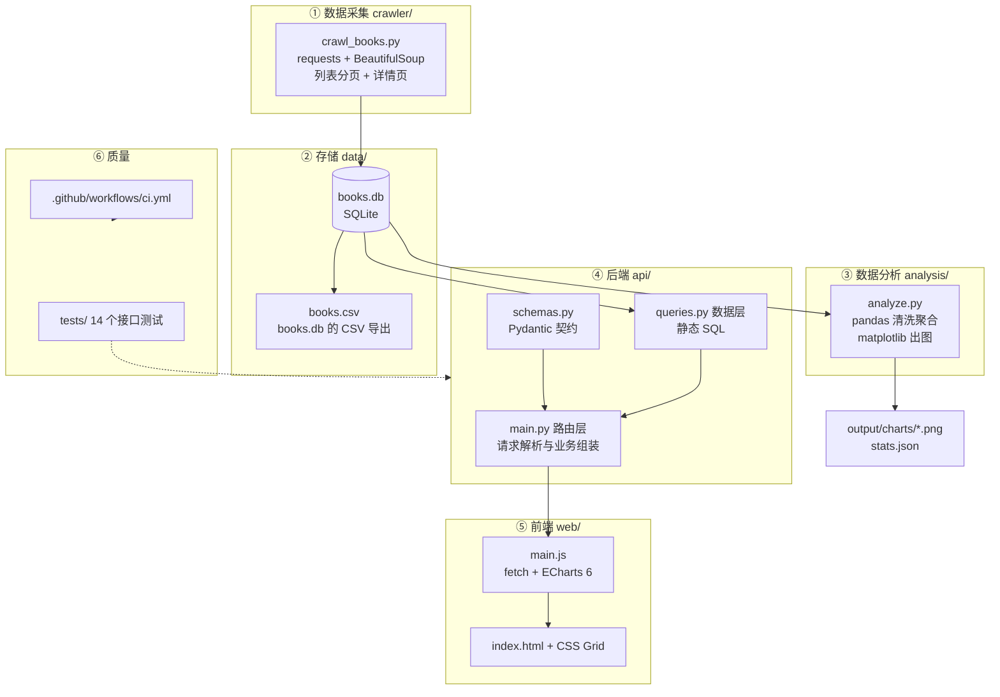

# 07.0 · 综合实战项目总览与架构

> 本章配套代码：`projects/book-insight/`
> 建议学习时长：约 2 小时（通读架构）+ 6 个模块各 1-2 小时
> 这个项目是整条教程的终点站：前面 6 章学的每个工具，都在这里承担一个真实职责。

## 学习目标

- 看懂「爬虫 → 数据库 → 分析 → API → 可视化」全链路的架构设计与数据流
- 能独立运行整个项目（采集/分析/测试/服务 4 条命令）
- 理解每个模块的工程取舍（为什么这样分层、为什么用 SQLite、SQL 为什么是静态字面量）
- 能以它为模板，替换成你自己的数据源与业务问题

## 0.1 项目一句话

**采集 1000 本图书的真实数据，存入 SQLite，用 pandas 做聚合分析，通过 FastAPI 暴露为 REST API，最终在 ECharts 6 深色数据大屏上呈现。**

数据源选择 [books.toscrape.com](https://books.toscrape.com/)——Scrapy 官方维护的爬虫练习站，robots.txt 无任何限制、明确欢迎抓取，用于教学完全合法合规（合规讨论见[爬虫合规章](../03-python-crawler/06-反爬应对与爬虫合规.md)）。

## 0.2 全链路架构



两条数据出口：

- **离线分析出口**：`books.db → pandas → PNG 图表 + stats.json`（第 04 章的产物形态）
- **在线服务出口**：`books.db → FastAPI → JSON → ECharts 大屏`（第 05/06/07 章的产物形态）

同一个库、两种消费方式——这正是数据项目最常见的形态。

## 0.3 数据集长什么样

`books` 表共 1000 行、14 列，全部来自真实页面解析：

| 列 | 类型 | 含义 | 示例 |
|---|---|---|---|
| id | INTEGER PK | 自增主键 | 42 |
| upc | TEXT UNIQUE | 图书条码 | `e10e1e165808918a` |
| title | TEXT NOT NULL | 书名 | `A Light in the Attic` |
| price | REAL | 含税价（英镑） | 51.77 |
| price_excl_tax / tax | REAL | 税前价 / 税额 | 51.77 / 0.0 |
| availability | INTEGER | 库存件数 | 22 |
| rating | INTEGER | 评分 1~5 | 3 |
| category | TEXT | 分类（50 种） | Poetry |
| num_reviews | INTEGER | 评论数 | 0 |
| description | TEXT | 简介 | ... |
| image_url / detail_url | TEXT | 封面 / 详情页 | ... |
| crawled_at | TEXT | 采集时间 | 2026-11-04T00:19:55+00:00 |

真实汇总（写死会过期，以下为写作时实测）：总数 1000，均价 £35.07，中位数 £35.98，评分均值 2.92，分类 50 个，全部在售。

## 0.4 目录结构与环境

```text
projects/book-insight/
├── crawler/crawl_books.py      # 采集脚本（--limit N 快速试跑）
├── data/books.db / books.csv / stats.json
├── analysis/analyze.py         # 分析脚本 + output/charts/*.png
├── api/{database,queries,models,schemas,main}.py
├── web/{index.html, css/style.css, js/main.js}
├── tests/{conftest.py, test_api.py}
├── requirements.txt / Makefile / README.md
```

本仓库作者实测环境：Python 3.14.0 + 上表依赖（版本见 requirements.txt）。
`data/books.db` 随仓库提供，**克隆后不跑爬虫也能直接起服务看大屏**。

## 0.5 五分钟跑通全流程

```bash
cd projects/book-insight
pip install -r requirements.txt   # 或 uv pip install -r requirements.txt

python analysis/analyze.py        # 离线分析：生成 stats.json + 5 张 PNG
python -m pytest tests/ -v        # 14 个接口测试
uvicorn api.main:app --reload     # 启动后端 + 大屏托管
# 浏览器打开 http://127.0.0.1:8000/  →  数据大屏
# http://127.0.0.1:8000/docs        →  交互式 API 文档
```

重新采集数据（可选）：

```bash
python crawler/crawl_books.py            # 全量 1000 本，约几分钟
python crawler/crawl_books.py --limit 40 # 快速体验
```

## 0.6 关键工程决策（面试也常问）

| 决策 | 选择 | 为什么 |
|---|---|---|
| 存储选 SQLite 还是 MySQL | 教学/单机选 SQLite | 零部署成本、单文件随仓库走；上 MySQL 只换连接层，SQL 几乎不变（见 [Ubuntu·MySQL 章](../02-linux-ubuntu/08-MySQL部署与数据库运维.md)） |
| 列表筛选放 SQL 还是 Python | 本项目 Python 侧 | 只读 1000 行的小数据集，Python 过滤最直观；生产大数据量必须用数据库侧参数化过滤（写法见 [FastAPI·数据库章](../03-fastapi-backend/03-数据库集成(SQLAlchemy).md)） |
| SQL 书写规范 | 全部静态字面量集中在 queries.py | 杜绝拼接注入面、便于 review；外部参数只能经绑定进入（详见 [存储章](01-数据采集与存储实战.md)的安全小节） |
| Pydantic 与 ORM 分层 | schemas.py 与 models.py 分开 | API 契约与表结构解耦，改表不泄漏到接口 |
| 前端部署 | FastAPI StaticFiles 同源托管 | 免 CORS 折腾；上 Nginx 后改为静态站点 + 反代（见 [部署章](05-部署上线与CI.md)） |
| 大屏数据获取 | 单一聚合端点 /api/charts/all | 一次请求拿全 7 组数据，减少前端瀑布请求 |

## 0.7 各模块文档索引

1. [01-数据采集与存储实战](01-数据采集与存储实战.md)——爬虫 + SQLite 落库
2. [02-pandas 分析实战](02-pandas分析实战.md)——清洗聚合 + matplotlib 出图
3. [03-FastAPI 后端实战](03-FastAPI后端实战.md)——分层设计与路由
4. [04-ECharts 大屏实战](04-ECharts大屏实战.md)——布局与图表实现
5. [05-测试、CI 与部署上线](05-测试CI与部署上线.md)——pytest + Actions + 服务器上线

## 常见坑与排查

| 现象 | 原因 | 解决 |
|---|---|---|
| 大屏空白、Console 报 fetch 失败 | 后端没启动 | 先 `uvicorn api.main:app --reload`，再访问 |
| 大屏图表不渲染 | ECharts CDN 不可达 | index.html 内置了 npmmirror 兜底；或本地下载 echarts.min.js |
| `sqlite3.OperationalError: no such table` | books.db 不在 data/ 目录 | 跑一次爬虫或从仓库重新拉取 data/ |
| 爬虫中断后重复数据 | 无（INSERT OR REPLACE 幂等） | 重跑即可，detail_url 唯一约束保证不重复 |
| pytest 报 404 | books.db 行 id 从 5 起步（历史测试残留） | 测试用临时库夹具，不受真实数据影响 |

## 动手练习

1. 给 `/api/books` 增加 `sort=price` 参数，要求**白名单映射**排序字段并补测试（提示：安全讨论见 FastAPI 教程）。
2. 把数据源换成 [quotes.toscrape.com](https://quotes.toscrape.com/) 名言数据，重新设计 3 张图表（提示：作者维度、标签维度、单句话长度分布）。
3. 给大屏加一张「分类数量 × 均价」气泡图（提示：ECharts scatter，symbolSize 映射数量）。

## 小结与自检清单

- [ ] 能画出全链路架构图并说清每个箭头是什么数据
- [ ] 本机能跑通 analyze.py / pytest / uvicorn 三条命令
- [ ] 能解释 queries.py 为什么全部用静态字面量
- [ ] 能说出 SQLite vs MySQL 的选型理由
- [ ] 能说出离线分析出口与在线服务出口的区别

## 延伸阅读

- [FastAPI 官方文档](https://fastapi.tiangolo.com/zh/)——本项目 API 层的规范来源
- [Apache ECharts 官网](https://echarts.apache.org/)——图表配置项手册
- [books.toscrape.com](https://books.toscrape.com/)——本项目数据源（练习站）
