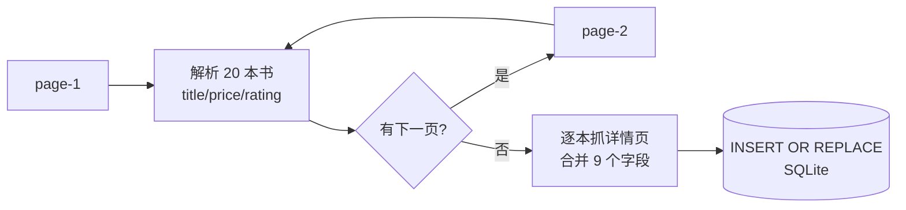

# 07.1 · 数据采集与存储实战（爬虫 → SQLite）

> 本章配套代码：`projects/book-insight/crawler/crawl_books.py`、`data/`
> 理论详解见 [02-requests爬虫实战](../03-python-crawler/02-requests爬虫实战.md) 与 [04-数据存储](../03-python-crawler/04-数据存储(csv-json-SQLite-MySQL).md)；本章只讲「在这个项目里我们怎么用、为什么这么做」。

## 学习目标

- 读懂一个 150 行左右的完整采集脚本：分页翻页、详情页二次抓取、入库一气呵成
- 掌握「列表页 → 详情页」两级抓取模式（真实项目最常见形态）
- 理解幂等入库设计：重复跑不产生脏数据
- 知道本项目的 SQL 安全规范是怎么落实的

## 1.1 采集目标与策略

books.toscrape.com 的结构：

```text
首页（侧边栏 50 个分类 + 目录）
└── /catalogue/page-N.html   # 目录分页，N = 1..50，每页 20 本
    └── 每本书一张详情页 /catalogue/<slug>/index.html   # UPC/税率/库存/分类/简介
```

采集策略（两级抓取）：

1. **目录页循环**：从 page-1 开始，沿「下一页」链接一直翻，直到没有下一页（比写死 50 页更健壮——站点改版也不怕）
2. **详情页逐个抓**：目录页只有书名/价格/评分/链接，UPC、库存件数、分类、简介都在详情页



## 1.2 关键代码逐段拆解

完整代码见 `crawler/crawl_books.py`（约 220 行），这里拆 5 个要点。

### ① 编码坑（真实踩过）

```python
FORCE_ENCODING = "utf-8"

def fetch(session, url, *, max_retries=3):
    for attempt in range(1, max_retries + 1):
        try:
            resp = session.get(url, timeout=15)
            resp.raise_for_status()
            resp.encoding = FORCE_ENCODING
            return resp.text
        except requests.RequestException:
            if attempt == max_retries:
                raise
            time.sleep(attempt * 2)
    raise RuntimeError("unreachable")
```

三个细节：

- **`resp.encoding = "utf-8"`**：该站响应头不含 charset，requests 会按 HTTP 标准（ISO-8859-1）猜，书名里的撇号会变成 `’`。这是爬虫教学的经典坑，本仓库真实踩过。
- **timeout 必须设置**：无超时的请求会永远挂起，拖死整个采集。
- **重试 + 退避**：失败后等 `attempt * 2` 秒再试，3 次失败才放弃——对偶发网络抖动友好。

### ② 列表页解析

```python
def parse_catalogue_page(html: str) -> list[dict]:
    soup = BeautifulSoup(html, "lxml")
    books = []
    for article in soup.select("article.product_pod"):
        a = article.select_one("h3 a")
        price_text = article.select_one("p.price_color").get_text(strip=True)
        rating_class = article.select_one("p.star-rating")["class"]
        books.append({
            "title": a["title"].strip(),                    # title 属性才是完整书名
            "price": float(PRICE_RE.search(price_text).group()),
            "rating": RATING_MAP.get(rating_class[-1], 0),  # "Three" -> 3
            "detail_url": urljoin(CATALOGUE_URL, a["href"]),
        })
    return books
```

两个易错点：

- 书名文本被 CSS 截断成 `A Light in ...`，**完整书名在 `<a title="...">` 属性里**
- 评分没有数字，是 class 名 `star-rating Three`——映射表转整数
- 相对链接用 `urljoin` 拼接，绝不手写字符串拼接 URL

### ③ 详情页解析（键值表 + 面包屑）

详情页的信息在一个「字段名-值」表格里，逐行 `<th>/<td>` 抽出来构建字典，再用正则从 `In stock (19 available)` 里抠库存数字；分类取面包屑 `Home > Books > 分类` 的最后一个链接；简介取 `#product_description` 之后的第一个段落（CSS 相邻选择器 `~`）。

### ④ 幂等入库（重点）

```python
conn.execute("INSERT OR REPLACE INTO books (title, price, rating, detail_url, upc, price_excl_tax, tax, availability, num_reviews, category, description, image_url, crawled_at) VALUES (?, ?, ?, ?, ?, ?, ?, ?, ?, ?, ?, ?, ?)", (title, price, rating, detail_url, upc, price_excl_tax, tax, availability, num_reviews, category, description, image_url, crawled_at))
```

- **`detail_url` 有 UNIQUE 约束** + `INSERT OR REPLACE`：重复运行整条链路，库里的行数不变——这就是幂等，代价是自增 id 会变（本项目不依赖 id 稳定性，可接受；不接受的场景改用 `ON CONFLICT(...) DO UPDATE`，写法见存储章）
- **`?` 占位符**：13 个值全部经参数绑定进入数据库。这是本仓库的硬性安全规范（讨论见下一小节）

### ⑤ 事务与提交节奏

```python
if i % 20 == 0 or i == total_items:
    conn.commit()
```

每 20 本提交一次：既避免千次小事务的性能损耗，也保证中断时最多丢 20 本，而不是全部。

## 1.3 SQL 安全规范怎么落实的

本仓库规范（在 [STYLE_GUIDE](../../STYLE_GUIDE.md) 第 7 节）要求：**外部输入只能经占位符进入 SQL，绝不拼接字符串**。本项目落实为三层：

1. 爬虫入库用 `?` 参数绑定（如上）
2. 所有查询 SQL 集中在 `api/queries.py`，全部是**完整静态字面量**，连字符串拼接都没有
3. 需要按条件筛选的场景（API 列表过滤），本数据集在 Python 侧完成；生产场景的标准做法是**数据库侧参数化过滤**，写法见 [FastAPI·数据库章](../06-fastapi-backend/03-数据库集成(SQLAlchemy).md)

反面案例长什么样（教学警示，本项目不含此写法）：

```python
# ❌ 危险：把变量拼进 SQL 文本。若 search 是 'X\' OR 1=1 --' 会怎样？
conn.execute("SELECT * FROM books WHERE title LIKE '%" + search + "%'")
```

## 1.4 实测运行记录

小样本验证：

```text
$ python crawler/crawl_books.py --limit 4 --delay 0.4
00:04:18 INFO 目录累计 20 本
00:04:18 INFO 目录完成，共 4 本，开始详情页
00:04:21 INFO 进度 4/4 失败=0
00:04:22 INFO CSV 导出 4 行
00:04:22 INFO 完成：库内 4 本
```

全量采集（真实数字）：1000 本书 = 50 个目录页 + 1000 个详情页，0.35s 间隔，
总耗时约 16 分钟，详情失败 0，产出 `books.db`（2.3MB）与 `books.csv`（1.7MB）。
仓库已附带这份数据，克隆即可复现后续所有分析结果。

## 1.5 Scrapy 版本

`projects/crawler-lab/book_scrapy/` 是同一目标的 Scrapy 实现（架构、Pipeline、
ROBOTSTXT_OBEY 等讲解见 [Scrapy 完全指南](../03-python-crawler/05-Scrapy框架完全指南.md)）。
什么时候值得换 Scrapy？——需要并发调度、自动限速、中间件生态、命令行调试时。

## 常见坑与排查

| 现象 | 原因 | 解决 |
|---|---|---|
| 书名出现 `’` | 编码误判 | 显式 `resp.encoding = "utf-8"` |
| 只抓到第 1 页 | 「下一页」链接相对路径拼接错 | 用 `urljoin(catalogue_url, href)` |
| 详情字段全 None | 选择器对不上 / 页面是 JS 渲染 | 先在浏览器确认目标节点存在 |
| `UNIQUE constraint failed` | 用了裸 INSERT 且重复运行 | 换 INSERT OR REPLACE 或 ON CONFLICT 更新 |
| 抓一会就挂起 | 没设 timeout | 所有请求强制 timeout |

## 动手练习

1. 给爬虫加 `--category` 参数：先进对应分类页，只采集该分类的书（提示：侧边栏链接结构）。
2. 把 CSV 导出改成 JSON Lines（一行一个 JSON 对象）。
3. 增加断点续爬：入库前查 detail_url 是否已存在，存在则跳过详情抓取（对比幂等方案的差异）。

## 小结与自检清单

- [ ] 能不看代码说出两级抓取的流程
- [ ] 能解释为什么 `resp.encoding` 要显式指定
- [ ] 能解释 INSERT OR REPLACE 的幂等语义与代价
- [ ] 能说出参数绑定防注入的原理（提示：SQL 结构与数据分离）

## 延伸阅读

- [requests 官方文档](https://requests.readthedocs.io/)——Session/编码/超时
- [BeautifulSoup 文档](https://www.crummy.com/software/BeautifulSoup/bs4/doc.zh/)——select 与解析器
- [SQLite 文档：UPSERT](https://www.sqlite.org/lang_upsert.html)
