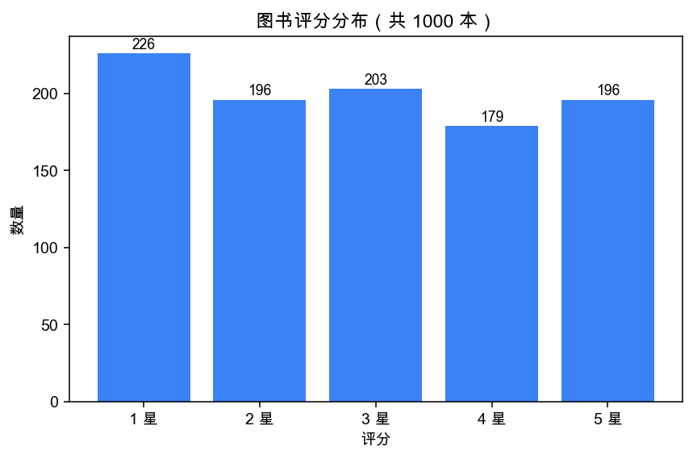
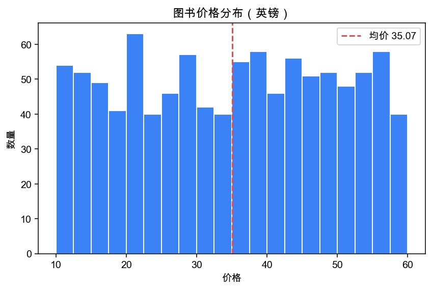
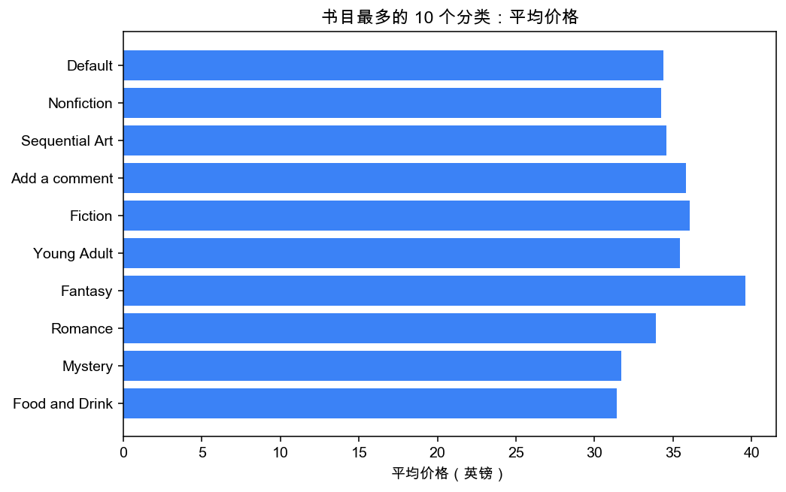
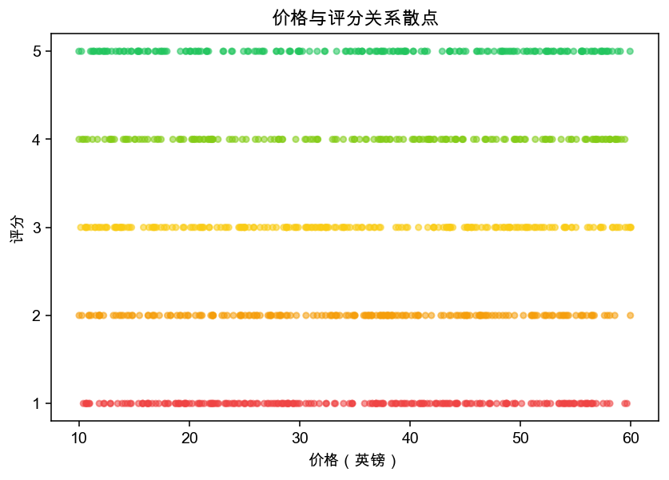
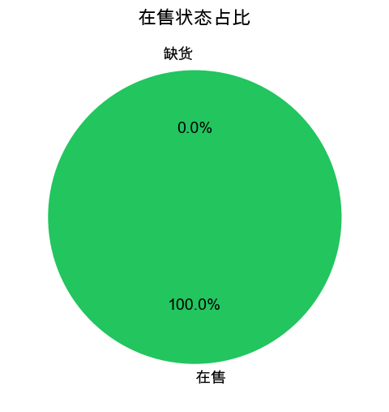

# 07.2 · pandas 分析实战（提问 → 聚合 → 图表 → 结论）

> 本章配套代码：`projects/book-insight/analysis/analyze.py`
> 图表输出：`projects/book-insight/analysis/output/charts/`（本仓库 `assets/images/data-analysis/` 存有副本，下方直接展示）
> 理论详解见 [04-pandas数据清洗](../04-data-analysis/04-pandas数据清洗实战.md) 与 [05-分组聚合](../04-data-analysis/05-pandas分组聚合与透视.md)；本章讲「真实数据的完整分析闭环」。

## 学习目标

- 掌握「业务问题 → 代码验证 → 图表 → 结论」的分析闭环
- 学会 value_counts / groupby / agg / cut 在真实数据上的用法
- 会用 matplotlib 输出可交付的统计图（含中文显示处理）
- 理解「分析结论必须能被数据支撑」的严谨性要求

## 2.1 先提问题，再写代码

拿到 1000 本图书数据后，分析不是从 `read_sql` 开始，而是从**业务问题**开始。本项目回答 5 个问题：

| # | 业务问题 | 对应图表 |
|---|---|---|
| Q1 | 评分质量如何？是刷出来的高分还是真实分布？ | 评分分布柱状图 |
| Q2 | 价格集中在什么区间？定价策略是什么？ | 价格直方图（10 英镑分桶） |
| Q3 | 书目集中在哪些分类？头部效应多强？ | 分类书目 TOP10 条形图 |
| Q4 | 书多的分类书贵还是便宜？ | 分类均价 TOP10 条形图 |
| Q5 | 贵的书评分更高吗？ | 价格 × 评分散点图 |

## 2.2 数据加载与快速体检

```python
conn = sqlite3.connect(DB_PATH)
df = pd.read_sql("SELECT * FROM books", conn)   # 静态 SQL，无参数
conn.close()
```

体检三件套的实测结果：

```python
df.shape        # (1000, 14)
df["rating"].value_counts().sort_index()
# 1    226
# 2    196
# 3    203
# 4    179
# 5    196
df["price"].describe()
# mean    35.07   min 10.00   50% 35.98   max 59.99
df["category"].nunique()   # 50
df["description"].isna().sum()   # 2（有 2 本书没有简介）
```

**第一时间发现的两个事实**：评分分布接近均匀（每档约 200 本）——这不是真实书店的自然分布，而是练习站故意造的数据；全部 1000 本都在售（availability > 0）。分析结论要带着这两个背景去讲。

## 2.3 聚合实现要点

### Q1 评分分布：value_counts

```python
rating_counts = df["rating"].value_counts().sort_index()
```

### Q2 价格分桶：pd.cut

```python
hist_edges = list(range(0, 70, 10))
hist_labels = ["%d-%d" % (hist_edges[i], hist_edges[i+1]) for i in range(len(hist_edges)-1)]
price_bucket = pd.cut(df["price"], bins=hist_edges + [1000], labels=hist_labels + ["60+"], right=False)
price_counts = price_bucket.value_counts().reindex(hist_labels + ["60+"]).fillna(0)
```

`right=False` 表示左闭右开 `[10, 20)`，避免边界价格（如 20.0）重复计数；`reindex` 补齐空桶保证坐标轴连续。

### Q3/Q4 分类聚合：groupby + 命名聚合

```python
by_cat = (df.groupby("category")
            .agg(count=("title", "size"), avg_price=("price", "mean"),
                 avg_rating=("rating", "mean"), total_stock=("availability", "sum"))
            .round(2).sort_values("count", ascending=False))
```

实测头部（节选）：

```text
      category  count  avg_price  avg_rating
       Default    152      34.39        2.84
    Nonfiction    110      34.26        2.88
Sequential Art     75      34.57        2.97
 Add a comment     67      35.80        2.76
       Fiction     65      36.07        3.18
```

注意 `Default` 是网站打标缺失的兜底分类、`Add a comment` 是页面残留文案被当成分类——**真实数据总有脏东西**，分析报告里要说明，而不是悄悄接受。

### Q5 散点：直接抽列

```python
df[["price", "rating"]]   # 1000 行，直接画散点足够轻
```

## 2.4 输出物 1：stats.json（给 API/前端复用）

分析结果不只是图——聚合结果同时写成 JSON，供大屏与调试复用：

```python
STATS_PATH.write_text(json.dumps(stats, ensure_ascii=False, indent=2), encoding="utf-8")
```

```json
{
  "summary": {"total_books": 1000, "avg_price": 35.07, "avg_rating": 2.92, ...},
  "rating_distribution": [{"rating": 1, "count": 226}, ...],
  "price_histogram": [{"bucket": "0-10", "count": 33}, ...],
  "categories": [{"category": "Default", "count": 152, ...}, ...]
}
```

**离线分析与在线 API 看同一份口径**，这是避免「报表和大屏数字对不上」的关键实践。

## 2.5 输出物 2：matplotlib 图表

中文字体处理（macOS 与 Ubuntu 各一套，见 [matplotlib 章](../04-data-analysis/06-数据可视化(matplotlib).md)）：

```python
matplotlib.use("Agg")  # 无显示环境下出图（服务器必需）
plt.rcParams["font.sans-serif"] = ["PingFang SC", "Arial Unicode MS", "Noto Sans CJK SC"]
plt.rcParams["axes.unicode_minus"] = False
```

Q1 评分分布图的实现：

```python
fig, ax = plt.subplots(figsize=(7, 4.2))
ax.bar([f"{r} 星" for r in rating_counts.index], rating_counts.values, color=ACCENT)
ax.set_title("图书评分分布（共 %d 本）" % int(rating_counts.sum()))
ax.set_xlabel("评分"); ax.set_ylabel("数量")
for i, v in enumerate(rating_counts.values):
    ax.text(i, v + 3, str(v), ha="center", fontsize=9)   # 柱顶标数值
fig.savefig(path, dpi=140, bbox_inches="tight")
```

## 2.6 五张真实图表与结论

**Q1 评分分布**：



*结论：1~5 星各约 200 本，接近均匀分布。说明该数据集评分是人为均匀填充的（练习站特性），不能当作真实市场口碑信号。*

**Q2 价格分布**：



*结论：20~60 英镑每桶约 200 本、0-10 与 50-60 桶偏少，整体近乎均匀偏平坦；均价 £35.07 与中位数 £35.98 几乎重合，说明没有显著的长尾价格拉偏。*

**Q3 分类书目 TOP10**：



*结论：Default 152 本排第一（站点缺失分类的兜底），Nonfiction 110 本次之；TOP4 合计约 400 本，占四成——头部集中度中等。*

**Q4 分类均价 TOP10**：

 *（Q4 图见 `output/charts/03_category_top.png` 同名文件与仓库 `assets/images/data-analysis/`）*

*结论：Food and Drink（£31.41）最低、Fantasy（£39.59）最高，各分类均价全部落在 £31~£40 区间——价格与分类相关性弱，定价基本与品类无关（练习站再次印证）。*

**Q5 价格 × 评分散点**：



*结论：五条评分横带各自横跨整个价格区间，任何价格段都同时存在 1~5 星。**价格与评分没有相关性**——想靠「贵=好」选书在这个数据集里行不通。*

**在售状态**（Q0 附加）：



*结论：1000 本全部在售，库存均值 8.6 件。*

## 2.7 结论的可信度声明（严谨性要求）

报告里必须写清楚数据的边界，防止读者过度推断：

1. 这是**练习站点**的构造数据：评分与价格分布均为人造均匀分布，结论仅对「这个数据集」成立，不可外推到真实图书市场。
2. 规模 1000 行、50 分类，`Add a comment` / `Default` 等脏分类未清洗而是如实标注。
3. 所有数字来自 analyze.py 的实际运行输出，图表与 JSON 同源。

## 常见坑与排查

| 现象 | 原因 | 解决 |
|---|---|---|
| 图里中文变方框 | matplotlib 找不到中文字体 | 按 OS 设置 font.sans-serif（Ubuntu 装 fonts-noto-cjk） |
| 分桶边界重复计数 | pd.cut 默认右闭 | `right=False` |
| 空价格桶消失 | value_counts 只返回非空 | `reindex(全部桶).fillna(0)` |
| groupby 数字变 float 难看 | 均值本来就是 float | `.round(2)` |
| 服务器跑不出图 | 无显示环境 | `matplotlib.use("Agg")` |

## 动手练习

1. 计算「税额占含税价比例」的分布（price_excl_tax/tax 列），回答：税率是否统一？
2. 按 `availability` 分箱（0-5/6-10/11-20/20+），统计每档书目数，画柱状图。
3. 把 5 个问题的答案整理成一页 markdown 报告，并给每条结论标注「数据支撑点」。

## 小结与自检清单

- [ ] 能复述「提问 → 聚合 → 图表 → 结论 → 可信度声明」闭环
- [ ] 会用 value_counts / pd.cut / groupby.agg 解决同类问题
- [ ] 图表能保存为 PNG 且中文正常
- [ ] 知道 stats.json 为什么和 API 用同一口径

## 延伸阅读

- [pandas 官方 User Guide: Group by](https://pandas.pydata.org/docs/user_guide/groupby.html)
- [matplotlib 官方教程](https://matplotlib.org/stable/tutorials/index.html)
