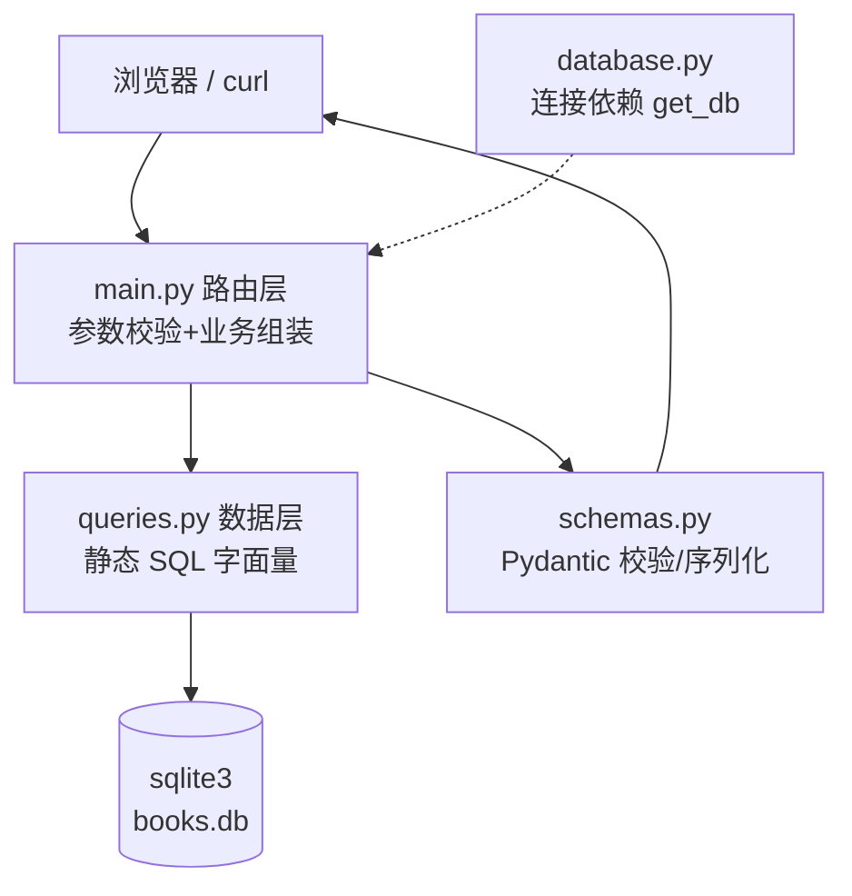

# 07.3 · FastAPI 后端实战（分层、路由、契约）

> 本章配套代码：`projects/book-insight/api/`
> 启动：`cd projects/book-insight && uvicorn api.main:app --reload`
> 理论详解见 [06-fastapi-backend/](../06-fastapi-backend/01-FastAPI入门(第一个API).md) 全章；本章讲这个项目的后端为什么这样分层。

## 学习目标

- 理解四文件分层：database / queries / schemas / main 各自的职责边界
- 会写「依赖注入数据库连接」的标准 FastAPI 模式
- 理解响应模型（response_model）如何保证 API 契约
- 掌握大屏聚合端点的设计思路

## 3.1 架构与请求生命周期



一次 `GET /api/books?category=Fiction&limit=2` 的完整旅程：

1. FastAPI 解析查询参数并按 `Query(ge=..., le=...)` 校验（不合法直接 422）
2. `get_db` 依赖注入一个 sqlite3 连接（请求结束自动关闭）
3. 路由调用 `queries.load_books(db)` 拿全量行（静态 SQL）
4. 路由内 `_keep()` 在 Python 侧做分类/评分/关键词过滤
5. 组装 `BookPage(...)`，response_model 按 schemas 序列化
6. 返回 JSON；连接被 `finally` 关闭

## 3.2 四个文件各管什么

### database.py——连接生命周期

```python
def get_db() -> Generator[sqlite3.Connection, None, None]:
    conn = sqlite3.connect(DB_PATH)
    conn.row_factory = sqlite3.Row       # 行可按列名访问
    try:
        yield conn
    finally:
        conn.close()
```

`yield` 依赖：请求开始时创建连接、结束时关闭——这是 FastAPI 管理资源的标准姿势（详见 [请求与响应进阶](../06-fastapi-backend/02-请求与响应进阶.md)）。
切换 MySQL 时只改这一个文件（换 pymysql 连接），SQL 基本不变。

### queries.py——全部 SQL 的唯一家

```python
def load_books(conn) -> list[sqlite3.Row]:
    return conn.execute("SELECT id, title, price, rating, category, availability, num_reviews, image_url, detail_url, upc, price_excl_tax, tax, description, crawled_at FROM books ORDER BY id").fetchall()
```

**文件头部的安全声明**：所有 SQL 都是完整静态字面量——无参数、无拼接、无动态组装。需要条件筛选的数据在 Python 侧完成（本数据集 1000 行只读，最直观）；生产环境用数据库侧参数化过滤（标准写法见 [FastAPI·数据库章](../06-fastapi-backend/03-数据库集成(SQLAlchemy).md)）。

### schemas.py——API 契约

```python
class BookOut(BaseModel):
    model_config = ConfigDict(from_attributes=True)
    id: int
    title: str
    price: float | None
    rating: int | None
    category: str | None
    ...

class BookDetail(BookOut):
    upc: str | None
    description: str | None
    ...                      # 列表精简，详情完整——两个视图一个模型族
```

要点：

- **输出过滤**：`description` 这类大字段不进列表视图，接口瘦身
- **`from_attributes=True`**：允许直接从 ORM 对象/Row 构造（`BookDetail.model_validate(row_dict)`）
- 分页容器 `BookPage(total, limit, offset, items)` 把分页元信息与数据一起返回——前端不必二次猜测总数

### main.py——路由与业务

```python
@app.get("/api/books", response_model=BookPage)
def list_books(
    limit: int = Query(20, ge=1, le=100),
    offset: int = Query(0, ge=0),
    category: str | None = None,
    min_rating: int | None = Query(None, ge=1, le=5),
    search: str | None = Query(None, max_length=80),
    db: sqlite3.Connection = Depends(get_db),
) -> BookPage:
    keyword = search.casefold() if search is not None else None
    books = [dict(r) for r in queries.load_books(db)]
    kept = [b for b in books if _keep(b, category, min_rating, keyword)]
    return BookPage(total=len(kept), limit=limit, offset=offset, items=kept[offset : offset + limit])
```

注意 `Query(ge=1, le=100)`：参数校验写在声明里，超限请求自动得到 422 与错误详情（实测见下）。

## 3.3 两个跨切面配置

### CORS（为大屏单独部署时备用）

```python
app.add_middleware(
    CORSMiddleware,
    allow_origins=["http://127.0.0.1:8000", "http://localhost:8000", "http://127.0.0.1:8060", ...],
    allow_methods=["GET"],
    allow_headers=["*"],
)
```

本项目前端由 API 同源托管（见 3.4），CORS 实际不触发；显式配置是为了前端单独用静态服务器打开时也能联调。生产应收紧到具体域名（安全清单见 [FastAPI·安全章](../06-fastapi-backend/04-认证授权与安全(JWT-CORS).md)）。

### 大屏静态托管

```python
_WEB_DIR = Path(__file__).resolve().parent.parent / "web"
app.mount("/", StaticFiles(directory=str(_WEB_DIR), html=True), name="web")
```

`mount("/")` 放在所有 API 路由**之后**：`/api/*` 先被路由匹配，其余路径落到静态文件。访问 `http://127.0.0.1:8000/` 即大屏，`/docs` 即接口文档——**一个进程交付整个项目**。

## 3.4 端点总表与真实运行输出

| 端点 | 参数 | 响应模型 |
|---|---|---|
| GET /api/health | — | `{"status": "ok"}` |
| GET /api/books | limit/offset/category/min_rating/search | BookPage |
| GET /api/books/{id} | 路径参数 | BookDetail |
| GET /api/stats/summary | — | Summary |
| GET /api/stats/ratings | — | list[RatingItem] |
| GET /api/stats/prices | — | list[PriceBucket]（Python 分桶） |
| GET /api/stats/categories | — | list[CategoryStat] |
| GET /api/stats/top-rated | — | list[TopBook] |
| GET /api/charts/all | — | ChartsAll（7 组数据打包） |

实测（对真实 1000 行库）：

```text
$ curl -s http://127.0.0.1:8010/api/stats/summary
{"total_books":1000,"categories":50,"avg_price":35.07,"median_price":35.98,
 "max_price":59.99,"min_price":10.0,"avg_rating":2.92,"in_stock":1000,
 "out_of_stock":0,"total_reviews":0,"avg_stock":8.6}

$ curl -s "http://127.0.0.1:8010/api/books?category=Fiction&min_rating=4&limit=3"
{"total":27,"limit":3,"offset":0,"items":[...]}

$ curl -s http://127.0.0.1:8010/api/books/99999 -w "%{http_code}"
{"detail":"book not found"}404

$ curl -s "http://127.0.0.1:8010/api/books?limit=500" -w "%{http_code}"
{"detail":[{"type":"less_than_equal",...}]}422
```

聚合端点为什么设计 `/api/charts/all`？大屏首屏需要 7 组数据，若逐个请求会产生请求瀑布与加载抖动；一次打包 + 后端共享查询，首屏一个 RTT 完成。

## 3.5 与 SQLAlchemy 模型的关系

`api/models.py` 是按 [SQLAlchemy 2.0 风格](../06-fastapi-backend/03-数据库集成(SQLAlchemy).md)（`DeclarativeBase` / `Mapped` / `mapped_column`）写的 `Book` 模型，作为 ORM 建模的教学对照；运行时数据层用的是 sqlite3 直连（见 database.py 头注）。什么时候值得切回 ORM 会话？——需要写事务、多表关联、迁移管理（Alembic）时。

## 常见坑与排查

| 现象 | 原因 | 解决 |
|---|---|---|
| 启动报 no module named api | 在错误目录启动 | 在 `projects/book-insight/` 下执行 uvicorn |
| 前端 fetch 报 CORS | 前后端不同源且未配 origins | 同源托管（本项目方案）或补 allow_origins |
| 422 但参数看起来合法 | 类型不符（如 rating=abc） | 看 422 响应里的 type/loc 字段定位 |
| 数据不更新 | uvicorn 未 reload / db 被替换 | `--reload` 或重启进程 |
| 大屏 404 | StaticFiles 挂载目录不对 | 确认 web/ 与 api/ 同级 |

## 动手练习

1. 新增 `GET /api/books/random`：随机返回 5 本书（提示：SQL 的 ORDER BY RANDOM() 或 Python sample）。
2. 给 BookPage 增加 `total_pages` 字段并同步更新测试。
3. 用 models.py 的 ORM 模型改写 queries.load_books（对照两种风格的行数与可读性）。

## 小结与自检清单

- [ ] 能画出一次请求的完整生命周期
- [ ] 能解释 get_db 的 yield 依赖机制
- [ ] 能说出 schemas 与 models 分开的原因
- [ ] 能解释 /api/charts/all 的聚合端点设计
- [ ] 422 校验错误会看 loc/type 定位

## 延伸阅读

- [FastAPI 文档：依赖注入](https://fastapi.tiangolo.com/zh/tutorial/dependencies/)
- [Pydantic v2 文档](https://docs.pydantic.dev/latest/)
