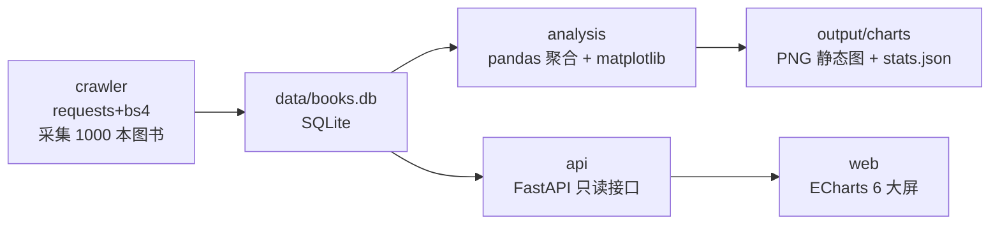

# Book Insight · 图书数据洞察平台

> 本仓库综合实战项目：把「爬虫 → 数据库 → pandas 分析 → FastAPI 后端 → ECharts 大屏」五个环节串成一条真实可运行的完整链路。
> 全部代码在本仓库作者的环境（Python 3.14.0）实测通过；对应教程见 `docs/07-final-project/`。

## 一句话架构



## 目录结构

```text
book-insight/
├── crawler/
│   └── crawl_books.py        # 采集 books.toscrape.com（列表页 50 页 + 详情页 1000 页）
├── data/
│   ├── books.db              # SQLite（随仓库提供，开箱即用）
│   ├── books.csv             # 同内容 CSV（pandas 快速读取用）
│   └── stats.json            # 分析聚合结果
├── analysis/
│   └── analyze.py            # pandas 分析 → stats.json + 5 张 PNG 图表
│   └── output/charts/*.png
├── api/
│   ├── database.py           # sqlite3 连接管理（FastAPI 依赖注入）
│   ├── queries.py            # 全部 SQL（完整静态字面量 + 安全说明）
│   ├── models.py             # SQLAlchemy 2.0 ORM 模型（教学对照）
│   ├── schemas.py            # Pydantic v2 响应模型
│   └── main.py               # 路由 + 大屏静态托管
├── web/
│   ├── index.html            # 大屏页面
│   ├── css/style.css         # 深色大屏样式（CSS Grid 响应式）
│   └── js/main.js            # fetch 数据 + 6 张 ECharts 图表
├── tests/
│   ├── conftest.py           # 临时库夹具（测试隔离）
│   └── test_api.py           # 14 个接口测试（pytest 全绿）
└── requirements.txt
```

## 快速开始（3 条命令）

```bash
# 1) 安装依赖（建议 venv/uv，见教程 docs/02-linux-ubuntu/07）
pip install -r requirements.txt

# 2)（可选）重新采集数据；仓库已附带 books.db，可跳过
python crawler/crawl_books.py            # 全量约 1000 本，几分钟
python crawler/crawl_books.py --limit 40 # 快速体验版

# 3) 生成分析图表（输出 stats.json 与 PNG）
python analysis/analyze.py

# 4) 启动服务，浏览器打开 http://127.0.0.1:8000/
uvicorn api.main:app --reload
```

运行测试：

```bash
python -m pytest tests/ -v      # 14 passed
```

## API 一览（启动后访问 /docs 有交互式文档）

| 端点 | 说明 |
|---|---|
| `GET /api/health` | 健康检查 |
| `GET /api/books` | 图书列表：`limit/offset/category/min_rating/search` |
| `GET /api/books/{id}` | 图书详情（含简介、UPC、税费） |
| `GET /api/stats/summary` | 汇总指标（总数/均价/中位数/评分/库存） |
| `GET /api/stats/ratings` | 评分分布 |
| `GET /api/stats/prices` | 价格直方图（10 英镑分桶） |
| `GET /api/stats/categories` | 50 个分类聚合（数量/均价/均分/库存） |
| `GET /api/stats/top-rated` | 评分最高 10 本 |
| `GET /api/charts/all` | 大屏聚合接口（一次拿全） |

## 大屏截图说明

大屏访问 `http://127.0.0.1:8000/`：顶部 5 个 KPI 卡片，下方 6 张 ECharts 图表
（评分分布 / 价格直方图 / 分类 TOP10 / 分类均价 / 价格×评分散点 / 在售状态）
与评分 TOP10 星级书单表；支持浏览器窗口自适应与「刷新数据」。

## 数据与合规说明

- 数据源 [books.toscrape.com](https://books.toscrape.com/) 是 Scrapy 官方维护的爬虫练习站，
  robots.txt 无任何限制、明确欢迎抓取，采集时默认 0.3s 间隔并自报 UA。
- 数据仅用于教学演示；站点内容版权归原站所有，请勿用于商业用途。
- 安全设计：项目 SQL 全部为静态字面量（见 `api/queries.py` 顶部说明），
  参数绑定、防注入的教学讨论见教程第 04/06 章。

## 已知教学取舍

- 数据集固定为只读 SQLite（1000 行），列表筛选在 Python 侧完成；
  生产环境应使用数据库侧参数化过滤，标准写法见 `docs/06-fastapi-backend/03-数据库集成(SQLAlchemy).md`。
- `api/models.py` 是 SQLAlchemy ORM 建模的教学对照实现，运行时未使用。
